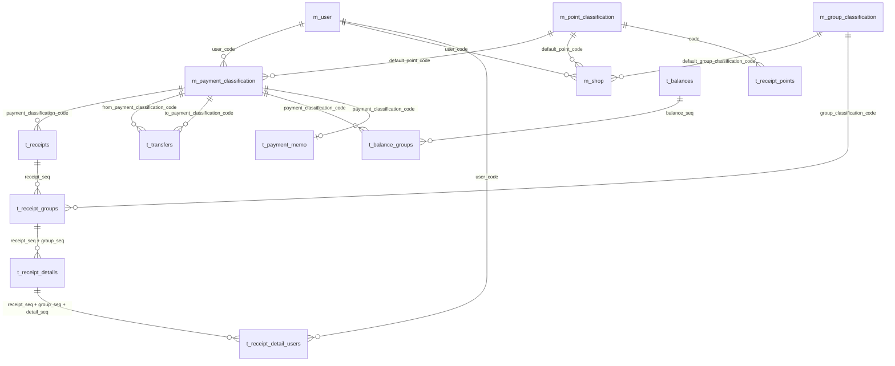
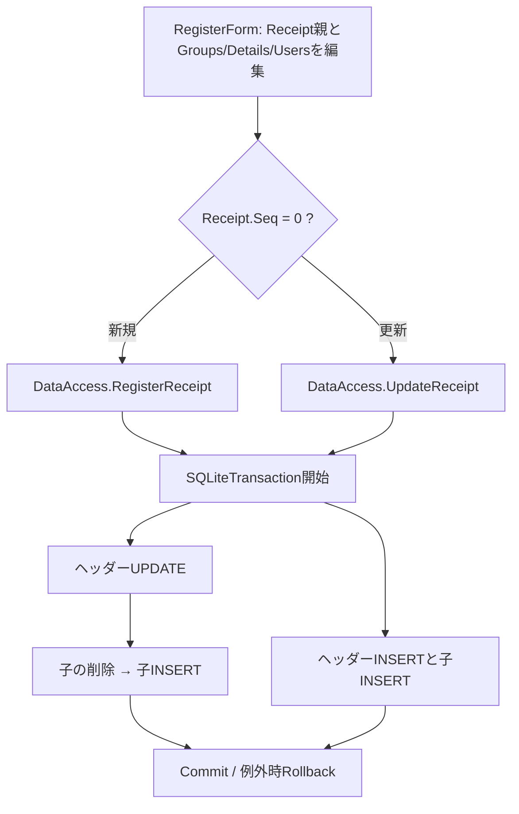

# 10 DBリレーション・データフロー・更新境界

更新: 2026-10-16 / **スキーマDDLと現在のVBコードを区別して記述**。図は説明用で、DDLを置き換えるものではない。

## 1. 物理外部キー（DDLで確認済み）

以下はアップロードされた実DDLに**明示されている外部キー**のみを使ったER図。必須項目と主キーの詳細は [02-database.md](02-database.md)。



**外部キー総数は17件**。図の多重度は物理制約だけで実データ件数や運用上の入力必須を保証するわけではない。

### 物理的に結合されていない重要な情報

| 意味上の関係 | 現在の実体 | リスク |
| --- | --- | --- |
| レシート ↔ 店舗マスタ | `t_receipts.shop_name` と `m_shop.name` の**文字列照合** | 名前変更・同名店舗・ユーザーごとの同名店舗でマッチが曖昧 |
| ポイント行 ↔ レシート | `t_receipt_points.receipt_seq` は存在するが、**FKなし** | レシートを削除しても孤児行が残り得る |
| レシートグループ ↔ 税率マスタ | `t_receipt_groups.tax` を税率**コード**として解釈するが、**FKなし** | コード不整合時に税率取得できない |
| 為替レート | `t_exchange_rates` は単独表 | 口座別通貨コードを物理FKで持つ構造ではない |

## 2. レシート保存フロー（現行）



**現行の物理削除順に注意**:

- `UpdateReceipt`: 親UPDATE → `DeleteReceiptGroups`（**グループ → 明細 → 対象者**）→ 再INSERT。
- `DeleteReceipt`: **レシート親DELETE** → `DeleteReceiptGroups`（上記の順）。
- 物理FK制約に `CASCADE` がない。`PRAGMA foreign_keys=ON` の接続では削除順が不適切なため、実行時エラーになり得る。**確認・改修なしに `PRAGMA foreign_keys=ON` だけを本番へ適用しない。**
- `t_receipt_points` はこれらの削除処理に登場しない。実データがあれば別途取り扱いが必要。

## 3. レシートの読み込みフロー

```text
ViewForm → DataAccess.GetReceipts(年月/年)
          └── t_receipts: 日付・支払方法で抽出
              └── t_receipt_groups: receipt_seqで抽出
                  └── t_receipt_details: receipt_seq + group_seqで抽出
                      └── t_receipt_detail_users: receipt_seq + group_seq + detail_seq
                          └── m_user と結びつく対象者リスト
```

- ソース上は親を取得した後、各子階層を別々に取得する。
- `t_receipts.total` はSELECTしておらず、`Receipt.Total` による再計算を用いる。
- グループと明細はそれぞれの `seq` で表示順が決まる。
- 年次集計ではこの読込を1年分について行うため、将来的な件数増加時にSQL発行回数を計測したい。

## 4. 振替・残高のフロー

```text
RegisterTransferForm → DataAccess.RegisterTransfer/UpdateTransfer/DeleteTransfer
  └── t_transfers （seq、振替日時・移動元・移動先・金額）

RegisterBalanceForm → DataAccess.RegisterBalance/UpdateBalance/DeleteBalance
  ├── t_balances （seq、日付）
  └── t_balance_groups （支払方法ごとの登録残高・任意の評価額）

RegisterPaymentMemoForm → DataAccess.RegisterPaymentMemo
  └── t_payment_memo （支払方法ごとの最終チェック日・メモ）
```

### 残高推算

`Calculation.AutoBalance` と `DataAccess.GetAutoBalance` にほぼ同内容の計算がある。最新の登録残高を起点として `-レシートTotal -出金振替 +入金振替` を計算する。重複実装は将来的な差異リスク。

## 5. 店舗設定とオーケー会員割引への変更点

以下は**将来の機能設計案**。

- 店舗マスタのIDをレシートに結びつけるか、明示的な店舗別ルール識別子をレシートへ保存する。
- 税端数のルールと計算単位、分数割引（`3/103`）は**別パラメータ**にする。
- 店舗の現在の設定だけから過去レシートを再計算してはならない。レシート側に適用時点のルール・確定値を記録。
- 既存レシートはレガシー計算のまま維持し、追加時点から新ルールを選択できるようにする。
- 新方式の具体的なカラム／移行SQLは**未確定で未適用**。[08-requested-enhancements.md](08-requested-enhancements.md)参照。

**根拠**: [実SQLite DDL](schema/monetail_schema.sql)、[DataAccess.vb](../HouseholdAccountsBeta/HouseholdAccountsBeta/DataAccess/DataAccess.vb)、[Receipt.vb](../HouseholdAccountsBeta/HouseholdAccountsBeta/Data/Data/Receipt.vb)、[Calculation.vb](../HouseholdAccountsBeta/HouseholdAccountsBeta/Logic/Calculation.vb)
