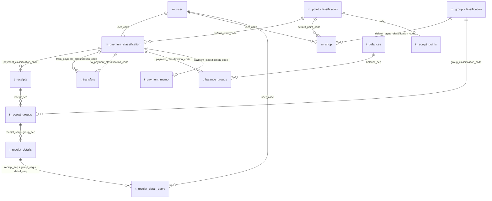
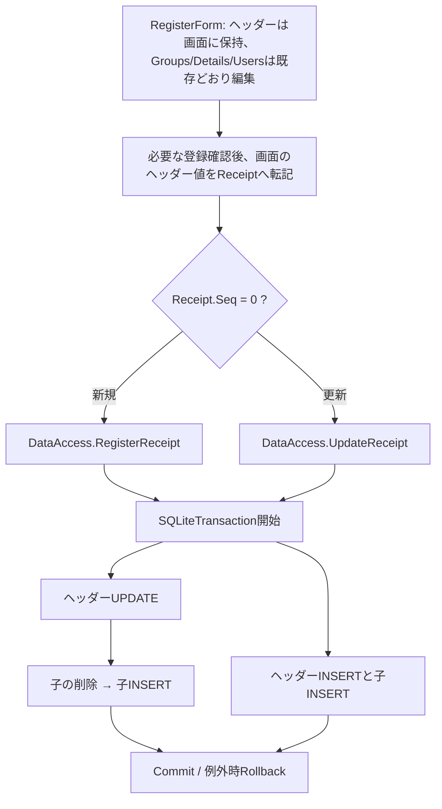

# 10 DBリレーション・データフロー・更新境界

更新: 2026-10-18 / **元のスキーマDDL・実装済み移行SQL・現在のVBコードを区別して記述**。図は説明用で、DDLを置き換えるものではない。

## 1. 物理外部キー（DDLで確認済み）

以下はアップロードされた実DDLに**明示されている外部キー**のみを使ったER図。元のDDLは16テーブル・90列・17外部キーで、税端数移行後は2列追加され92列になるが、テーブルと外部キーの数は変わらない。必須項目と主キーの詳細は [02-database.md](02-database.md)。



**外部キー総数は17件**。図の多重度は物理制約だけで実データ件数や運用上の入力必須を保証するわけではない。

### 物理的に結合されていない重要な情報

| 意味上の関係 | 現在の実体 | リスク |
| --- | --- | --- |
| レシート ↔ 店舗マスタ | `t_receipts.shop_name` と `m_shop.name` の**文字列照合** | 名前変更・同名店舗・ユーザーごとの同名店舗でマッチが曖昧 |
| ポイント行 ↔ レシート | `t_receipt_points.receipt_seq` は存在するが、**FKなし** | レシートを削除しても孤児行が残り得る |
| レシートグループ ↔ 税率マスタ | `t_receipt_groups.tax` を税率**コード**として解釈するが、**FKなし** | コード不整合時に税率取得できない |
| 為替レート | `t_exchange_rates` は単独表 | 口座別通貨コードを物理FKで持つ構造ではない |

## 2. レシート保存フロー（現行）



- 内税／外税と端数方式は、編集中はコントロールだけで保持する。合計プレビューは `Receipt.GetTotal(taxType, taxRoundingMode)` を呼び、元の `Receipt.TaxType`・`TaxRoundingMode`・`Total` は変更しない。登録確認前の代入やキャンセル時の復元処理はない。
- 店名・所在地・支払方法・タグ等と同じく、必要な確認がすべて済んでから両税設定を転記する。グループ・明細は既存の共有オブジェクトを編集し、既存レシートを開く際に子をDBから再読込する。レシート全体のディープコピーは導入していない。
- 流用は従来どおり、確認後に `Seq = 0` として画面上の値を転記し、そのまま新規保存・画面終了する。追加の登録操作はなく、店舗履歴による再初期化もしない。元レシートのDB行は保持する。

**物理削除順（2026-10-18修正）**:

- `UpdateReceipt`: 親UPDATE → `DeleteReceiptGroups`（**対象者割当 → 明細 → グループ**）→ グループ・明細・対象者割当を再INSERT。
- `DeleteReceipt`: `DeleteReceiptGroups`（上記の順）→ **レシート親DELETE**。
- 更新・削除とも既存のトランザクション内で行い、途中のDELETE・INSERTや親DELETEが失敗すると、そのトランザクション内のDB変更をすべてRollbackする。物理FK制約に `CASCADE` は追加しない。
- テスト用DBではFK ON/OFFの両方で成功・巻き戻し・別レシートの保持を検証済み。アプリの接続設定や `PRAGMA foreign_keys` の既定値は変更しない。既存の実データ整合性や、他の更新経路のFK対応を検証済みとは扱わない。
- `t_receipt_points` はこれらの削除処理に登場しない。実データがあれば別途取り扱いが必要。

## 3. レシートの読み込みフロー

```text
ViewForm → DataAccess.GetReceipts(年月/年)
          └── t_receipts: 日付・支払方法で抽出
              └── t_receipt_groups: receipt_seqで抽出
                  └── t_receipt_details: receipt_seq + group_seqで抽出
                      └── t_receipt_detail_users: receipt_seq + group_seq + detail_seq
                          └── m_user と結びつく対象者リスト
```

- ソース上は親を取得した後、各子階層を別々に取得する。
- 残高推算用の `GetPaymentReceipts(dateFrom, dateTo, payment)` も、ヘッダーから同じ子読込へ進む。一覧・残高の両経路で `tax_rounding_mode` を取得し、保存された方式で再計算する。
- `t_receipts.total` はSELECTしておらず、`Receipt.Total` による再計算を用いる。
- グループと明細はそれぞれの `seq` で表示順が決まる。
- 年次集計ではこの読込を1年分について行うため、将来的な件数増加時にSQL発行回数を計測したい。

**任意文字列のNULL対応（2026-10-18）**:

- 両ヘッダー読込の `shop_location`・`tag`、グループの `tag`、明細の `tag` の計6箇所で、`IsDBNull` によりSQLのNULLだけを `String.Empty` に変換する。既存の空文字・日本語・空白はそのまま保持する。
- 読込、子の再読込、画面取消・再表示では、DBのNULL、金額、対象者割当を更新しないことを一時DBで自動検証済み。明示的な登録／更新時は既存保存SQLが画面上の空文字を保存する。
- このNULL対応では、必須の店名・品名等や数値列の読込、DB定義は変更していない。

**小数割引率の読込（LEG-005）**:

- 一覧・残高・子再読込から共通で呼ぶ`LoadReceiptDetailData`の`DiscountRate`を`GetDouble(7)`で取得する。SQLiteのREAL値に旧`GetInt32(7)`を使うと`InvalidCastException`になるため、モデルの`Double`へ合わせた。
- `discount_rate INTEGER NOT NULL`の宣言と保存SQLは維持する。小数率はREAL、整数率はINTEGERとして格納できる。新規・更新と3読込経路の回帰で、率と合計が保持され、読込で保存済みの率・単価値引・数量・合計等を更新しないことを自動検証済み。

## 4. 振替・残高のフロー

```text
RegisterTransferForm → DataAccess.RegisterTransfer/UpdateTransfer/DeleteTransfer
  └── t_transfers （seq、振替日時・移動元・移動先・金額）

RegisterBalanceForm → DataAccess.RegisterBalance/UpdateBalance/DeleteBalance
  ├── t_balances （seq、日付）
  └── t_balance_groups （支払方法ごとの登録残高・任意の評価額）

RegisterPaymentMemoForm → DataAccess.RegisterPaymentMemo
  └── t_payment_memo （支払方法ごとの最終チェック日・メモ）
```

**残高削除（LEG-027）**: `DataAccess.DeleteBalance`は既存トランザクション内で**`t_balance_groups` → `t_balances`**の順に対象残高の子・親を削除する。親DELETEが失敗した場合は先行する子DELETEもRollbackし、例外を呼出元へ伝える。変更はDELETE順だけで、製品のFK設定・DDL・画面操作は維持する。

実際のDataAccessと製品と同じSQLiteの一時DBで、FK ON/OFFの削除成功（子0／2件）、テスト専用トリガーによる親削除失敗からの全件復元と同じDataAccessでの再削除（子2件）を自動検証済み。他の残高と無関係な全テーブルが不変であることも確認する。残高の登録・更新や画面の確認操作を網羅したという意味ではない。

**支払メモ一括保存（LEG-012）**: 入力リストが空なら処理を終える。既存のUPSERTをリスト順に1つのトランザクションで実行し、全件成功時にCommitする。末尾行などで失敗した場合は、その一括保存の先行する追加・更新もRollbackして例外を呼出元へ伝え、トランザクションを破棄する。保存SQL・パラメーター・NULLの日付／タグの扱い、画面の終了時確認は変更しない。画面から空のメモを渡す場合は従来どおり空文字となる。

一時DBのFK ON/OFFで、成功・末尾INSERT／UPDATE失敗時の全件復元と同じDataAccessでの再保存・空リストを自動検証済み。対象外行の保持と読込によるDB不変も確認する。支払メモ画面の確認操作や、エラー後の画面状態を自動検証したという意味ではない。

### 残高推算

`Calculation.AutoBalance` と `DataAccess.GetAutoBalance` にほぼ同内容の計算がある。最新の登録残高を起点として `-レシートTotal -出金振替 +入金振替` を計算する。重複実装は将来的な差異リスク。

## 5. レシート別税端数と店舗履歴・オーケーの継続運用

以下のDB拡張・アプリ処理は実装済みで、移行SQLを含め自動テスト済み。利用者の実DBへの適用状況と、実レシートとの照合結果は未確認。

- **`t_receipts.tax_rounding_mode`は各レシートで選択・保存する正本**。税率ごとに合算した後に切捨／四捨五入。
- 新規入力の初期方式は、店名と支払方法の所有者の `account_name = Environment.UserName` で履歴を絞り、`date DESC, seq DESC LIMIT 1` で取得する。候補選択・自由入力確定の両方に適用し、履歴なしは `floor`。手動選択後と既存レシートの編集では上書きしない。
- `m_shop.tax_rounding_mode` は移行互換性のため列・読込モデルを残すが、**現在の初期選択では使用せず、編集画面も追加しない**。店舗マスタ未登録でもレシートで方式を選べる。
- **店舗マスタとのFK・`shop_code`は追加しない**。履歴だけの店・自由入力の店でも使用可能。
- [移行SQL](migrations/20261017_01_shop_tax_rounding.sql)は2列を追加し、旧レシートの方式を既定値 `floor` として旧計算を維持する。既存の `total` や対象者割当は更新せず、接続の外部キー設定も変更しない。バックアップしたDBのコピーに一度だけ適用する。[15 詳細設計](15-shop-tax-rounding-design.md)参照。
- **オーケー割引は新しい計算機能・DB列を設けず、既存の`discount_fee`への手入力を継続**。まとめ明細で合計割引を入れる場合は`quantity=1`に注意。[08](08-requested-enhancements.md)参照。

**根拠**: [実SQLite DDL](schema/monetail_schema.sql)、[DataAccess.vb](../HouseholdAccountsBeta/HouseholdAccountsBeta/DataAccess/DataAccess.vb)、[Receipt.vb](../HouseholdAccountsBeta/HouseholdAccountsBeta/Data/Data/Receipt.vb)、[Calculation.vb](../HouseholdAccountsBeta/HouseholdAccountsBeta/Logic/Calculation.vb)、[RegisterForm.vb](../HouseholdAccountsBeta/HouseholdAccountsBeta/Control/RegisterForm.vb)、[自動テスト](../tests/README.md)
