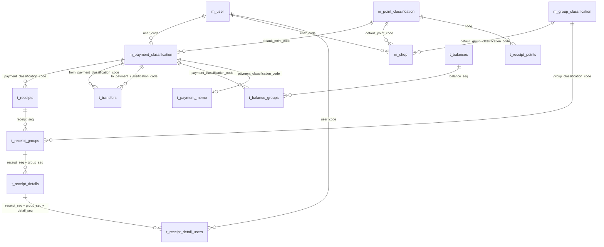
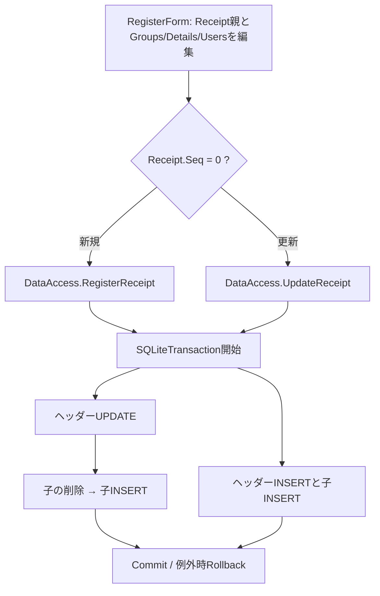

# 10 DBリレーション・データフロー・更新境界

更新: 2026-10-16 / **スキーマDDLと現在のVBコードを区別して記述**。図は説明用で、DDLを置き換えるものではない。

## 1. 物理外部キー（DDLで確認済み）

以下はアップロードされた実DDLに**明示されている外部キー**のみを使ったER図。必須項目と主キーの詳細は [02-database.md](02-database.md)。



**外部キー総数は17件**。図の多重度は物理制約だけで実データ件数や運用上の入力必須を保証するわけではない。

### 物理的に結合されていない重要な情報

| 意味上の関係 | 現在の実体 | リスク |
| --- | --- | --- |
| レシート ↔ 店舗マスタ | `t_receipts.shop_name` と `m_shop.name` の**文字列照合** | 名前変更・同名店舗・ユーザーごとの同名店舗でマッチが曖昧 |
| ポイント行 ↔ レシート | `t_receipt_points.receipt_seq` は存在するが、**FKなし** | レシートを削除しても孤児行が残り得る |
| レシートグループ ↔ 税率マスタ | `t_receipt_groups.tax` を税率**コード**として解釈するが、**FKなし** | コード不整合時に税率取得できない |
| 為替レート | `t_exchange_rates` は単独表 | 口座別通貨コードを物理FKで持つ構造ではない |

## 2. レシート保存フロー（現行）



**物理削除順（2026-10-18修正）**:

- `UpdateReceipt`: 親UPDATE → `DeleteReceiptGroups`（**対象者割当 → 明細 → グループ**）→ グループ・明細・対象者割当を再INSERT。
- `DeleteReceipt`: `DeleteReceiptGroups`（上記の順）→ **レシート親DELETE**。
- 更新・削除とも既存のトランザクション内で行い、途中のDELETE・INSERTや親DELETEが失敗するとDB全体の変更をRollbackする。物理FK制約に `CASCADE` は追加しない。
- テスト用DBではFK ON/OFFの両方で成功・巻き戻し・別レシートの保持を検証する。アプリの接続設定や `PRAGMA foreign_keys` の既定値は変更しない。既存の実データ整合性や、他の更新経路のFK対応を検証済みとは扱わない。
- `t_receipt_points` はこれらの削除処理に登場しない。実データがあれば別途取り扱いが必要。

## 3. レシートの読み込みフロー

```text
ViewForm → DataAccess.GetReceipts(年月/年)
          └── t_receipts: 日付・支払方法で抽出
              └── t_receipt_groups: receipt_seqで抽出
                  └── t_receipt_details: receipt_seq + group_seqで抽出
                      └── t_receipt_detail_users: receipt_seq + group_seq + detail_seq
                          └── m_user と結びつく対象者リスト
```

- ソース上は親を取得した後、各子階層を別々に取得する。
- `t_receipts.total` はSELECTしておらず、`Receipt.Total` による再計算を用いる。
- グループと明細はそれぞれの `seq` で表示順が決まる。
- 年次集計ではこの読込を1年分について行うため、将来的な件数増加時にSQL発行回数を計測したい。

## 4. 振替・残高のフロー

```text
RegisterTransferForm → DataAccess.RegisterTransfer/UpdateTransfer/DeleteTransfer
  └── t_transfers （seq、振替日時・移動元・移動先・金額）

RegisterBalanceForm → DataAccess.RegisterBalance/UpdateBalance/DeleteBalance
  ├── t_balances （seq、日付）
  └── t_balance_groups （支払方法ごとの登録残高・任意の評価額）

RegisterPaymentMemoForm → DataAccess.RegisterPaymentMemo
  └── t_payment_memo （支払方法ごとの最終チェック日・メモ）
```

### 残高推算

`Calculation.AutoBalance` と `DataAccess.GetAutoBalance` にほぼ同内容の計算がある。最新の登録残高を起点として `-レシートTotal -出金振替 +入金振替` を計算する。重複実装は将来的な差異リスク。

## 5. 店舗別税端数への変更点・オーケーの継続運用

以下のDB拡張は**税端数に関する設計案のみ**。

- **`t_receipts.tax_rounding_mode`は各レシートで選択・保存する正本**。税率ごとに合算した後に切捨／四捨五入。
- `m_shop.tax_rounding_mode`は**マスタ登録済み店舗を明示選択した新規入力の初期値だけ**。未登録の店でもレシート側で選べる。
- **店舗マスタとのFK・`shop_code`は追加しない**。履歴だけの店・自由入力の店でも使用可能。
- 旧レシートは旧計算のまま維持する。カラム追加の[移行SQL案](migrations/20261017_01_shop_tax_rounding.sql)は**未適用**。[15 詳細設計](15-shop-tax-rounding-design.md)参照。
- **オーケー割引は新しい計算機能・DB列を設けず、既存の`discount_fee`への手入力を継続**。まとめ明細で合計割引を入れる場合は`quantity=1`に注意。[08](08-requested-enhancements.md)参照。

**根拠**: [実SQLite DDL](schema/monetail_schema.sql)、[DataAccess.vb](../HouseholdAccountsBeta/HouseholdAccountsBeta/DataAccess/DataAccess.vb)、[Receipt.vb](../HouseholdAccountsBeta/HouseholdAccountsBeta/Data/Data/Receipt.vb)、[Calculation.vb](../HouseholdAccountsBeta/HouseholdAccountsBeta/Logic/Calculation.vb)
