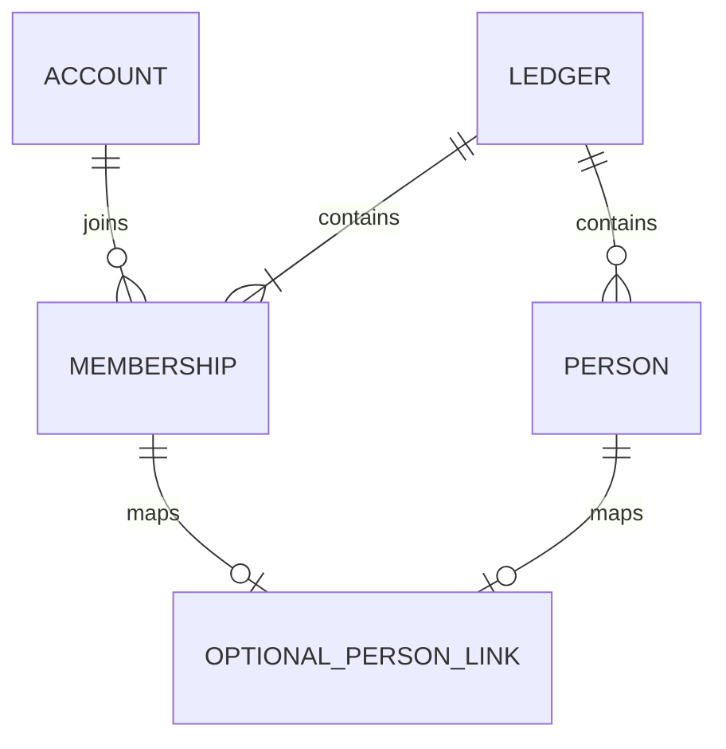

# 58 家計簿のDB・APIと後続設計

更新: 2026-10-27。**家計簿の作成・自分の一覧・個別参照APIと新規DB初期化を実装。画面・招待・人物対応・業務入力は未実装。** 現行契約と後続の設計案を区別し、未確定事項は実装時に推測で埋めない。

## 確定済みの前提

- SQLiteは1ファイル。認証アカウントは全体、家計簿・人物・業務マスタ・取引は家計簿ごとに管理する。同じアカウントの複数参加を認める。
- 全登録利用者が家計簿を作成できる。家計簿の参加招待と、全体管理者によるアカウント登録招待は別の操作。
- 家計簿の権限は閲覧者・編集者・管理者。招待を受けて参加した人は閲覧者。全体のAdminロールを家計簿の権限へ読み替えない。
- アカウントと人物は別管理。家計簿管理者が任意に対応を設定する。人物だけの登録、人物との対応なしでの登録・ログインを認め、名前一致で自動対応しない。
- 編集者は自分の支払方法を編集でき、管理者は他人のものも編集できる。振替は両側の編集権限を確認する。これをレシートの使用可能な支払方法や全業務操作の権限へそのまま広げない。
- 通常操作では最後の有効な家計簿管理者を保護する。紛失・復元等の緊急復旧中はログイン可能な管理者が一時的に0人でもよい。

## 確定した仕様（DEC-046・048）

| 項目 | 仕様 | 状態 |
| --- | --- | --- |
| 家計簿作成 | 入力は名前だけ。作成者を家計簿管理者にし、人物・支払方法は自動作成しない | API実装済み・画面未実装 |
| 任意の人物対応 | 同じ家計簿では1アカウント0〜1人物、1人物0〜1アカウント。家計簿ごとに独立 | 利用者確認済み・未実装 |

家計簿名は前後空白を除いて1〜100文字。同名を認め、名前で統合しない。上限は.NETのstring.Lengthで数える。作成にパスキーの直近再確認は要求しない。人物名・参加者一覧等の未確定事項は後述する。

親のアカウントだけが家計簿管理者として参加し、人物は子供だけを登録する構成も認める。親自身の人物登録・紐づけや、子供のアカウント作成は不要。家計簿を操作するアカウントと記録対象の人物を分け、人物対応の有無を管理権限の条件にしない。

## 保存構成（人物関連は後続案）

認証ストアは引き続きアカウント・鍵・セッションを保存する。家計簿用のモデルと権限確認は`Features/Monetail`へ配置し、認証基盤から家計簿の参加者・人物を参照しない。SQLiteの接続と初回定義はPersistence/ApiDbContextでまとめ、家計簿モデルの制約はLedgerModelで設定する。今回の3表は未リリースAPIの初回定義へ組み込む。以前の開発用DBを更新する互換経路は作らない。

| テーブル（人物関連2表は未実装） | 主な列 | 主キー・制約 |
| --- | --- | --- |
| `ledgers` | `id`, `name`, `created_by_auth_user_id`, `created_at_utc`, `revision` | `id`が主キー。作成者は認証アカウントへRESTRICTのFK |
| `ledger_members` | `ledger_id`, `auth_user_id`, `role`, `joined_at_utc`, `revision` | 家計簿ID＋認証IDが主キー。家計簿・認証アカウントへFK。roleはViewer / Editor / AdminのCHECK |
| `ledger_people` | `ledger_id`, `person_id`, `name`, `display_order`, `revision` | 家計簿ID＋人物IDが主キー。家計簿へFK。名前を一意キーにしない |
| `ledger_member_people` | `ledger_id`, `auth_user_id`, `person_id`, `revision` | 家計簿ID＋認証IDが主キー、家計簿ID＋人物IDをUNIQUE。参加者と人物へ同じ家計簿IDを含む複合FK |
| `ledger_creation_requests` | `request_id`, `actor_auth_user_id`, `ledger_id`, `requested_name`, `created_at_utc` | 要求IDが主キー、作成した家計簿IDはUNIQUE。操作者と家計簿へFK |

- IDはサーバー生成のランダムなUUIDをTEXTで保持し、日時はUTC。空白のみの名前は拒否する。同じ名前でもIDで区別し、既存家計簿・人物へ統合しない。
- 表の列は原則NOT NULL。人物未対応は対応表の行なしで表現し、人物のない参加者やアカウントのない人物を自然に扱う。
- FKは原則RESTRICTとし、人物や参加者への操作から業務データ・認証アカウントを連鎖削除しない。参加者を除外するときの対応行の解除は同じトランザクションで行う案。人物の削除・退会履歴・過去入力者の表示は後続設計。
- `ledger_members(auth_user_id, ledger_id)`に一覧用索引を設ける。家計簿内の役割変更等は`revision`を照合し、更新成功時に新しい値を保存する。
- `ledger_creation_requests`は現在のアカウント発行と同じ再送識別の考え方。処理した名前も保持し、同じ要求IDで異なる内容を送っても別の家計簿を作らない。
- 業務マスタ・取引の新スキーマは別途設計する。支払方法等は所属を複合FKで検証できるようにし、親レシートと明細・対象者等にも他家計簿を参照させない。現行Windows用テーブルへ今回の列を直接追加する案ではない。

図の任意の1対1は利用者確認済み。FKは家計簿をまたぐ対応を拒否できるが、「管理者1人以上」は単純なFKで表せないため書込時に確認する。

## 家計簿作成と再送

1. 有効なログインアカウントであることを確認し、名前とクライアント生成の空でない`requestId`を受け取る。作成者ID・role・人物IDを入力から受け付けない。
2. SQLiteの書込トランザクションで、操作者が現在も有効で同じセッションが利用可能か確認する。
3. 要求IDが未処理なら、家計簿・作成者のAdmin参加・要求記録を同時に保存する。どこかで失敗した場合は全て戻し、管理者のない家計簿だけを残さない。
4. 確定前にもセッション・利用可否を確認する。生コードや家計簿参加用の招待はこの操作では発行しない。
5. 同じ操作者・要求ID・名前の再送は同じ家計簿IDを返す。別操作者または異なる名前は409とし、元の家計簿情報を返さない。別の要求IDは別操作として扱う。

作成者が参加者から外れた後に同じ要求を再送した場合、家計簿情報の再表示は現在の参加権限も確認して拒否する。要求記録だけを根拠に閲覧権限を復活させない。家計簿削除APIは初回実装に含めず、要求記録の保存期間・将来の削除時の再送扱いは削除設計時に決める。

## 作成・参照APIと後続案

| メソッド・パス | 条件・用途 |
| --- | --- |
| `POST /ledgers` | 有効な登録アカウントが名前・requestIdを送り、家計簿を作成。初回201、同じ要求の再送200 |
| `GET /ledgers` | 自分が参加する家計簿だけを返す。未参加なら空配列。全体Adminでも他家計簿を含めない |
| `GET /ledgers/{id}` | 現在の参加を検証し、ledgerId・name・現在の自分のrole・revisionを返す |
| `GET /ledgers/{id}/members` | 参加者一覧。公開項目は当該家計簿のメンバーのID・表示名・role等に限定。閲覧できる役割は要確認 |
| `PATCH /ledgers/{id}/members/{accountId}` | 家計簿管理者がroleとrevisionを送る案。最新の権限・最後の管理者・競合を検証 |
| `PUT /ledgers/{id}/members/{accountId}/person` | 家計簿管理者が同じ家計簿の人物を指定し、任意の対応を設定する案。既存対応の無断上書きは409 |
| `DELETE /ledgers/{id}/members/{accountId}/person` | 家計簿管理者がrevisionを照合して対応だけを解除する案。認証アカウント・人物は残す |

POST /ledgersの本文はnameと空でないUUIDのrequestIdだけを受け付ける。余分な列・不正な名前／要求IDは400。GETの一覧と個別参照も同じ4項目を返す。

後半のメンバー管理・人物対応は未実装の設計対象で、未確認の権限や人物CRUDまで実装する許可を意味しない。参加者追加は家計簿招待の受領で行い、任意のアカウントID指定による直接追加APIは作らない。招待発行・受領APIは期限等の仕様確定後に別途定義する。

- 作成を除き、対象家計簿の現在の参加・roleを要求ごとにDBで確認する。Cookieの全体Adminやクライアントのroleを信用しない。
- 未認証・セッション失効・利用停止は401。未参加と不存在の家計簿は同じ404、参加済みで役割不足は403、古いrevision・対応の重複・要求IDの競合は409。未実装の権限変更等への適用は後続設計。
- 全体のアカウント検索・一覧・存在照会を家計簿管理者へ追加しない。人物名・表示名からの照合も行わない。
- 書込時はDBの最新の参加・権限・対象所属をトランザクション内で再確認する。最後の有効な管理者の同時降格・除外は、同じ書込ロック内で確認し、片方しか成立させない。
- 全体のアカウント停止と家計簿管理者保護の関係、緊急時の家計簿管理者復旧は別途具体化する。既存の全失効コマンドへ、今回新しい家計簿参照を加えない。
- /ledgersはProgram.csから共通HTTP境界へ追加する。ログイン、固定HTTPS・ホスト検証・no-store、POSTのOrigin・CSRF・64KiB上限、認証／保存障害時503を適用する。GETは追加の本人再確認を要求しない。認証APIに設定済みの回数制限は変更せず、家計簿作成への追加回数制限は確認待ちで未実装。

## 新規利用の方針（DEC-037〜046）

新規利用を基本とし、アカウントは家計簿未参加でも登録・ログインできる。全体管理者だけがアカウント一覧から新規登録を招待し、家計簿の参加者画面にアカウント登録招待の入口を増やさない。通常の登録で全体Adminを付与しない。

ログイン画面の「招待コードで登録」から、コード・本人の表示名・パスキー登録を経て明示ログインする。未登録者が家計簿参加の招待を受けた場合も、先に全体管理者の招待でアカウント登録・ログインし、その後に参加を確定する。参加招待だけでは新規アカウントを作らない。将来の招待期間は未決定であり、現在の登録コードの10分をそのまま採用済みとは扱わない。

人物・支払方法・分類等のマスタは家計簿ごとに独立し、同名でも共有・統合しない。アカウント表示名と人物名も同期しない。家計簿が違えば任意の人物対応は独立する。初期マスタ・設定画面・入力開始条件は後続設計とし、店舗マスタなしで入力できる方針は維持する。特定人物のデータの閲覧・編集範囲や、複数対象者の明細・集計の制限も後続とする。

新しい業務データの入力者・更新者はサーバーがログインアカウントの安定した識別子から決め、明細対象者とは分ける。表示名を本人識別のキーにしない。保存形式・名前変更時の履歴表示は未確定で、既存の`update_user`等は一括変換しない。

## 新規利用と既存DBの境界

想定する遷移は「明示初期設定 → 初回管理者登録 → 明示ログイン → 家計簿一覧 → 新規作成 → 家計簿ホーム」。複数参加でも一覧から選べる形を基本案とし、1件だけの場合の自動選択等は画面設計で決める。

新規DBには最初から家計簿行や人物を埋めず、認証登録後に家計簿作成を行う。通常起動・HTTP要求での自動初期化は採用しない。初期設定と再開の現行手順は[42](42-api-foundation.md#db移行登録復旧コマンド)を参照する。

既存Windows版DBの引継ぎは、新構成確定後に一度きりのSQLを手動適用して行う（DEC-047）。APIは移行後の新構成を扱い、新旧DBを切り替える設定・互換モデル・専用の移行画面やAPIは追加しない。以下は移行手順の骨子であり、移行SQL自体は新スキーマ確定後に作成する。

1. サービスを停止し、既存DBをバックアップして作業コピーを用意する。
2. 作業コピーへ、アカウント登録に必要な新構造を準備するSQLを適用する。EFの移行履歴は実際に適用した定義と対応させ、未実行の移行を適用済みにしない。
3. 管理者・利用者のアカウントを通常の登録処理で作り、生成されたアカウントIDを確認する。認証情報・パスキーを手動で作らない。
4. アカウントID・対象家計簿ID・旧人物コード等をSQLに明示して、参加者・人物対応・既存の業務データを新構造へ移す。人物名による自動照合や、人物名のアカウント名へのコピーはしない。
5. 件数・金額・型・外部キー・関連付けを合成データで事前検証し、実際の作業コピーでも照合してから切り替える。失敗したコピーに推測でSQLを重ねず、バックアップからやり直せる手順にする。

保存済み`receipt.total`（NULLを含む）・過去の更新者・業務値は再計算・補正しない。移行SQLは登録されたアカウントのIDを対応先として使い、アカウントのID自体を書き換えない。構造準備とデータ移行を分け、既存DBへのSQL適用を通常の初期化コマンドに混ぜない。

新規APIの保存構成は`Persistence/ApiDbContext`と専用EF移行系列にまとめた。登録・ログイン・復旧は家計簿内の人物対応に依存しない。家計簿の3表も同じ初回定義に含める。SQL移行を済ませるまではWindows版DBを新APIへ接続しない。

## 次の実装と確認

家計簿一覧・作成の画面、家計簿招待、人物管理と任意対応、役割変更を具体化し、初期マスタから業務入力へ接続する。画面で1件だけの家計簿を自動選択するか等は画面設計で決める。今回、人物・支払方法・分類・取引を追加するAPIは作らない。

実HTTPと合成SQLiteで一般アカウントの作成、名前の境界と再送、同時作成、3表の保存失敗、保存中の失効と作成者Adminの喪失、現在の参加／役割、全体Adminの非特権化、FK・役割制約、HTTP境界を確認する。検証結果の正本は[tests/README](../tests/README.md)。招待・人物対応・権限変更や一度きりのSQL移行は未実装で、受入確認済みとは扱わない。

## 後続で確定すること

人物名の入力制約、人物作成・変更の権限、メンバー一覧の閲覧範囲、家計簿参加招待の期限・共有／対象固定・取消・再送、退会・除外と再参加の履歴、全体の利用停止と家計簿管理者保護、入力者／更新者の保存・表示、マスタ初期値、家計簿の改名・削除・画面の細かな遷移は保留。この案のテーブルやAPIを、それらまで完成した仕様とは扱わない。
