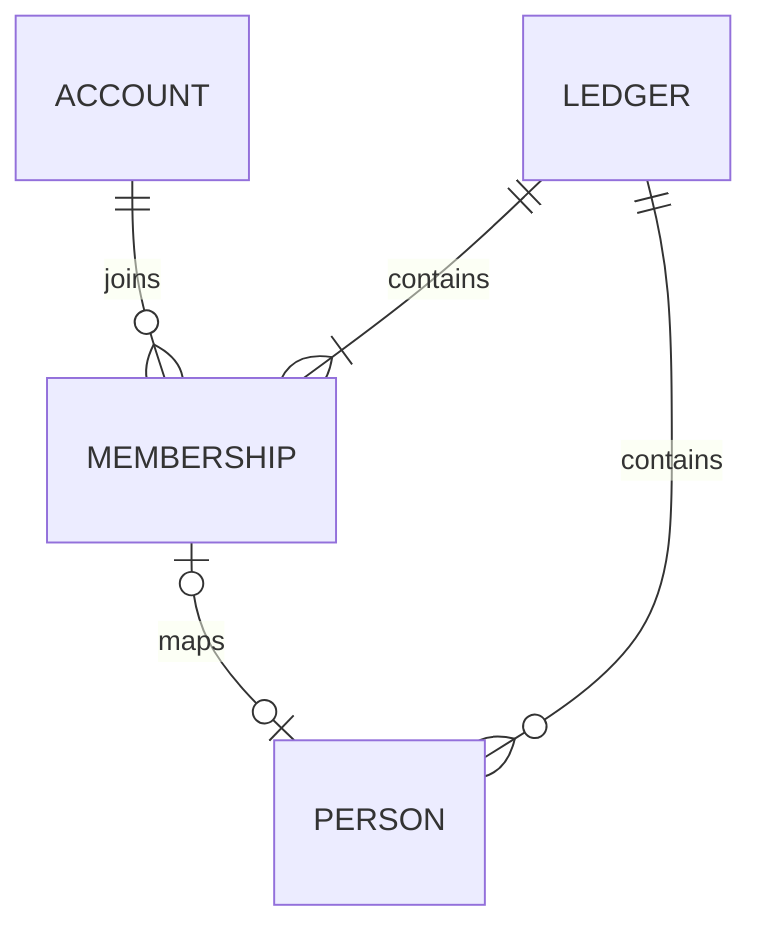

# 58 家計簿のDB・APIと後続設計

更新: 2026-10-31。**家計簿・人物・参加者・家計簿招待のAPIと共通再送記録を実装。新版Windowsは接続・認証・家計簿選択／作成／切替まで。人物・参加者・招待の管理画面、ブラウザーの招待受領、レシート等の業務入力は未実装。** 現行契約と後続の設計案を区別し、未確定事項は実装時に推測で埋めない。

## 確定済みの前提

- SQLiteは1ファイル。認証アカウントは全体、家計簿・人物・業務マスタ・取引は家計簿ごとに管理する。同じアカウントの複数参加を認める。
- 全登録利用者が家計簿を作成できる。家計簿の参加招待と、全体管理者によるアカウント登録招待は別の操作。
- 家計簿の権限は閲覧者・編集者・管理者。招待を受けて参加した人は閲覧者。全体のAdminロールを家計簿の権限へ読み替えない。
- アカウントと人物は別管理。家計簿管理者が任意に対応を設定する。人物だけの登録、人物との対応なしでの登録・ログインを認め、名前一致で自動対応しない。
- 編集者は自分の支払方法を編集でき、管理者は他人のものも編集できる。振替は両側の編集権限を確認する。これをレシートの使用可能な支払方法や全業務操作の権限へそのまま広げない。
- 通常操作では最後の有効な家計簿管理者を保護する。紛失・復元等の緊急復旧中はログイン可能な管理者が一時的に0人でもよい。

## 確定した仕様（DEC-046・048）

| 項目 | 仕様 | 状態 |
| --- | --- | --- |
| 家計簿作成 | 入力は名前だけ。作成者を家計簿管理者にし、人物・支払方法は自動作成しない | API・新版Windows画面実装済み |
| 任意の人物対応 | 同じ家計簿では1アカウント0〜1人物、1人物0〜1アカウント。家計簿ごとに独立 | API実装・管理画面は未実装 |

家計簿名は前後空白を除いて1〜100文字。同名を認め、名前で統合しない。上限は.NETのstring.Lengthで数える。作成にパスキーの直近再確認は要求しない。人物名は下記の人物管理、参加者一覧等の未確定事項は後述する。

親のアカウントだけが家計簿管理者として参加し、人物は子供だけを登録する構成も認める。親自身の人物登録・紐づけや、子供のアカウント作成は不要。家計簿を操作するアカウントと記録対象の人物を分け、人物対応の有無を管理権限の条件にしない。

<a id="人物の管理dec-055未実装"></a>

### 人物の管理（DEC-055・API実装／画面未実装）

人物・参加者・招待のAPIと初回DB定義を実装済み。管理画面は未実装で、以下の画面動作は設計として保持する。レシート・振替・残高等の業務表はまだないため、それらの記録日に基づく有効期間の検証は業務モデルの追加時に実装する。今回の参照削除制限は、参加者との対応とDBのRESTRICT制約で検証した。

利用者確認済みの方針は次のとおり。

- 人物IDはAPI側で生成するUUIDとし、名前・表示順から独立した識別子にする。通常の人物管理画面には表示しない（DEC-062）。
- 人物名は前後の空白を除いて1〜100文字。同じ家計簿で同名の人物は認めない。前後空白除去後の完全一致で比較し、大文字小文字・全角半角・Unicodeの正規化を同一視しない。文字数は家計簿名と同じ`.NET string.Length`（UTF-16コード単位数）で数える。通常の日本語は1、一部の絵文字等は複数として数える。上限超過を自動で切り詰めず、API側でも検証して入力エラーにする。名前が変わっても人物の識別は維持する（DEC-063）。
- 人物一覧は当該家計簿の全参加者が閲覧可能。未参加者や未ログインの利用者への公開を意味しない。
- 人物一覧は有効期間にかかわらず全員を表示する。人物の並び順は任意に設定できるようにし、通常の人物一覧・選択欄では、設定順にかかわらずログイン中の本人を先頭とする。それ以外の人物は設定順に従う。本人に対応する人物がなければ先頭への移動は行わない。下記の並び順設定画面のみ例外とする。
- 設定する並び順は家計簿内で共通とし、変更できるのは家計簿管理者のみ。本人を先頭に移すのは各利用者への表示時に行い、保存している共通順そのものは変えない。
- 人物一覧に管理者用の［並び順を変更］を置き、専用の並び順設定画面を開く。この画面だけは本人を先頭へ移さず、保存する共通順をそのまま表示する。人物を選択して［上へ］［下へ］で移動し、［保存］で確定する。［キャンセル］は変更を保存せず一覧へ戻る。
- 人物を追加できるのは家計簿管理者のみ。
- 人物名を変更できるのは本人と家計簿管理者。本人とは、当該家計簿でその人物に対応付けられたアカウントでログインしている利用者。人物名の一致で本人と判定しない。
- 人物との対応は家計簿内の参加者編集画面で設定する。家計簿管理者が、その参加者に対応する人物を同じ家計簿から選び、「未設定」も認める。人物編集にはアカウント選択を置かない。全体のアカウント設定と家計簿内の参加者編集を区別する。人物登録や家計簿への参加と対応付けは独立した操作とする（DEC-061）。
- 対応は参加者テーブルにNULL許容の人物IDを持たせて保存する。未設定はNULLとし、同一家計簿内で同じ人物への対応の重複を禁止する。同じ家計簿の人物への複合FKを設け、対応専用テーブルは作らない（DEC-059。人物側にアカウントIDを持つDEC-058から変更）。
- 人物編集の保存は、名前・有効期間を1要求・1トランザクションでまとめる。どこかが失敗したら全体を戻し、成功時は更新後の人物一覧も同じ応答で返す。人物との対応は参加者編集で別の操作として保存する（DEC-061。DEC-056から対応の操作場所を移すが、人物情報の一括保存・一覧返却は維持する）。
- 人物の削除・有効期間の変更は家計簿管理者のみ。
- 名前変更後は過去の記録も現在の人物名で表示する。各取引に変更前の人物名を複製しない。
- 使用済みの人物は残し、過去の表示・集計を維持したまま、今後の選択候補から外せるようにする。本当に未使用の人物は削除可能にする。
- 人物に有効期間を設定できるようにする。適用対象は明細対象者に限定せず、支払方法の所有者を通じたレシート・振替・残高等、人物を使用する業務全体。人物の期間は認証アカウントの利用期限とは別で、登録・ログインは引き続き人物対応に依存しない。
- 有効期間は操作日ではなく記録対象の日付で判定する。レシートではレシートの日付を使い、現在は期間終了後でも期間内の日付のレシートを入力するときは選択できる。
- 有効開始日・終了日はそれぞれ空欄なら、その側の制限なし。両方空欄なら全期間で有効。指定した開始日・終了日はともに有効期間に含む。開始日が4/1なら4/1は入力可能、3/31は不可。終了日が9/30なら9/30は入力可能、10/1は不可。判定はレシートの日付に対して行う。
- 人物を使用している既存の記録を範囲外にする有効期間の設定・変更は認めない。レシート・振替・残高等を対象とする。例えば4/1の既存レシートで使われていれば、開始日を4/2に変更できない。
- 未使用の判定では、レシートに加えて振替・残高も対象にする。
- 人物への参照が1件でも残っている間は削除不可。取引がなくても、所有者として登録された支払方法や参加者との対応が残っていれば削除しない。削除処理では参照や対応を自動解除せず、先に管理者が参加者編集で人物を「未設定」にして保存し、その後で人物を削除する。対応解除後も他の参照があれば削除不可。アカウント本体・家計簿への参加・役割は維持する（DEC-060・061）。

人物管理画面は家計簿ホームのメニューから開く。人物一覧に絞り込み等の機能は設けない。

一覧は1人を選択する方式とし、未選択時や権限がない操作のボタンは無効にする。削除時は人物名を含む確認を表示し、参照があれば削除せず理由を表示する。このボタン制御・削除操作は利用者確認済み。

人物名の文字数の数え方・同名判定は上記の方針で確定済み。画面の具体案は下記に分ける。各業務機能で有効期間の判定に使う日付や、支払方法自体の有効期間との関係は、その機能の設計時に具体化する。参加者編集での人物の選択・解除・付け替えと参加者表への人物IDの保存は確定済みだが、APIのパスと要求・応答項目は下記に実装済み。管理画面の配置等の未決定事項とは区別する。

削除制限の技術方針は利用者確認済み。人物を参照する支払方法・明細対象者等に家計簿ID＋人物IDの索引を設け、DBの外部キー制約（RESTRICT）で参照のある人物の削除を拒否する。APIは参照による削除拒否を画面へ伝える。一覧表示時に全履歴を走査せず、削除時の現在の参照をDB側で検証する。書込トランザクションと外部キー制約で、他の端末との同時操作でも参照切れを防ぐ。具体的な参照先は業務モデル設計時に網羅する。一覧で削除可否を事前表示するかは未確定。

旧版で人物を直接参照する箇所は、購入明細の対象者、支払方法の所有者、店舗マスタの人物別設定。レシートの支払者・振替の移動元と先・残高・支払メモは支払方法を通じて人物を参照する。集計はこれらから算出し、集計専用の人物参照を保存しない。新版の参加者から人物への任意の対応も参照元に含め、残っている間は人物を削除できない。旧店舗の人物別設定等を新版へ採用するかは、旧列の存在を根拠に決定せず後続設計で確認する。

#### 人物管理画面の構成案（一部確認済み・未実装）

全員表示・任意の設定順と通常表示での本人先頭・専用画面での並べ替え・ボタン制御・削除確認は上記の確定事項に従う。以下のその他の具体案は確認対象として区別し、了承前に製品コードや期待値テストへ取り込まない。現在の新Windows版と同じメインウィンドウの内容を切り替え、一覧・追加と編集・並び順設定の3種類を設ける案とする。

| 画面 | 表示・操作の案 |
| --- | --- |
| ホーム | 上部の「メニュー」に「人物管理」を追加し、開いている家計簿の人物一覧へ進む |
| 人物一覧 | 家計簿名・人物名・有効開始日・有効終了日を表示。本人の人物名に「本人」を添える。全員表示と表示順は上記の確定事項に従う。検索・絞り込み・期間による自動非表示は行わない |
| 人物の追加 | 人物名・有効開始日・有効終了日を入力。初期値はすべて空欄。［登録］と［キャンセル］を置く |
| 人物の編集 | 選択した人物の現在の名前・有効開始日・有効終了日を表示。アカウントの選択は置かない。［保存］と［キャンセル］を置く |
| 並び順設定 | 管理者のみ操作可能。共通順で全員を表示し、［上へ］［下へ］で並べ替える。［保存］で確定、［キャンセル］で破棄して一覧へ戻る。本人先頭の表示処理は適用しない |

人物一覧の配置例（表示データは説明用）。期間の空欄は制限なしを表し、その説明を一覧にも添える。

```text
人物管理 — 家族の家計簿

人物名       有効開始日     有効終了日
父（本人）
母           2026/04/01
子供A                      2026/09/30

空欄は期間の制限なし
［追加］［編集］［削除］      ［ホームへ戻る］
［並び順を変更］
```

追加・編集画面は共通の配置とする案。追加時は空欄から入力し、編集時は現在値を表示する。

```text
人物の編集 — 家族の家計簿

人物名       ［父                    ］
有効開始日   ［                      ］
有効終了日   ［                      ］
期間の空欄は制限なし

［保存］［キャンセル］
```

操作権限は上記の確定事項に従い、画面では次の形にする案。

| 操作 | 家計簿管理者 | 管理者以外の本人（閲覧者を含む） | それ以外の参加者 |
| --- | --- | --- | --- |
| 一覧を見る | 可 | 可 | 可 |
| 追加 | 可 | 不可 | 不可 |
| 選択した人物を編集 | 名前・有効期間 | 自分の名前のみ。有効期間は表示するが変更不可 | 不可 |
| 削除 | 確認後に実行。参照があれば拒否 | 不可 | 不可 |
| 並び順を変更 | 可 | 不可 | 不可 |

- 一覧は1人を選択する方式とし、未選択時や権限がない操作のボタンは無効にする。0件なら「人物は登録されていません。」を表示し、管理者は［追加］から登録する。
- 追加・編集の成功後は一覧へ戻り、［キャンセル］は入力を保存せず一覧へ戻る。［ホームへ戻る］は開いていた家計簿のホームへ戻る。
- 人物の追加・編集は名前と有効期間をまとめて保存する。人物名の空欄・文字数超過・同名・開始日が終了日より後の入力や、既存の記録を期間外にする変更は理由を画面内へ表示し、入力を残して修正できるようにする。
- 削除時は人物名を含む確認を表示する。削除成功後は一覧から取り除き、参照があれば削除せず理由を表示する。削除可否を調べるために一覧表示時の全履歴走査は行わない。
- 通信失敗では入力を保持して再試行可能にする。更新版の不一致による競合では、下記の確認済みの画面内表示で最新情報を確認し、明示的に切り替えてから保存する。権限喪失時は下記の確認済みの画面内エラー方針に従う。通信障害時の再送の具体的な応答項目はAPI設計で具体化する。

**競合時の最新情報表示（利用者確認済み・未実装）**

競合時だけ編集画面内に最新の保存内容を表示する方式へ変更した（DEC-065。DEC-064の読み直しダイアログを置き換える）。最新内容を表示するLabel群をPanelにまとめ、通常は非表示にする。既存のFlowLayoutPanelで配置し、表示領域をあらかじめ予約しない。競合時にはその分だけ縦に広がり、必要なら既存のスクロールを使う。

- 更新版の競合応答に、現在の権限で返せる最新の情報と更新版を含める。人物編集では名前・有効開始日・有効終了日の3項目すべてを読み取り専用で表示する。相違のある項目だけに絞る表示や差分の強調は行わない。確認のためだけの追加取得通信を行わない。同名等の入力・制約エラーと更新版の競合を区別する。
- 編集中の入力はそのまま残し、最新情報とは別に保持する。最新情報を受け取っただけで入力や保存用の更新版を切り替えない。
- ［最新内容に切り替える］を押したときだけ、入力欄と保存用の更新版を表示中の最新情報へ置き換え、通常の編集へ戻る。今回の未保存入力が置き換わることを表示する。切り替えるまでは古い版による保存を通さない。
- 切り替えた後の保存でも更新版を照合する。さらに変更されていれば再び最新情報を表示し、競合を理由に自動で上書きしたり、入力を黙って破棄したりしない。

**参加者編集・並べ替えの競合（利用者確認済み・未実装）**

- 参加者編集は人物編集と同じ仕組みを使う（DEC-090）。同じ参加者行の役割・人物対応の先行変更を検出したら、最新の役割と対応する人物を読み取り専用で表示する。編集内容は残し、［最新内容に切り替える］で入力と参加者の更新版を置き換える。役割と対応の別項目を編集していても同じ参加者行の古い版は保存しない。
- 人物の並べ替えの競合では、「ほかの操作で変更されています。最新の並び順を読み込みます。」と知らせ、そのまま未保存の並べ替えを破棄して最新の並び順へ置き換える（DEC-092）。最新一覧を参考欄に並べる表示や、切り替えるかを選ぶ確認は設けない。
- 最新の人物一覧と並び順全体の更新版を競合応答に含め、追加GETなしで編集側の全一覧と保存用の更新版を置き換える（DEC-092）。人物の追加・削除も反映し、並べ替え画面では共通順をそのまま表示する既定方針を維持する。
- 権限喪失はDEC-081のエラー表示を優先し、閲覧権限のない最新情報を返さず、再取得や自動遷移をしない。
- 別々の参加者に同じ人物を同時設定した場合は、先に確定した対応だけを成立させ、後の保存は制約エラーとして拒否する（DEC-091）。更新版の競合用の切り替え表示ではなく、画面内に別の参加者へ設定済みと表示して入力を残す。失敗した保存では役割・人物対応の両方を変更せず、他の参加者の対応を奪わない。

**入力エラーの表示（利用者確認済み・未実装）**

人物名の文字数超過等の入力不備は、［登録］または［保存］を押したときに画面内の該当欄付近へ短いエラー文を表示する（DEC-081）。普段は表示領域を予約せず、エラー時だけ説明を追加する。入力は保持し、保存せずに該当欄へフォーカスを戻して修正できるようにする。クライアントで確認できる入力不備は送信前に止め、API側でも同じ条件を検証する。

| 条件 | 表示する説明の案 |
| --- | --- |
| 人物名が100文字超 | 人物名は100文字以内で入力してください。 |
| 人物名が空欄・空白のみ | 人物名を入力してください。 |
| 同じ家計簿に完全一致の同名がある | 同じ名前の人物が登録されています。 |
| 開始日が終了日より後 | 有効開始日は有効終了日以前の日付にしてください。 |
| 既存の記録が新しい有効期間から外れる | 既存の記録が期間外になるため、この有効期間には変更できません。 |

<a id="人物とアカウントの対応付け一部確認済み未実装"></a>

#### 人物とアカウントの対応付け（API実装／画面未実装）

対応の操作場所も保存先と合わせて参加者側へ移すことを利用者確認済み（DEC-061）。家計簿内の参加者編集で、管理者が「対応する人物」を選ぶ。人物編集や全体のアカウント編集では設定しない。同じ家計簿で人物・アカウントとも最大1つの任意の対応とする。以下では確定事項と、まだ確認が必要な詳細を区別する。

- 人物の候補は同じ家計簿に限定し、「未設定」も選べる。全体のアカウント検索や名前一致の自動対応は行わない。
- 解除は「未設定」を選んで保存する。
- 付け替えは参加者編集で別の人物を選んで保存し、元の対応解除と新しい対応を同じトランザクションでまとめて確定する。失敗時は元の対応を維持する。
- 別の参加者に既に紐付いている人物は選択不可とする。別々の参加者が同時に同じ人物を設定しても、先に保存した方だけが成立し、後の保存は画面内の制約エラーとして拒否する（DEC-091）。変更したい場合は、先に元の参加者の編集画面で対応を解除する。保存時も現在の対応を確認し、別端末による先行設定を上書きしない。
- 対応付けても人物名・アカウント表示名は同期せず、過去の記録の人物や支払方法の所有者を別の人物へ移さない。一方、対応するアカウントが変わると本人の判定や、自分の支払方法として編集できる対象に影響する。
- 参加者一覧は家計簿管理者のみ閲覧できる（DEC-070）。人物一覧を全参加者が閲覧できる方針とは区別する。参加者編集の役割と人物対応は一括保存する（DEC-072）。同名アカウントを区別するための内部IDの補助表示は設けない（DEC-076）。人物の追加・編集には対応の選択欄を設けない。

**参加者管理画面（一部確認済み・未実装）**

人物との対応の操作場所・管理者権限、参加者一覧の閲覧を家計簿管理者に限定すること、家計簿招待の入口を参加者一覧だけに置くことは確認済み。以下のその他の表示項目・操作配置等の具体案は、確認済み事項と区別する。

| 画面 | 表示・操作の案 |
| --- | --- |
| 参加者一覧 | 家計簿ホームのメニューから開く。アカウント表示名・家計簿内の役割・対応する人物を表示し、未対応は「未設定」と示す。［招待］［編集］［ホームへ戻る］を置く案。［招待］をここだけに置くことは確認済み |
| 参加者編集 | 対象のアカウント表示名は表示のみ。役割（閲覧者・編集者・管理者）と対応する人物を選択し、［保存］［キャンセル］を置く。人物との対応は「未設定」も選択可能 |

一覧の閲覧は家計簿管理者のみとし、画面の入口だけでなく一覧APIでも現在の家計簿内の権限を確認する。全体のアカウント管理者権限だけを理由に他の家計簿の一覧を公開しない。役割・人物との対応を変更するのも家計簿管理者のみ。編集画面では役割と人物対応を1要求・同じトランザクションで保存し、片方が失敗した場合は全体を戻すことを確認済み（DEC-072）。最後の有効な管理者を保護する確定方針を維持する。自分自身の降格・除外は禁止し、別の家計簿管理者が行う（DEC-079）。

参加者の追加は既定の家計簿招待から行い、任意のアカウントIDによる直接追加や全体のアカウント登録招待を、この画面へ追加しない。家計簿への招待の画面・期限等は後述の正本を参照する。

**参加者の除外（利用者確認済み・未実装）**

利用者の「除外の実装は大変でないならやりましょう」を受け、現在の参照関係を確認した。現行の参加者行は家計簿・アカウントを参照する側であり、参加者行を参照する業務表はまだない。追加予定の人物対応も参加者から人物への参照なので、基本的な除外は大きな追加にならず、今回の実装対象へ含める（DEC-073）。一般参加者による本人の退会は追加せず、管理者による除外に絞る（DEC-078）。

以下の除外・保存・再参加の方針も利用者確認済み（DEC-075）。

- 管理者が参加者一覧から対象を選び、確認後に除外する。最後の有効な管理者は除外不可とする既定方針を維持する。
- 参加者行とそこに保持する人物対応を取り除き、アカウント・人物・過去の業務記録は残す。各APIは現在の参加を確認し、除外後の要求に家計簿へのアクセスを許可しない。既に端末へ返した情報を回収する仕組みではない。
- 再参加は新しい招待で行い、役割は閲覧者・人物対応は未設定から始める。以前の役割・対応を自動復活させない。

除外と同時更新の競合の応答・画面、専用の参加履歴の要否は未決定。今後の入力者・更新者の参照設計で、参加者行の削除と過去の表示を両立させる。

**本人の退会は追加しない（利用者確認済み・未実装）**

シンプルさを優先する利用者の再判断によりDEC-077の一般参加者の退会追加を取り下げる（DEC-078）。退会専用のメニュー・画面・APIは設けず、家計簿管理者による除外へ統一する。管理者自身の降格・除外についても、別の管理者が行う方針に確定した（DEC-079）。

**降格・除外は別の管理者が行う（利用者確認済み・未実装）**

シンプルさを優先し、自分自身の降格・除外を禁止する（DEC-079）。自分を対象にした役割変更・除外を画面とAPIの両方で禁止し、別の家計簿管理者が操作する。自分の人物対応の編集権限は、従来の管理者権限から変更しない。

操作者自身は管理者として残るので、操作成功直後に本人が権限・参加を失う場合の特別な応答や画面遷移が不要になる。また、残す管理者が実際にはアクセス手段を失っていたのに本人が降格・除外してしまう事態を避けやすい。別の管理者への依頼が必要になる不便は受け入れる。最後の有効な管理者を保護する既定方針は維持し、同時操作時も最新の操作者の参加・役割を同じ書込トランザクション内で再確認する。

他の端末から降格・除外された場合の各要求での権限・参加の検証は引き続き必要。保存成功時の自己降格・自己除外の分岐は作らず、別操作で権限を失った場合の応答・画面遷移とは区別する。

家計簿への招待の入口は参加者一覧の［招待］だけに置く（DEC-071）。メニュー直下には［招待］を設けず、同じ操作の入口を重複させない。招待画面のリンク発行・一覧・取消は後述の方針を維持する。

同名アカウントの識別用に内部IDの表示・確認・コピー操作は追加しない（DEC-076）。表示名と対応する人物による表示とし、同名で人物未設定等の場合に画面上で区別できないことを当面許容する。新しいユーザー名等の識別項目も今回追加しない。内部処理は引き続き安定したアカウントIDで対象を特定し、同名アカウントを統合したり名前で更新対象を照合したりしない。一覧の並び順等は未確定。人物名は家計簿内で同名不可なので、人物候補の表示に全体のアカウント情報を持ち込む必要はない。管理者以外の人物一覧に他の参加者のアカウント情報を公開せず、本人の先頭表示等に必要な自分の対応の判定と区別する。

<a id="人物管理apidbの具体案一部確認済み未実装"></a>

#### 人物管理API・DB（実装済み）

人物情報の一括保存と更新後一覧の同一応答、参加者編集での対応保存、API側で生成するUUIDの人物IDは利用者確認済み（DEC-056・061・062）。下表の9操作のAPIパスとDB変更の構成は確認済み（DEC-089）。要求・応答と競合・再送のAPI契約は以下の実装内容に従い、未実装の画面と区別する。人物・参加者・招待の保存処理とAPI、未リリースAPIの初回定義へ実装した。業務取引のモデル・実DBの移行・管理画面は今回の実装に含めていない。

**APIのパス・通信単位（実装済み）**

以下のパスはすべて`/ledgers/{ledgerId}`からの相対パス。各要求で有効なログインと現在の参加を確認し、書込時は最新の役割・本人の対応もトランザクション内で検証する。

| メソッド・パス | 用途・権限 | 取得・保存の単位 |
| --- | --- | --- |
| `GET /people` | 全参加者が人物一覧を取得 | 全員を共通順で返し、ログイン中の本人の人物ID・現在の役割・並び順の更新版も返す。通常画面だけが表示時に本人を先頭へ移す |
| `POST /people` | 管理者が人物を追加 | 作成操作のrequestId・名前・有効開始日・有効終了日を送り、名前・期間をまとめて登録。新規人物は共通順の末尾へ追加する（DEC-085）。作成要求の再送は下記の共通記録表で識別する |
| `PATCH /people/{personId}` | 管理者、または自分の名前を変更する本人が保存 | 名前・有効期間を1要求・1トランザクションで保存し、更新後一覧を同じ応答で返す。アカウントとの対応は受け付けない。本人だけの権限では名前以外の変更を認めない。部分更新の省略・nullは下記のとおり |
| `DELETE /people/{personId}` | 管理者が削除 | 人物の更新版を照合して削除。参照があれば削除せず理由を返す |
| `PUT /people/order` | 管理者が共通順を保存 | 全人物のIDを設定順で並べた配列と並び順の更新版を送る。全体を同じトランザクションで保存し、［上へ］［下へ］の操作ごとの通信は行わない |
| `GET /members` | 管理者が参加者一覧を取得 | アカウントID・表示名・役割・対応人物・参加日時・参加者の更新版と、本人や人物順の表示に必要な情報をまとめて返す。IDは操作対象の特定用で、同名識別の画面表示には使わない |
| `GET /members/{accountId}/edit` | 管理者が参加者の対応を編集する情報を取得 | 現在の参加者情報と同じ家計簿の人物候補を1応答で返す（DEC-088）。他の参加者に対応済みの人物は選択できない状態で示す |
| `PATCH /members/{accountId}` | 管理者が参加者の役割と人物の対応を保存 | 役割と人物対応を1要求・同じトランザクションで保存することは確認済み。人物IDと参加者の更新版をJSON本文で送る。NULLなら対応解除、別の人物IDなら付け替え |
| `DELETE /members/{accountId}` | 管理者が別の参加者を除外 | 対象の参加者の更新版を照合して参加者行と人物対応だけを削除し、更新後参加者一覧を返す。自分自身は対象不可。更新版はJSON本文のrevisionで送る |

APIの具体的な項目名・型と更新版を送る場所は下記の形式で実装した。人物の新規作成では要求ID、更新・削除では対象の更新版、共通順保存では全人物のID配列と並び順全体の更新版を送る。作成・更新・削除・共通順保存の成功時は更新後一覧を含める。参加者の除外・役割変更は自分以外が対象だが、自分の人物対応だけの変更を禁止するものではない。

一覧の人物データは`personId`・`name`・`validFrom`・`validTo`・共通順・人物の`revision`を返す。人物とアカウントの全対応を全参加者に公開する必要はなく、通常表示で必要な本人の人物IDだけをログインアカウントから求める。

人物の作成・更新・削除・共通順保存では、更新後の人物一覧を同じ成功応答に含めることを確認済み（DEC-080）。参加者の更新・除外でも、操作者が管理者のままなら更新後の参加者一覧を同じ成功応答に含める。人物一覧に本人の人物ID・現在の役割・並び順の更新版も含める。一覧の再取得を別のHTTP要求にせず、画面は同じ形式の応答から一覧へ戻れる。更新後一覧の取得もサーバーの同じトランザクション内で行い、確定してから応答する。

人物編集では一覧応答の名前・期間・更新版から入力を始め、編集画面を開くためだけのGETを追加しない（DEC-088）。保存時に最新の参加・権限と更新版を検証する。参加者編集は現在の参加者情報と人物候補を1応答で取得する。この取得でも現在の管理者権限を検証する。

人物保存のPATCHでは項目の省略を「変更しない」、日付の明示的な`null`を「期間制限なし」と区別する。人物の更新版は必須とし、名前だけの更新で日付を意図せず解除しない。参加者保存のPATCHでは人物IDの明示的な`null`を「対応解除」とする。管理者以外の本人は人物の名前だけを送る。

**要求・応答の項目（実装済み）**

上記の9操作で、更新版はDELETEも含めJSON本文の`revision`へ統一し、省略・nullを区別し、エラー応答に種類と表示文を持たせる基本方針は確認済み（DEC-093）。以下の具体的なDTO項目は、既定の権限・通信単位・再送・競合の画面動作に従って整理する。

| 操作 | JSON本文の項目案 |
| --- | --- |
| 人物作成 | `requestId`、`name`、`validFrom`、`validTo`。要求IDと名前は必須。作成時の日付の省略またはnullは、その側の期間制限なし |
| 人物更新 | 必須の`revision`、変更する`name`・`validFrom`・`validTo`。管理者以外の本人は名前だけを送る |
| 人物削除 | 必須の`revision` |
| 共通順保存 | 必須の`revision`（順序全体の版）と`personIds`（現在の全人物IDを設定順で1回ずつ） |
| 参加者更新 | 必須の`revision`、変更する`role`・`personId` |
| 参加者除外 | 必須の`revision` |

更新で省略した項目は変更せず、日付のnullは期間制限の解除、人物IDのnullは対応解除とする（DEC-093）。人物名・役割にnullは認めない。画面の通常保存では編集可能な項目をまとめて送り、役割と人物対応は一括で確定する。省略の扱いを、項目ごとに別々の保存要求を送る意味にはしない。

人物一覧と人物の変更成功応答は、`people`配列・`myPersonId`・`currentRole`・`orderRevision`の共通形式を使う。各人物は`personId`・`name`・`validFrom`・`validTo`・`displayOrder`・`revision`を持つ。API内部とクライアントの操作対象の特定にはIDを使い、利用者への識別用表示には使わない。

参加者一覧と参加者の変更成功応答は`members`配列・`currentAccountId`・`currentRole`を返す。各参加者は`accountId`・`displayName`・`role`・`personId`・`personName`・`personDisplayOrder`・`joinedAtUtc`・`revision`を持つ。本人先頭や人物順・参加順を表示するための情報を同じ応答で返す。参加者編集の取得は`member`と`personCandidates`を返し、人物候補には`personId`・`name`・`isSelectable`を含める。他の参加者に設定済みの人物も選択不可で表示する既定方針に従う。

失敗応答は`code`（機械判定用）と`message`（表示用）を基本とし、必要に応じて該当欄や最新情報を含める方針は確認済み（DEC-093）。項目名は、入力欄を`field`、現在の権限で返せる競合の最新情報を`latest`とする。入力不備400・認証401・権限403・対象不在/未参加404・更新版や一意性等の競合409・既存の回数超過429・保存障害503とする。409の中でも更新版不一致と制約違反を`code`で区別し、既定の画面動作へ分岐する。共通の認証・CSRF・HTTP境界での拒否は既存の応答形式を維持し、各業務処理のエラーと区別する。既存の認証・家計簿APIの応答形式は一括変更していない。

**DBの構成（初回定義へ実装済み）**

アカウントとの対応は参加者表に人物IDを持つ構成で利用者確認済み（DEC-059）。人物0人・人物未対応の参加者・アカウントに対応しない人物を認め、人物への対応から認証アカウントを自動作成しない。人物IDのUUID採用・日付の保存形式・更新版の保存単位も確認済み。以下は現在の実装内容。未実装の業務表や画面の設計とは区別する。

- `ledger_people`に人物名・有効開始日・有効終了日・共通順・人物の更新版を保存する。期間は時刻やタイムゾーンを持たない日付とし、SQLiteでは`YYYY-MM-DD`形式のTEXT、制限なしはNULLで保存する方針を確認済み（DEC-086）。APIでも同形式の文字列またはnullを使い、C#では`DateOnly?`で扱う。正しい日付を固定桁で保存し、両日がある場合の開始日≦終了日を検証する。DBのCHECKでも前後関係を検証する。
- 同一家計簿の人物名にUNIQUE制約を設け、同時登録でも同名を防ぐ。比較は前後空白除去後の完全一致とし、SQLiteのBINARY比較にそろえる。共通順は各人物行に保存し、並べた人物ID配列からサーバーが順序値を設定する（DEC-087）。
- 既存の`ledgers`行に、人物の並び順全体で共有する更新版`people_order_revision`を1つ追加する（DEC-087）。人物0人でも取得でき、名前・権限等の変更と並べ替えの競合を分けられる。人物の追加・削除・順序変更時に更新し、共通順を保存する要求で照合する。
- 人物の更新版は名前・有効期間が変わったときに更新する（DEC-087）。人物との対応は参加者の更新版で検証する。共通順だけの変更では人物の更新版を変更せず、人物情報・参加者情報・並べ替えの競合を区別する。
- 更新版の値は、現行の家計簿・参加者の実装と同様、APIが生成するUUID文字列へそろえる（DEC-087）。各対象に現在の値を1つ保持し、取得時に返した値を保存要求で照合して、新しい版への置換と業務変更を原子的に行う。値の大小で新旧を判定せず一致だけを見る。人物1人・参加者1人・家計簿ごとの人物順全体の3単位に分ける方針は確認済み。並び順の各人物行の更新と全体の更新版の置換は同じトランザクションで行う。

**アカウント対応の保存構成（API／DB実装済み）**

`ledger_members`にNULL許容の`person_id`を設け、対応なしをNULLで表現する。`ledger_people`はアカウントIDを持たず、人物の名前・有効期間・表示順等を管理する。人物の登録とアカウントの参加は独立させ、対応専用表`ledger_member_people`は作らない。

- 参加者の主キー`(ledger_id, auth_user_id)`と人物IDの単一列で、1アカウントが同一家計簿で対応できる人物を最大1人とする。`(ledger_id, person_id)`へUNIQUE制約を置き、1人物へ複数アカウントが対応することも防ぐ。SQLiteではNULLを複数行に持てるため、人物未対応の参加者を複数登録できる。
- `(ledger_id, person_id)`から`ledger_people`の同じ組へRESTRICTの複合FKを設け、他家計簿の人物へ対応できないようにする。本人の人物IDは現在の参加者行から求める。参加者編集の人物候補は同じ家計簿の人物から取得する。
- 名前・期間は人物編集で人物行にまとめて保存し、対応は参加者編集で参加者行へ保存する。それぞれの画面の保存を1要求で完了し、操作の途中で失敗した場合はその保存全体を戻す。
- 対応変更は参加者の更新版で検証・更新する（DEC-087）。人物保存時の本人判定は、人物の更新版だけを根拠にせず、現在の参加者行と役割を要求ごとに確認する。参加者の役割変更等との競合の扱いはAPI設計で具体化する。
- 参加者の`person_id`が人物を参照している間は、RESTRICTの複合FKで人物削除を拒否する。人物削除APIは参加者の対応を変更しない。削除したい場合は、先に参加者編集で人物を「未設定」として保存し、参照がなくなってから削除する。アカウント本体・参加行・役割は保持する（DEC-060・061）。

保存構成とAPIを初回定義へ実装した。Windows／ブラウザーの管理画面は未実装。除外・再参加は上記の確認済み方針に従い、本人の退会は追加しない方針と、降格・除外は別の管理者が行う確定方針は上記を参照する。コードの責務と依存は[04](04-architecture.md#apiの責務と依存)を参照する。

**人物IDの採番（API／DB実装済み）**

DB自動採番の整数・家計簿内の整数・サーバー生成UUIDを比較し、人物IDはサーバー生成UUIDに決定した（DEC-062）。DB保存前にAPIで発行でき、既存の家計簿IDとC#の`Guid`による受け渡し・検証をそろえられる。単一SQLiteでは整数の自動採番も有効であり、UUIDの方が小さい・高速という理由ではない。

人物IDは表示順・人物名と分離し、同じ家計簿の人物へ複合FKで参照する。主キーは家計簿ID＋人物ID、人物IDはUUIDのN形式のTEXTとする。IDを知っていることは閲覧・更新権限の根拠にしない。UUIDだけで通信再送時の二重作成を防げるとは扱わず、再送管理は下記の確認対象とする。

**同時編集・失敗・再送（一部確認済み・未実装）**

- 古い更新版のまま上書き保存せず、競合応答の最新情報を画面内で確認して明示的に切り替える方式は確認済み（DEC-065）。更新・削除に人物の`revision`を必須とし、古い版なら409と最新情報を返す。共通順の保存も専用の更新版を必須とし、他の管理者の並べ替えや人物の追加・削除後に古い配列を上書きしない。
- 共通順のID配列には現在の全人物を1回ずつ含める。他家計簿のID・重複・欠落を受け付けない。同時変更は409、形式不備は400にする。
- 権限不足403、当該家計簿の不在・未参加や当該家計簿に存在しない人物404、入力不備400、同名・対応済みアカウント・既存記録を期間外にする変更・参照のある人物の削除409、保存障害503に理由を付ける。未認証・失効等の認証結果は既存契約に従う。DBの障害をすべて「参照あり」へ置き換えない。
- 人物編集では名前・期間のどこかが失敗した場合はその保存全体を戻す。参加者編集での対応の付け替えも、失敗時は元の対応を維持する。別の画面で既に保存した変更まで巻き戻す契約にはしない。期限の検証は今後実装する業務データの登録・更新側でも同じ書込トランザクション内で行う。未実装のレシート・振替・残高まで今回検証済みとは扱わない。
- 通信失敗時の再送では、作成の重複や、応答だけ失われた更新の再適用を防ぐ必要がある。更新等は古い版を受け付けず、再取得して結果を確認する案。作成は下記の共通要求記録表・基本6列・照合方法・自動削除しない保持方針を確認済み。人物が削除済みなら再作成せず、created_result_deletedで削除済みと応答する。

**作成結果が不明な場合の再送管理（API実装済み）**

入力不備等で保存前に拒否された場合と、タイムアウト等で保存結果が分からない場合を区別する。人物のUUIDはAPI側で発行する確定方針を維持し、作成操作ごとに要求IDで再送を識別する。機能ごとに再送管理表を増やさず、まず家計簿作成と人物作成で共通の要求記録表を使うことを確認済み（DEC-066）。

一覧で利用者が結果を確認する方式・人物行に要求IDを持つ方式・機能別の記録表と比較し、同じ仕組みを共有して表の増加を抑える構成を選んだ。基本6列と各列の役割、成功時だけ業務データと同時に確定する構成も実装済み（DEC-067）。既存の家計簿作成の再送契約を共通形式でも維持する。

同名禁止の制約は同じ名前の同時登録を防げるが、同じ作成操作かどうかを識別するものではない。元の作成が処理中なら、一覧に見えない時点でも保存失敗とは断定できない。再送管理を採用する場合も、要求IDだけで権限を与えず、対象家計簿の現在の参加・役割を確認する。

**共通の再送管理表（API／DB実装済み）**

共通の要求記録表`operation_requests`を使い、以下の6列を基本の保存項目とする方針は確認済み。SQLiteの具体的なDDLやシリアライズ等はこの方針に従って実装する。

| 列名 | 型 | 用途 |
| --- | --- | --- |
| `request_id` | TEXT（UUID・主キー） | クライアントが作成操作ごとに発行し、同じ操作の再送では同じ値を送る。人物そのもののUUIDとは別 |
| `operation_type` | TEXT | `ledger.create`・`person.create`等で処理の種類を区別する |
| `actor_auth_user_id` | TEXT | サーバーが検証済みログイン情報から設定し、誰の要求かを照合する |
| `request_hash` | TEXT | 正規化した要求内容から作るSHA-256の照合値。処理の対象範囲と、前後空白除去後の名前・期間等を含め、同じ要求IDで別内容が送られたことを識別する |
| `result_id` | TEXT | 作成済みの家計簿・人物のIDを保持し、各機能が現在の権限で結果を取得する |
| `created_at_utc` | TEXT（UTC日時） | 要求のUTC記録日時。自動削除の期限には使わない |

要求IDを主キーにして同じIDの別行を作らず、既存行の処理種類・操作者・要求内容も照合する。対象家計簿等の範囲は各機能が渡す正規化済み要求に含め、同じ内容を別家計簿へ送る要求を取り違えない。人物名や日付等を機能別の列として増やす代わりに照合値を使い、結果のHTTP本文全体を記録する前提にはしない。

成功した作成だけを業務データと同じトランザクションで記録し、独立した「処理中」「失敗」等の状態列は設けない。途中で失敗すれば業務データと要求記録の両方を戻す。同時再送はトランザクションと要求IDの主キーで整合させる。

家計簿専用だった`ledger_creation_requests`を共通形式へ置き換え、同じ要求の再送、異なる操作者・内容、失効・参加喪失時の既存契約を維持した。

要求の照合・記録は共通処理とし、人物や家計簿の作成・最新の参加や権限の確認・再送時に返せる結果の判断は各機能が担当する。業務データの保存と共通の要求記録を同じトランザクションで確定する構成とする。まずは作成操作を対象とし、更新・削除を含む全APIの履歴を一律に記録する前提にはしない。

作成結果のIDは処理履歴として保持し、対象の削除を止めるFKは設けない。人物削除後の古い要求を再作成と扱わないようにしつつ、参加者や支払方法等からの参照による削除制限は維持する。記録は作成操作ごとに増えるが、自動削除せず保持する（DEC-074）。既存の認証アカウント作成用`auth_account_creation_requests`まで統合するかは、その契約と認証側の責務を確認してから決める。共通化によって認証から家計簿への依存を作らない。

**再送記録の保持条件（API／DB実装済み）**

保持期限を定め、その期間内の再送だけを保証する方式がある。例えば[Stripe API v1](https://docs.stripe.com/api/idempotent_requests)は24時間以上経過したキーを削除可能とし、削除後に同じキーを使うと新しい要求として処理すると説明している。この期間を本アプリへ流用する決定ではない。

本アプリでは共通の再送記録を自動削除せず保持することを確認済み（DEC-074）。現在の対象は家計簿・人物の作成だけで、応答全体を保存せず6列の記録を残すため、期限切れ後の再送や定期削除の仕組みを追加せずに済む。人物が削除・改名された後も元の作成要求を識別できる。記録は増え続けるので、対象を大量の取引作成へ広げる場合等には再評価する。保持を有限にする場合は、保証期間を先に合意し、期限後の古い要求を新規作成に扱うか拒否できる仕組みを設けるかも合わせて決める。

**管理画面・後続業務で確認する残りの項目**

1. 人物・参加者のAPIは上記の要求・応答形式で実装済み。Windowsの各管理画面と、アカウント管理・パスキー管理の具体的な画面への入口・配置は後続で実装・確認する。
2. 共通の再送管理：共通化・基本6列・要求IDの主キー・内容照合・対象への削除制限FKなし・自動削除せず保持は確認済みなので再確認しない。人物削除後の古い再送では再作成せず「作成した人物は削除されています」と画面内に表示する方針も確認済み。応答項目は上記の実装形式を使う。既存の認証アカウント作成用表の統合はこの採用に含めず、了承前に範囲を追加しない。
3. 参加者一覧は家計簿管理者のみ、招待の入口はその一覧だけ、役割・人物対応は一括保存と確認済み。除外時は参加者行と対応だけを削除し、再参加は招待で閲覧者・人物未設定とすることも確認済み。同名アカウントを見分けるための内部IDは画面に表示しないと確認済み。権限喪失時は保存せず画面内に説明し、再取得・自動遷移をしないことも確認済み。その他の画面詳細は未確定。

**一覧の並び方（API実装／表示画面は未実装）**

- 新規人物は共通順の末尾へ追加する（DEC-085）。
- 参加者一覧は、利用者が提示した「本人を先頭、次に人物対応ありを人物の共通順、最後に人物未設定を参加順」でAPIから返す。参加者専用の並べ替え保存機能は追加していない。

**権限喪失・削除済み結果への再送（利用者確認済み・未実装）**

- 別の管理者による降格・除外等で必要な権限を失っていれば、登録・更新を拒否し、入力を残したまま画面内へ理由を表示する（DEC-081）。エラー後の再取得や自動遷移は行わない。
- 画面を閉じた後、現在の権限では許可されない画面へ再入場させない。降格では管理画面等、除外では対象の家計簿へのアクセスを制限する。降格後も許可されている閲覧等まで一律に禁止しない。画面制御だけでなく各APIでも現在の参加・権限を検証する。
- 同じ人物を同時編集した更新版の競合はDEC-065の最新情報表示を維持する。権限喪失の応答には閲覧できない最新情報を含めず、追加取得もしない。
- 作成済み人物が削除された後の再送は再作成せず、「作成した人物は削除されています」と画面内に示す（DEC-081）。具体的なHTTP項目はAPI案で整理する。

人物・参加者を含む認証済み業務APIは、作成・更新・削除・順序保存等の書込を共有20回／分、参照・家計簿を開く操作を共有120回／分へ分ける方針を確認済み（DEC-069）。この2枠を原則とし、別枠が必要な操作を追加する場合は、理由と対象を示して確認する。

## 新版の業務モデル・DB設計方針（未実装）

新版は、旧版と基本的に同じ機能を実現できることを基準に、業務モデルとDB構造を一から設計する。レシート・振替・残高・支払メモ・マスタ・集計について、操作・記録内容・計算結果を整理してから、必要な表・列・型・NULL許容・関連・制約・索引を決める。旧版の表名・列名・列の存在を、そのまま新版の要件としない。ソースの命名方針は[04](04-architecture.md#新版windows版の構成)を正本とする。

新設する業務テーブルの主キーと採番も、整数・UUID等の候補、キーの一意性の範囲、同時登録・再送・親子参照の要件から検討する。旧版のSeq／Codeや、実装済みAPIのUUIDを一律に引き継ぐ前提にはしない。人物IDについては比較後にUUIDの採用を確定した。それ以外の未確定の列名・キーは設計案として見直す。実装済みの認証・家計簿APIの現行契約と、新たに検討する業務構造を区別する。

構造の再設計と機能の変更を分け、旧版と異なる操作・計算・保存内容が必要になった場合は実装前に確認する。既存データの引継ぎと保存時合計の保持は[新規利用と既存DBの境界](#新規利用と既存dbの境界)に従い、新スキーマ確定後に旧列・旧キーとの対応を整理する。人物以外の業務テーブルや採番方式は後続で確定する。

## 保存構成（APIの初回定義へ実装済み）

認証ストアは引き続きアカウント・鍵・セッションを保存する。家計簿用のモデルと権限確認は`Features/Monetail`へ配置し、認証基盤から家計簿の参加者・人物を参照しない。SQLiteの接続と初回定義はPersistence/ApiDbContextでまとめ、家計簿モデルの制約はLedgerModelで設定する。これらのAPI用テーブルは未リリースAPIの初回定義へ組み込む。以前の開発用DBを更新する互換経路は作らない。

| テーブル | 主な列 | 主キー・制約 |
| --- | --- | --- |
| `ledgers` | `id`, `name`, `created_by_auth_user_id`, `created_at_utc`, `revision`, `people_order_revision` | `id`が主キー。作成者は認証アカウントへRESTRICTのFK。人物順全体の更新版を保存する |
| `ledger_members` | `ledger_id`, `auth_user_id`, `role`, `joined_at_utc`, `revision`, `person_id` | 家計簿ID＋認証IDが主キー。家計簿・認証アカウントへFK。roleはViewer / Editor / AdminのCHECK。NULL許容の人物IDを保存する。家計簿ID＋人物IDをUNIQUEとし、同じ家計簿の人物へのRESTRICTの複合FKを設ける |
| `ledger_people` | `ledger_id`, `person_id`, `name`, `valid_from`, `valid_to`, `display_order`, `revision` | 人物IDはAPI側で生成するUUID。家計簿ID＋人物IDが主キー。家計簿へFK。同一家計簿内の人物名は前後空白除去後の完全一致で重複を禁止。日付はYYYY-MM-DDのTEXT/NULLに確定。更新版は名前・有効期間を対象とするUUID。アカウントIDは持たない |
| `operation_requests` | 上記の共通再送管理表の6列 | 要求IDを主キーとする共通の処理履歴。家計簿・人物・招待の作成で共有し、結果IDに削除制限FKを設けない |
| `ledger_invitations` | 上記の招待テーブル9列 | 招待IDが主キー、トークンを一意とし、家計簿・発行者・使用者へRESTRICTのFK |
| `ledger_navigation` | `auth_user_id`, `last_opened_ledger_id` | アカウントIDが主キー。アカウントと家計簿へRESTRICTのFK。参加行へのFKは設けず、参照・開く時に現在の参加を検証 |

- 実装済みの家計簿IDはサーバー生成のランダムなUUIDをTEXTで保持し、作成・参加・要求記録の日時はUTC。家計簿名は空白のみを拒否し、同じ名前でもIDで区別して既存家計簿へ統合しない。未実装の業務データの採番は上記の設計方針で別途検討する。
- 表の列は原則NOT NULL。参加者の人物IDと人物の有効期間の空欄はNULLを認める。人物未対応の参加者は`person_id`がNULLの参加者行、アカウントに対応しない人物はどの参加者からも参照されない人物行として扱う。
- FKは原則RESTRICTとし、人物や参加者への操作から業務データ・認証アカウントを連鎖削除しない。参加者の退会履歴・過去入力者の表示は後続設計。人物削除では参加者との対応を含む参照を自動解除せず、参照が残っている間は削除を拒否する。詳細は[人物の管理](#人物の管理dec-055未実装)を参照する。
- `ledger_members(auth_user_id, ledger_id)`に一覧用索引を設ける。家計簿内の役割変更等は`revision`を照合し、更新成功時に新しい値を保存する。
- 再送の記録は共通の`operation_requests`へ移す方針。家計簿専用だった`ledger_creation_requests`を共通表へ置き換え、要求内容の照合値を使い、同じ要求IDで異なる内容を送っても別の家計簿・人物を作らない。
- 業務マスタ・取引の新スキーマは別途設計する。支払方法等は所属を複合FKで検証できるようにし、親レシートと明細・対象者等にも他家計簿を参照させない。現行Windows用テーブルへ今回の列を直接追加する案ではない。



図の任意の1対1は利用者確認済み。FKは家計簿をまたぐ対応を拒否できるが、「管理者1人以上」は単純なFKで表せないため書込時に確認する。

## 家計簿作成と再送

1. 有効なログインアカウントであることを確認し、名前とクライアント生成の空でない`requestId`を受け取る。作成者ID・role・人物IDを入力から受け付けない。
2. SQLiteの書込トランザクションで、操作者が現在も有効で同じセッションが利用可能か確認する。
3. 要求IDが未処理なら、家計簿・作成者のAdmin参加・要求記録・最終選択を同じトランザクションで保存する。どこかで失敗した場合は全て戻し、管理者のない家計簿だけを残さない。
4. 最終選択の保存後、確定前にもセッション・利用可否と作成者のAdmin参加を確認する。生コードや家計簿参加用の招待はこの操作では発行しない。
5. 同じ操作者・要求ID・名前の再送は、現在の参加を確認して同じ家計簿を開き、最終選択を更新して同じ家計簿IDを返す。別操作者または異なる名前は409とし、元の家計簿情報を返さない。別の要求IDは別操作として扱う。

作成者が参加者から外れた後に同じ要求を再送した場合、家計簿情報の再表示は現在の参加権限も確認して拒否する。要求記録だけを根拠に閲覧権限を復活させない。家計簿削除APIは初回実装に含めず、共通の要求記録は自動削除せず残し、将来の家計簿削除APIの扱いは削除設計時に決める。

## 作成・参照APIと後続案

家計簿を指定して開く・最後の家計簿を開く・作成して開くを、それぞれ1回の要求で完了する。現在の本人と参加の確認はAPI内部で行い、確定後に画面に必要な家計簿データを返す。

| メソッド・パス | 条件・用途 |
| --- | --- |
| `POST /ledgers` | 有効な登録アカウントが名前・requestIdを送り、家計簿を作成して開き、最終選択も更新。初回201、同じ要求の再送200 |
| `GET /ledgers` | 自分が参加する家計簿だけを返す。未参加なら空配列。全体Adminでも他家計簿を含めない |
| `GET /ledgers/{id}` | 現在の参加を検証し、ledgerId・name・現在の自分のrole・revisionを返す |
| `POST /ledgers/open-last` | 最終選択から対象を決め、同じトランザクションで現在の参加を確認して開く。200で`{ledger: 上記4項目}`。履歴なし・現在は未参加なら`{ledger: null}`を返し、履歴を変更せず通常の起動先判定へ進める |
| `POST /ledgers/{id}/open` | 本文は不要。本人と参加を確認して家計簿データを取得し、最終家計簿の更新を同じトランザクションで確定してから上記4項目を200で返す |
| `GET /ledgers/{id}/members` | 当該家計簿の管理者のみが参加者一覧を閲覧できる。項目は当該家計簿のメンバーのID・表示名・role等に限定し、具体的な返却形式は後続設計 |
| `PATCH /ledgers/{id}/members/{accountId}` | 家計簿管理者がroleとrevisionを送る案。最新の権限・最後の管理者・競合を検証 |

POST /ledgersの本文はnameと空でないUUIDのrequestIdだけを受け付ける。余分な列・不正な名前／要求IDは400。GETの一覧と個別参照も同じ4項目を返す。

人物とアカウントの対応は参加者編集から保存する方針を利用者確認済み（DEC-061）。人物保存APIには含めない。参加者保存APIのパスと項目は上記のとおり実装し、同じ対応を操作する複数のAPIを重複して実装しない。

一覧・個別参照では最終家計簿を変更しない。指定／最後の家計簿を開く処理と、作成して開く処理で更新する。保存障害なら503でデータを返さず、以前の選択を維持し、新規作成も含めてトランザクション全体を戻す。保存中に本人が失効・停止なら401で全体を戻す。参加を失った場合、指定して開く操作と作成要求の再送は404、最後を開く操作は上記のnull応答とする。新規作成時に作成者のAdmin参加を失った場合は整合性エラーの503とする。不在と未参加の応答は同じ。別アカウントのIDを入力から受け取らない。正常応答でも端末への到達は保証できないため、応答喪失時は同じ家計簿を開き直せる。複数端末が同時に開いた場合は、最後に確定した操作が記録される。

人物・参加者・招待のAPIは、上記の確認済みの権限・一括保存・競合契約を実装した。参加者追加は家計簿招待の受領で行い、任意のアカウントID指定による直接追加APIは作らない。招待発行・受領APIは後述の定義に従う。

- 作成を除き、対象家計簿の現在の参加・roleを要求ごとにDBで確認する。Cookieの全体Adminやクライアントのroleを信用しない。
- 未認証・セッション失効・利用停止は401。指定した家計簿の未参加と不存在は同じ404、参加済みで役割不足は403、古いrevision・対応の重複・要求IDの競合は409。人物・参加者・招待の操作にも適用する。
- 全体のアカウント検索・一覧・存在照会を家計簿管理者へ追加しない。人物名・表示名からの照合も行わない。
- 書込時はDBの最新の参加・権限・対象所属をトランザクション内で再確認する。最後の有効な管理者の同時降格・除外は、同じ書込ロック内で確認し、片方しか成立させない。
- 全体のアカウント停止と家計簿管理者保護の関係、緊急時の家計簿管理者復旧は別途具体化する。既存の全失効コマンドへ、今回新しい家計簿参照を加えない。
- /ledgersはProgram.csから共通HTTP境界へ追加する。ログイン、固定HTTPS・ホスト検証・no-store、POSTのOrigin・CSRF・64KiB上限、認証／保存障害時503を適用する。GETは追加の本人再確認を要求しない。認証APIの既存のIP単位の回数制限は維持する。

### アカウント単位の回数制限（DEC-049）

認証済みの業務APIは原則として同じアカウントで、作成・更新・削除・順序保存等の書込を合わせて固定1分20回、参照・家計簿を開く操作を合わせて固定1分120回の別枠とする方針を確認済み（DEC-069。DEC-068の全操作を共有120回とする方針から変更）。現行コードでは家計簿作成の20回枠を人物・参加者・招待の書込でも共有する枠へ拡張した。機能ごとに書込枠や参照枠を追加せず、新しい別枠は必要な理由と対象を示して確認してから追加する。

| 対象 | 現行実装 |
| --- | --- |
| 家計簿・人物・参加者・招待の作成・更新・削除・順序保存・参加確定 | 同一アカウントで共有20回／分 |
| 家計簿の参照・開く、人物・参加者・招待の一覧／編集情報、招待preview | 同一アカウントで共有120回／分 |

認証後の検証済みアカウントIDで数え、端末・セッション・IPや対象家計簿が違っても同じ枠の要求は合算する。別アカウントの枠と、書込・参照の2枠は独立。作成して開く操作や更新後一覧の取得等のAPI内部処理は別のHTTP要求として二重計上せず、書込要求は書込枠だけを使う。既存の指定家計簿・最後の家計簿を開く要求は、最終選択の更新を含めても従来どおり参照枠とする。HTTPメソッドだけで書込・参照を判定しない。制限判定を通る要求は入力不備等も数え、超過は待機させず429とする。Cookie検証で未認証・失効と判断した要求はアカウント枠を使わず401等の認証結果を返す。認証APIは[43](43-passkey-authentication-design.md)の既存のIP単位の制限を維持する。DBにカウンターや列を追加しない。

## 新規利用の方針（DEC-037〜046）

新規利用を基本とし、アカウントは家計簿未参加でも登録・ログインできる。全体管理者だけがアカウント一覧から新規登録を招待し、家計簿の参加者画面にアカウント登録招待の入口を増やさない。通常の登録で全体Adminを付与しない。

アカウント登録は全体管理者から受け取った招待リンクを開き、本人の表示名・パスキー登録を経て明示ログインする方式にする（DEC-050）。利用者によるコード入力は不要。未登録者が家計簿参加の招待を受けた場合も、先に全体管理者の招待でアカウント登録・ログインし、その後に参加を確定する。参加招待だけでは新規アカウントを作らない。アカウント登録と家計簿参加をまとめた同時招待は採用せず、それぞれ別の招待として扱う。家計簿参加招待の発行・条件・画面は後述する。

人物・支払方法・分類等のマスタは家計簿ごとに独立し、別の家計簿に同名があっても共有・統合しない。アカウント表示名と人物名も同期しない。家計簿が違えば任意の人物対応は独立する。初期マスタ・人物以外の設定画面・入力開始条件は後続設計とし、店舗マスタなしで入力できる方針は維持する。特定人物のデータの閲覧・編集範囲や、複数対象者の明細・集計の制限も後続とする。

新しい業務データの入力者・更新者はサーバーがログインアカウントの安定した識別子から決め、明細対象者とは分ける。表示名を本人識別のキーにしない。保存形式・名前変更時の履歴表示は未確定で、既存の`update_user`等は一括変換しない。

### 登録・ログインの3画面（DEC-050・未実装）

| 画面 | 表示する内容 | 操作と遷移 |
| --- | --- | --- |
| ログイン | アプリ名、ログインボタン | ログインを押すとページ遷移なしでブラウザー／OSのパスキー認証を開始。新規登録の入口は置かず、登録は招待リンクから開始する |
| 新規登録 | 表示名の入力欄、登録ボタン | 招待情報はリンクから受け取り、コード入力欄・戻るの操作は置かない。登録を押すとページ遷移なしでパスキー作成を開始。成功時だけ登録成功画面へ進む |
| 登録成功 | 「登録が完了しました。」、ログインボタン | 自動ログインしない。ログインを押すとその場でパスキー認証を開始し、ログイン画面へ戻る操作を要求しない |

- 操作ボタンはログイン画面・登録成功画面が「ログイン」、新規登録画面が「登録」だけとする。「パスキーでログイン」「招待コードで登録」「戻る」は使わない。
- 新規登録画面に「登録には招待コードが必要です。」等の説明文は置かない。表示名はアカウント自身の名前であり、家計簿内の人物名とは別。
- 入力不足は該当欄の近く、登録・認証の失敗は画面内へメッセージを表示する。メッセージボックスやエラー専用画面へ遷移せず、登録画面の入力内容を保持して修正・再試行できるようにする。パスキー操作のキャンセルも同じ画面に留まる。
- 招待リンク自体の無効・取消・期限切れは、下記の共通の招待エラー画面で案内する。
- 登録の確定とログインセッションの作成は別操作。招待リンクを開いたことだけでは登録や招待の消費を確定しない。
- 両画面のログイン成功後は家計簿側へ進み、所属0件なら下記の家計簿作成画面、所属1件以上なら最後に開いていた家計簿の画面を表示する。有効なログイン状態が残っている通常アクセスではログイン画面を省略し、同じ行き先へ直接進む。招待リンクなしで新規登録を開いた場合の案内は後続で確定する。

招待リンクの発行・保持条件と未実装の技術事項は[43](43-passkey-authentication-design.md#アカウント登録の招待リンクdec-050未実装)を正本とする。既存の登録APIがコードを受け取ることと、利用者がコードを手入力することを区別する。

### 所属0件の家計簿作成画面

通常のログイン成功後、参加している家計簿が0件なら家計簿作成画面へ進む。家計簿名の入力欄と作成ボタンに加えて、次の案内を表示する。

```text
参加している家計簿はありません。
参加する場合は、管理者から招待リンクを受け取ってください。

家計簿名 ［                 ］

         ［作成］
```

他の家計簿へ参加する利用者は、自分の家計簿を作成する必要はない。家計簿管理者から別途受け取る招待リンクで、下記の参加確認画面へ進む。

### 所属1件以上で開く家計簿

通常のログイン成功後、参加している家計簿が1件以上なら、最後に開いていた家計簿の画面へ進む。複数件に参加していても、毎回の一覧選択は要求しない。前回の選択を権限の根拠にはせず、現在もその家計簿に参加していることを確認する。

開いた履歴がない場合、または前回の家計簿に現在は参加していない場合は、所属1件ならその家計簿、複数件なら家計簿一覧へ進む。所属が0件になっていれば、上記の家計簿作成画面を表示する。最後に開いた家計簿はアカウント単位で保持し、同じアカウントの端末間で共有する。家計簿を正常に開けた時にサーバーへ保存し、一覧を表示しただけの場合や開く処理に失敗した場合には変更しない。起動時は上記の`open-last`の応答から直接表示し、IDを指定し直す往復を挟まない。Windowsから別の履歴保存要求も送らない。

### 家計簿のホーム・切替・追加

家計簿のホームはレシート一覧とする。ホーム上の家計簿名を押すと、画面遷移せずポップアップメニューに参加している家計簿の一覧と「＋追加」を表示する。別の家計簿を選んで切り替え、「＋追加」から家計簿作成画面へ進む。レシート一覧の列・検索等の詳細は後続設計とする。

現段階はレシート一覧の枠と切替・追加まで。業務データはまだ取得・表示しない。作成APIの応答から直接表示し、IDを指定して開く要求を追加しない。家計簿作成の通信再試行は、同じ画面の同じ名前なら同じ要求IDを再利用して重複作成を防ぐ。名前を変えた作成は新しい操作とする。

<a id="家計簿への招待の発行一覧取消未実装"></a>

### 家計簿への招待の発行・一覧・取消（API実装／画面未実装）

家計簿管理者が「メニュー → 参加者管理 → 参加者一覧の［招待］ → 招待画面」から操作する。家計簿招待の入口は参加者一覧だけとし、メニュー直下には設けない（DEC-071）。招待画面にはリンクを追加するボタンと有効な招待リンクの一覧を表示し、同じ画面で各リンクを取り消せるようにする。

- 有効期限は発行から7日間。アカウント登録用の10分とは別の条件とする。
- 1リンクで新たに参加できるのは1名。未参加者は［参加する］を押して参加に成功した時だけ使用済みにし、参加失敗や画面を開く・閉じるだけでは消費しない。既存参加者には開いた時点で参加済みと表示し、［参加する］を表示せず、リンクを消費・失効させない（DEC-084。DEC-083の既存参加者が押した時の失効を変更）。
- 有効なリンクの一覧には、未使用・期限内・未取消のものを表示する。
- 招待を受けて参加したアカウントの初期役割は、既定の方針どおり閲覧者とする。

**招待先・再コピー・再発行（利用者確認済み・未実装）**

- 招待先のアカウントは発行時に固定せず、リンクを受け取った登録済みアカウントがログインして参加する（DEC-094）。発行画面に全体のアカウント検索・指定を追加しない。アカウント登録と家計簿参加を別の招待にする既定方針は維持する。
- 有効リンク一覧から、既存の同じ招待リンクを再表示・コピーできる（DEC-094）。家計簿招待のトークンは暗号化せず保存し、同じリンクの復元に使う（DEC-095）。
- 再発行専用の操作は追加せず、古いリンクの取消と新しいリンクの発行で対応する（DEC-094）。新しいリンクを発行しただけで他の有効リンクを一律に無効にしない。

同じリンクによる同時参加でも1人しか新たに参加できない既定方針は維持する。参加者追加と招待の使用済み化を同じトランザクションで確定し、他のアカウントは使用済みの案内となる構成を検討する。これは既存参加者がリンクを消費しないDEC-084とは区別する。

**家計簿招待API・保存方式（API／DB実装済み）**

再コピー可能というDEC-094を満たすため、家計簿招待用の`ledger_invitations`を設ける（DEC-097）。トークンを暗号化せず保存することは確認済み（DEC-095）。保存項目は、招待ID（API生成UUID）・家計簿ID・トークン・発行者アカウントID・発行UTC日時・期限UTC日時・使用者アカウントID（未使用はNULL）・使用UTC日時（未使用はNULL）・取消UTC日時（未取消はNULL）の9列を基本とする（DEC-097）。期限切れは現在時刻との比較で求め、状態名の重複列を持たない。保存したトークンを照合・再コピーの両方に使い、ハッシュの重複列を追加せず、トークンに一意制約を置く。

トークンは暗号学的乱数で生成し、家計簿招待では平文保存する（DEC-095）。Data Protectionでのトークン暗号化案は採用しない。平文のトークン・リンク全体は通常ログへ記録しない。認証側の登録招待は既定のハッシュのみ・再表示なしのままとし、家計簿招待の平文保存・再コピーに合わせて変更しない。

APIは参加確定時にも現在の期限・使用済み・取消状態をDBで検証し、失効済みのトークンでは新たに参加させない。確認画面を開いた時点だけの検証で参加を通さない。すべてのリンクが失効していれば、DBに残ったトークンから新たに参加することはできない。招待の失効と、既に成立した参加を除外する操作は別とする。

| API（利用者確認済み・DEC-096） | 役割 |
| --- | --- |
| `GET /ledgers/{ledgerId}/invitations` | 現在の家計簿管理者が有効な招待とコピー用リンクを取得 |
| `POST /ledgers/{ledgerId}/invitations` | 現在の家計簿管理者が招待を発行。作成要求IDを受け取り、発行したリンクと更新後の有効招待一覧を返す |
| `DELETE /ledgers/{ledgerId}/invitations/{invitationId}` | 現在の家計簿管理者が招待を取消し、更新後の有効招待一覧を返す |
| `POST /ledger-invitations/preview` | 登録済みログインアカウントが本文のトークンで状態・参加先・参加済みかを確認。読み取り専用 |
| `POST /ledger-invitations/accept` | 登録済みログインアカウントが本文のトークンで参加を確定 |

管理者用APIは毎回現在の家計簿内の役割を確認し、受領側は家計簿未参加でもログイン済みアカウントが利用できる構成にする。参照とpreviewは既定のアカウント共有120回／分、発行・取消・acceptは共有20回／分を使う。HTTPメソッドだけで回数枠を分けない既定方針に従う。ブラウザーの招待ページ・トークンの受け渡し・ログイン後の固定の戻り先は、後述の確認済み方針に従う。

次のAPI・再送・一括保存の基本処理は利用者確認済み（DEC-096）。

- 招待発行の再送も既定の共通`operation_requests`へ`ledger-invitation.create`として記録する。成功した招待と同一トランザクションで記録し、同じ作成要求の再送では新しいリンクを増やさない。新しい専用の再送表は作らない。DEC-096により、DEC-066の家計簿・人物作成の対象へ招待発行も追加する。
- 未参加者の参加者行追加・招待の使用済み化・対象家計簿を開く処理と最終選択の更新を同一トランザクションにまとめる。成功応答へ家計簿データを含め、参加後に別の開く要求を送らない。どこかで保存に失敗すれば参加・招待消費・最終選択をすべて戻す。
- 同じリンクを別のアカウントが同時に承諾しても、先に確定した1人だけを参加させる。後の要求は使用済みとして扱う。取消と参加も同じ書込トランザクションで状態を照合し、取消が先なら参加不可、参加が先ならその参加を取消操作で元へ戻さない。
- 既存参加者には参加済みと表示し、リンクを消費しないDEC-084を維持する。使用済み・期限切れ・取消済み等の案内は既定の招待エラー画面に従う。招待行や共通の要求記録を根拠に、除外済みのアカウントを自動で再参加させない。

**招待テーブルの列（DB実装済み）とブラウザー受け渡し（未実装）**

上記の9列と以下の列名を確認済み（DEC-097）。トークンの平文保存自体はDEC-095で確認済み。招待の状態を案内できるよう、期限切れ・使用済み・取消済みでも行を残し、自動削除は設けない。

| 列名 | 内容 |
| --- | --- |
| `id` | API生成の招待UUID・主キー |
| `ledger_id` | 参加先の家計簿ID |
| `token` | 推測困難な乱数トークン。平文で保持し、照合とリンクの再コピーに使う。一意制約を置く |
| `created_by_auth_user_id` | 発行したアカウントID |
| `created_at_utc` | 発行日時 |
| `expires_at_utc` | 有効期限 |
| `used_by_auth_user_id` | 使用したアカウントID。未使用はNULL |
| `used_at_utc` | 使用日時。未使用はNULL |
| `revoked_at_utc` | 取消日時。未取消はNULL |

ブラウザーのトークン受け渡しは以下の方針を確認済み（DEC-098・099）。通常のログインでは最後に開いた家計簿等へ進み、招待経由ではログイン後の参加確認を優先する。

1. リンクは設定済みの固定HTTPSオリジンを使い、`https://<公開オリジン>/ledger-invitation#token=<トークン>`の形にする。`#`以降のフラグメントをブラウザーのJavaScriptが読み取り、トークンをAPIへのPOST本文で送る。URLのパス・クエリにトークンを入れない。
2. 読み取ったトークンを同一タブの`sessionStorage`へ一時保存し、`history.replaceState`で表示中のURLからフラグメントを除く。ページ再読み込みやログインへの移動を挟んでも同じタブで復元する。恒久的な`localStorage`には保存しない。
3. 未ログインならログインへ進み、成功後は招待の参加確認を表示する。`/auth/login?returnUrl=/ledger-invitation`で、ログイン画面へ「成功後は招待ページを表示する」と伝える（DEC-099）。ログイン画面の戻り先許可へこの固定パスだけを追加し、既存の`/connect/authorize`への戻り方を維持する。戻り先URLへトークンを埋め込まない。
4. 招待ページで一時保存したトークンを使ってpreviewし、［参加する］でacceptする。トークンの保持だけで権限を与えず、APIの最新の本人・期限・取消・使用状態の確認を維持する。
5. 参加成功・既に参加済み・使用済み等で利用不可・本人の［戻る］では一時保存を消す。通信障害やログイン待ちの間は再試行できるよう残す。一時保存を利用できない場合は入力や秘密値をログへ出さず案内し、参加処理を進めない。

フラグメントは通常のページ取得のHTTP要求へ送られないため、招待トークンをリクエストURLの通常ログへ載せずに受け渡せる。APIへのPOST本文もログへ出さない既定方針は維持する。DBで暗号化しないDEC-095とは別の、ブラウザーとAPI間の受け渡し方法である。

### 家計簿の参加確認・結果（未実装）

参加前確認と参加確定のAPIは実装済み。previewはstatus・ledgerId・ledgerName・expiresAtUtc、参加成功はstatus=joinedと開いたledgerを返す。以下のブラウザー画面とログインからの復帰は未実装。招待取消は現在の状態を同じトランザクション内で検証する単方向の処理であり、使用済みの招待を取り消して参加を解除することはない。

リンクを受け取って開く・参加する操作と使用済み等の表示はブラウザー側で扱い、Windows専用の参加画面やリンク受信は追加しない。Windowsの参加者一覧から開く招待発行・管理の画面とは区別する。

未参加者が家計簿招待リンクを開くと、参加先の家計簿名を使った「『家計簿名』に参加しますか？」と「参加する」「戻る」を表示する。アカウントの表示名とは区別する。招待を開いただけでは参加せず、「参加する」で確定する。

未ログインなら先にログイン画面を表示し、ログイン成功後は通常の家計簿への遷移よりも参加確認画面への復帰を優先する。参加確認画面の「戻る」は、ログイン済みなら上記の通常の行き先（最後に開いた家計簿等）、未ログインならログイン画面へ進む。

参加成功後は、その家計簿のレシート一覧へ進み、「家計簿に参加しました」を一定時間表示する。参加完了専用の画面は挟まない。有効なリンクを開いたアカウントが既に参加済みなら、その時点で「この家計簿には参加済みです。」と表示する（DEC-084）。［参加する］は表示せず、参加・役割・人物対応を変更せず、招待リンクも消費・失効させない。メッセージの具体的な表示時間は実装前に具体化する。

### 招待リンクの共通エラー画面（未実装）

アカウント登録・家計簿参加の両方で、リンクに問題がある場合は同じ形式のエラー画面を表示する。

| 状態 | 表示するメッセージ |
| --- | --- |
| 無効・取消済み | 無効な招待です。 |
| 期限切れ | 招待の期限が切れています。 |
| 使用済み（家計簿参加） | この招待リンクは使用済みです。 |

「戻る」などの操作ボタンは置かない。アカウント登録の招待と家計簿参加の招待は別々のまま扱い、有効期間等の条件まで共通化しない。

### アカウント操作の入口（未実装）

メニューから「パスキー管理」「ログアウト」を利用できるようにする。「アカウント管理」は全体管理者にだけ表示し、「参加者管理」は対象家計簿の管理者にだけ表示する。家計簿招待は参加者一覧の［招待］から開き、メニュー直下には重複する入口を設けない。画面での表示制御に加え、全体のアカウント管理APIは既存の全体管理者条件を、参加者管理・家計簿招待のAPIは当該家計簿の管理者条件を確認する。

## 新規利用と既存DBの境界

初回管理者の想定する遷移は「明示初期設定 → 初回管理者登録 → 明示ログイン → 所属0件の家計簿作成 → 家計簿ホーム」。通常のログイン後の行き先と家計簿切替は上記の画面仕様に従う。

新規DBには最初から家計簿行や人物を埋めず、認証登録後に家計簿作成を行う。通常起動・HTTP要求での自動初期化は採用しない。初期設定と再開の現行手順は[42](42-api-foundation.md#db移行登録復旧コマンド)を参照する。

既存Windows版DBの引継ぎは、新構成確定後に一度きりのSQLを手動適用して行う（DEC-047）。APIは移行後の新構成を扱い、新旧DBを切り替える設定・互換モデル・専用の移行画面やAPIは追加しない。以下は移行手順の骨子であり、移行SQL自体は新スキーマ確定後に作成する。

1. サービスを停止し、既存DBをバックアップして作業コピーを用意する。
2. 作業コピーへ、アカウント登録に必要な新構造を準備するSQLを適用する。EFの移行履歴は実際に適用した定義と対応させ、未実行の移行を適用済みにしない。
3. 管理者・利用者のアカウントを通常の登録処理で作り、生成されたアカウントIDを確認する。認証情報・パスキーを手動で作らない。
4. アカウントID・対象家計簿ID・旧人物コード等をSQLに明示して、参加者・人物対応・既存の業務データを新構造へ移す。人物名による自動照合や、人物名のアカウント名へのコピーはしない。
5. 件数・金額・型・外部キー・関連付けを合成データで事前検証し、実際の作業コピーでも照合してから切り替える。失敗したコピーに推測でSQLを重ねず、バックアップからやり直せる手順にする。

保存済み`receipt.total`（NULLを含む）・過去の更新者・業務値は再計算・補正しない。移行SQLは登録されたアカウントのIDを対応先として使い、アカウントのID自体を書き換えない。構造準備とデータ移行を分け、既存DBへのSQL適用を通常の初期化コマンドに混ぜない。

新規APIの保存構成は`Persistence/ApiDbContext`と専用EF移行系列にまとめた。登録・ログイン・復旧は家計簿内の人物対応に依存しない。家計簿の4表も同じ初回定義に含める。SQL移行を済ませるまではWindows版DBを新APIへ接続しない。

## Windows版のAPI対応を先行する（実装中）

Webでの業務入力を作る前に、Windows版を同じAPIへ接続する。認証アカウント・パスキー・家計簿とその参加権限を共用し、Windowsログイン名をAPIの本人識別や認可の根拠にしない。家計簿内の人物は引き続きアカウントと別管理で、任意対応を使う。

現行のWindows版は起動時に人物・支払方法等のマスタをSQLiteから読み、一覧・入力・集計もDataAccessを直接利用する。新APIは認証・全体アカウント管理・家計簿の作成／参照／開く操作に加え、人物・参加者・招待のAPIを実装した。支払方法・分類・レシート等の業務APIはまだない。

新版は旧版とは別プロジェクトとし、技術構成・配置は[04](04-architecture.md#新版windows版の構成)を正本とする。旧版全体を一括変換せず、起動・認証・家計簿選択、レシートの一覧／入力・編集、振替・残高・集計の順に機能を移す。各機能に必要なAPIを先に用意し、移した機能ごとに旧版との操作・計算結果を確認する。旧版は切替完了まで利用できる状態で残す。

APIは後からWebの業務画面でも利用する。

Windows版のログインは外部ブラウザーのパスキー認証とOAuthの認可コード＋PKCEを使う（DEC-051）。ブラウザー側のCookie認証を維持し、Windows版のAPI通信はBearerトークンで行う。既にブラウザーでログイン済みなら再認証を省略し、元の固定期限を引き継ぐ。OAuthの現行API・固定期限・失効の契約は[43](43-passkey-authentication-design.md#windows版のoauth認証dec-051)を正本とする。新版Windowsに接続設定・ログイン待ち・復元・ログアウトと、家計簿の参加確認・選択・作成・切替を実装した。家計簿の通信も必要なトークン更新を行い、明確な認証拒否だけでログインへ戻す。

Windows版の起動時も、保存されたログイン状態が有効ならログイン画面を省略して家計簿へ進む。必要なトークン更新とAPIでの有効性・現在の参加確認を行い、上記の[通常の行き先](#所属1件以上で開く家計簿)に従う。保存情報が存在するだけで認証済みとは判断しない。

認証情報の保存・更新・削除は[43](43-passkey-authentication-design.md#windows版の認証情報保存)、APIの業務モデル・キー設計は実装時に具体化する。旧版の取引Seq・マスタCodeを新版モデルの前提にせず、旧キーとの対応は一度きりのSQL移行で整理する。

既存データの引継ぎは前節の一度きりのSQL適用を維持する。保存済みreceipt.totalを再計算・補正しない。既存Windows版の直接DB接続をAPIが扱えるようになったとみなしたり、現在の実DBへ新構成を自動適用したりしない。

### Windows版の接続先設定

接続先が未設定の初回起動では、サーバーURLの入力欄と「接続」を表示する。HTTPSの接続先を確認してから設定を保存し、ログインへ進む。次回以降は保存済みの接続先を使ってこの入力を省略する。「メニュー → 接続先の設定」から変更できるようにする。変更時の再ログインとトークンの扱いは[43](43-passkey-authentication-design.md#windows版の認証情報保存)、保存先と形式は[04](04-architecture.md#新版windows版の構成)を正本とする。

### Windows版の起動表示・接続失敗時の操作

起動時の接続確認等は画面を固めずに行う。1秒未満で完了した場合は起動専用の小窓を表示せず、家計簿またはログイン等の行き先へ進む。1秒経過時点で未完了なら「接続中…」の小窓を表示し、完了したら閉じて行き先の画面を表示する。

接続失敗が分かった場合は1秒を待たずにエラーメッセージと「再試行」「接続先の変更」「終了」を表示し、URLの修正へ進めるようにする。通信障害と認証の失効を区別し、接続できないことだけを理由に保存済み認証情報を削除しない。

接続確認は10秒でタイムアウトとし、失敗時は上記の接続エラーとして扱う。小窓の表示開始までの1秒とは別の時間であり、ブラウザーで利用者の認証操作を待つ時間には、この10秒を適用しない。

起動時に必要なトークン更新を行ってもログイン状態を継続できない場合、またはDPAPIで復号できない場合は、接続先設定を残してログイン画面へ進む。認証をキャンセルした場合もログイン画面に留まり、再試行できるようにする。通信障害を理由に再ログインへ切り替えたり、接続先設定を消したりしない。

### Windows版のログイン・認証待ち・ブラウザー完了表示

Windows側のログイン画面はアプリ名と「ログイン」を表示し、押すと外部ブラウザーで認証を開始する。ブラウザー側が未ログインならログイン画面からパスキー認証し、既に有効なログイン状態なら再認証を省略する。Windows側で認証成功を確認してトークンを取得したら、認証待ちを終了して通常の家計簿側の行き先へ自動で進み、Windows側に認証成功専用の画面は挟まない。

認証待ちのWindows画面には「Monetail」「ブラウザーでログインしてください。」と「ブラウザーを開く」「キャンセル」を表示する。前者はブラウザーが開かなかった・閉じてしまった場合に開き直すための操作とし、後者はWindowsのログイン画面へ戻って再試行できるようにする。

認証完了後は、認証に使ったブラウザーのタブを自動で閉じることを試みる。閉じられない場合は「認証が完了しました。このタブを閉じて、Monetailに戻ってください。」を表示する。[ブラウザーの自動終了制約](https://developer.mozilla.org/en-US/docs/Web/API/Window/close)により、常に閉じられることは前提にしない。

Windows版を前面へ戻すことも試み、OSによって制限された場合はタスクバーの点滅で知らせる。[Windowsの前面表示制約](https://learn.microsoft.com/en-us/windows/win32/api/winuser/nf-winuser-setforegroundwindow)に従い、自動復帰ができない場合でも認証の完了と家計簿側への遷移を妨げない。

## 次の実装と確認

人物表・参加者の人物対応・人物順全体の版・共通作成要求記録・招待表とAPI・共有回数枠を実装した。次はWindowsの人物・参加者・招待管理と、ブラウザーの招待受領・ログインからの復帰を実装・検証する。実装時点で残る未確定の利用者向け仕様が見つかった場合は、その箇所を確認済みと混同しない。

実Windowsで家計簿の選択・作成・切替と認証を確認する作業は引き続き残る。レシート一覧・入力の本体に必要な支払方法・分類・取引と、各業務での人物期間検証は後続のモデル設計で具体化する。これらや一度きりのSQL移行を、人物・参加者管理の設計完了だけで実装・検証済みとは扱わない。

実HTTPと合成SQLiteで一般アカウントの作成、名前の境界と再送、同時作成、作成と最終選択の保存失敗、保存中の失効と作成者Adminの喪失、現在の参加／役割、全体Adminの非特権化、FK・役割制約、HTTP境界を確認する。検証結果の正本は[tests/README](../tests/README.md)。招待・人物対応・権限変更はAPIの自動テストで確認した。管理画面の実装・手動受入確認と一度きりの実DB移行は未実施。

## 後続で確定すること

[人物の管理](#人物の管理dec-055未実装)に残る画面・各業務での期間検証の詳細、参加履歴の要否、全体の利用停止と家計簿管理者保護、入力者／更新者の保存・表示、マスタ初期値、家計簿の改名・削除・画面の細かな遷移は保留。この案のテーブルやAPIを、それらまで完成した仕様とは扱わない。
