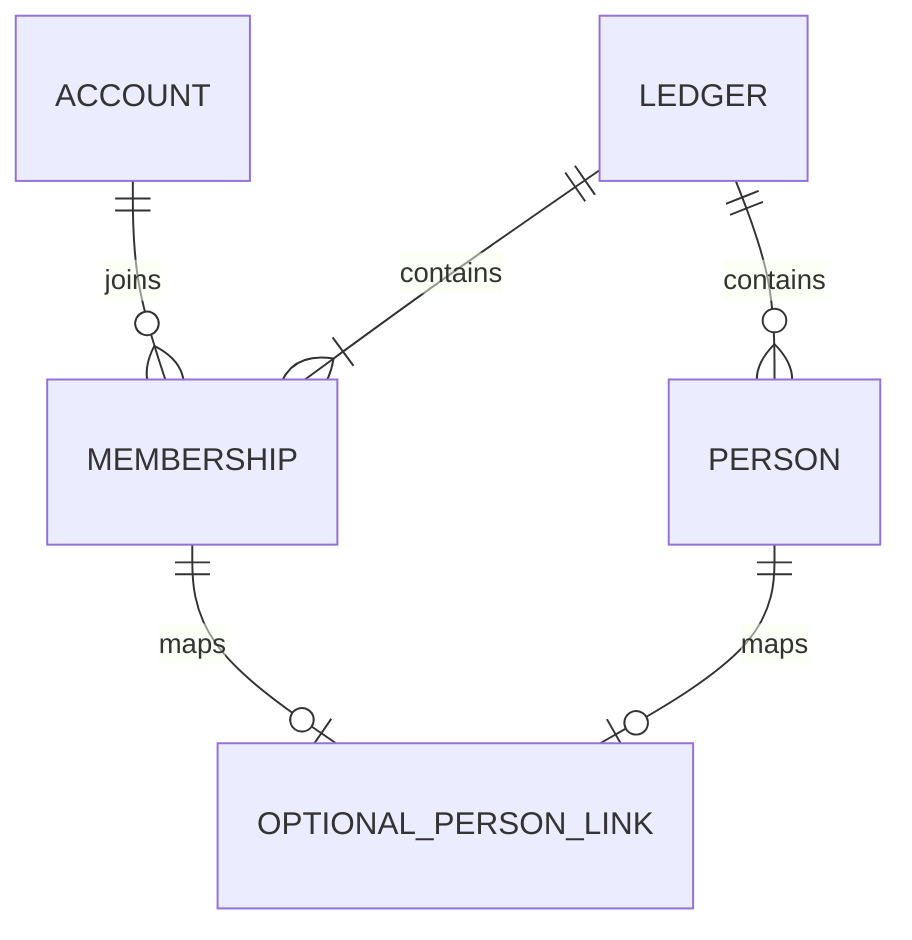

# 58 家計簿のDB・API基盤の設計案

更新: 2026-10-27。**レビュー用の設計案。未実装であり、作成時の動作・任意の1対1対応・既存DBの一度きりのSQL移行は利用者確認済み。その他の技術提案・保留事項を確定仕様として扱わない。** 新規導入・所属・権限・人物対応をここに集約する。

## 確定済みの前提

- SQLiteは1ファイル。認証アカウントは全体、家計簿・人物・業務マスタ・取引は家計簿ごとに管理する。同じアカウントの複数参加を認める。
- 全登録利用者が家計簿を作成できる。家計簿の参加招待と、全体管理者によるアカウント登録招待は別の操作。
- 家計簿の権限は閲覧者・編集者・管理者。招待を受けて参加した人は閲覧者。全体のAdminロールを家計簿の権限へ読み替えない。
- アカウントと人物は別管理。家計簿管理者が任意に対応を設定する。人物だけの登録、人物との対応なしでの登録・ログインを認め、名前一致で自動対応しない。
- 編集者は自分の支払方法を編集でき、管理者は他人のものも編集できる。振替は両側の編集権限を確認する。これをレシートの使用可能な支払方法や全業務操作の権限へそのまま広げない。
- 通常操作では最後の有効な家計簿管理者を保護する。紛失・復元等の緊急復旧中はログイン可能な管理者が一時的に0人でもよい。

## 今回確定した仕様（DEC-046）

| 項目 | 仕様 | 状態 |
| --- | --- | --- |
| 家計簿作成 | 入力は名前だけ。作成者を家計簿管理者にし、人物・支払方法は自動作成しない | 利用者確認済み・未実装 |
| 任意の人物対応 | 同じ家計簿では1アカウント0〜1人物、1人物0〜1アカウント。家計簿ごとに独立 | 利用者確認済み・未実装 |

以下の具体テーブル名・URL・保存方法はこの仕様を実現する技術提案。具体テーブル名等は引き続き設計案としてレビューする。家計簿名・人物名の文字数上限、メンバー一覧の閲覧範囲等の未確定事項は後述し、実装時に推測で埋めない。

親のアカウントだけが家計簿管理者として参加し、人物は子供だけを登録する構成も認める。親自身の人物登録・紐づけや、子供のアカウント作成は不要。家計簿を操作するアカウントと記録対象の人物を分け、人物対応の有無を管理権限の条件にしない。

## 保存構成案

認証ストアは引き続きアカウント・鍵・セッションを保存する。家計簿用のモデルと権限確認は`Features/Monetail`へ配置し、認証基盤から家計簿の参加者・人物を参照しない。SQLiteの接続と移行はDB全体で管理する。複数のDbContextを使う場合も、書込をまたぐ処理は同じ接続・トランザクションを共有する設計とし、移行履歴と適用順を初期化設計時に確定する。

| テーブル案 | 主な列 | 主キー・制約 |
| --- | --- | --- |
| `ledgers` | `id`, `name`, `created_by_auth_user_id`, `created_at_utc`, `revision` | `id`が主キー。作成者は認証アカウントへRESTRICTのFK |
| `ledger_members` | `ledger_id`, `auth_user_id`, `role`, `joined_at_utc`, `revision` | 家計簿ID＋認証IDが主キー。家計簿・認証アカウントへFK。roleはViewer / Editor / AdminのCHECK |
| `ledger_people` | `ledger_id`, `person_id`, `name`, `display_order`, `revision` | 家計簿ID＋人物IDが主キー。家計簿へFK。名前を一意キーにしない |
| `ledger_member_people` | `ledger_id`, `auth_user_id`, `person_id`, `revision` | 家計簿ID＋認証IDが主キー、家計簿ID＋人物IDをUNIQUE。参加者と人物へ同じ家計簿IDを含む複合FK |
| `ledger_creation_requests` | `request_id`, `actor_auth_user_id`, `ledger_id`, `requested_name`, `created_at_utc` | 要求IDが主キー、作成した家計簿IDはUNIQUE。操作者と家計簿へFK |

- IDはサーバー生成のランダムなUUIDをTEXTで保持し、日時はUTC。名前の前後空白を除く案とし、空白のみは拒否する。同じ名前でもIDで区別し、既存家計簿・人物へ統合しない。
- 表の列は原則NOT NULL。人物未対応は対応表の行なしで表現し、人物のない参加者やアカウントのない人物を自然に扱う。
- FKは原則RESTRICTとし、人物や参加者への操作から業務データ・認証アカウントを連鎖削除しない。参加者を除外するときの対応行の解除は同じトランザクションで行う案。人物の削除・退会履歴・過去入力者の表示は後続設計。
- `ledger_members(auth_user_id, ledger_id)`に一覧用索引を設ける。家計簿内の役割変更等は`revision`を照合し、更新成功時に新しい値を保存する。
- `ledger_creation_requests`は現在のアカウント発行と同じ再送識別の考え方。処理した名前も保持し、同じ要求IDで異なる内容を送っても別の家計簿を作らない。
- 業務マスタ・取引の新スキーマは別途設計する。支払方法等は所属を複合FKで検証できるようにし、親レシートと明細・対象者等にも他家計簿を参照させない。現行Windows用テーブルへ今回の列を直接追加する案ではない。



図の任意の1対1は利用者確認済み。FKは家計簿をまたぐ対応を拒否できるが、「管理者1人以上」は単純なFKで表せないため書込時に確認する。

## 家計簿作成と再送

1. 有効なログインアカウントであることを確認し、名前とクライアント生成の空でない`requestId`を受け取る。作成者ID・role・人物IDを入力から受け付けない。
2. SQLiteの書込トランザクションで、操作者が現在も有効で同じセッションが利用可能か確認する。
3. 要求IDが未処理なら、家計簿・作成者のAdmin参加・要求記録を同時に保存する。どこかで失敗した場合は全て戻し、管理者のない家計簿だけを残さない。
4. 確定前にもセッション・利用可否を確認する。生コードや家計簿参加用の招待はこの操作では発行しない。
5. 同じ操作者・要求ID・名前の再送は同じ家計簿IDを返す。別操作者または異なる名前は409とし、元の家計簿情報を返さない。別の要求IDは別操作として扱う。

作成者が参加者から外れた後に同じ要求を再送した場合、家計簿情報の再表示は現在の参加権限も確認して拒否する。要求記録だけを根拠に閲覧権限を復活させない。家計簿削除APIは初回実装に含めず、要求記録の保存期間・将来の削除時の再送扱いは削除設計時に決める。

## API案と認可

| メソッド・パス案 | 条件・用途 |
| --- | --- |
| `POST /ledgers` | 有効な登録アカウントが名前・requestIdを送り、家計簿を作成。初回201、同じ要求の再送200 |
| `GET /ledgers` | 自分が参加する家計簿だけを返す。未参加なら空配列。全体Adminでも他家計簿を含めない |
| `GET /ledgers/{id}` | 現在の参加を検証し、家計簿名・自分のrole・revision等を返す |
| `GET /ledgers/{id}/members` | 参加者一覧。公開項目は当該家計簿のメンバーのID・表示名・role等に限定。閲覧できる役割は要確認 |
| `PATCH /ledgers/{id}/members/{accountId}` | 家計簿管理者がroleとrevisionを送る案。最新の権限・最後の管理者・競合を検証 |
| `PUT /ledgers/{id}/members/{accountId}/person` | 家計簿管理者が同じ家計簿の人物を指定し、任意の対応を設定する案。既存対応の無断上書きは409 |
| `DELETE /ledgers/{id}/members/{accountId}/person` | 家計簿管理者がrevisionを照合して対応だけを解除する案。認証アカウント・人物は残す |

後半のメンバー管理・人物対応は家計簿作成に続く設計対象で、未確認の権限や人物CRUDまで実装する許可を意味しない。参加者追加は家計簿招待の受領で行い、任意のアカウントID指定による直接追加APIは作らない。招待発行・受領APIは期限等の仕様確定後に別途定義する。

- 作成を除き、対象家計簿の現在の参加・roleを要求ごとにDBで確認する。Cookieの全体Adminやクライアントのroleを信用しない。
- 未認証・セッション失効・利用停止は401。未参加と不存在の家計簿は同じ404、参加済みで役割不足は403、古いrevision・対応の重複・要求IDの競合は409とする案。
- 全体のアカウント検索・一覧・存在照会を家計簿管理者へ追加しない。人物名・表示名からの照合も行わない。
- 書込時はDBの最新の参加・権限・対象所属をトランザクション内で再確認する。最後の有効な管理者の同時降格・除外は、同じ書込ロック内で確認し、片方しか成立させない。
- 全体のアカウント停止と家計簿管理者保護の関係、緊急時の家計簿管理者復旧は別途具体化する。既存の全失効コマンドへ、今回新しい家計簿参照を加えない。
- 新しい経路にも固定HTTPS・ホスト検証・no-store・Origin・CSRF・本文上限・障害時拒否を適用する。現行の共通HTTP境界は`/auth`と`/admin`だけを対象にしているため、そのままで保護できるとは扱わない。レート制限と重要操作の直近本人確認はAPI詳細設計で確定する。

## 新規利用の方針（DEC-037〜046）

新規利用を基本とし、アカウントは家計簿未参加でも登録・ログインできる。全体管理者だけがアカウント一覧から新規登録を招待し、家計簿の参加者画面にアカウント登録招待の入口を増やさない。通常の登録で全体Adminを付与しない。

ログイン画面の「招待コードで登録」から、コード・本人の表示名・パスキー登録を経て明示ログインする。未登録者が家計簿参加の招待を受けた場合も、先に全体管理者の招待でアカウント登録・ログインし、その後に参加を確定する。参加招待だけでは新規アカウントを作らない。将来の招待期間は未決定であり、現在の登録コードの10分をそのまま採用済みとは扱わない。

人物・支払方法・分類等のマスタは家計簿ごとに独立し、同名でも共有・統合しない。アカウント表示名と人物名も同期しない。家計簿が違えば任意の人物対応は独立する。初期マスタ・設定画面・入力開始条件は後続設計とし、店舗マスタなしで入力できる方針は維持する。特定人物のデータの閲覧・編集範囲や、複数対象者の明細・集計の制限も後続とする。

新しい業務データの入力者・更新者はサーバーがログインアカウントの安定した識別子から決め、明細対象者とは分ける。表示名を本人識別のキーにしない。保存形式・名前変更時の履歴表示は未確定で、既存の`update_user`等は一括変換しない。

## 新規利用と既存DBの境界

想定する遷移は「明示初期設定 → 初回管理者登録 → 明示ログイン → 家計簿一覧 → 新規作成 → 家計簿ホーム」。複数参加でも一覧から選べる形を基本案とし、1件だけの場合の自動選択等は画面設計で決める。

新規DBには最初から家計簿行や人物を埋めず、認証登録後に家計簿作成を行う。通常起動・HTTP要求での自動初期化は採用しない。以下の初期化手順・移行構成は今回追加する提案であり、確認前に実装しない。

現在の`AuthDatabaseMigrator`は`m_user`・`t_receipts`を検査し、接続もReadWriteに固定している。さらに`auth_user_links`と発行履歴の旧`UserCode`が`m_user`を参照するため、存在チェックだけを緩めても新規導入にはならない。人物のダミー行・仮の業務表は作らない。

既存Windows版DBの引継ぎは、新構成確定後に一度きりのSQLを手動適用して行う（DEC-047）。APIは移行後の新構成を扱い、新旧DBを切り替える設定・互換モデル・専用の移行画面やAPIは追加しない。以下は移行手順の骨子であり、移行SQL自体は新スキーマ確定後に作成する。

1. サービスを停止し、既存DBをバックアップして作業コピーを用意する。
2. 作業コピーへ、アカウント登録に必要な新構造を準備するSQLを適用する。EFの移行履歴は実際に適用した定義と対応させ、未実行の移行を適用済みにしない。
3. 管理者・利用者のアカウントを通常の登録処理で作り、生成されたアカウントIDを確認する。認証情報・パスキーを手動で作らない。
4. アカウントID・対象家計簿ID・旧人物コード等をSQLに明示して、参加者・人物対応・既存の業務データを新構造へ移す。人物名による自動照合や、人物名のアカウント名へのコピーはしない。
5. 件数・金額・型・外部キー・関連付けを合成データで事前検証し、実際の作業コピーでも照合してから切り替える。失敗したコピーに推測でSQLを重ねず、バックアップからやり直せる手順にする。

保存済み`receipt.total`（NULLを含む）・過去の更新者・業務値は再計算・補正しない。旧認証データがある場合も無断で削除・改変しない。移行SQLは登録されたアカウントのIDを対応先として使い、アカウントのID自体を書き換えない。構造準備とデータ移行を分け、既存DBへのSQL適用を通常の初期化コマンドに混ぜない。

### 新規DBの移行構成案

- 新規API用の`ApiDbContext`と初期移行を用意する。Identity・登録コード・セッション・アカウント発行履歴を作成し、`m_user`・`auth_user_links`・発行履歴の旧`UserCode`はモデルにも新規DBにも含めない。家計簿の表は家計簿機能の実装時に追加する。
- 新規DB全体を1つのEF移行系列で管理し、専用の`__MonetailMigrationsHistory`へ記録する。後続の家計簿移行もこの系列に追加する。認証・家計簿のモデル設定は各責務に置き、移行の適用順は共通の永続化層が管理する。
- 新構成の実装では、旧`m_user`への参照を認証モデルから外し、旧DBへの通常接続経路を維持しない。適用済みの旧移行ファイルや既存DBは今回変更せず、旧構造からの引継ぎは上記SQL手順で扱う。旧移行を新規DBへ再実行したり、DBの表から新旧構成を自動選択したりしない。
- 通常接続はReadWrite・FK有効とし、初期化コマンドだけが新規ファイルを作成できる。初期化では未移行の旧DB・未知の移行ID・将来版のDBを書込み前に拒否する。移行作業中の新旧表の共存や最終的な旧表の扱いは移行SQLの設計対象で、APIに互換モードを設ける理由にはしない。

### 初期設定コマンド案

新規導入ではAPIを停止し、書込可能な既存の親ディレクトリと永続領域を用意してから、次の順に実行する。`initialize-db`は未実装。既定Composeのマウント設定等は[42](42-api-foundation.md)にある現状を変更済みとは扱わない。

```sh
dotnet run --project src/Monetail.Api -- initialize-db
dotnet run --project src/Monetail.Api -- initialize-admin
```

| 操作案 | 対象・成功時の動作 |
| --- | --- |
| `initialize-db` | 未存在・空のファイル、または検証済みの新規API系列だけ。初期作成／未適用の移行を行い、完了した移行IDを表示する。管理者・コード・家計簿・人物は作らない |
| `initialize-admin` | 新規系列の移行完了を確認して既存の管理者作成処理を使う。管理者・Adminロール・登録コードのハッシュを同じトランザクションで保存する |
| 既存の登録・復旧コマンド | 新規系列でも同じ認証処理を利用する。コード再発行・全失効・復元後リセットの条件や生コードの取扱いは[42](42-api-foundation.md)を維持する |

現行`migrate-auth-db`の動作は[42](42-api-foundation.md)のとおり。新構成の運用手順には組み込まず、既存DBの引継ぎに常設コマンドを追加しない。既存の認証・復旧処理は新構成へ接続する。

初期化対象は永続化するSQLiteファイルとする。親ディレクトリは自動作成せず、既存ファイルを削除・置換しない。空DBは利用者定義の表・ビュー・索引・トリガーも移行履歴もない状態とし、不明な既存オブジェクトを消して空にしない。

管理者が既にある場合、`initialize-admin`の再実行は変更なしで成功し、生コードを再表示しない。初回登録前でも管理者を増やさない。コードの期限切れ・出力紛失は、同じアカウントIDへの既存の再発行操作で回復する。管理者の保存成功後に出力が失われた場合もIDを調べられるよう、再実行では既存の管理者IDを表示する案とする（コードは表示しない）。自動ログイン・自動全失効は行わない。

### 途中失敗・再実行

| 状態 | 再実行時の扱い案 |
| --- | --- |
| ファイル作成直後・移行前に停止 | 空DBとして検証できれば初期移行から再開。失敗時もファイルを勝手に削除しない |
| 移行途中に通常の例外 | 各移行のDDLと履歴を同一トランザクションで戻し、完了済み移行の次から再開。初期移行ではトランザクション外SQLを使わない |
| 移行後・管理者作成前に停止 | DB準備は変更なし。`initialize-admin`を実行する |
| 管理者保存前／保存後に停止 | 保存前は全体をロールバック、保存後は同じ管理者を維持。再発行は明示操作のみ |
| 移行ロック残留・構造と履歴の不一致・未知の表 | 自動修復・ロック削除をせず失敗。停止・バックアップ後に調査する |
| 同時実行 | 初期化のDB検査と移行を排他化し、ロック取得後に再検査する。履歴・管理者の重複を作らず、待機期限内に取得できなければ失敗する |

正しい新規DBとして再開できる条件は「既知の移行履歴が適用順の先頭から連続し、その段階の表・列・索引・FKと一致すること」。空DBと、EFが作成した履歴／ロックの管理表だけが残る状態も区別して検証する。未適用の移行だけでなく未知の履歴を確認し、`GetPendingMigrationsAsync`だけで適用済みと判断しない。CLIの非待受・終了コード・タイムアウトは[42](42-api-foundation.md)の既存契約を使う。

実装時は合成データと実SQLiteで、空ファイル／未存在からの準備、初回登録・ログイン、新規系列のモデルと移行の一致、再実行、移行・管理者保存前後の失敗と再開、同時実行、別用途・旧DB・未知／将来の履歴・不完全スキーマの拒否、通常起動とHTTP要求の作成／移行0回を検証する。拒否対象と旧DBは既存値・型・スキーマ・保存済みtotalの不変も確認する。今回は設計のみで、これらを実施済みとは扱わない。

## 実装順と受入条件

1. 上記の新規DB初期化案を確認し、DB準備・移行系列と既存の初回管理者登録の接続を実装する。
2. 確定した作成時の動作と任意の1対1を前提に、名称の入力制約と家計簿作成・参照APIの保護条件を確定する。
3. 家計簿・参加者・作成要求記録の移行を追加し、作成・自分の一覧・個別参照を実装して画面へ接続する。
4. 家計簿招待の仕様、人物管理と任意対応、メンバー権限変更を順に具体化する。
5. 業務マスタを用意し、レシート、次に振替の入力へ進む。

実装時には、作成者の権限・原子的保存・同時作成と再送・別アカウントへの結果非公開・未参加家計簿の拒否・全体Adminの非特権化・保存途中の失効・最新role・同時降格・他家計簿の人物指定・対応の重複と解除を合成データで検証する。新規DBの準備と旧データ保持の移行はそれぞれ実SQLiteで確認する。今回は文書変更だけであり、これらの機能テストを実施済みとは扱わない。

## 後続で確定すること

名称の文字数上限、人物作成・変更の権限、メンバー一覧の閲覧範囲、家計簿参加招待の期限・共有／対象固定・取消・再送、退会・除外と再参加の履歴、全体の利用停止と家計簿管理者保護、入力者／更新者の保存・表示、マスタ初期値、家計簿の改名・削除・画面の細かな遷移は保留。この案のテーブルやAPIを、それらまで完成した仕様とは扱わない。
