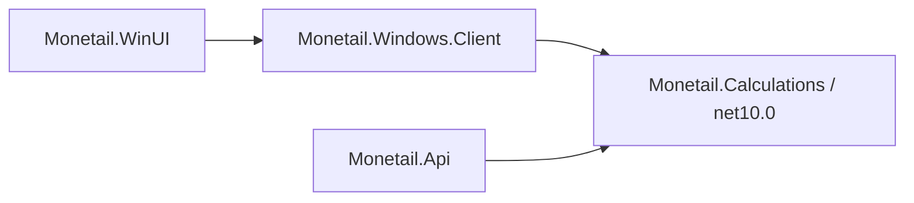

# APIの構成・責務と依存

[← 04 全体構成の入口](04-architecture.md)

同じリポジトリの`src/Monetail.Api/`にC#／ASP.NET Core／.NET 10 LTSの独立プロジェクトを置く。Windows版のプロジェクト・モデルは参照しない。API専用SQLiteの初期化と初期管理者・登録コード発行を専用コマンドで行い、通常起動ではDBを自動作成・移行しない。既存Windows版DBの一度きりのSQL引継ぎと、Windows版を先にAPIへ接続する方針は[58](58-ledger-foundation-design.md)を参照する。リポジトリ直下にSDKを固定する`global.json`は置かず、API用CIでは.NET 10 SDK、既存テスト用CIでは従来の.NET 8 SDKを使う。認証の現行契約は[43](43-passkey-authentication-design.md)、起動・DB準備は[42](42-api-foundation.md)を正本とする。

## 共通計算の参照関係（工程6-D4-B実装済み）

`Monetail.Calculations`は入力/解析/結果/例外モデル、入力単独の検証、レシート計算を保持する。BCL以外のパッケージやAPI/Client/DB/認証/HTTP/WinUIへの依存を持たない。APIとClientは同じプロジェクトを参照し、計算式を複製しない。計算契約は[レシートAPI](ledger-receipt-api.md#金額計算参考額dec-156157)を参照。

APIの`ReceiptCalculator`/`ReceiptValidation`は薄いアダプターとして既存の呼出しを維持する。計算用の型は`Monetail.Calculations.Receipts`へ移動し、API内部では型エイリアスを使う（HTTP DTOではない）。`ReceiptMasterData`と`IncomeExpenseKind`に基づく科目/費用区分/取引日の税率照合はAPI側に残し、共通の`IReceiptValidationChecks`で基本検証の元の位置から呼ぶ。マスタ検証を最後へ移すことで最初のエラーが変わることを避ける。最新マスタの取得・有効期間/所属・認証/参加/権限・トランザクション・HTTPエラー変換は既存APIの責務のままとする。

## APIの責務と依存

| 配置 | 責務 |
| --- | --- |
| `Authentication` | パスキー・Cookie／OAuth・セッション・失効と認証用保存モデル。家計簿の機能フォルダを参照しない |
| `Features/Accounts` | 全体のアカウント一覧・初回発行・再発行。認証基盤を使う |
| `Features/Monetail/Ledgers` | 家計簿の作成・参照・開く、人物・参加者・人物対応・招待のAPIと保存モデル・制約。業務取引と各管理画面は後続 |
| `Features/Monetail/Operations` | 家計簿・人物・招待の成功した作成要求を、共通6列で照合・保存する。結果IDへの削除制限FKを持たない |
| `Persistence` | API全体のDbContext・明示初期化と構造検証（正式リリース前はMigration/履歴なし、空DBを現行モデルから作成。リリース後からMigration導入）。認証・家計簿のモデルを構成し、同じ初回定義で管理 |
| `Program.cs` | 認証と各機能の登録・起動・管理コマンドの受付。家計簿の保護経路を認証のHTTP境界へ指定する |

別アプリは独立したアカウントを持ち、流用するのは認証コードとする。アカウント・鍵・セッション・権限の共有やSSOは採用しない。認証ライブラリの別プロジェクト化は必要時に検討する。

現行API契約は[認証API](auth-api-contract.md)、起動・運用は[42](42-api-foundation.md)、家計簿のAPIと後続設計は[58](58-ledger-foundation-design.md)。優先順位は[07](07-roadmap.md)だけに記載する。

### 後続の責務分離案（未了承・未実装）

アカウント・家計簿内の業務・両者を結ぶ処理を、コードの責務として明示的に分ける案。現行の配置は上表のとおり。今回はLedgers内に各操作のファイル、Operationsに共通要求記録を追加した。以下の案による既存クラスの全面的な移動・プロジェクト分割は実施していない。

| 責務の区分案 | 主な内容 |
| --- | --- |
| 認証・アカウント | アカウントの登録・表示名・パスキー・ログイン・セッション・利用停止。家計簿や人物を参照しなくても成立する |
| 家計簿内の業務 | 人物・支払方法・分類・レシート・振替・残高・集計。家計簿に属する記録と業務ルールを管理する |
| アカウントと家計簿を結ぶ処理 | 参加・招待・家計簿内の役割・操作権限・人物との任意の対応・最終家計簿の選択。検証済みアカウントIDを使い、対象家計簿での操作を判断する |

認証基盤から家計簿へ依存させない方針は維持する。家計簿側は認証済みのアカウント情報を受け取り、参加・権限を確認して操作する。人物情報は人物編集、人物との対応は家計簿内の参加者編集で保存する。各画面の保存要求に対応する処理の中で、必要な検証・変更を同じトランザクションで完了する案とする。

この責務分離はDBの表数やHTTP要求の分割とは別に設計する。参加者表に人物IDを持つ採用方針と、編集を一括保存する契約は[58](ledger-persons.md#人物の管理dec-055未実装)を正本とし、コード上の責務を分けるためだけに対応表や追加のHTTP要求を作らない。具体的な配置・呼出し方向は、相互依存や中身の曖昧な共通処理を増やさない形で提案してから確定する。

