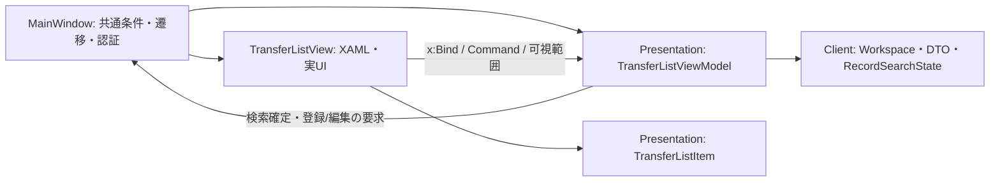

# 新Windows版 WinUI 3・Clientの構成

[← 04 全体構成の入口](04-architecture.md)

## 新版Windows版の構成

新版は**Windows 11のみ・.NET 10 LTS・C#・WinUI 3（Windows App SDK）**のアプリとする。プロジェクトは`src/Monetail.WinUI/Monetail.WinUI.csproj`。ターゲットは`net10.0-windows10.0.26100.0`、最小対応バージョンはWindows 11初版の`10.0.22000.0`。Windows App SDKは安定版1.8系列を使用する。初期ビルドと起動の検証はx64で行い、ARM64は未検証とする。

起動時の接続設定・ブラウザーログイン・保存ログインの復元・家計簿選択／作成／切替・ログイン情報・ログアウトを既存Clientへ接続済み。ホームと、左メニューを残した右側の人物一覧を表示する。起動中の待機表示も同じWindow内で扱い、具体的な表示・遷移は[58](ledger-windows.md#windows版の起動表示接続失敗時の操作)に従う。通常起動にサンプルデータは表示しない。人物の追加・編集・保存、日付/Enter入力、競合表示と同一アカウントでの再ログイン後の編集復帰を実装済み。人物削除の確認とAPI接続も実装済み。共通順設定と認証失効後の未保存順の復元も接続済み。

開発・CIでは非パッケージの自己完結した配置を使い、Windows App SDKと.NETランタイムを出力先に含めて起動を確認する。これは検証用の設定で、製品インストーラーの方式・更新方法・配布対象CPUを決定したものではない。WinUI 3のビルド・製品起動・同じXAMLによるスモークテストは専用の`.github/workflows/winui.yml`で行う。画像の取得は`preview/winui-*`ブランチでの単発実行に限定する。

API通信・認証・保存・日付と時刻の補完は`src/Monetail.Windows.Client/Monetail.Windows.Client.csproj`（`net10.0`）に分ける。画面はClientを参照し、入力欄・フォーカス・IMEは[59の入力仕様](59-input-controls-design.md)に従ってWinUI 3で実装する。API・認証契約・保存形式・通信単位を表示上の都合で変えない。旧VB.NET／.NET Framework 4.8は独立したアプリとして残し、新版から旧版の実行ファイル・プロジェクトを参照しない。レシート等の業務画面とインストーラーは後続とする。

画面、API通信、認証情報の保持を分ける。新版はAPI経由で読み書きし、画面へSQLやSQLite接続を持ち込まない。認証契約は[43](auth-windows-oauth.md#windows版のoauth認証dec-051)、起動時の遷移と段階移行は[58](ledger-windows.md#windows版のapi対応を先行する実装中)を正本とする。

通信回数をなるべく減らす。1つの操作で必要な処理と応答データをAPI側でまとめ、IDを取得してから同じ対象を再要求する往復を避ける。現在の認証・権限確認はAPI内部で維持し、振る舞いを変える統合は利用者の確認後に行う。

API接続先URLは、Windowsユーザーごとの`%LOCALAPPDATA%\Monetail\settings.json`に保存する。通常設定と認証情報は分け、JSONにトークンを含めない。認証情報は[43のDPAPI保存方針](auth-windows-oauth.md#windows版の認証情報保存)、初回入力と変更は[58の接続先設定](ledger-windows.md#windows版の接続先設定)に従う。

新版の変数・プロパティ・メソッド・クラス名は、意味と責務に合わせてC#の命名慣習で一から考える。既存フォーム・独自コントロールは操作・配置・計算条件を確認する資料として使い、必要な機能から実現する。機械的なVBからの変換を前提にせず、API対応と.NETの互換性を機能単位で確認する。業務モデルとDBの再設計方針は[58](ledger-foundation-core.md#新版の業務モデルdb設計方針未実装)を参照する。グラフ部品の選定とインストーラーの作成方式は実装前に具体化する。

## 家計簿選択画面の分離（第1段階）

`Views/LedgerChoiceView`が既存の家計簿選択XAML・単一選択状態・［開く］の有効化/クリックを所有する。公開面は一覧を受け取る`Ledgers`と選択IDを通知する`OpenRequested`の各1つ。選択はListViewに保持し、独立した選択モデルやMainWindowへの参照を持たない。MainWindowはClientからの取得、通知されたIDの`OpenLedgerAsync`、認証/未保存保護、画面遷移を担当する。UserControlはHTTP・認証・Windowを知らず、他画面にも依存しない。

MainWindowは内側のListView/ボタンに触れず、一覧設定とイベント受信だけを行う。元の標準コントロール・配置値・AutomationIdを維持し、余分なTab停止を追加しない。新しいViewModel・依存ライブラリ・ナビゲーション基盤は導入しない。家計簿作成/ホーム等は今回は分離しない。

| 計測対象 | 基点main `0e246d2` | 分離後 |
| --- | ---: | ---: |
| MainWindow.xaml（空行込み） | 987行 | 980行 |
| MainWindow*.cs全partial（空行込み、生成コード除外） | 4,504行 | 4,498行 |
| 家計簿選択画面の内側コントロールへの直接参照（名前の種類） | 2 | 0 |
| MainWindow.xamlのx:NameとMainWindow*.cs識別子の共通集合 | 298 | 296 |

最後の行はソースの名前一致による指標で、意味解析/生成コードの集計ではない。画面自体の`LedgerChoicePage`参照は1つのまま維持する。新規ViewはXAML17行＋C#31行、既存MainWindowの13行減と合わせて製品コードは差引35行増。行数削減自体よりも、画面の選択/ボタン処理をMainWindowから切り離したことを成果とする。検証の正本は[tests/README.md](../tests/README.md)。

## 科目一覧の分離（一覧だけ）

`CategoriesContent`は従来のGrid/表示境界のまま、その内側の一覧・フィルター・操作列を`Views/CategoryListView`へ移す。`CategoryDialog`・`CategoryOrderContent`・API・権限判定・競合/401復帰はMainWindow側に残す。Viewは全件データを同じ参照で受け取り、従来と同じ本日/両端含む期間判定と選択復元を行う。業務版・要求ID・権限・復帰情報は複製しない。

公開面は`Categories`（nullは従来の未取得/解除、空配列は取得済み0件）・`SelectedCategory`・`IncludeInactive`の3プロパティ、MainWindowが計算済みの2つの操作可否を渡す`SetActionsEnabled`、4操作＋選択変更の5イベント。9メンバー（コンストラクター除外）であり、イベント集約enum/ディスパッチャーや新ViewModel/DIはない。ViewからMainWindow/Workspace/他画面を参照しない。既存`CategoryRow`は順序画面とも共有するため移動しない。空一覧の表示属性は従来のDescriptionと同値でView内へ置き、MainWindowのローカルStyleに依存しない。

| 集計対象 | 基点main `aeb1a18` | 分離後 |
| --- | ---: | ---: |
| 製品WinUIの手書きC#/XAML総行数（空行込み） | 5,970 | 6,036 |
| MainWindow.xaml / 全partial C#行数 | 980 / 4,498 | 959 / 4,491 |
| 一覧内部へのMainWindow直接参照（名前の種類 / 出現数） | 7 / 17 | 0 / 0 |
| MainWindow科目関連の状態フィールド | 17 | 17 |
| Viewの追加データ参照 / boolフラグ | 0 / 0 | 1 / 0 |
| Viewの公開イベント / 公開API総数 | 0 / 0 | 5 / 9 |
| 対象内のXAMLイベント購読（内部＋境界） | 7＋0 | 7＋5 |

行数は`git ls-files src/Monetail.WinUI`の`.cs`/`.xaml`（生成物除外）。新ViewはXAML32＋C#62＝94行、MainWindowの28行減と合わせ差引66行増。直接参照は移管した7つのx:Nameの識別子一致数。状態はCategories/CategoryRecovery/CategoryOrderの明示フィールドを数え、生成コントロール参照とイベントdelegate backing fieldは除外する（追加delegateはイベント5件として明示）。選択/フィルターのNative状態は従来どおり各1つで複製しない。

残る依存は、MainWindowからの一覧更新・選択/フィルター参照・操作可否の反映と5通知、および既存CategoryRow/CategoryInfoの共有。MainWindowの業務状態17個は今回削減しない。全件参照とイベント境界が増える代わりに、直接のコントロール操作をViewへ閉じ込める。取得/解除は既存DisplayCategories/ResetCategoriesから同期する。検証は[tests/README.md](../tests/README.md)を参照。

## 振替一覧のMVVM移行（実装済み）

振替一覧を起点に、WinUI 3の画面固有処理を段階的にMVVMへ移行する。振替一覧については**既存の`TransferListState`を新ViewModelで包まず、状態管理を`TransferListViewModel`へ一本化した**。既存クラス・ファイルを維持することを目的とせず、表示仕様・API契約・失敗時の操作を維持して内部構造を組み直す。レシート一覧の移行は後節に記す。振替/レシートの入力画面、他の管理画面のMVVM化は別工程とする。

| 置き場所 | 役割 |
| --- | --- |
| `Monetail.WinUI/Views/Transfers/TransferListView.xaml` | 6列の一覧、見出し・登録・focus時の先頭復帰、読込中・空・エラー・再試行・続きを読み込む等の表示 |
| `Monetail.WinUI/Views/Transfers/TransferListView.xaml.cs` | WinUI固有のListView可視範囲・スクロール・フォーカス、画面遷移通知。Window内部コントロールへは依存しない |
| `Monetail.Windows.Presentation/Transfers/TransferListViewModel.cs` | `CommunityToolkit.Mvvm`による通知・Command、唯一の行コレクション・選択・一覧取得・カーソル・失敗/再試行・中断/再開・保存行の探索状態 |
| `Monetail.Windows.Presentation/Transfers/TransferListItem.cs` | API応答からの表示用投影（日時・振替元/先名称・金額・メモ）。マスタ名の再取得で必要な項目を更新できること |
| `Monetail.Windows.Client` | `TransfersWorkspace`、`TransferListQuery`、API DTO、認証例外と通信契約。移管後は一覧状態を二重保持しない |
| `MainWindow` | 共通年月・人物・支払方法・共通キーワードの適用、家計簿切替、入力画面への遷移、401認証復帰とWindow寿命 |

`Monetail.Windows.Presentation`は**WinUI 3を参照しない`net10.0`のクラスライブラリ**とし、既存Clientと`CommunityToolkit.Mvvm`を参照する。DIコンテナー、新しい汎用ナビゲーション/Service/イベント基盤は追加しない。ViewModelはコンストラクターで必要な依存を受け取り、`MainWindow`や`Microsoft.UI.Xaml`を参照しない。検索の適用済み条件は引き続き`RecordSearchState`を正本とし、ViewModel内に別の適用済みフィルター状態を複製しない。検索欄の未確定入力と適用済み条件は区別する。

### 公開インターフェースの境界

ファイル間の**機能と所有者**だけを固定する。公開名は実装に対応する。privateメソッドやイベントの型はこの境界内で必要最小限とする。外部から新しい汎用サービスやWindow全体を渡さない。

| 境界 | 公開する状態・操作の目安 | 公開しないもの |
| --- | --- | --- |
| `TransferListViewModel` → `TransferListView` | 読み取り専用の`Rows`、双方向の`SelectedItem`・`SearchText`、初回/追加読込・空・失敗と再試行可否・エラー文、登録可否、`Search`/`Retry`/`Continue`/`ReturnToStart`コマンド | `ScrollViewer`、`Visibility`などWinUI型や画面要素 |
| `TransferListView` → `TransferListViewModel` | 選択通知、可視最終行・領域が埋まったか・利用者の下方向スクロール意図の通知 | ScrollViewerそのものやXAMLの内部`x:Name`をVMへ渡さない |
| `MainWindow` → `TransferListViewModel` | 現行家計簿に対応する一覧開始/再検索（確定済み`TransferListQuery`を渡す）、保存行探索・再選択、画面離脱の`Suspend`と復帰の`Resume`、終了時の破棄、支払方法表示名変更の通知、登録可否の更新 | 同じ行コレクション/カーソル/選択をMainWindowでも保持しない |
| `TransferListViewModel` → `MainWindow` | 登録/選択行の編集要求（共通キーワード検索の確定はMainWindowから実行）、認証継続不可を判別する取得エラーの通知・参照 | Windowの画面遷移・ContentDialog・共通年月の直接操作 |
| `MainWindow` ↔ `TransferListView` | 編集画面との往復に必要な縦横スクロール位置の記憶・復元、選択行を必要なときだけ画面内に表示する操作 | ListView/ScrollViewerのインスタンスや内部ボタンを公開しない |
| `TransferListViewModel` → `TransfersWorkspace` | 既存`ListAsync(TransferListQuery, CancellationToken)`でデータ取得。支払方法名称は既存マスタから提供された読み取り手段で表示投影する | API認証・JSON・業務クエリ契約の再実装 |

**状態の正本**：

- 共通年月・人物・支払方法・両一覧の文字列検索の適用値は`RecordSearchState`と内包する`ReceiptSearchState`が正本。表示中の共通キーワード下書きは`MainWindow.RecordKeyword`に保持し、［検索］／Enterで`ApplySharedText`が年月を検証して両方へ確定する。個別VMの`SearchText`は互換の公開窓口として残すが各一覧に検索欄は置かない。振替保存後は`ApplySavedTransfer`の調整後に共通キーワードも両方へ同期し、Viewの表示値も更新する。
- 一覧データ・選択行・読み込み/失敗・後続カーソル・初回自動補充回数・要求世代・中断再開情報は**VMのみに保持**する。`SelectedItem`から振替IDを導出し、同じ選択を別フィールドでも常時保持しない。API実行中の固定クエリは遅延応答を判定するためのスナップショットであり、共通フィルターの新しい正本ではない。
- 表示用`TransferListItem`はAPI行の投影と、支払方法名の変更通知だけを持つ。新しい永続状態・業務検証・Commandを持たない。行を一意に特定できる振替IDは提供する。
- `TransferListView`は実コントロール、スクロールの一時位置・利用者操作意図・フォーカスだけを保持する。行・選択ID・ページングをView内に複製しない。既存Home領域とViewのインスタンスを維持して隠す/戻す際、選択と縦横スクロールを復元する。
- 登録ボタンの可否は既存の権限判定と編集中のオープン状態から**外側で確定した結果**をVMへ渡してバインドする。VMに認証/権限の別判定を実装しない。取得401の認証画面遷移もWindowの責務で、VMから直接`NavigateToLogin`しない。

**操作の流れ**：

1. 共通フィルター変更 → MainWindowが確定条件を生成 → VMが旧要求を無効化して一覧先頭からGET → `Rows`と表示状態をバインド更新。共通キーワード欄の［検索］／EnterはMainWindowが共通年月の入力検証も行い、レシート・振替の両一覧を再取得する。IME変換中のEnterで検索しない。
2. 一覧の下方向スクロール/サイズ変更 → Viewが可視行・領域充足・利用者スクロールを通知 → VMが既存の先読み/最大300件仕様で必要な場合にのみ追加取得する。スクロール位置そのものはViewに残す。
3. 登録/編集 → VMの操作要求をMainWindowが受けて入力画面を開く → VMは中断し、必要ならViewが位置を記憶。保存/削除成功時はMainWindowが共通条件を調整後にVMへ確定クエリと保存ID（削除時は選択解除）を渡して一覧を更新。保存失敗時は一覧条件や選択を変更しない。
4. 一覧取得失敗 → VMが初回/追加の失敗状態を通知 → Viewが対応箇所に表示。認証失効の遷移だけMainWindowが判断する。家計簿/アカウント切替・ウィンドウ終了で中断/破棄し、旧レスポンスを反映しない。

**移行境界**：`MainWindow.Transfers.cs`の一覧固有処理、`MainWindow.xaml`の振替一覧領域、`TransferRow.cs`を新構成へ移し、`TransferListState.cs`と`TransferRow.cs`は実装・テストの移管完了後に削除済み。振替入力・保存・認証復帰が旧一覧の`x:Name`や内部フィールドを直接参照する箇所は、新Viewの必要最小限の公開操作に置き換える。途中段階で旧/新の二重取得や二重選択を残さない。共通フィルターやレシートには仕様変更を加えない。

**受入条件**：既存[振替画面仕様](ledger-transfer-ui.md)を維持する。特に初回最大300件補充、スクロール残り20行で追加100件、上限到達後の明示続行、`invalid_cursor`からの1回復旧、古い非同期応答の破棄、401による認証復帰、失敗したページだけの明示再試行、一覧復帰時の選択・縦横スクロール、保存行の探索/フォーカス、旧API順/検索条件、登録/編集への遷移を検証する。Clientの旧`TransferListState`直接テストは表示状態を対象とするものをPresentationのViewModelテストへ移し、`RecordSearchState`等Client契約のテストは残す。WinUIスモークは製品と同一XAMLをリンクし、既存の操作/AutomationIdを維持する。Windowsで製品・スモークをビルドして検証し、実施できない場合は未検証を明記する。

### 実装の所有者と構造比較

- `TransferListViewModel`は読取delegate・`RecordSearchState`・マスタ名称読取delegateを受け取る。`ObservableObject`/`RelayCommand`（CommunityToolkit.Mvvm 8.4.2）を使用し、WinUI/HTTP/認証の別実装を持たない。`Rows`は単一`ObservableCollection`の読取専用ラッパーで、`SelectedTransferId`は`SelectedItem`から導出する。`SearchText`には保存フィールドがなく、外部変更は`RefreshSearchText`で通知する。
- `SearchCommand`/`RegisterCommand`/`EditCommand`は`SearchRequested`/`OpenRequested`の2通知だけでWindowへ委譲する。検索中の新しい検索も許可し、旧取得の中断/世代照合はVMで行う。登録可否はWindowが既存ルールで計算した`CanRegister`。`RetryCommand`/`ContinueCommand`/`ReturnToStartCommand`と一覧取得世代・中断/再開・保存行探索はVMが所有する。探索中の未解決IDもVMにだけ保持し、通常の選択IDと二重管理しない。
- Viewの公開面は`ViewModel`、編集開始待ちのWindow所有UIを配置する`OpeningContent`（標準ContentControlの内容スロット）、`RememberPosition`/`RestorePosition`/`ObserveViewport`。ListView・ScrollViewer・検索TextBoxは公開しない。IMEと実スクロールの状態はViewへ移し、外側の共通Enter移動との二重処理を防ぐ。
- `MainWindow.Transfers.cs`は共通条件の確定、Workspaceの既存依存をVMへ渡す接続、外部権限による登録可否、認証例外による画面遷移だけを担当する。編集/保存/401復帰は同じView/VMを使い、検索条件を変更しない往復では行・選択・縦横スクロールを保つ。

| 集計対象 | 基点main `f7fb0e8` | 分離後 |
| --- | ---: | ---: |
| WinUI＋Client＋PresentationのC#/XAML総行数 | 10,161 | 10,479 |
| WinUIのC#/XAML行数 | 6,206 | 6,305 |
| MainWindow.xaml / 全partial C#行数 | 959 / 4,661 | 908 / 4,549 |
| MainWindowから一覧内部への直接参照（コントロール種類 / 出現数） | 13 / 29 | 0 / 0 |
| MainWindowの一覧用明示フィールド（編集側の保存行・表示位置を含む） | 11 | 0 |
| 行の格納先 | StateのDTO列＋Windowの表示列 | VMの表示列1つ |
| 選択の正本 | StateのIDとWindow/ListViewとの手動同期 | VMのSelectedItem（IDは導出、Viewへ双方向バインド） |

行数は各`src/Monetail.WinUI`/`Monetail.Windows.Client`/`Monetail.Windows.Presentation`の追跡済み`.cs`/`.xaml`、空行込み・生成物除外。差引318行増であり、コード量削減を成果としない。Viewの281行とPresentationの355行を追加し、旧State136行・旧Row19行を削除。MainWindowのXAML51行/C#112行減。移管対象のx:Nameの識別子一致で直接参照を数える（編集開始待ち4要素はWindow所有のまま対象外）。

状態が消えたのではなく、旧Stateの15格納箇所に対しVMは19箇所（追加は読取専用ラッパー・外部CanRegister、Windowから移した探索ID/探索中の2つ）。注入依存、イベントdelegate、Toolkit生成Command、UIの生成フィールドはこの数に含めない。Viewの明示フィールドは7つで、IME helper・ScrollViewer・実スクロール観測・復帰位置tupleを保持する。VMに行/選択/検索下書きのコピーはなく、Viewにも行/選択ID/カーソルを持たせない。

増えた依存はWinUI→Presentation→Clientと、Toolkitの通知/6 Command、2操作通知、Viewの2プロパティ/3操作である。共通条件・権限/認証・編集開始待ちのスロットはWindow、実表示位置はViewという境界の受け渡しは残る。汎用イベント/Service/DI基盤や、他画面のViewModel化は追加しない。関連テスト・CIと未検証事項は[tests/README.md](../tests/README.md)を参照する。

### 一覧Viewの観測境界

- `ModelChanged`は保存行探索による非NULLの`SelectedItem`変更だけを監視し、同じVM/行であることを予約実行時にも確認して表示する。`SearchText`/`CanRegister`等の通知では測定しない。XAMLの`x:Bind`通知は独立して維持する。
- 可視範囲は既存の`Rows.CollectionChanged`、`Loaded`、`ScrollViewer.ViewChanged`と`ListView.SizeChanged`、Windowからの表示復帰要求で測る。常時の`LayoutUpdated`は使用しない。既存の低優先Dispatcher要求へまとめ、`UpdateLayout`完了後に行範囲/スクロール領域を読む。レイアウト確定中の通知も同じ要求へまとめる。`Loaded`時点の参照を固定せず、確定後の現在のScrollViewerと異なる場合だけ旧購読を解除して接続し直す。タイマーや新しい状態フィールドは追加しない。
- 保存行の`ScrollIntoView`はViewの選択通知に一本化し、保存処理からの重複呼出と公開`ScrollSelectionIntoView`を削除した。表示位置復元と保存行表示の前に操作意図を解除し、プログラムによるスクロールを追加取得の操作とみなさない。利用者のホイール/バー/キー/タッチ開始を表す既存フラグは残す。
- 登録Buttonの有効状態は`RegisterCommand.CanExecute`だけで制御し、重複する`IsEnabled`バインディングを削除した。登録可否の計算、編集中の一覧非表示と編集開始ガードは既存のまま。

レビュー修正の基点`b71c7fa`との比較では、ViewのXAML/C#は261→281行、製品全体は19行増。明示フィールド7つ（bool 3つ）は不変、公開操作4→3（代わりにprivateの`ConnectScroller`を追加、総メソッド数は不変）、保存行の表示要求元2→1、全プロパティ通知からの測定を0にした。行数を減らすための変更ではなく、観測対象・表示要求の所有者を絞り、遅延実行時の対象確認とレイアウト確定を明示する変更である。

## レシート一覧のMVVM移行（実装済み）

PR #202の振替一覧と同じ責務境界へ移行し、旧`ReceiptListState`を包まず取得状態を`ReceiptListViewModel`へ移した。表示と操作の正本は[レシート画面](ledger-receipt-ui.md)であり、本節は構成だけを定める。

| 所有者 | 担当 |
| --- | --- |
| `Views/Receipts/ReceiptListView.xaml/.cs` | 既存6列・見出し・登録・focus時の先頭復帰・読込/空/失敗/再試行/続行、可視範囲と実スクロール・フォーカス・縦横位置の記憶/復元 |
| `Presentation/Receipts/ReceiptListViewModel` | 唯一の表示行コレクション・選択、取得世代/カーソル、100件取得・300件補充・20行先読み、中断/再開・1回カーソル復旧、通知と5 Command |
| `Presentation/Receipts/ReceiptListItem` | 保存済み応答の表示用投影。ローカル秒精度・NULL・保存済み合計額を保持し、マスタ名称だけ再表示。独自ソート/再計算なし |
| `MainWindow.Receipts.cs`等 | `RecordSearchState`、共通年月/人物/支払方法、検索確定、共有マスタ取得、Workspace接続、登録可否・編集遷移・認証/Window寿命 |
| `Windows.Client` | `ReceiptsWorkspace`・Transport・DTO・検索契約・認証/書込。`ReceiptSearchState`は共通`RecordSearchState.Receipts`のまま |

Viewは`ViewModel`/`OpeningContent`の2プロパティと`RememberPosition`/`RestorePosition`/`ObserveViewport`の3操作だけを公開する。WindowやClientSession、一覧内コントロールは渡さない。編集開始待ちUIはWindowの名前スコープ/所有権を維持した内容スロットに置き、そのVisibilityにラッパーも追従して従来の間隔を維持する。

VMの`Rows`は単一`ObservableCollection<ReceiptListItem>`の読取専用窓口。`SelectedReceiptId`は`SelectedItem`から導出し、ListViewへ双方向バインドする。旧WindowのDTO→表示行同期と選択ID同期は削除した。`SearchText`は`RecordSearchState.Receipts.ShopText`の窓口で別の格納先を持たないが、現行WinUIの共通キーワード検索はWindowが直接確定する。要求中の`conditions`はカーソル/世代に結び付いた読取スナップショットであり、新しい編集用フィルターではない。

`SearchCommand`/`RegisterCommand`/`EditCommand`と2通知（`SearchRequested`/`OpenRequested`）を使用する。登録可否は従来のWindowルールを`CanRegister`へ渡す。登録/編集の進行中ガードもWindowの既存`receiptOpening`等が正本であり、取消済みの旧HTTP応答待ちをCommandの別ガードとして残さない。検索の競合はVMの世代管理で、編集開始の競合はWindowの既存照合で処理する。`RetryCommand`/`ContinueCommand`はVMの現在状態に従う。

可視範囲はRows/Size/Loaded/ViewChangedと復帰時の明示要求で測定し、全プロパティ通知や常時LayoutUpdatedには依存しない。既存の低優先Dispatcher要求へまとめ、レイアウト確定後に現在のScrollViewerへ接続する。ViewportFilledの変化はViewportFilled/CanContinueと続行Commandだけへ通知する。復元時は利用者の操作意図を解除し、自動補充上限を解除しない。

退避は`Suspend`、明示破棄は`Dispose`と区別する。旧Windowが行っていた表示行クリアはVM.Disposeへ移し、所有する行・選択をクリアする。nullのバインド更新だけに頼らず、ログアウト後に古い行を残さない。通常の画面往復・同一アカウントの編集401復帰では元のView/VM/入力コントロールを保ち、既存の復帰・未保存保護を変更しない。全体保存/削除の画面接続は引き続き後続であり、保存ボタンは無効。振替保存後のレシート再取得は新VMのStartAsyncへ接続する。

### 構造比較

基点main `f9b40df`との比較。追跡済みC#/XAMLの物理行（空行込み・生成物除外）を数える。

| 対象 | 前 | 後 |
| --- | ---: | ---: |
| WinUI＋Client＋Presentation総行数 | 10,481 | 10,822 |
| WinUIのC#/XAML行数 | 6,305 | 6,481 |
| MainWindow XAML / 全partial C# | 908 / 4,549 | 840 / 4,529 |
| MainWindowから移管した一覧内コントロールへの直接参照（種類 / 出現数） | 12 / 24 | 0 / 0 |
| 一覧/共通フィルター用Windowの明示格納箇所（編集側の復帰位置を含む） | 13 | 4 |
| 一覧状態モデルの格納箇所 | 旧State 15 | VM 17 |
| Viewの明示フィールド | 0 | 7 |
| 実際の行コレクション | StateのDTO列＋Windowの表示列 | VMの表示列1つ |

総行数は341行増、MainWindowはXAML68行/C#20行減。変更した橋渡し行の複数文を改行した分も含む。View282行、VM262行、Item18行を追加し、旧State115行と旧Row（共通選択肢型を含む）26行を削除、共通選択肢型8行はWindow側へ残した。行数削減そのものを成果としない。

格納箇所は明示フィールド/自動プロパティの保存先を数え、注入依存・イベントdelegate・Toolkit生成Command・生成UIフィールドは除く。旧State15＋Window13＝28に対しVM17＋View7＋Window4＝28。VMへの追加2つは同じ行列の読取専用ラッパーと外部登録可否であり、選択IDと検索下書きは複製しない。Viewの復帰位置は縦横のtuple1つとして数える。Windowに残る4つは共通検索、マスタ取得寿命、共通フィルターのキーボード、フィルター更新ガード。編集開始待ち4要素と共通フィルターは意図的にWindowへ残し、一覧内部の直接参照集計からは除く。

新しい業務フレームワーク・Service/DI・外部パッケージはなく、既存WinUI→Presentation→Clientの参照を使う。Viewの3操作と2内容プロパティ、VMの2通知/読取・名称delegateの受け渡しは残る。旧VBの6列表示・選択/ダブルクリックの実装を照合し、単一Windowとページングは新版の既存DEC-162/236等を優先して維持した。新しい旧版互換処理は追加しない。

## レシート・振替のViewModelページング共通化（実装済み）

`Presentation/Lists/CursorListViewModel<TItem>`の1段だけの共通基底に、行コレクション/選択、読込/失敗状態、カーソル、世代/キャンセル、中断要求、補充予算と通知/Retry/Continue Commandを集約した。各VMがこの状態を直接継承し、別のPagerとVMで行・選択・フラグを同期しない。共通処理はWinUI型・HTTP・Client DTO・業務検索条件を参照せず、表示行の列と不透明な次カーソルを受け取る。

100件単位の取得は既存Workspace/Transportの契約を維持し、共通VMは初回300件（追加補充2回）・末尾20行を判断する。中断した要求は同じカーソル/補充種別で再開し、成功時だけ予算を消費する。失敗後は手動再試行、invalid_cursorは検索開始ごとに1回だけ先頭へ戻る。古い応答は表示行への投影前に拒否する。ViewportFilledだけの変更は従来どおり依存プロパティとContinue Commandだけに通知する。

各VMに残すものは、型付きクエリの読取スナップショット、APIエラーから共通の失敗/カーソル不正/先頭再読込への分類、DTO投影・名称/エラー文、検索/登録/編集の通知。`RecordSearchState`、登録可否の計算、認証遷移と未保存保護は既存の所有者を維持する。未知のプログラム例外は取得失敗へ変換せず伝播する。

保存行への移動は両一覧で共通の要件として実装済み。`CursorListViewModel`が探索対象/探索中状態、最大300件探索、focusへの切替、選択、探索のキャンセル・中断再開/再試行を所有する。各VMは対象行のID照合、型付きfocusクエリ、現在の確定条件での再試行だけを実装し、探索ループや取得状態は複製しない。focusの404は各VMが既存の共通先頭復旧へ分類し、通常cursorの404と区別する。レシートfocusReceiptId APIと探索は接続済みだが、保存UIと保存後の検索条件解除は未接続/未決定のまま。正本は[レシートAPI](ledger-receipt-api.md)・[画面](ledger-receipt-ui.md)を参照。

退避時は行/選択を保持し、破棄時のクリア方針は各VMの既存Dispose契約を維持する。特にレシートの明示クリアをSuspendへ混ぜない。WinUIのView・スクロール/IME、MainWindow、Client/API/DBに変更はない。共通基底1つとページ結果/失敗分類だけを追加し、設定クラス・DI・新しいライブラリはない。

| 集計対象 | 基点main `a7c3dc5` | 共通化後 |
| --- | ---: | ---: |
| 両VM＋共通基底の製品C#（空行込み） | 595行 | 514行（基底246＋Receipt91＋Transfer177） |
| WinUI＋Client＋Presentationの手書きC#/XAML総行数 | 10,777行 | 10,696行 |
| 状態の宣言箇所（注入依存・イベント・生成Commandを除く） | 36 | 21（共通15＋Receipt2＋Transfer4） |
| 実行時の保持箇所（Receipt / Transfer） | 17 / 19 | 17 / 19 |
| 行コレクション/選択の正本 | 各VMに各1つ | 各VMが継承する基底に各1つ |
| ページングの取得ループ/状態遷移の実装 | 2組 | 1組 |

行数は追跡済みの対象拡張子の物理行、空行込み・生成物除外。状態数には読取専用ラッパーと自動プロパティを含める。共通宣言の削減は実行時メモリ削減を意味しない。必要な取得状態を減らさず、変更箇所を一元化するための抽出である。Query/HTTPエラー分類・保存行の業務制御は共通化せず、1段の継承と限定したprotected拡張点が新しい依存になる。検証結果・未検証事項は[tests/README](../tests/README.md)を参照する。

### レシート保存行探索の追加と振替との共通化

PR #205統合後のmain `098369a`を基点に、探索対象IDと探索中フラグを振替VMから既存共通基底へ移した。1段の継承を維持し、新しい探索Service/設定/DI/状態ラッパーは追加しない。共通基底はWinUI・HTTP・業務クエリを参照しない。取得世代と補充予算も元の一組だけを使用する。探索中の利用者キャンセルをループ条件で確認し、キャンセル後に同じカーソルを繰り返さない。

Viewの保存行選択通知は`ListViewportController.ShowSavedSelection`へ集約し、同じVM/選択であることを予約実行時にも確認してから操作意図を解除しScrollIntoViewする。各ViewはSelectedItem通知だけを渡す。新たなView状態フィールドは追加しない。レシートの［先頭に戻る］はfocus時だけ表示し、通常時の配置/Tab順を変えない。Window・RecordSearchState・保存UIには変更しない。

| 集計対象 | 前 | 後 |
| --- | ---: | ---: |
| 両VM＋共通基底のC#（空行込み） | 514行 | 537行（基底303＋Receipt120＋Transfer114） |
| WinUI＋Client＋PresentationのC#/XAML | 10,696行 | 10,773行 |
| 状態の宣言箇所 | 共通15＋Receipt2＋Transfer4＝21 | 共通17＋Receipt2＋Transfer2＝21 |
| 実行時の保持箇所 Receipt / Transfer | 17 / 19 | 19 / 19 |
| 探索ループ/再開制御 | 振替だけの1実装 | 両一覧が使う共通1実装 |
| 保存行ScrollIntoViewの実装 | 振替Viewだけ | 両Viewが使う共通1実装 |

行数・状態数は上表と同じ集計方法。レシートにも独立した探索対象/探索中状態が必要になるため実行時は2つ増えるが、状態の宣言と処理を両VMへ複製しない。API/Clientクエリに追加したfocus IDは要求値であり、このVM状態集計には含めない。旧版`ViewForm_List.SelectReceiptRowBySeq`の保存行選択/表示を参照し、新版は標準ListViewと確定済みカーソル方式を使用する。旧版の全件走査・独自表示位置計算は持ち込まない。検証は[tests/README](../tests/README.md)を参照する。

## WinUIの責務棚卸しと段階的分離（検討順序・未実装）

現状、`MainWindow.xaml`に複数画面のXAMLがあり、`MainWindow*.cs`の多数のpartialがコントロールと状態を共有する。partialのファイル分割は責務の分割ではない。既存Clientの保存・入力・通信の業務契約は維持しながら、振替一覧は前節の構成へ移行済み。状態の複製は行わない。

| 検討順 | 現状の主な所有者 | 次の境界候補 | 分離に際して残すもの |
| --- | --- | --- | --- |
| 完了 | `MainWindow.Ledgers.cs`内の家計簿選択操作 | `Views/LedgerChoiceView` | 一覧選択・開く操作をViewへ、家計簿Open/認証をWindowに保持 |
| 1 | `MainWindow.Ledgers.cs`の作成フォームと`MainWindow.xaml` | 家計簿作成フォームの表示・入力をViewへ | `LedgerCreationDraft`の再試行、実際のCreate/画面遷移、取消時の行き先はWindow/Clientの契約を維持 |
| 2 | `MainWindow.xaml.cs`/`MainWindow.Persons.cs`の人物一覧 | 一覧・フィルター・選択をViewへ | 権限、編集ダイアログ、並び順、401復帰のガードは動作を確認しながら別工程 |
| 3（一部完了） | `MainWindow.Categories.cs`/`MainWindow.Payments.cs` | 科目一覧はCategoryListViewへ分離済み。支払方法一覧は後続 | グループ順、権限、削除、競合、並び替え/復帰を同時に再設計しない |
| 完了 | 振替一覧 | TransferListView・TransferListViewModelへ移行（前節） | 初回/追加読込・401・画面往復・保存行探索を維持 |
| 完了 | レシート一覧 | ReceiptListView・ReceiptListViewModelへ移行（前節） | 検索/ページング・画面往復・401・入力保護を維持 |
| 後段 | `MainWindow.ReceiptEditor.cs`／`MainWindow.TransferEditor.cs` | レシート専用入力画面・振替専用入力画面の機能別分離 | 未確定入力、保存結果不明、401復帰、未保存確認、画面往復の状態を壊さない |
| 維持 | `MainWindow.xaml.cs`/`Connection.cs`/`Activation.cs`など | Window全体のオーケストレーション | 家計簿・アカウント切替、グローバルナビゲーション、寿命・未保存ガード |

この順序は**コード構造の調査に基づく実装候補**であり、対象画面の仕様変更・実装承認・テスト成功を意味しない。各段階の着手前にXAMLイベント・呼出関係・テスト参照を確認し、最小のView公開面と変更前後の依存を示してから小さなPRにする。守るべき契約は対象機能の正本、実装指針は[`monetail-winui-architecture` Skill](../.agents/skills/monetail-winui-architecture/SKILL.md)。

## 正式レシート計算の利用基盤（工程6-D4-B実装済み）

Clientは`Monetail.Calculations`をProjectReferenceし、APIと同じ入力検証・Decimal計算・結果モデルを使用する。[参照関係とAPI側の責務](architecture-api.md#共通計算の参照関係工程6-d4-b実装済み)を参照。`ReceiptCalculations.FromSnapshot`/`FromEditor`で保存用スナップショット/編集状態を共通入力へ変換し、`Calculate`で通信なしに計算できる。ID・版・入力値・選択・下書き・未保存状態は変更しない。小数秒を丸めず共通検証へ渡し、未反映下書き/未確定の必須値は補正せず拒否する。支払方法等の保存専用条件を計算のために追加しない。

既存のClient書込要求・フォームの検証条件/メッセージは維持する。税率履歴の取得はD4-A、WinUIの参考額表示・再計算イベント・税率候補接続はD4-Cで接続済み。保存APIやマスタ不一致時の再取得接続は後続工程で、保存ボタンは無効。

## 支払方法のClient接続・画面

`PaymentMethodTransport`・`PaymentMethodsWorkspace`で一覧、作成、部分編集、削除、人物別並び替えを接続済み。確定契約は[業務モデル](ledger-core-schema.md#支払方法の作成編集削除apidec-135crud実装済み)と[並び順API](ledger-core-schema.md#支払方法の並び順採番保存api競合dec-132api実装済み)を参照する。

- `PaymentMethodsInfo`はAPI配列順・有効期間外の全行・0件人物を含む所有者別順序版を保持する。表示順の変更・本日有効への絞り込みは行わない。
- `PaymentMethodCreationDraft`は正規化した入力と所有者、requestIdを保持する。同じ作成の通信再試行には同じ下書きを渡す。自動的な業務再送や追加GETは行わない。
- `PaymentMethodChanges`は名前の省略と、`PaymentDateChange`による期間の省略/明示nullを区別する。更新版は行版、並び替えは対象人物の順序版を送る。全IDの一致・名前重複・使用済み判定はAPIが検証する。
- `CanManageOwner`は現在ロールと本人対応から操作可否を示す。Workspaceは人物管理と同じく権限をキャッシュせず、保存時の現在権限をAPIで検証する。403/404の最新権限と、操作別の409最新行/一覧/順序は型付きの業務例外で返し、勝手に表示状態へ適用しない。
- 認証更新・別アカウント検知・応答サイズ制限は既存Clientを共用する。WinUIの人物別一覧・追加/編集/削除ダイアログ・人物固定の並び順画面も[DEC-136](ledger-core-schema.md#windows版の支払方法管理画面dec-136winui実装済み)へ接続済み。認証復帰は元のアカウント・接続先・所有者・入力/旧版/requestIdを保持し、別アカウントへ引き継がない。並び順409だけは対象所有者の全行情報を応答へ追加し、追加GETなしで最新へ置換する。これ以外のAPI・DB/Migrationは変更していない。

## 科目のClient接続・画面

`CategoryTransport`・`CategoriesWorkspace`で一覧・作成・部分編集・削除・共通順の並び替えを接続済み。確定契約は[科目CRUD](ledger-core-schema.md#category-crud-api)・[並び替え](ledger-core-schema.md#category-order-api)を参照する。

- 型付きDTOの`CategoryInfo`は`IsEnabled`を持たず、`ValidFrom`・`ValidTo`をnullableのDateOnlyで保持する。`CategoriesInfo`は期間外を含む全行・API配列順・同順位/欠番・順序版を保持する。ID/更新版はGuid。未知の収支/税区分、不正な日付・型・ID・版・一覧は接続エラーにする。
- `CategoryInput`は名前・収支・初期税区分に任意の期間を加える。名前はTrim後1〜100 UTF-16単位。`CategoryCreationDraft`は入力とrequestIdを保持し、同じ作成の明示再試行に使う。
- `CategoryChanges`は名前・収支・初期税区分と、`CategoryDateChange`による期間の部分更新。文字列のnullは省略、期間はdefaultが省略・new(null)が境界解除。片方の期間だけでも現在行と組み合わせて前後関係を検証する。表示順は送らない。
- 行版と順序版を使い分け、並び替え配列は認証更新前にコピーする。`ClientSession`の認証更新・再ログイン・外部認証変更検知を共用し、成功一覧を使って追加GETしない。`CanManage`は現在の家計簿ロールによる表示用判定で、権限・重複・全IDの整合性はAPIが最終検証する。
- `CategoryRequestException`はコード・field・403/404の権限と、409の形に応じた`LatestCategory`/`LatestCategories`を保持する。最新行の対象IDも照合し、更新された収支・期間も受信する。自動取得・適用・保存はしない。401/403/404の非公開latestは読まない。429/503も型付き。既存Client操作の503処理は変更しない。

`MainWindow.Categories`・`CategoryOrder`・`CategoryRecovery`と`CategoryRow`で管理画面を接続済み。画面の表示・保存・競合・認証復帰は[科目管理画面](ledger-core-schema.md#科目管理画面)、人物の期間フィルターは[人物仕様](ledger-persons.md)を正本とする。レシートの親情報・科目入力は工程6-D2、明細編集は工程6-D3。税率履歴のClient取得/キャッシュは工程6-D4-Aで実装済み。計算表示と税率候補は工程6-D4-Cで接続済み。保存の画面接続は後続。

## 振替のClient読取接続

`TransferTransport`・`TransferJson`・`TransfersWorkspace`で一覧/詳細/振替名候補/支払方法自動補完の4種類のGETを接続済み。HTTPの正本は[振替API](ledger-transfer-api.md)、画面側の将来の適用規則は[振替画面](ledger-transfer-ui.md)を参照する。書込Client・編集モデルも下記の範囲で実装済み。WinUI一覧は下記の範囲で実装済み。入力・保存は下記の第3工程の範囲で接続済み。

- `TransferListQuery`・`TransferSuggestionQuery`・`TransferAutofillQuery`は省略/空文字と不透明カーソルを保持し、Trim・正規化・日付変換をしない。`focusTransferId`とcursorは空cursorも含め併用不可。APIの順序を保持し、自動再検索・ページ追加・キャッシュ更新・入力への補完適用は行わない。
- 一覧7項目/詳細8項目、候補の元文字列/`HasMore`、補完のnullable Guidの組を型付きで返す。UUID D形式、ローカル秒精度の`DateTimeKind.Unspecified`、正整数Int32、必須NULL/型/重複ID/対象IDを検証する。空文字メモだけをnullとして扱う。指定元があっても補完不能の両nullをそのまま返す。
- `ClientSession.ExecuteAuthenticatedAsync`と共通送信境界の認証更新・10秒タイムアウト・キャンセル・別アカウント検知を共用する。`TransferRequestException`はStatusCode/Code/Fieldと403/404の`PeoplePermissions`を保持し、DEC-280の403/404/200両nullを区別する。読取エラーのサーバーmessage/latestは公開しない。401・通信/不正応答・利用者キャンセルは既存Clientの例外で区別する。
- 一覧/詳細の成功本文だけをストリームで読み、構築時に一覧100件を検証する。候補/補完/エラーは既存64KiB上限を維持する。レシートClientや既存APIの読取契約は変更しない。

## 記録ホームの共通フィルター・振替一覧

`RecordSearchState`が既存`ReceiptSearchState`を保持し、年月・全期間・人物・支払方法を両一覧へ共通適用する。上部のキーワード入力1つを検索確定時に店名と振替名の両方へ適用する。共通年月だけの確定ではキーワード下書きを適用しない。表示・操作の正本は[ホーム3一覧](ledger-transfer-ui.md#3つの一覧と共通フィルター確定範囲)と[共通UI](../UI_DESIGN.md)。

`MainWindow.Transfers.cs`が既存`TransfersWorkspace.ListAsync`をPresentationへ接続し、UI非依存の`TransferListViewModel`で取得世代・ページング・中断／再開を管理する。`TransferListItem`はAPI順と保存金額を維持し、支払方法名を既存マスタキャッシュから表示する。レシートと振替はそれぞれ読込・失敗・再試行を管理し、共通条件変更時は両一覧の旧世代を破棄する。マスタ取得はホーム文脈のCancellationTokenで共有し、片方の検索中断だけでは他方のマスタ待機を失敗させない。

年月・人物・支払方法と共通キーワードは標準`ScrollViewer`内の横1行にまとめ、幅不足は同領域の横スクロールで扱う。各一覧は見出し・登録（必要時の［先頭に戻る］）の1行の下に`ListView`を持ち、編集開始通知は一覧に重ねる。各一覧のスクロールは独立する。初期の上下60:40・下段左右2:1を実装済み。振替入力・保存後focusは下記の第3工程で接続。残高データ・スプリッター・比率保存は後続。

## 振替のClient書込接続

`TransferWriteRequest.Create/Update/Delete`と`TransferWriteTransport`を`TransfersWorkspace.CreateAsync/UpdateAsync/DeleteAsync`へ接続済み。POSTは新規/流用登録で共用する。HTTP・入力値・再送の正本は[振替API](ledger-transfer-api.md)、画面の操作は[振替画面](ledger-transfer-ui.md)を参照する。編集モデルは下記の範囲で実装済み。WinUIでの書込接続は下記の第3工程まで実装済み。

- `TransferSnapshot`は業務6項目の型付き入力。要求は一操作の家計簿/対象ID/revision/requestId/JSONを生成時に固定し、毎回新しいHttpContentを作る。確定エラーを修正した保存は新しい要求、結果不明の再試行は同じ要求を使う。家計簿/操作の異なる窓口への流用を拒否する。既存`ClientSession`による認証更新・アカウント変更検知を共用し、更新後の再実行でも同じ本文を送る。
- 秒未満・UTF-16長/Unicode空白だけの名前・メモ改行・正整数Int32・空/同一支払方法ID・UUID v4のrevisionを入力時に検証する。日時はカレンダー値を時差変換せず送り、Trim・丸め・切り詰めはしない。空文字メモだけをnullにする。所有権/期間/権限はAPIが最終検証し、Client独自の制限は追加しない。
- POSTは201/空本文とLocationを検証し、`TransferCreatedInfo.TransferId`だけを返す。Locationは受信した生のヘッダーから同一家計簿・D形式の非空ID・振替詳細パスを検証し、同一オリジンの絶対URLも受理する。URLへ自動アクセスしない。共通送信境界に任意の成功ヘッダー検証フックだけを追加し、既存レシートの振る舞いは維持する。PUT/DELETEは204/空本文で完了し、IDや更新版を生成・推定しない。
- 業務エラーのStatusCode/Code/Field、403/404のPermissionsは既存`TransferRequestException`を共用する。PUT/DELETEの409 `LatestTransfer`だけを詳細GETと同じ8項目の検証で保持し、対象IDも照合する。両経路の受信revisionはUUID v4とRFC variantを検証する（振替/支払方法IDのUUID版は制限しない）。`request_conflict`は明示nullのlatestを検証する。共通エラーのmessage/409のpermissionsは読み捨て、入力や更新版へ自動適用しない。振替409を含むエラー本文は従来の64KiB上限を維持する。
- `TransferWriteUncertainException.Kind`のConnection/Timeout/InvalidResponseは保存成否を断定しない。利用者キャンセルは既存のOperationCanceledExceptionとして返し、サーバー側の保存取消を保証しない。認証更新中の通信/認証エラー・別アカウント検知は既存例外を維持する。自動業務再送・保存後GET・一覧/残高キャッシュ変更は行わない。

## 振替の専用入力・保存（第3工程）

`MainWindow.TransferEditor.cs`で`TransferEditorState`／`TransferDraft`を表示し、共通の日付・時刻と`FormKeyboard`を利用する。`MainWindow.TransferSuggestions.cs`は標準`AutoSuggestBox`の入力・プレビュー・確定を分け、画面内候補キャッシュ、デバウンス、IME保護、旧応答破棄、モデルの入力由来に従った補完を行う。既存内部TextBoxにも共通IME監視を登録する。

`MainWindow.TransferSave.cs`は`TransferWriteRequest`を一操作で一度だけ作成し、結果不明時は同じオブジェクトを保持する。保存後の共通条件調整は`RecordSearchState.ApplySavedTransfer`、最大300件の探索とフォーカス開始／404の1回復旧は`TransferListViewModel`で管理する。API保存と一覧再取得は区別し、保存後の一覧取得失敗で再度保存しない。新規と既存に応じた確認・保存不可時の離脱保護を共通ナビゲーションに接続する。

第4-Aでは`MainWindow.TransferSave.cs`が409 `revision_conflict`の2択を表示し、破棄確認後の`TransferEditorState.AdoptLatest(true)`で通常編集へ戻す。`RenderTransferEditor`は競合中のコピー可能な読み取り専用表示と［最新を読み込む］を維持する。応答latestを使い、採用時の詳細GET・自動再保存は行わない。`request_conflict`やアクセス喪失・結果不明を採用対象にしない。

第4-Bの`MainWindow.TransferRecovery.cs`は入力値のスナップショットを作らず、元のWindow/コントロール/編集モデル/不変要求をそのまま保持する。`NavigateToLogin`で編集破棄を行わない再認証経路と、識別子・フォーカス/表示位置だけの復帰情報を使う。同じ本人/接続先で元家計簿へ復帰し、人物/支払方法を再取得する。マスタ失敗の一時読み取り専用はモデルの恒久的な権限拒否と分け、再試行後に保存済み両側のID（既存baselineの読み取り専用参照）も使って権限を再評価する。別本人/接続先・終了時は保持状態を破棄し、ディスク保存しない。

業務・復旧の正本と、残高連動で未完成の範囲は[第3工程の実装境界](ledger-transfer-ui.md#第3工程の実装境界)。API／DB契約、既存レシートの保存機能は変更していない。

## 画面表示・認証退避・編集破棄の責務（第1段階）

`ShowPage`は表示/非表示と一覧取得の中断・再開を扱い、既存の未承認遷移ガードを維持する。`ShowLogin`はログイン画面と操作可否/メッセージの表示だけを行い、編集・家計簿・認証コンテキストを破棄しない。

- 認証が必要になった呼出元は`NavigateToLogin`へ進む。振替の`SuspendTransferForAuthentication`が元のモデル/コントロール/要求を保持できる場合は破棄せず、ログイン取消・連続401でも既存の復帰情報を使う。それ以外は既存どおり家計簿内容を破棄してログインへ進む。人物・科目・支払方法・参加者の退避/復元方式は変更しない。
- 通常移動は既存の未保存確認を通す。通常ログアウトは確認とセッションログアウトの成功後、`DiscardLedgerContents`と`ClearLedger`を明示してからログインを表示し、401退避判定を通さない。
- `DiscardLedgerContents`が編集と一覧の破棄をまとめる。`ClearLedger`は選択家計簿/選択用データ/ヘッダーの解除だけを行う。家計簿表示の切替でも破棄を明示する。別本人/接続先での振替復帰拒否ではここを通し、入力と要求を持ち越さない。
- 従来の`ResetReceipts`は`ResetRecordHome`へ改称し、記録ホームのレシート/振替一覧・検索・マスタ取得を終了する責務に限定した。振替/レシート編集の破棄は呼ばない。振替復帰拒否時の振替編集リセットの重複も除去した。

新しい状態フラグ・汎用編集クラスは追加していない。振替の認証復帰段階、結果不明、409、入力イベント再入の各状態は意味が異なるため維持する。レシート編集中の401復帰は後続の下記実装でこの分離を利用する。確認・権限・再送の正本は画面ごとの仕様書を参照する。

## レシート編集の401復帰

`MainWindow.ReceiptRecovery.cs`は元の`ReceiptEditorState`/親入力/明細下書き/コントロールを保持し、本人・家計簿・接続先と最初のフォーカス/文字選択/スクロール位置だけを記録する。共通操作が画面を無効化する前に位置を取得し、通常離脱と同じ既存同期関数で未通知の入力も既存バッファへ取り込む（明細の追加/更新はしない）。一つの復帰段階でログイン待ち・取得中・失敗・権限喪失を区別し、入力全体のコピーやディスク保存をしない。保護/消去は名前付きTextBoxへ直接適用し、非表示時のVisualTree実体化に依存しない。`NavigateToLogin`/`DiscardLedgerContents`に接続し、未承認遷移ガードはレシートにも適用する。

同じ本人への復帰時は人物・科目・税率・支払方法を再取得し、最後の支払方法応答の現在ロール/本人対応と既存編集の保存基準支払方法から権限を確認する。Clientの`SavedPaymentMethodId`は既存baselineへの読み取り専用参照で、現在の入力値とは独立する。再取得中/失敗時は入力を保持した読み取り専用、失敗時だけ明示再試行。既存の科目行・人物CheckBoxを再利用して表示名を更新し、フォームの再読込や下書き反映を行わない。税率初期値も再取得した履歴を参照する。

今回検証できるのは認証退避入口と復帰の経路。保存APIの画面接続は対象外で、登録/更新/流用登録と保存ショートカットは無効のまま。利用者向け契約・未実装範囲は[レシート画面](ledger-receipt-ui.md#401再認証と元の画面復元dec-268)と[実装境界](ledger-receipt-implementation.md#レシート401認証復帰の実装境界)を参照。

## 振替の編集状態モデル

`Transfers/TransferEditorState`・`TransferDraft`はWinUIに依存しない編集状態。操作仕様は[振替画面](ledger-transfer-ui.md)を正本とする。`Create(DateOnly)`は呼出側の日付と00:00:00・未選択/金額未入力で開始し、`Edit(TransferInfo)`は保存済み8項目を保持する。時計・HTTP・requestId発行・保存・マスタ取得は持たない。

- `Draft.SetDate/SetTime/SetAmount`はnullableな値と未確定文字列を別に保持する。解析/入力補完/確定は後続画面が共通入力契約で行い、モデルは文字列を勝手に解析・補正しない。未確定文字列が残る保存準備では、以前の解析値を使わず拒否する。`HasUnsavedChanges`/`NeedsLeaveConfirmation`は実データと未確定入力で判定し、元の値へ戻れば解消する。メモnull/空文字は同値、空白は別値。選択由来だけの変更は除外する。
- `SelectFrom/SelectTo`と`TransferSelectionSource`で未選択/手動/履歴自動/保存済みを管理する。新規の`BeginAutofill`は元表記・取引日・手動指定元の文脈を返し、`TryApplyAutofill`はその文脈の応答だけを適用する。空白のみの名前は既存検証と同じ`string.IsNullOrWhiteSpace`で開始を拒否し、Trimや入力値の変更はしない。条件を変更して戻した場合・新しい文脈を開始した場合・別の編集状態・読み取り専用への移行では旧応答を採用しない。手動/保存済みの保護、両null時の自動値だけの解除、金額/メモを変更しない規則を守る。通信・デバウンス・候補表示は実行しない。
- `PrepareSave(Register/Update/ReuseRegistration)`は要求オブジェクトを生成せず、`TransferWriteRequest`の入力検証を共用して独立した6項目Snapshotを返す。更新だけ元ID/版を付け、流用は現在値を保持してID/版を除く。`PrepareDelete`は保存済みID/版だけを返す。失敗しても入力・基準・版は変更しない。`IsMidnight`/`HasSavedDateChanged`は警告条件を返し、日時未確定なら判定不能をnullで区別する。
- `RegisterConflict`は未保存入力/旧版を維持して最新8項目を別に保持する。`AdoptLatest(true)`による明示採用時だけ基準・入力・版を切り替える。競合からの復帰と403/404は`TransferReadOnlyReason`で表現し、入力/保存準備を拒否しても値の読取/コピーは妨げない。アクセス喪失を古い競合の採用で解除しない。実権限取得・認証復帰・確認/画面遷移・保存結果不明の要求保持は後続WinUIの責務。

## レシートのClient読取接続（工程6-A）

`ReceiptTransport`・`ReceiptsWorkspace`で一覧/詳細/履歴候補3種/親情報自動補完のGETを接続済み。正本は[レシートAPI](ledger-receipt-api.md)・[候補/補完API](ledger-receipt-suggestions.md)。WinUI一覧・画面用マスタキャッシュ基盤は工程6-Bで接続済み。書込Clientは工程6-Cで接続済み。編集状態モデルは工程6-D1で実装済み。親情報・科目・遷移の基本画面は工程6-D2で実装済み。明細フォーム/一覧は工程6-D3で接続済み。履歴候補UIは未実装。

- `ReceiptListQuery`・`ReceiptSuggestionQuery`・`ReceiptAutofillQuery`は入力時の条件を保持する。UUIDをD形式、取引日をInvariantのYYYY-MM-DDで送り、qの省略/空文字や不透明なcursorをTrim・正規化・破棄しない。ページの自動取得、業務エラー後の再試行、並び替えや候補/マスタキャッシュ更新は行わない。
- 一覧は要約7項目と`NextCursor`、詳細は親/グループ/明細/人物ID配列、候補は元文字列と`HasMore`、補完はNULL可の3項目を型付きで返す。日時は`DateTimeKind.Unspecified`のローカル秒精度、率はJSON文字列を正確な`decimal`/`decimal?`へ解析し、非課税nullと課税0%を分ける。JSON整数と数値文字列を混同せず、必須NULL項目の省略・不正コード/型・ID重複等を拒否する。APIの配列順を維持し、合計は再計算しない。
- Workspaceは既存`ClientSession.ExecuteAuthenticatedAsync`の更新/失効/アカウント変更検知を共用する。認証更新に伴う既存の再実行でも同じ検索条件を使う。業務エラーは`ReceiptRequestException`のStatusCode/Code/Field、403/404の権限情報を返す。401は既存の`AuthenticationRejectedException`、通信/不正応答は`ApiConnectionException`、利用者のキャンセルはキャンセル例外として区別する。読取エラーの任意のmessage/latestを採用せず、トークンを画面へ渡さない。
- 100件の有効な一覧は日本語の店名・所在地・メモで64KiBを超えるため、**一覧と詳細の成功本文だけ**をストリームから型付きDTOへ読み込む。本文全体の固定バイト上限・独自のメモ/子件数上限は追加しない。JSONの構造/必須項目、構築時の一覧100件、既存の10秒通信タイムアウトとキャンセルで保護する。DTOを保持するメモリは必要。候補（100文字×100件）・補完・読取エラー本文と既存APIは従来の64KiB上限を維持し、認証/方向転換/例外処理も共通の送信境界で扱う。

### レシート一覧の表示制御（工程6-B）

`MainWindow.Receipts.cs`が`ReceiptsWorkspace`をPresentationの`ReceiptListViewModel`へ接続する。共通`RecordSearchState.Receipts`の`ReceiptSearchState`が確定条件/下書きの正本であり、VMが取得世代/ページング/読込状態と唯一の表示行を保持する。構造は前節の[レシート一覧のMVVM移行](#レシート一覧のmvvm移行実装済み)を参照する。表示契約は[レシート画面](ledger-receipt-ui.md)を正本とする。画面遷移で進行中の一覧取得をキャンセルし、旧応答を適用しない。ClientSessionの認証を共用するが、一覧読込でWindow全体をbusyにしない。

`ClientConnection.Masters`は`LedgerMasterCache`を保持し、人物・支払方法・科目の初回取得を共有する。管理画面の既存Display処理で応答を反映し、遅延した古いマスタ取得で更新を戻さない。破棄条件はDEC-255に従う。`ReceiptListItem`は保存済み合計額とマスタ由来の表示名だけを整形し、会計額を計算しない。

## レシートのClient書込接続（工程6-C）

`ReceiptWriteRequest.Create/Update/Delete`で操作ごとの新しい要求を作り、`ReceiptsWorkspace.CreateAsync/UpdateAsync/DeleteAsync`へ渡す。HTTP/再送の正本は[レシートAPI](ledger-receipt-api.md#保存リクエストと無変更putdec-258)、画面の保持/離脱/再認証は[レシート画面](ledger-receipt-ui.md#保存結果を確認できない場合dec-261)。

- `ReceiptSnapshot`・`ReceiptGroupSnapshot`・`ReceiptDetailSnapshot`は書込専用項目を型付けする。新規子のIDはnullとしてJSONから省略し、他のNULLは明示。マスタ所属/期間/実税率/費用区分と収支の整合性・計算はAPIが最終検証する。入力だけの型/長さ/列挙値/周期/重複等は要求作成時にも検証し、Trimや自動補正をしない。
- 要求は家計簿・操作・対象・revision・requestIdと送信JSONを固定し、元の入力配列を保持しない。通信再試行は**同じ要求オブジェクト**を渡す。入力配列を後で変更しても本文を変えない。確定エラーを修正した新しい保存には新しい要求を作る。別の家計簿/操作のWorkspace呼出しには流用できない。別アカウントへの下書き非引継ぎは後続WinUIの責務で、同一Sessionの認証変更検知は既存処理を共用する。
- `ReceiptJson`でDecimal文字列/整数/NULLを分け、DateTimeの年月日時分秒をそのまま送る。Kindによるタイムゾーン変換はせず、秒未満の入力は拒否する。成功は本文なしの201/204を検証してTask完了だけを返し、存在しないID/版を生成・取得しない。自動GET、キャッシュ反映、無変更PUTの省略は行わない。
- 確定業務エラーは`ReceiptRequestException`のStatusCode/Code/Field/Reason、403/404のPermissionsで返す。409は共通のmessage/field/permissions（nullを含む）も受理する。fieldは型付き例外へ保持し、messageと409のpermissionsは読み捨てる。書込409の`LatestReceipt`だけは詳細GETと同じ検証（対象ID・全階層・型・NULL・精度・重複等）を共用。**書込409だけ**をストリーム読取にし、大きなlatestを扱う。他API/他ステータスの64KiB、10秒タイムアウト、方向転換/認証の境界を維持する。latestの採用・マスタ再取得・保存禁止への移行は呼出し側の明示操作であり、Clientは入力を変更しない。
- `ReceiptWriteUncertainException.Kind`はConnection/Timeout/InvalidResponseを区別し、保存成否を断定しない。利用者キャンセルは既存のOperationCanceledExceptionのまま返し、送信後のキャンセルで保存取消を保証しない。認証更新中の通信失敗は既存ApiConnectionException、認証失効/別アカウント変更も既存例外を保つ。認証更新に必要な既存の再実行でも同じ本文を送り、通信失敗による自動業務再送はしない。

WinUIの入力・認証復帰は上記の実装状態を参照。保存結果不明/競合の表示・候補UIは後続。API・DB・Migrationは変更しない。

## レシート編集状態モデル（工程6-D1）

`Receipts/ReceiptEditorState`はWinUIに依存せず、`Create`／`Edit`で親・科目グループ・明細・対象人物を保持する。操作仕様の正本は[レシート画面](ledger-receipt-ui.md#レシートの編集開始更新流用登録dec-276)。

- 可変な`Header`・`Draft`と、反映済みの`Groups`を分離。`HasUnappliedChanges`と`HasUnsavedChanges`を別々に比較し、両者を`NeedsLeaveConfirmation`へ集約する。明細値・人物配列・ベースライン・保存用DTOは複製して外部変更を分離し、対象人物は集合として比較する。
- 科目／明細のローカル`Key`は保存IDとは別。新規保存IDはnull。既存IDは更新時に維持し、削除後に同じ既存科目を保存前に再追加した場合も元GroupIdを使用する（既存APIの子ID契約）。内容は自動復元しない。明細を動かして元の順序へ戻せば元の疎なdisplay_orderも維持できる。
- 選択切替は`PendingTransition`を保留し、`ResolveTransition`で適用／破棄／中止する。検証・次の初期値取得を先に済ませ、失敗時に元の選択や入力を更新しない。ダイアログ・フォーカス・エラー表示は呼出側の責務。
- 初期値は`ReceiptCategoryDefaults`のコールバックへ科目IDと現在の取引日時を渡して解決する。`ReceiptTaxSelection`で未選択／非課税／課税0%を分ける。`RefreshNewDraftDefaults`は未変更の新規明細フォームだけを明示更新し、保存済み値や手入力を上書きしない。モデルは時計・税率履歴取得・計算を持たない。
- `PrepareSave(Register/Update/ReuseRegistration)`は未反映入力を拒否し、独立した全階層`ReceiptSnapshot`と対象ID/版を返す。更新だけ既存ID/版を維持し、流用登録は現在値のまま保存済みID/版を除く。編集中の空グループは許可し、保存準備で拒否。要求生成を伴わない既存書込検証を共用し、明細／全体の追加検証フックを用意する。金額計算やマスタ参照の検証は呼出側・APIに委ね、別の計算方式を作らない。
- requestId生成・HTTP送信・競合採用・認証復帰は実行しない。後続画面は選んだ保存方式で工程6-Cの不変要求を一度作り、結果不明時にはそれを維持する。再試行時に編集モデルから要求を作り直さない。

## レシート基本入力画面（工程6-D2）

`MainWindow.ReceiptEditor.cs`と同じ製品XAMLを使用する。`HomePage`の共通ヘッダー下で`RecordContent`／`ReceiptEditorPage`を切り替え、一覧のモデル・選択・スクロールを保持する。親／科目操作は工程6-D1の`ReceiptEditorState`を使用し、DB・SQL・認証トークンを画面モデルに持たせない。詳細GETは既存`ReceiptsWorkspace.GetAsync`、名称・候補は`LedgerMasterCache`を使用する。

離脱時は入力イベントの通知に頼らず現在のコントロール値を読み取り、未確定の日付／時刻も保護する。空欄へ戻した任意項目は元のNULL／空文字を維持して未変更判定を復元する。既存ナビゲーションの確認と通常終了の取消を共通化し、未承認の画面切替でも編集中の状態を捨てない。`TimeInputBox`は`DateInputBox`と同じ確定境界で既存Client補完を使う。標準ListViewの`SingleSelectionFollowsFocus=false`で科目のフォーカスと確定選択を分ける。画面の動作・暫定の保存禁止・残る実装は[UI正本](ledger-receipt-ui.md#工程6-d2の実装境界)を参照。

税設定の由来はUI非依存の`ReceiptParentInputState`で項目別に保持する。`SelectTaxInclusion/SelectTaxRounding`は同値でも手動にし、`TryAutofill...`は手動/既存保存値を拒否する（HTTPは呼ばない）。状態をReceiptEditorStateの値比較から分け、由来だけの変更は未保存にしない。WinUIは標準RadioButtonのClickを明示操作、Checkedを値同期として扱い、`RenderReceiptTaxValues`は由来を変更せず描画する。`ReceiptRecurrenceInput.Parse`で間隔空欄と不正を区別し、不正時は入力文字列・最後の有効なモデル値を維持する。業務契約は[UI正本](ledger-receipt-ui.md#新規親情報の初期値dec-277)・[自動補完の正本](ledger-receipt-suggestions.md#radiobuttonの明示選択と補完保護dec-278)を参照。

## レシート明細フォーム・一覧（工程6-D3）

`MainWindow.ReceiptDetails.cs`は既存の`ReceiptEditorState`へ画面内操作を接続する。`ReceiptDetailInput`は未確定の数値文字列を可変下書きから分け、全数値の解析後だけ下書きを同期する。単価・単価値引の整数式は旧版と同じ+/-/*の優先順位・途中Int32範囲とし、解析失敗を0へ置き換えない。更新済み行と未反映フォームは別に保持する。

一覧表示は`ReceiptDetailRow`、人物選択は標準CheckBoxと単一のTab停止位置・上下フォーカス移動を使用する。選択変更を一度元へ戻し、標準ContentDialogで未反映下書きを解決した後だけ新しい対象へ移動する。共通`FormKeyboard`に明細のIME追跡を含め、明細領域のPreviewKeyDownでAlt+Enterを扱う。業務仕様と未接続部分は[UI正本](ledger-receipt-ui.md#工程6-d3の実装境界)を参照。

## 新版Windows版の配布・削除（未実装）

新版はインストーラー形式で配布する方針とする。アンインストール時に、そのWindowsユーザーの設定・認証情報も削除するか選べるようにする。対象はこのPCに保存した新版のデータで、サーバー上のアカウントや家計簿データは削除しない。アプリ内の専用データ削除操作は保留にし、初期実装の必須機能にはしない。

インストーラーの作成ツール、インストール範囲と更新方法、削除選択の初期値などは後続で設計する。インストーラーとアンインストール処理はまだ実装していない。

## 共通税率履歴のClient読取・キャッシュ（工程6-D4-A）

`TaxRateTransport`は全件GETの4項目を`TaxRateInfo`へ読み込み、率はDecimal文字列/NULL、日付はDateOnlyで保持する。成功応答は既存ReceiptJsonの逐次読取を共用して64KiBを超える履歴も扱い、他の応答・エラーの制限は変更しない。`TaxRatesInfo`はコピー済みの読取専用コレクションで全期間・配列順を保持し、`IsValidOn`だけで期間の両端を含めた照合ができる。候補化/初期選択はD4-Cの範囲であり、ここでは行わない。

`TaxRatesWorkspace.ListAsync`は既存ClientSessionの認証更新と前後のコンテキスト検証を通す。同Sessionが所有する`TaxRateHistoryCache`は家計簿に依存せず、キャッシュヒットや日付変更による追加GETはない。明示的な再ログイン/復元・ログアウト成功・認証失効/別ログイン検出で破棄する。通常のトークン更新と通信障害によるログアウト失敗では破棄しない。ClientConnectionの接続先変更/Disposeでは旧Sessionのキャッシュも破棄する。世代照合で旧応答の返却/保存を拒否し、取得失敗を記憶・自動再取得しない。ディスク保存・TTL・定期更新は設けない。API保存時の最新履歴検証は既存どおり維持する。契約の正本は[共通税履歴](ledger-core-schema.md#共通税率履歴の全件getメモリキャッシュ)。

## 税率・正式計算の画面接続（工程6-D4-C実装済み）

`MainWindow.ReceiptCalculations`が既存税率キャッシュと共通計算をレシート画面へ接続する。取得は編集開始前、候補/適合判定はClientの`ReceiptTaxRules`、正式金額は`ReceiptCalculationDisplay`→`ReceiptCalculations.CalculateApplied`を使用する。従来`FromEditor`の未反映拒否は維持し、表示専用経路は反映済みの値だけをコピーする。計算式をWinUIに複製しない。

行は`INotifyPropertyChanged`の表示プロパティだけを更新し、入力欄・選択・フォーカス・下書きを再生成しない。候補の再構成中はSelectionChangedから入力へ書き戻さず、現在の期限外税率も保持する。取得失敗の再試行、日付/率不一致、計算不能/部分額を誤認させない表示の正本は[レシートUI](ledger-receipt-ui.md#税率候補正式計算の画面接続工程6-d4-c実装済み)を参照。API保存・税率の自動投入は接続しない。
