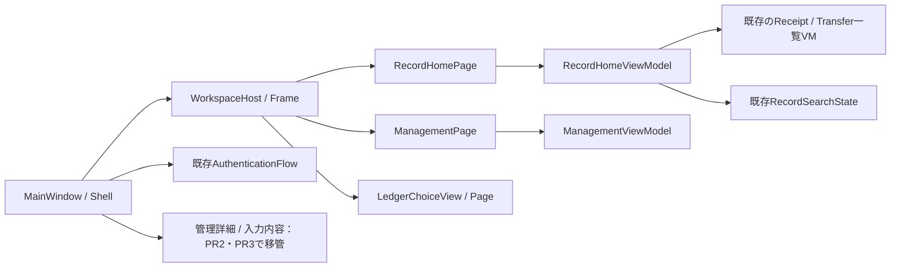
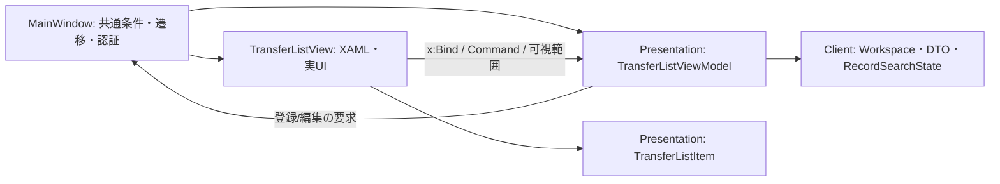

# 新Windows版 WinUI 3・Clientの構成

[← 04 全体構成の入口](04-architecture.md)

## 新版Windows版の構成

新版は**Windows 11のみ・.NET 10 LTS・C#・WinUI 3（Windows App SDK）**のアプリとする。プロジェクトは`src/Monetail.WinUI/Monetail.WinUI.csproj`。ターゲットは`net10.0-windows10.0.26100.0`、最小対応バージョンはWindows 11初版の`10.0.22000.0`。Windows App SDKは安定版1.8系列を使用する。初期ビルドと起動の検証はx64で行い、ARM64は未検証とする。

起動時の接続設定・ブラウザーログイン・保存ログインの復元・家計簿選択／作成／切替・ログイン情報・ログアウトを既存Clientへ接続済み。ホームと、左メニューを残した右側の人物一覧を表示する。起動中の待機表示も同じWindow内で扱い、具体的な表示・遷移は[58](ledger-windows.md#windows版の起動表示接続失敗時の操作)に従う。通常起動にサンプルデータは表示しない。人物の追加・編集・保存、日付/Enter入力、競合表示と同一アカウントでの再ログイン後の編集復帰を実装済み。人物削除の確認とAPI接続も実装済み。共通順設定と認証失効後の未保存順の復元も接続済み。

開発・CIでは非パッケージの自己完結した配置を使い、Windows App SDKと.NETランタイムを出力先に含めて起動を確認する。これは検証用の設定で、製品インストーラーの方式・更新方法・配布対象CPUを決定したものではない。WinUI 3のビルド・製品起動・同じXAMLによるスモークテストは専用の`.github/workflows/winui.yml`で行う。画像の取得は`preview/winui-*`ブランチでの単発実行に限定する。

API通信・認証・保存・日付と時刻の補完は`src/Monetail.Windows.Client/Monetail.Windows.Client.csproj`（`net10.0`）に分ける。画面はClientを参照し、入力欄・フォーカス・IMEは[59の入力仕様](59-input-controls-design.md)に従ってWinUI 3で実装する。API・認証契約・保存形式・通信単位を表示上の都合で変えない。旧VB.NET／.NET Framework 4.8は独立したアプリとして残し、新版から旧版の実行ファイル・プロジェクトを参照しない。レシート等の業務画面とインストーラーは後続とする。

画面、API通信、認証情報の保持を分ける。新版はAPI経由で読み書きし、画面へSQLやSQLite接続を持ち込まない。認証契約は[43](auth-windows-oauth.md#windows版のoauth認証dec-051)、起動時の遷移と段階移行は[58](ledger-windows.md#windows版のapi対応を先行する実装中)を正本とする。

通信回数をなるべく減らす。1つの操作で必要な処理と応答データをAPI側でまとめ、IDを取得してから同じ対象を再要求する往復を避ける。現在の認証・権限確認はAPI内部で維持し、振る舞いを変える統合は利用者の確認後に行う。

API接続先URLは、Windowsユーザーごとの`%LOCALAPPDATA%\Monetail\settings.json`に保存する。通常設定と認証情報は分け、JSONにトークンを含めない。認証情報は[43のDPAPI保存方針](auth-windows-oauth.md#windows版の認証情報保存)、初回入力と変更は[58の接続先設定](ledger-windows.md#windows版の接続先設定)に従う。

新版の変数・プロパティ・メソッド・クラス名は、意味と責務に合わせてC#の命名慣習で一から考える。既存フォーム・独自コントロールは操作・配置・計算条件を確認する資料として使い、必要な機能から実現する。機械的なVBからの変換を前提にせず、API対応と.NETの互換性を機能単位で確認する。業務モデルとDBの再設計方針は[58](ledger-foundation-core.md#新版の業務モデルdb設計方針未実装)を参照する。グラフ部品の選定とインストーラーの作成方式は実装前に具体化する。

## 接続先設定のPage・UserControl・MVVM

初回と「管理・設定 → 接続先の設定」の重複フォームを置き換えた。表示・切替・保存/認証の契約は[Windows接続](ledger-windows.md#windows版の接続先設定)を正本とする。

| 所有者 | 責務 |
| --- | --- |
| `Views/Connection/ConnectionSetupPage` | 初回/ログイン前の設定Page。NavigationCacheModeはDisabled。共通Viewを配置し、離脱で解放する |
| `Views/Connection/StartupPage` | 保存認証の検証中だけ生成する表示専用Page。即時進捗表示、NavigationCacheModeはDisabled |
| `Views/Connection/ConnectionSettingsView` | 共通XAML、x:Bindの双方向URL入力、近傍検証表示、既存FormKeyboardによるEnter/IME、初期/検証失敗時のフォーカス。公開面はViewModel DPのみ（ctor/DP登録を除く） |
| `Presentation/Connection/ConnectionSettingsViewModel` | URL生入力1つ、ApiEndpoint.Parseによる検証、接続/キャンセルCommand、Commandから導出する処理中状態。WinUI/HTTP/トークン/Windowを参照しない |
| `MainWindow.Connection` | 認証フローの生成/終了、現在の家計簿/本人/接続先、既存未保存保護・認証復帰・共有通知と進捗の調停。View内部のTextBox/ボタンを参照しない |
| 既存`ClientConnection`・Client | メタデータ確認→設定保存→接続先変更時だけトークン消去、認証復元。確認取消後に設定を保存しない |

Window構築中に認証フローのPrepareInitialDestinationで接続先と保存認証の有無をローカルで調べ、Activate前に初回表示先を決定する。未設定はConnectionSetupPage、認証なしはログインを直接表示し、StartAsyncで通信や起動Pageを開始しない。認証ありの場合だけ、同じAuthenticationHostのFrameへ表示専用のStartupPageを生成する。保存/認証読込エラーは共有失敗画面と明示再試行へ接続する。起動時の状態別契約は[58](ledger-windows.md#windows版の起動表示接続失敗時の操作)を正本とする。

StartupPageはNavigationCacheMode=Disabledの標準Pageで、表示時からProgressRingが動く。ViewModelやWindowへの通知は持たない。認証フローはページ型とFrameだけを扱い、内部コントロールを参照しない。認証情報の存在判定はClientSession.HasSavedAuthenticationから既存ITokenStore.Loadを利用し、トークンをWindowへ公開・キャッシュせず、RestoreAsyncで改めて読込・検証する。起動でのメタデータ取得は省略するが、接続先確定時の検証と既存認証更新は維持する。

起動/接続読取の取消元を認証フローに1つ保持し、Page解放時に取消する。認証が確認でき、保持中の振替/レシート編集へ正式に復帰する場合は、Page解放から切り離して既存のWindow所有マスタ再取得へ引き継ぐ（同じ10秒期限・Window寿命は維持する）。認証/家計簿取得後にも取消を確認し、Page離脱後の既知の遅延失敗も画面へ適用しない。新しい状態bool・Service・ルーター・認証スナップショットは追加しない。従来の遅延表示Task/タイマー・Window内の起動Gridを削除する。

| 起動変更の比較（基点main 5e5f20a、空行込み・生成物除外） | 前 | 後 |
| --- | ---: | ---: |
| MainWindow.xaml | 641行 | 634行 |
| MainWindow.Connection.cs | 444行 | 456行 |
| 製品srcのC#/XAML総量 | 18,845行 | 18,875行 |
| Windowから起動Page内部への名前参照 | 4箇所/2要素 | 0 |
| 起動表示用のboolフラグ | 0 | 0 |
| 起動用CancellationTokenSourceの明示フィールド | 0 | 1 |
| 未設定時の通信 | 0 | 0 |
| 設定済み・認証なしの起動通信 | 1（メタデータ） | 0 |
| 有効保存認証→前回家計簿までの通信 | 3 | 2 |
| 更新が必要な保存認証→前回家計簿までの通信 | 4 | 3 |

通信数は本人確認・必要な更新・open-lastまで（各画面のマスタ/一覧取得は別）で、合成HTTPにより検証する。起動表示のUI状態はPageの有無から導出する。新しい表示専用PageはXAML12行+C#8行、Client追加は4行。総行数の削減ではなく、不要な通信・遅延と内部参照をなくし、離脱時の読取寿命を明示する変更である。

管理画面では既存右ペインの空ContentControlへ同じUserControlを必要時に配置する。通常の画面遷移・管理項目変更・終了ではVMを停止してホストのContentを消し、初回側はナビゲーション引数を持つFrameもホストごと解放する。新たな画面キャッシュ、画面レジストリ、独自ルーター、Service/DIは追加しない。再訪は保存済みURLから生成し、2つの設定Viewは併存しない。ほかの機能画面・共通Shellは旧構成を残す段階移行で、全画面のPage化が完了したとは扱わない。

VMは未保存URLを正本として保持し、既存Clientへ渡す際だけ解析する。不正URLは送信せず原文を保持して欄の近くに表示し、接続/保存/認証の失敗は従来の共有エラー処理へ委ねる。ネットワーク失敗だけで認証を削除せず、再試行はWindowが保持する同じ解析済み候補を使う。処理状態はAsyncRelayCommandから読み、独立したprocessing/cancelled/initialized boolは追加しない。画面寿命のCancellationTokenSourceは確認・保存までに使い、確定後の認証/401復帰はWindowの元の10秒の期限と寿命で継続する。Page解放で復帰先のマスタ取得を中断しない。

| 比較（基点main ef4f043、空行込み・生成物除外） | 前 | 後 |
| --- | ---: | ---: |
| MainWindow XAML / 全partial C# | 658 / 3,760行 | 641 / 3,813行 |
| WinUI / Presentation / Client C#/XAML | 6,853 / 1,398 / 3,739行 | 6,997 / 1,475 / 3,739行 |
| 3製品プロジェクト合計 | 11,990行 | 12,211行 |
| URL欄/キャンセルのWindow直接参照（種類/箇所、C#） | 3 / 11 | 0 / 0 |
| URL解析の実装呼出元 | Windowに2か所 | VMに1か所 |
| 未訪問設定フォームの起動時生成 | 2フォーム | 設定済み0、未設定1 |
| Window Connectionの明示フィールド / bool | 8 / 2 | 8 / 2 |

総行数は221行増える（共有View72＋Page35＋VM77、Window全体36行増＋既存ClientConnectionの取消確認1行）。元のフォーム2か所の常駐と内部操作をなくす一方、初回表示確定・画面寿命・処理可否/通知を明示する。VMの明示保持はURL/検証文字列2、読み取り専用の説明1、画面寿命1、注入delegate2。生成Command/DP/ネイティブ入力・フレームワーク内部状態は別とし、全状態数が減ったとは主張しない。Windowの共有busy/認証/再試行をVMへコピーせず、UI内部状態は新しいVM1つに集約する。旧ServerUrl/SettingsServerUrlの2系統とConnect/ConnectSettings/CancelConnectionハンドラー、WindowからのFormKeyboard登録を削除した。AutomationIdは共通ServerUrl/ConnectButton/ConnectionCancelへ統一する。

WinApp CLIは実行環境にないため未実行。Microsoft Learnの[WinUI 3 Frame/Page実例](https://learn.microsoft.com/en-us/windows/apps/develop/ui/navigation/navigate-between-two-pages)・[Frame.Navigate 1.8参照](https://learn.microsoft.com/en-us/windows/windows-app-sdk/api/winrt/microsoft.ui.xaml.controls.frame.navigate?view=windows-app-sdk-1.8)・[WinUI 3データバインド](https://learn.microsoft.com/en-us/windows/apps/develop/data-binding/data-binding-in-depth)と製品ビルドでAPI/バインドを確認した。旧VB版はXML/SQLiteの接続設定を使い、APIのHTTPS URL/OAuth設定画面の直接対応はないため、新版の既存Client契約を優先する。検証結果と手動確認の限界は[tests/README](../tests/README.md)を参照する。

## Shell・Page・MVVM統合の3PR計画（PR1 #231マージ済み）

PR1は[PR #231](https://github.com/k-o-a-b-c/monetail/pull/231)でマージ済み。PR2は[Draft PR #244](https://github.com/k-o-a-b-c/monetail/pull/244)で管理機能を移管した。PR3の入力Page化は未実装であり、3PR全体の完了を意味しない。

最終構成はMainWindowを共通Shell（ナビゲーション許可、家計簿/本人/接続先、認証フロー、横断未保存確認、全体操作状態/通知、Window寿命）とし、主画面は標準Frame/Page、複雑な表示/CommandはPresentation、業務下書き/通信/版/再送はClientを正本とする。全面MVVM化のための基盤や独自ルーターは作らない。

| 工程 | 境界と所有者 | 今回の状態 |
| --- | --- | --- |
| PR1 | WorkspaceHostのFrame、記録RecordHomePage/RecordHomeViewModel、管理ManagementPage/ManagementViewModel。共通ヘッダーはShell、検索/選択と表示用投影はVM、IME/フォーカス/表示位置はView。既存の2一覧VM/RecordSearchStateを再利用 | **PR #231で実装・マージ済み** |
| PR2 | 人物/科目/支払方法/参加者/招待と順序・ダイアログを機能View/VMへ移管。各取得寿命、権限投影、競合/401/再送と画面通知を維持し、Windowの管理詳細Grid・条件付きShowErrorを除去。ダイアログは必要時生成 | **Draft PR #244で実装** |
| PR3 | 既存レシート/振替EditorView/VMを各入力Pageへ統合。Windowの入力View所有とAPI調整を整理し、401の実コントロール保持・フォーカス/未確定入力/要求保持を維持して旧partial/ホストを撤去 | 未実装 |

最終の主遷移はShellのWorkspaceHostとし、記録ホーム・管理コンテナー・家計簿選択・レシート入力・振替入力を標準Pageとして必要時に開く。既に必要時Pageである家計簿作成と認証前画面は、それぞれ既存のLedgerPageHost/AuthenticationFlowのFrameを再利用する。管理コンテナー内の人物/科目/支払方法/参加者・招待は機能単位のPage/Viewと既存PresentationのVMへ分け、標準Frame/NavigationViewで選択する。単純な家計簿選択/作成と認証前Pageには専用VMを増やさない。PR2の機能内部の所有者は次節に示す。

最終構成では、各VMが表示投影/Command/画面読取の世代・取消を、Clientが下書き/権限/版/不変要求と結果不明を、ViewがIME/フォーカス/スクロールと必要時生成のダイアログを所有する。Shellは現在コンテキストと遷移承認を渡し、入力コントロールや選択を読まない。RunAsyncの例外分類は再利用し、機能分離に合わせてfailed通知を当該Viewへ接続してShowErrorの機能分岐を減らす。新しい共通エラーServiceは作らない。

PR3で入力専用Pageへ移る際は、一覧VM/検索/位置を保持してホームPageを通常解放し、遷移前の未保存確認を取消した場合は元Pageを維持する。401だけは認証用の既存Frameを前面に出し、元入力Page/VM/実コントロール/未完了要求を同じ本人・家計簿・接続先での復帰または明示破棄まで保持する。通常離脱/別コンテキスト/終了で購読・読取取消・参照を解放し、書込の取消を保存失敗の確定とは扱わない。入力内容の別スナップショットや画面レジストリは設けない。

着手時はHomePageにヘッダー・共通検索・3一覧・両入力Viewが常駐し、ManagementPageにNavigationViewと全管理機能が常駐していた。記録検索と管理メニュー選択はWindowのpartialから内部x:Nameを直接操作し、通常離脱でもViewを保持していた。比較対象はmain e74c241、一覧/編集/Client契約と既存スモークを正本とする。

PR1はRecordHomePageとManagementPageを必要時にFrame.Navigateで生成し、通常離脱では購読・内容・Frame参照を解放する。家計簿を開いている間の共通ヘッダーは記録・管理・入力画面で表示し、管理専用の戻るボタンと廃止済みのメニュー仮項目を置かない。記録VMは家計簿単位に検索・既存2一覧VMを保持し、View再生成でも同じ行/選択を利用する。表示位置は一覧VMの値へ移し、ListViewportControllerはUI測定/適用を担当する。検索下書きはRecordSearchStateの既存値を使用し、別の文字列/フィルター正本を作らない。記録Pageの読取/表示復帰はそのPageで取消し、古い復帰が新Pageへ作用しない。

401で編集中の記録PageはFrameから外さず非表示で一時保持する。AuthenticationFlowは別Frameを既存どおり所有し、同じ本人/家計簿/接続先での復帰だけ元のPage・入力View・モデルを再利用する。通常離脱/別本人/終了では保持を解除する。家計簿選択は既存の単純なViewをPageへ変更し、選択だけでは開かない契約を維持する。家計簿作成Pageと認証前Pageの契約は変更しない。

旧Windows版のViewForm_List.vb（登録/編集後の選択行復元）とViewForm.vb（年月/設定への操作）、MasterMaintenanceFormの対応部分を照合した。選択保持は継承し、別WindowのShowDialogや旧ショートカットを新設せず、新版の同一Window・共通検索/キー仕様を維持する。今回の構造変更による操作仕様の追加はない。

PR1実装時には管理詳細と入力Viewの業務移管をPR2/3へ残し、Windowが既存の2つの内容領域（管理詳細/入力）を所有してPageへ内容単位で接続していた。Page内部のコントロールをWindowへ公開する転送層は設けない。管理詳細と管理ダイアログの先行生成・Windowの管理固有エラー分岐はPR2で除去した。入力領域の移管はPR3へ残り、全画面のMVVM/必要時生成が完了したとは扱わない。ページ境界を作るだけの案より検索・選択/操作の正本をVMへ移す案を採用し、入力業務を同時に移す大規模案は後続へ分割する。

### PR1の依存・状態比較

PR1のソース行数・フィールド数・直接参照数の比較値、検証結果と未検証の実機操作は[PR #231](https://github.com/k-o-a-b-c/monetail/pull/231)を参照する。行数やフィールド数の増減は責務分離の成否を単独では示さない。

**現在の境界**：記録・管理コンテナーの2Page/2VMと家計簿選択Pageを必要時生成する。管理内の機能Page/VMは次節のとおり分離した。記録ホームの行・選択・検索適用状態は既存の2一覧VM/`RecordSearchState`が正本で、Windowに別の状態を作らない。表示位置は一覧VMに保持し、`ListViewportController`がUIへの適用を担当する。記録/管理Pageは通常離脱時に購読・復帰要求・Frame参照を解放し、401での編集中に限って元Pageと入力を一時保持する。

共通検索・一覧内部・管理メニューへのWindow直接参照をPR1で除去し、管理詳細はPR2で次の境界へ移した。**レシート/振替入力のPage化はPR3に残る**。Windowの横断遷移・認証・未保存保護は維持し、Service・DI・独自ルーター・イベントバスは追加しない。

### PR2：管理機能のPage・ViewModel境界

管理内の遷移は`ManagementPage`の内側Frameが担当する。Shellは共通ナビゲーション、画面横断の未保存確認、認証/家計簿/接続先、共通busyと例外分類、Window寿命だけを調停する。管理内のコントロールや各編集値をWindowへ転送しない。

| 機能 | View | Presentationの所有者 | 維持するClient契約 |
| --- | --- | --- | --- |
| 人物・共通順 | `PeoplePage`・`PersonEditorDialog` | `PeopleManagementViewModel` | 本人の名前とAdminの期間/削除/順序、行版と全体順序版、`PersonCreationDraft` |
| 科目・共通順 | `CategoriesPage`・`CategoryEditorDialog` | `CategoriesManagementViewModel` | 収支/税区分/全期間、Admin操作、行競合の明示採用と順序409の最新切替、`CategoryCreationDraft` |
| 支払方法・所有者別順 | `PaymentMethodsPage`・`PaymentEditorDialog` | `PaymentMethodsManagementViewModel` | 所有者固定、Admin/本人Editor、所有者別の全件順序と版、`PaymentMethodCreationDraft` |
| 参加者・招待 | `ParticipantsPage`・`ParticipantEditorDialog`・`InvitationCancellationDialog` | `ParticipantsManagementViewModel` | 本人役割の固定、人物候補、明示的な最新採用、`LedgerInvitationDraft`と同じrequestIdによる再送 |

一覧行・選択・フィルター・操作可否・通知/検証結果・Commandは各VM、フォーカス/IME・ダイアログの生成/deferral/表示/解放はViewに置く。対応人物の候補可否はVMの値を正本とし、Viewで標準ComboBoxItemのIsEnabledへ反映する。候補の作り直し中は選択イベントを外し、UI再生成で選択値を消さない。保存値・旧revision・作成要求は既存Client DTO/Draftの**同じ参照**を用い、業務編集モデルやHTTPエラー分類を複製しない。名前/期間/選択値の生入力はUI用の値として保持し、正規化・検証は既存Clientへ委ねる。検証のfield/メッセージは一組から各近傍表示へ投影し、元の入力欄へフォーカスを戻す。

`ManagementContext`は現在の本人/家計簿/接続先、共有の現在権限、既存Workspace、Windowの操作実行コールバックをまとめる。busyはWindowの表示用投影であり、別の保存処理を開始する状態機械にはしない。401再試行でClientが再構成されても、本人/接続先を照合した後にWorkspaceだけを再接続し、入力・版・作成要求を置き換えない。`IManagementFeature`はViewの読取/ダイアログ寿命を管理Pageへ渡す小さな契約に限定する。CRUDの認可・競合形式・順序保存が異なるため、汎用CRUD基底VMやService/DI/イベントバスは設けない。

通常の管理内移動と記録への復帰ではPage・購読・読取取消元を解放する。家計簿を開いている間はVMの一覧設定と必要な再送Draftを保持し、家計簿/本人/接続先の破棄時にまとめて解放する。**招待の未完了発行Draftは通常の一覧移動だけで消さない**。ダイアログの通常終了は入力と対象/要求参照を解放し、並び順のキャンセルは未保存順だけを破棄する。401では元の管理Page・実ダイアログ・VMを一時非表示で保持し、4種類の全入力Snapshotを作らない。初回の退避で従来どおり記録一覧とマスタを解除し、連続401では保持中の管理入力を上書きしない。

復帰はWindowが同じ本人/家計簿/接続先を確認して元の家計簿を開き、当該VMが現在の一覧/権限を取得する。旧revision・入力・未保存順・requestIdは維持し、自動保存・自動再送をしない。参加解除時に権限のない最新情報を追加取得しない。編集行の409は明示採用まで別保持し、共通順/所有者順の409は既存仕様どおりその順序だけを最新へ切り替える。削除・除外・招待取消の確認を自動再開しない。未完了の招待発行を保持した取消中の401でも、取消ダイアログだけを解放し、発行Draftは同じ参照で保持する。通常の通信失敗はViewへ渡したfailed通知先に表示し、Windowの`ShowError`は管理詳細の分岐を持たない。

`ContentDialog.Hide()`時の401処理内では、PrimaryButtonのdeferralが待っている`ShowAsync`の完了を待たない。次回の復帰で閉じたTaskの完了を確認してから同じダイアログを表示する。画面を外した読取の取消/遅延401は新画面へ適用せず、書込には読取用の取消元を流用しない。Popupが非表示になった時点と、Task/参照の通常解放が終わる時点を区別する。

管理内の接続設定は`ConnectionSettingsPage`から既存の共通`ConnectionSettingsView`/VMを使用する。ログイン情報は単純な`AccountPage`で表示し、専用VMは増やさない。管理/記録の共通ヘッダー、レシート/振替入力の既存View・保存/競合/401は維持する。入力専用Page化と残るWindow所有の入力領域・確認ダイアログはPR3の範囲であり、本PRの完了対象に含めない。

共有ヘッダーの家計簿メニューは記録/管理の双方で利用する。別家計簿への切替前の未保存並び順確認はWindowが所有し、各機能VMの`HasOrderChanges`を管理VMから参照する。人物/科目/支払方法の開始時ID配列を基準に比較し、画面を開いただけ・元の順序へ戻した場合は未変更とする。認証復帰の最新マスタ取得で基準を置き換えない。メニューを開く/閉じる・現家計簿の選択では確認せず、確認取消・切替API失敗では元のPage/並び順/選択を保持する。成功時だけ既存の破棄経路へ進む。確認文言・操作の正本は[DEC-348](../UI_DESIGN.md)を参照する。新規VM/Service/汎用遷移基盤は追加しない。

### PR2の責務・状態比較

基点`e54a1c3`とPR2の製品WinUI/Presentationを比較する。空行込み、生成物・テストを除外。C#のメソッド/明示フィールドはRoslyn構文で数え、auto-property/record位置引数の生成フィールドは含めない。内部参照は基点の管理130個のx:Nameを照合し、同名のMasters.PaymentNameメソッド呼出しと移管先VMのAccountNameプロパティを除外する。

| 指標 | 前 | 後 |
| --- | ---: | ---: |
| MainWindow XAML | 464行 | 64行 |
| MainWindow C# / メソッド | 3,729行 / 286 | 1,905行 / 120 |
| MainWindow 明示フィールド / うちbool | 106 / 37 | 39 / 12 |
| 管理内部のx:Name直接参照（異なる名前 / 出現回数） | 126 / 524 | 0 / 0 |
| WinUI＋Presentation製品総行数（C#＋XAML） | 9,421 | 10,898 |
| 同C#明示フィールド / うちbool | 221 / 67 | 198 / 55 |
| 同ObservableProperty / うちbool | 2 / 0 | 55 / 13 |
| 明示フィールド＋ObservablePropertyのbool宣言 | 67 | 68 |
| 同C#メソッド / C#＋XAMLファイル | 668 / 82 | 804 / 100 |
| 管理の具象型に宣言する操作/寿命通知event | 5 | 10 |
| 管理VM/Contextが保持する協力Func | 2 | 4 |

製品総量は1,477行増えた。レビュー対応の家計簿切替保護は91行・明示フィールド4個（開始順序3配列と表示中ContentDialog1個）を含み、bool・イベント・Serviceを増やさない。XAMLバインディング、4機能VMの通知/Command、Pageとダイアログの寿命接続が増分であり、コード量や全体状態数を減らしたとは扱わない。Windowの管理9partial（1,788行）と4種類の復帰Snapshotを削除し、元のDTO/Draft・実Viewを保持する方式へ統一した。4Pageの退避boolを共有状態から導出する追加案は、最終CIの未変更候補試験の失敗との因果関係を特定できず、今回から取り下げた。検証済みのPage/ダイアログ寿命の判定を残し、全体boolの削減は達成したと扱わない。3機能のIsOrderingは版から導出し、入力エラーはfield/message一組から投影する。未使用の4保存Command/4保存通知は設けず、ダイアログの標準PrimaryButton/deferralを利用する。

追加した主要な境界は6機能/単純Page、4機能VM、共有ManagementContext、UI寿命用の小さなIManagementFeature契約と5必要時ダイアログ。Commandが完了済みViewのTaskを直接保持しないようVMのawait境界を置き、通常離脱ではViewのイベント接続を解除する。操作/寿命通知eventは旧科目Viewの5個から、メニュー1・編集開始4・機能からの復帰4・Shellへの復帰1の10個へ増えた（標準UI/PropertyChanged通知とinterface上の重複宣言を除く）。管理VM/Contextの協力Funcは遷移許可/内部遷移の2個から、遷移許可/接続設定/ログアウト/共通実行の4個へ変わる。各購読は通常離脱時に解除し、Window全体や内部コントロールをViewへ渡さないための境界に限定する。新規Service/DI/外部ライブラリ、共通CRUD基底クラスはない。共通コンテキストと寿命契約は、Windowから機能内部を参照せず、共通busy・認証・取消を既存実行へ接続するために限定した。

旧Windows版MasterMaintenanceFormは空の設定フォームで、ViewFormはShowDialog後に一覧を更新する。新版の管理入力/401に相当する旧実装があるとは扱わず、新版正本の同一Window・権限/入力/順序/再送契約を維持する。検証結果と未実施項目は[テスト記録](../tests/README.md#management-mvvm-pr2)を参照する。

## RunAsyncと認証失敗の責務（PR #230）

| 区分 | 所有者と契約 |
| --- | --- |
| 共通 | WindowのRunAsyncがbusy/closed、処理中UI、既存例外分類・安全なメッセージ、401/認証コンテキスト変更時の退避、権限情報反映、finallyでの復帰を所有する |
| 通常業務 | 管理機能は操作ごとのfailed通知先を渡し、各Viewへ表示する。他の業務の既定通知先は共有ShowError。自動再送・FailurePage遷移は追加しない |
| 起動・OAuth・接続設定 | AuthenticationFlowが分類済み失敗を受け取り、内部のShowFailureとretryで専用Page・再試行を所有する。起動/OAuth後の失敗は設定/保存認証から再開し、接続変更は失敗した候補を再検証する |
| Window境界 | RunAuthenticationAsyncは共通実行を借用し、失敗時に既存ShowAuthenticationの遷移許可/ホスト接続を確認してフローの通知先を呼ぶ。再試行先の選定やFailurePageの型を扱わない |
| 認証成功後 | AuthenticatedAsync/OpenDestinationAsync・家計簿取得・編集復帰の順序はWindowに残す。家計簿取得失敗も同じ認証操作の失敗として再試行できる |

RunAsyncの第2引数は再試行Func<Task>ではなく省略可能なAction<string>。省略時はShowError、認証操作はフロー、管理操作は当該VMの失敗通知先を使用する。旧WindowのRestartAuthenticationAsync/ReportFailureを削除し、RestartAsync/ShowFailureをフローのprivateメソッドへ限定した。7つの協力コールバックのうちexecuteの契約だけを変更し、接続先候補や再試行をWindowへ往復させない。executeの第2引数は候補データから失敗通知Actionへ置き換わるため、明示的な通知コールバックは1つ増える。これは共通分類からフローへ戻すための操作単位の引数で、購読・保持フィールド・中継クラスは増やさない。

フロー側ですべての例外分類を行う案は、通常業務の認可反映・401退避と同じcatch/メッセージの重複を招くため採用しない。共通実行を残し、表示先を渡す構成を採用する。Windowの実行境界は、管理画面の接続確認失敗時には認証Frameを接続し、未承認の編集中遷移やWindow終了時には表示を拒否するため残す。汎用Service/新規クラス・状態フラグ・例外分類器は追加しない。

| 比較（main 8fb832d、空行込み・生成物除外） | 前 | 後 |
| --- | ---: | ---: |
| MainWindow.Connection.cs | 407行 | 400行 |
| 上記partialのメソッド数 | 28 | 26 |
| AuthenticationFlow | 337行 | 337行 |
| フローのpublicメソッド数（プロパティ除外） | 10 | 8 |
| フローconstructorの協力コールバック数 | 7 | 7 |
| execute引数のコールバック数 | 操作1（第2引数は接続先データ） | 操作1＋失敗通知1 |
| 明示フィールド（Window接続partial / フロー） | 7 / 5 | 7 / 5 |
| 上記boolフィールド | 2 / 0 | 2 / 0 |
| 製品srcのC#/XAML総量 | 19,432行 | 19,425行 |

OAuth待機の取消/再オープン、10秒の接続期限、旧Page応答拒否、終了時の解放、401の元モデル/実コントロール保持は維持する。ShowErrorの画面別通知・SetOperationsEnabledは今回再設計しない。検証記録は[tests/README](../tests/README.md)を参照する。

## ShowPageのホーム復帰Task（PR #229）

ShowPageは同期の遷移ガード/表示切替を維持し、ホーム復帰だけを例外処理付きのResumeRecordHomeAsyncへ渡す。async void相当のDispatcherQueueラムダを削除し、Task.Yieldで同期の遷移を終えてから既存ResumeAsyncを待つ。レシート/振替の初回読込もTask.WhenAllで同じ例外境界から待ち、即時の401で一覧が破棄された場合は後続一覧を旧ホームへ生成しない。読込中も他画面へ移動できる既存の操作可否を保つため、全体busyを持つRunAsyncでは包まない。通常の通信/業務エラーと401は既存VMのFailure/通知を維持し、予期しない復帰例外は型だけをTraceへ記録して、現在のホームに限り共有InfoBarへ「一覧を表示できませんでした。」を表示する。例外の内部メッセージは画面へ公開しない。

WindowのhomeResume取消元1つは、表示復帰Taskとawait後のObserveViewport/表示位置復元の寿命だけを所有する。通信へは従来のWindow tokenを渡し、CursorListViewModelのSuspend・要求世代・再試行・カーソル状態を複製しない。同一ホームで進行中の復帰を二重開始しない。通常離脱・編集開始・一覧破棄・Window終了で表示復帰を取消し、再訪は新しい所有者で開始する。旧Taskは完了後にも取消/画面/編集状態を確認し、現在の所有参照と一致するときだけ参照を解除する。取消元はTaskのusing/finallyで解放する。旧Taskが中断不能な通信完了を待っても、新しい復帰の行・表示位置・復元保留状態へ触れない。

401の未保存入力/元の実コントロール保持、編集復帰順、RunAsync・ShowError・AuthenticationFlowの責務は変更しない。ListViewportController自体の既存Dispatcher処理は今回の対象外とし、一覧の表示位置/可視範囲測定を引き続き担当する。新しいService、Dispatcher基盤、ViewModel状態、bool/世代カウンターは追加しない。

| 比較（基点main c6d97ba、空行込み・生成物除外） | 前 | 後 |
| --- | ---: | ---: |
| ShowPageの非同期Dispatcherラムダ | 1 | 0 |
| 初回一覧読込のTask破棄 | 2 | 0 |
| Windowの表示復帰取消元 | 0 | 1 |
| 追加bool/要求世代カウンター | 0 | 0 |
| MainWindow.Connection.cs / Receipts.cs / Transfers.cs | 354 / 221 / 59行 | 407 / 224 / 59行 |
| 製品srcのC#/XAML総量 | 19,374行 | 19,432行 |

総量58行増は、例外を観測するTask境界、同期呼出元を保った遷移寿命、await後の旧UI更新拒否のため。単なるコールバック移動ではなく、初回2読込と復帰を同じ例外境界で待つ。通信・業務状態は既存の正本を維持する。検証と手動確認の限界は[tests/README](../tests/README.md)を参照する。

## 起動・認証フローの寿命分離（PR #228）

内部の具象クラス`Authentication/AuthenticationFlow`一つに、初期表示のローカル判定、接続設定/保存認証確認、OAuthブラウザー待機/取消、認証前Page/Frame購読と再試行を集約する。ClientConnection/ClientSessionは借用し、トークン・アカウント・業務状態を複製しない。主領域の遷移は標準Frame.Navigate、各Pageは既存の表示/操作通知を維持する。StartupService、認証用ViewModel、DI、汎用ルーターを追加しない。

WindowはWindow寿命、共通ナビゲーション、認証フローの生成/終了、OpenDestinationAsyncによる家計簿取得と既存の編集復帰順、401での同一モデル/実コントロール保持を所有する。通常業務のRunAsyncの例外分類・busy・権限反映は維持し、認証側も同じ操作実行を借用する。接続先設定が通常業務内で要求された場合も、API検証・保存・認証復元はフローへ委ね、Windowは離脱確認と画面引き渡しだけを行う。

### 終了と再生成

通常の家計簿/作成/業務画面表示でWindowの認証参照とAuthenticationHost.Contentを解除してDisposeする。フローは7つのPage購読を解除し、Frame/Page・ブラウザー・読取/ブラウザー取消元・再試行の保持を外す。OAuthの待受は既存BrowserOAuthLoginのusing寿命で終了し、認証検証完了後の引き渡しより前に解放する。取消元は操作のusing/finallyでDisposeし、終了時は先にCancelして旧結果を反映しない。操作完了までのローカルawait参照を強制GCで消そうとはせず、恒久参照と購読が残らないことを検証する。

401/ログアウト後は必要時に新しいフローを生成する。401の編集データと実コントロールはWindowに残り、認証フローへコピーしない。先に編集画面を表示して続けるマスタ再取得では読取取消元の保持を解除し、Page解放では止めず既存の10秒期限/Window終了に従う。家計簿取得/復帰判定はフローへ移さない。LedgerCreatePageは認証後の別ホストと4通知をWindowが所有し、認証フローを残さない。

起動・接続確認/復元はWindow寿命にリンクした既存10秒の読取スコープを共用し、Page変更時の取消とPage同一性で旧結果を拒否する。接続設定Viewの取消は検証/保存までに限定し、確定後は認証フローの寿命へ渡す。ブラウザーの利用者操作待ちには10秒制限を付けない。確認中のログインからの離脱でも取消元を保持して旧応答を拒否する。通信障害時のトークン保持と接続先検証→保存→必要時のトークン消去順は既存Clientの契約を維持する。

### 比較と追加した境界

PR #228での行数・フィールド数・参照数の比較は当該PRの差分を参照し、検証結果は[テスト記録](../tests/README.md)を参照する。現行の責務は上記のとおり、認証フローがPage購読・ブラウザー待機・再試行の寿命を所有し、Windowは業務遷移・例外分類・認可・401復帰を保持する。認証用の新規Service/DI/ルーターは設けない。

## ログインPageと認証前画面の責務

`Views/Authentication/LoginPage`は表示と`LoginRequested`・`ConnectionChangeRequested`・`BrowserOpenRequested`・`CancelRequested`の4通知を持つ、NavigationCacheMode=Disabledの標準Page。専用ViewModel・Client/HTTP/Window参照は持たない。ログインボタンと接続先変更のAutomationId・標準のTab順を維持する。旧VBはローカルDB起動とWindowsユーザー名による識別であり、このOAuth画面の対応物はない。新版の[ログイン契約](ledger-windows.md#windows版のログイン認証待ちブラウザー完了表示)を維持する。

認証専用のAuthenticationFlowが接続先設定・起動・ログイン・接続失敗のPageとAuthenticationHost内のFrameを所有する。ログイン表示中だけ4イベント、失敗表示中だけ3イベントを直接購読し、離脱/終了で解除する。認証フロー内では標準Frame.Navigateで切り替え、同じLoginPage内の認証前/ブラウザー待機は引き続きVisibilityで切り替える。通常業務への引き渡しではWindowの認証参照とホストContentを外し、フローをDisposeする。家計簿作成は認証後のLedgerPageHostへ分離する。

Windowの通常遷移ガードと同じく、認証退避以外では未承認の編集中遷移を拒否する。認証前Pageへの遷移時にも旧画面の可視状態を閉じ、一覧の読取を中断する。共有InfoBarはFrame外に残してログイン中も利用する。通常離脱と401退避を区別する既存の`NavigateToLogin` / `DiscardLedgerContents`は維持し、元のレシート/振替モデル・入力コントロールを破棄しない。閉鎖済みWindowではログインPageを再生成しない。起動時の通信/表示タイミング、OAuth/Client/保存形式は変更しない。

| Page分離時の比較（PR #221、基点main 52db880、空行込み・生成物除外） | 前 | 後 |
| --- | ---: | ---: |
| MainWindow.xaml | 634行 | 627行 |
| MainWindow.Connection.cs | 456行 | 487行 |
| 製品srcのC#/XAML総量 | 18,875行 | 18,929行 |
| Window生成フィールド（ログインGrid/ボタン） | 2 | 0 |
| C#から旧ログインGridへの名前参照 | 3 | 0 |
| ログインXAMLからWindowへのClick直結 | 2 | 0 |
| MainWindow.Connectionの明示フィールド / boolフィールド | 9 / 2 | 9 / 2 |
| ログインPage固有の保持 | 常駐Grid/ボタン | 操作通知2つ・表示時だけ生成 |

Page分離時（PR #221）はXAML15行+C#15行。Window側の31行増は、通知の接続/解除、Page全体の操作可否、終了ガード、旧画面の可視状態/読取中断の共通化による。総量54行増を隠さず、不要な状態・VM・Service・ルーターを増やさずに、生成と解放の境界・依存を明示する。Microsoft Learnの[WinUI 3 Frame/Page実例](https://learn.microsoft.com/en-us/windows/apps/develop/ui/navigation/navigate-between-two-pages)とWindows App SDK 1.8のFrame.Navigateを参照し、WinApp CLIは環境にないため未実行。実ビルド・寿命/認証復帰の検証結果と未検証事項は[tests/README](../tests/README.md)を参照する。

### 同一LoginPage内のブラウザー認証待ち

認証前/待機はPage内の`LoginContent` / `WaitingContent`を標準Visibilityで切り替える。Pageの`SetAuthenticationState(waiting, canInteract)`はUIだけを更新し、認証状態を保持するVM/独立フラグを追加しない。AuthenticationFlowはbrowserLoginとブラウザー取消元の寿命から待機表示/操作可否を決め、処理中制御はWindowの既存busyを参照する。コード交換後はURL参照を外して利用者の再表示/取消を止める一方、取消元は認証検証完了まで保持してPage離脱・Window終了に従う。検証後の家計簿引き渡しでは、ローカルのWindow寿命にリンクしたtokenを使用する。

開始/取消/拒否/メッセージ更新では既存Pageを維持する。通常離脱で4通知を解除してFrame参照を解放し、再訪は新規生成する。Window内の旧認証待ちGrid/ボタンは削除した。遅れて戻るブラウザー起動結果は、同じ認証要求がまだ取消可能な状態か確認してから通知する。ユーザー操作・OAuth・401編集保持は[画面正本](ledger-windows.md#windows版のログイン認証待ちブラウザー完了表示)、検証証跡は[tests/README](../tests/README.md)を参照する。

| 待機統合の比較（基点main 2c6cbf7、空行込み・生成物除外） | 前 | 後 |
| --- | ---: | ---: |
| MainWindow.xaml | 627行 | 617行 |
| MainWindow.Connection.cs | 487行 | 521行 |
| LoginPage XAML / C# | 15 / 15行 | 26 / 29行 |
| 製品srcのC#/XAML総量 | 18,929行 | 18,978行 |
| Window生成フィールド（認証待ちGrid/操作列/ボタン） | 4 | 0 |
| Window C#から待機画面/ボタンへの名前参照 | 7 | 0 |
| Connection partialの明示フィールド / bool | 9 / 2 | 9 / 2 |
| Pageの操作通知 / UIメソッド | 2 / 0 | 4 / 1 |

49行増はUI切替・4通知接続/解除・既存状態からの操作可否・旧ブラウザー起動結果の破棄を明示した分である。重複した待機画面を削除し、Windowからの内部コントロール操作をなくす。待機中の再オープン/取消をbusyで止めるための新しい状態フラグ、ViewModel、ルーターは設けない。WinUI 3の[UIElement.Visibility](https://learn.microsoft.com/en-us/windows/windows-app-sdk/api/winrt/microsoft.ui.xaml.uielement.visibility?view=windows-app-sdk-1.8)と既存の標準ボタンを使用する。

### 接続失敗Pageの生成・解放

`Views/Connection/FailurePage`はエラー文の表示と`RetryRequested`・`ConnectionChangeRequested`・`ExitRequested`の3通知だけを担当する標準Page（NavigationCacheMode=Disabled）。表示文字列はFrame.Navigateの引数で受け、Windowは内部x:Nameを参照しない。専用VM・Client参照・保持フラグは追加しない。

AuthenticationFlowがretryを正本として保持し、既存の設定/保存認証再読込・10秒期限・認証と通信障害の区別を維持する。処理中はPage全体の標準IsEnabledを無効にし、再試行入口も既存のbusy/closedで二重実行を拒否する。通常離脱・終了時は3イベントを解除してFrameを解放し、再訪は新Pageとする。

認証表示への入口はWindowのShowAuthenticationで未承認遷移ガードを維持する。認証退避中だけ接続失敗Pageへ進め、通常の未承認遷移は引き続き拒否する。非表示と編集状態の破棄を区別し、元のレシート/振替モデル・コントロールは再試行後も再利用する。古い起動応答の拒否は既存のFrame同一性/取消処理で行い、新しい状態を追加しない。

| 接続失敗Page分離の比較（基点main 6a6c0c8、空行込み・生成物除外） | 前 | 後 |
| --- | ---: | ---: |
| MainWindow.xaml | 617行 | 606行 |
| MainWindow.Connection.cs | 521行 | 536行 |
| FailurePage XAML / C# | 0 / 0行 | 20 / 24行 |
| 製品srcのC#/XAML総量 | 18,978行 | 19,026行 |
| Window生成フィールド（失敗Grid/メッセージ/再試行） | 3 | 0 |
| Window C#から旧失敗Grid/メッセージへの名前参照 | 4 | 0 |
| 失敗XAMLからWindowへのClick直結 | 3 | 0 |
| Connection partialの明示フィールド / bool | 9 / 2 | 9 / 2 |
| Pageの操作通知 / 公開UIメソッド / 専用状態フィールド | 0 / 0 / 0 | 3 / 0 / 0 |

製品総量は48行増。増分はPage境界と3通知の接続/解除・操作可否・重複再試行ガードであり、Windowから失敗画面の内部依存を除いた。新しいVM/Service/ルーターや認証情報の複製はない。旧VBにOAuth接続失敗画面の対応物はなく、新版の[画面契約](ledger-windows.md#windows版の起動表示接続失敗時の操作)を維持する。検証結果・未検証事項は[tests/README](../tests/README.md)を参照する。

### 起動・認証復帰の調停と通常業務の失敗通知

WindowはActivate前に接続先・保存認証の有無を通信なしで判定し、表示先とWindow寿命を管理する。既存`ClientConnection`は設定とClient構成、`ClientSession`は認証の検証/更新/保持、`LedgerWorkspace.StartAsync`は有効な最後の家計簿の取得・履歴無効時の所属一覧取得、各Pageは表示と操作通知を担当する。接続設定/認証のClient実装・認証契約・Pageは変更しない。起動仕様は[画面正本](ledger-windows.md#windows版の起動表示接続失敗時の操作)、家計簿の選定は[新規利用の正本](ledger-onboarding.md)を維持する。

PR #225の[家計簿選定仕様](ledger-onboarding.md#所属1件以上で開く家計簿)を実装済み。`open-last`が有効ならそのまま開き、nullなら所属一覧を取得してWindowが0件は作成・1件以上は既存の選択Viewへ進める。所属1件の自動オープンと専用の404再取得は廃止した。選択Viewは未選択・開く無効で開始し、選択だけではAPIを呼ばず、明示的な「開く」で既存APIを使用する。新しいService/VM/状態はなく、401復帰・通常の開く処理・API/DB契約は変更しない。

`OpenDestinationAsync`は振替→レシート→管理機能の復帰を調停する。管理機能は保持したPage内の機能だけを復帰し、旧4管理機能の個別Window復帰Snapshotは使用しない。復帰がない場合だけ`OpenInitialLedgerAsync`でWorkspaceの結果を表示する。通常の家計簿表示から復帰判定を分離し、管理内の判定は当該Pageへ委ねるが、入力2画面と管理の間を調停するWindowの横断依存は必要なため残す。401でのモデル/実コントロール保持、起動Pageを解放してから続けるマスタ再取得、10秒期限・Window終了・遅延応答の拒否は既存処理を維持する。

`RunAsync(action, failed: ...)`は認証/管理操作の分類済み失敗を指定先へ返し、その他の通常業務は`RunAsync(action)`で既存の共有通知を使う。以下の比較はPR #224当時の変更である。認証フローが再試行先とFailurePageを所有する。旧`connectionFailure`と再試行先の組合せを廃止し、通常業務から実際には使われない20個のコールバックを除いた。通常業務の処理本体、権限反映、例外種別/メッセージ、認証退避・busy/finallyは変えない。例外分類は共有の一か所を維持し、起動専用の例外処理を複製しない。通常業務画面の変更はこの未使用引数の除去だけとする。

| 境界整理の比較（基点main 5afcee1、空行込み・生成物除外） | 前 | 後 |
| --- | ---: | ---: |
| MainWindow.Connection.cs / Ledgers.cs | 536 / 201行 | 541 / 207行 |
| 上記2 partialのメソッド数 | 33 / 12 | 33 / 13 |
| 上記2 partialの明示フィールド / boolフィールド | 13 / 2 | 13 / 2 |
| 製品srcのC#/XAML総量 | 19,026行 | 19,037行 |
| 通常業務から未使用の再試行先への参照 | 20 | 0 |
| RunAsync呼出箇所（接続/認証・通常業務） | 3・20 | 3・20 |
| RunAsync / ReportFailureの引数数 | 3 / 3 | 2 / 2 |
| connectionFailure引数の宣言 | 2 | 0 |
| 新規Service / VM / ルーター | 0 / 0 / 0 | 0 / 0 / 0 |

製品総量11行増は通常の家計簿表示の境界1メソッドと可読性のための分岐展開・コメントによる。フィールドや状態フラグは増えていない。単なる移管に留めず、20個の不要な操作間参照と、同じ失敗ポリシーを重複指定するboolを削除した。再試行要求の保持や例外処理を別クラスへ隠す抽象化は加えない。検証結果・既存の断続的な失敗・未検証事項は[tests/README](../tests/README.md)を参照する。

### 家計簿作成Pageと所属更新

`Views/Ledgers/LedgerCreatePage`を認証後専用LedgerPageHostのFrameへ必要時だけ生成する。PageはUI用の所属0件/追加の表示引数、入力、4通知（作成・所属確認・ログアウト・キャンセル）と既存FormKeyboardを担当する。WindowにはPage内部のx:Name参照を残さず、入力は作成通知の文字列で渡し、欄下エラー/フォーカスと正常な所属0件の補足結果だけ公開UIメソッドで扱う。新しいViewModel/Service・独自ルーター・永続化/入力コピーを追加しない。画面仕様の正本は[所属0件の作成画面](ledger-onboarding.md#所属0件の家計簿作成画面)。

Windowは既存LedgerCreationDraft・RunAsync・LogoutAsync・LedgerWorkspace.StartAsyncを使用する。所属確認後0件の場合は既存Pageを再利用し、未確定の入力と同名の再送draftを保持する。通常離脱では4購読とFrame参照・作成draftを解放し、再訪は新しいPageとする。更新中は既存busy/IsEnabledで二重操作を拒否し、ローカルのWindow寿命にリンクした取消元とUnloaded購読で読取を中断する。応答反映前にFrame同一性を確認し、離脱後の遅延応答/既知の失敗で新画面を上書きしない。通常の失敗分類・401退避・既存の作成/認証契約は維持する。

| Page化と操作追加（基点main fdcb28a、空行込み・生成物除外） | 前 | 後 |
| --- | ---: | ---: |
| MainWindow.xaml | 606行 | 592行 |
| MainWindow.Connection.cs / Ledgers.cs | 541 / 207行 | 560 / 266行 |
| 製品srcのC#/XAML総量 | 19,028行 | 19,211行 |
| Window生成フィールド（旧作成Grid/案内/名前/作成/キャンセル） | 5 | 0 |
| Pageの公開操作通知 / UIメソッド | 0 / 0 | 4 / 2 |
| 新規VM / Service / Window状態フィールド | 0 / 0 / 0 | 0 / 0 / 0 |

Page本体はXAML38行・C#77行。製品183行増には所属確認/ログアウト、読取寿命・通知/解放と最終レイアウト/検証表示を含む。旧キーボード接続1行をMainWindow.Personsから除去し、Page内へ移した。旧VBはローカルDB起動でOAuth所属/ログアウトの対応物がなく、新版の正本を優先する。検証結果と未検証事項は[tests/README](../tests/README.md)を参照する。

最終レイアウトは所属0件の「家計簿がありません」から、新規作成・招待参加・補助ログアウトを区切り線で分ける。追加時は同じPage型で短いフォームに切り替える。検証の正本は既存LedgerCreationDraft内の純粋なValidateNameへまとめ、コンストラクターとPageの欄下エラー解除で共用する。表示の再判定ではdraftやrequestIdを生成しない。Pageには同じFormKeyboardのUI参照だけを保持し、業務入力や処理フラグを複製しない。

必須/文字数違反は欄下テキストと入力欄のアクセシビリティHelpTextを更新し、InfoBarを使用しない。API/通信失敗は共有InfoBarを維持する。所属確認開始時は古い補足結果を消し、正常終了して同じPageに残った場合だけ通常色の0件結果を表示する。右上24pxの共通ProgressRingと既存busy/IsEnabledを使い、Page内に新しいRingや固定高さのエラー領域を追加しない。

## 家計簿選択画面の分離（第1段階）

`Views/LedgerChoiceView`が既存の家計簿選択XAML・単一選択状態・［開く］の有効化/クリックを所有する。公開面は一覧を受け取る`Ledgers`と選択IDを通知する`OpenRequested`の各1つ。選択はListViewに保持し、独立した選択モデルやMainWindowへの参照を持たない。MainWindowはClientからの取得、通知されたIDの`OpenLedgerAsync`、認証/未保存保護、画面遷移を担当する。UserControlはHTTP・認証・Windowを知らず、他画面にも依存しない。

MainWindowは内側のListView/ボタンに触れず、一覧設定とイベント受信だけを行う。元の標準コントロール・配置値・AutomationIdを維持し、余分なTab停止を追加しない。新しいViewModel・依存ライブラリ・ナビゲーション基盤は導入しない。家計簿作成/ホーム等は今回は分離しない。

移管時のXAML/C#行数・直接参照数は当時のGit差分を参照し、検証は[テスト記録](../tests/README.md)を参照。家計簿選択Viewが選択状態と［開く］通知を所有し、Windowは取得・認証・家計簿を開く操作・未保存保護を担当する。新しい汎用VM/DIは増やさず、旧版の選択・Tab・見た目の契約を維持する。

## 科目一覧の分離（一覧だけ）

従来の一覧のみの`CategoryListView`はPR2で`Views/Management/CategoriesPage`へ置き換えた。一覧/フィルター/選択・順序/権限/競合/復帰は`CategoriesManagementViewModel`、フォーカス/IMEと必要時の`CategoryEditorDialog`はPageが所有し、MainWindowは科目内部を参照しない。現在の寿命・所有者は[PR2の境界](#pr2管理機能のpageviewmodel境界)、過去の一覧のみの検証は[テスト記録](../tests/README.md)を参照する。

## 振替一覧のMVVM移行（実装済み）

振替一覧を起点に、WinUI 3の画面固有処理を段階的にMVVMへ移行する。振替一覧については**既存の`TransferListState`を新ViewModelで包まず、状態管理を`TransferListViewModel`へ一本化した**。既存クラス・ファイルを維持することを目的とせず、表示仕様・API契約・失敗時の操作を維持して内部構造を組み直す。レシート一覧の移行は後節に記す。振替/レシートの入力画面、他の管理画面のMVVM化は別工程とする。

| 置き場所 | 役割 |
| --- | --- |
| `Monetail.WinUI/Views/Transfers/TransferListView.xaml` | 6列の一覧、見出し・登録・focus時の先頭復帰、読込中・空・エラー・再試行・続きを読み込む等の表示 |
| `Monetail.WinUI/Views/Transfers/TransferListView.xaml.cs` | WinUI固有のListView可視範囲・スクロール・フォーカス、画面遷移通知。Window内部コントロールへは依存しない |
| `Monetail.Windows.Presentation/Transfers/TransferListViewModel.cs` | `CommunityToolkit.Mvvm`による通知・Command、唯一の行コレクション・選択・一覧取得・カーソル・失敗/再試行・中断/再開・保存行の探索状態 |
| `Monetail.Windows.Presentation/Transfers/TransferListItem.cs` | API応答からの表示用投影（日時・振替元/先名称・金額・メモ）。マスタ名の再取得で必要な項目を更新できること |
| `Monetail.Windows.Client` | `TransfersWorkspace`、`TransferListQuery`、API DTO、認証例外と通信契約。移管後は一覧状態を二重保持しない |
| `MainWindow` | 共通年月・人物・支払方法・共通キーワードの適用、家計簿切替、入力画面への遷移、401認証復帰とWindow寿命 |

`Monetail.Windows.Presentation`は**WinUI 3を参照しない`net10.0`のクラスライブラリ**とし、既存Clientと`CommunityToolkit.Mvvm`を参照する。DIコンテナー、新しい汎用ナビゲーション/Service/イベント基盤は追加しない。ViewModelはコンストラクターで必要な依存を受け取り、`MainWindow`や`Microsoft.UI.Xaml`を参照しない。検索の適用済み条件は引き続き`RecordSearchState`を正本とし、ViewModel内に別の適用済みフィルター状態を複製しない。検索欄の未確定入力と適用済み条件は区別する。

### 公開インターフェースの境界

ファイル間の**機能と所有者**だけを固定する。公開名は実装に対応する。privateメソッドやイベントの型はこの境界内で必要最小限とする。外部から新しい汎用サービスやWindow全体を渡さない。

| 境界 | 公開する状態・操作の目安 | 公開しないもの |
| --- | --- | --- |
| `TransferListViewModel` → `TransferListView` | 読み取り専用の`Rows`、双方向の`SelectedItem`、初回/追加読込・空・失敗と再試行可否・エラー文、登録可否、`Register`/`Edit`/`Retry`/`Continue`/`ReturnToStart`コマンド | `ScrollViewer`、`Visibility`などWinUI型や画面要素 |
| `TransferListView` → `TransferListViewModel` | 選択通知、可視最終行・領域が埋まったか・利用者の下方向スクロール意図の通知 | ScrollViewerそのものやXAMLの内部`x:Name`をVMへ渡さない |
| `MainWindow` → `TransferListViewModel` | 現行家計簿に対応する一覧開始/再検索（確定済み`TransferListQuery`を渡す）、保存行探索・再選択、画面離脱の`Suspend`と復帰の`Resume`、終了時の破棄、支払方法表示名変更の通知、登録可否の更新 | 同じ行コレクション/カーソル/選択をMainWindowでも保持しない |
| `TransferListViewModel` → `MainWindow` | 登録/選択行の編集要求（共通キーワード検索の確定はMainWindowから実行）、認証継続不可を判別する取得エラーの通知・参照 | Windowの画面遷移・ContentDialog・共通年月の直接操作 |
| `MainWindow` ↔ `TransferListView` | 編集画面との往復に必要な縦横スクロール位置の記憶・復元、選択行を必要なときだけ画面内に表示する操作 | ListView/ScrollViewerのインスタンスや内部ボタンを公開しない |
| `TransferListViewModel` → `TransfersWorkspace` | 既存`ListAsync(TransferListQuery, CancellationToken)`でデータ取得。支払方法名称は既存マスタから提供された読み取り手段で表示投影する | API認証・JSON・業務クエリ契約の再実装 |

**状態の正本**：

- 共通年月・人物・支払方法・両一覧の文字列検索の適用値は`RecordSearchState`と内包する`ReceiptSearchState`が正本。表示中の共通キーワード下書きは`MainWindow.RecordKeyword`に保持し、［検索］／Enterで`ApplySharedText`が年月を検証して両方へ確定する。個別VMには検索Command・下書きの公開窓口を置かない。振替保存後は`ApplySavedTransfer`の調整後に共通キーワードも両方へ同期し、Viewの表示値も更新する。
- 一覧データ・選択行・読み込み/失敗・後続カーソル・初回自動補充回数・要求世代・中断再開情報は**VMのみに保持**する。`SelectedItem`から振替IDを導出し、同じ選択を別フィールドでも常時保持しない。API実行中の固定クエリは遅延応答を判定するためのスナップショットであり、共通フィルターの新しい正本ではない。
- 表示用`TransferListItem`はAPI行の投影と、支払方法名の変更通知だけを持つ。新しい永続状態・業務検証・Commandを持たない。行を一意に特定できる振替IDは提供する。
- `TransferListView`は実コントロール、スクロールの一時位置・利用者操作意図・フォーカスだけを保持する。行・選択ID・ページングをView内に複製しない。既存Home領域とViewのインスタンスを維持して隠す/戻す際、選択と縦横スクロールを復元する。
- 登録ボタンの可否は既存の権限判定と編集中のオープン状態から**外側で確定した結果**をVMへ渡してバインドする。VMに認証/権限の別判定を実装しない。取得401の認証画面遷移もWindowの責務で、VMから直接`NavigateToLogin`しない。

**操作の流れ**：

1. 共通フィルター変更 → MainWindowが確定条件を生成 → VMが旧要求を無効化して一覧先頭からGET → `Rows`と表示状態をバインド更新。共通キーワード欄の［検索］／EnterはMainWindowが共通年月の入力検証も行い、レシート・振替の両一覧を再取得する。IME変換中のEnterで検索しない。
2. 一覧の下方向スクロール/サイズ変更 → Viewが可視行・領域充足・利用者スクロールを通知 → VMが既存の先読み/最大300件仕様で必要な場合にのみ追加取得する。スクロール位置そのものはViewに残す。
3. 登録/編集 → VMの操作要求をMainWindowが受けて入力画面を開く → VMは中断し、必要ならViewが位置を記憶。保存/削除成功時はMainWindowが共通条件を調整後にVMへ確定クエリと保存ID（削除時は選択解除）を渡して一覧を更新。保存失敗時は一覧条件や選択を変更しない。
4. 一覧取得失敗 → VMが初回/追加の失敗状態を通知 → Viewが対応箇所に表示。認証失効の遷移だけMainWindowが判断する。家計簿/アカウント切替・ウィンドウ終了で中断/破棄し、旧レスポンスを反映しない。

**移行境界**：`MainWindow.Transfers.cs`の一覧固有処理、`MainWindow.xaml`の振替一覧領域、`TransferRow.cs`を新構成へ移し、`TransferListState.cs`と`TransferRow.cs`は実装・テストの移管完了後に削除済み。振替入力・保存・認証復帰が旧一覧の`x:Name`や内部フィールドを直接参照する箇所は、新Viewの必要最小限の公開操作に置き換える。途中段階で旧/新の二重取得や二重選択を残さない。共通フィルターやレシートには仕様変更を加えない。

**受入条件**：既存[振替画面仕様](ledger-transfer-ui.md)を維持する。特に初回最大300件補充、スクロール残り20行で追加100件、上限到達後の明示続行、`invalid_cursor`からの1回復旧、古い非同期応答の破棄、401による認証復帰、失敗したページだけの明示再試行、一覧復帰時の選択・縦横スクロール、保存行の探索/フォーカス、旧API順/検索条件、登録/編集への遷移を検証する。Clientの旧`TransferListState`直接テストは表示状態を対象とするものをPresentationのViewModelテストへ移し、`RecordSearchState`等Client契約のテストは残す。WinUIスモークは製品と同一XAMLをリンクし、既存の操作/AutomationIdを維持する。Windowsで製品・スモークをビルドして検証し、実施できない場合は未検証を明記する。

### 実装の所有者と構造比較

- `TransferListViewModel`は読取delegate・`RecordSearchState`・マスタ名称読取delegateを受け取る。`ObservableObject`/`RelayCommand`（CommunityToolkit.Mvvm 8.4.2）を使用し、WinUI/HTTP/認証の別実装を持たない。`Rows`は単一`ObservableCollection`の読取専用ラッパーで、`SelectedTransferId`は`SelectedItem`から導出する。共通検索の確定はWindowから行い、各VMへ確定済みクエリを渡す。
- `RegisterCommand`/`EditCommand`は`OpenRequested`通知だけでWindowへ委譲する。検索中の新しい検索も許可し、旧取得の中断/世代照合はVMで行う。登録可否はWindowが既存ルールで計算した`CanRegister`。`RetryCommand`/`ContinueCommand`/`ReturnToStartCommand`と一覧取得世代・中断/再開・保存行探索はVMが所有する。探索中の未解決IDもVMにだけ保持し、通常の選択IDと二重管理しない。
- Viewの公開面は`ViewModel`、編集開始待ちのWindow所有UIを配置する`OpeningContent`（標準ContentControlの内容スロット）、`RememberPosition`/`RestorePosition`/`ObserveViewport`。ListView・ScrollViewer・検索TextBoxは公開しない。IMEと実スクロールの状態はViewへ移し、外側の共通Enter移動との二重処理を防ぐ。
- `MainWindow.Transfers.cs`は共通条件の確定、Workspaceの既存依存をVMへ渡す接続、外部権限による登録可否、認証例外による画面遷移だけを担当する。編集/保存/401復帰は同じView/VMを使い、検索条件を変更しない往復では行・選択・縦横スクロールを保つ。

移行時の行数・フィールド数・直接参照数の比較はPR #202の差分を、検証結果は[テスト記録](../tests/README.md)を参照する。現在は一覧の行・選択をViewModelに一本化し、Windowから一覧内コントロールへの直接依存を設けない。行数の増減自体は設計の成否を示さない。

### 一覧Viewの観測境界

- `ModelChanged`は保存行探索による非NULLの`SelectedItem`変更だけを監視し、同じVM/行であることを予約実行時にも確認して表示する。`CanRegister`等の一覧表示範囲に無関係な通知では測定しない。XAMLの`x:Bind`通知は独立して維持する。
- 可視範囲は既存の`Rows.CollectionChanged`、`Loaded`、`ScrollViewer.ViewChanged`と`ListView.SizeChanged`、Windowからの表示復帰要求で測る。常時の`LayoutUpdated`は使用しない。既存の低優先Dispatcher要求へまとめ、`UpdateLayout`完了後に行範囲/スクロール領域を読む。レイアウト確定中の通知も同じ要求へまとめる。`Loaded`時点の参照を固定せず、確定後の現在のScrollViewerと異なる場合だけ旧購読を解除して接続し直す。タイマーや新しい状態フィールドは追加しない。
- 保存行の`ScrollIntoView`はViewの選択通知に一本化し、保存処理からの重複呼出と公開`ScrollSelectionIntoView`を削除した。表示位置復元と保存行表示の前に操作意図を解除し、プログラムによるスクロールを追加取得の操作とみなさない。利用者のホイール/バー/キー/タッチ開始を表す既存フラグは残す。
- 登録Buttonの有効状態は`RegisterCommand.CanExecute`だけで制御し、重複する`IsEnabled`バインディングを削除した。登録可否の計算、編集中の一覧非表示と編集開始ガードは既存のまま。

一覧Viewの観測・選択表示に関する過去のレビュー修正の計測値は、当時の差分と[テスト記録](../tests/README.md)を参照する。

## レシート一覧のMVVM移行（実装済み）

PR #202の振替一覧と同じ責務境界へ移行し、旧`ReceiptListState`を包まず取得状態を`ReceiptListViewModel`へ移した。表示と操作の正本は[レシート画面](ledger-receipt-ui.md)であり、本節は構成だけを定める。

| 所有者 | 担当 |
| --- | --- |
| `Views/Receipts/ReceiptListView.xaml/.cs` | 既存6列・見出し・登録・focus時の先頭復帰・読込/空/失敗/再試行/続行、可視範囲と実スクロール・フォーカス・縦横位置の記憶/復元 |
| `Presentation/Receipts/ReceiptListViewModel` | 唯一の表示行コレクション・選択、取得世代/カーソル、100件取得・300件補充・20行先読み、中断/再開・1回カーソル復旧、通知と5 Command |
| `Presentation/Receipts/ReceiptListItem` | 保存済み応答の表示用投影。ローカル秒精度・NULL・保存済み合計額を保持し、マスタ名称だけ再表示。独自ソート/再計算なし |
| `MainWindow.Receipts.cs`等 | `RecordSearchState`、共通年月/人物/支払方法、検索確定、共有マスタ取得、Workspace接続、登録可否・編集遷移・認証/Window寿命 |
| `Windows.Client` | `ReceiptsWorkspace`・Transport・DTO・検索契約・認証/書込。`ReceiptSearchState`は共通`RecordSearchState.Receipts`のまま |

Viewは`ViewModel`/`OpeningContent`の2プロパティと`RememberPosition`/`RestorePosition`/`ObserveViewport`の3操作だけを公開する。WindowやClientSession、一覧内コントロールは渡さない。編集開始待ちUIはWindowの名前スコープ/所有権を維持した内容スロットに置き、そのVisibilityにラッパーも追従して従来の間隔を維持する。

VMの`Rows`は単一`ObservableCollection<ReceiptListItem>`の読取専用窓口。`SelectedReceiptId`は`SelectedItem`から導出し、ListViewへ双方向バインドする。旧WindowのDTO→表示行同期と選択ID同期は削除した。共通キーワードの下書きはWindowが保持し、`ApplySharedText`で確定したクエリをVMへ渡す。要求中の`conditions`はカーソル/世代に結び付いた読取スナップショットであり、新しい編集用フィルターではない。

`RegisterCommand`/`EditCommand`と`OpenRequested`通知を使用する。登録可否は従来のWindowルールを`CanRegister`へ渡す。登録/編集の進行中ガードもWindowの既存`receiptOpening`等が正本であり、取消済みの旧HTTP応答待ちをCommandの別ガードとして残さない。検索の競合はVMの世代管理で、編集開始の競合はWindowの既存照合で処理する。`RetryCommand`/`ContinueCommand`はVMの現在状態に従う。

可視範囲はRows/Size/Loaded/ViewChangedと復帰時の明示要求で測定し、全プロパティ通知や常時LayoutUpdatedには依存しない。既存の低優先Dispatcher要求へまとめ、レイアウト確定後に現在のScrollViewerへ接続する。ViewportFilledの変化はViewportFilled/CanContinueと続行Commandだけへ通知する。復元時は利用者の操作意図を解除し、自動補充上限を解除しない。

退避は`Suspend`、明示破棄は`Dispose`と区別する。表示行クリアは共通基底のDisposeが担当し、両VMの所有する行・選択をクリアする。nullのバインド更新だけに頼らず、ログアウト後に古い行を残さない。通常の画面往復・同一アカウントの編集401復帰では元のView/VM/入力コントロールを保ち、既存の復帰・未保存保護を変更しない。全体保存/削除の画面接続は引き続き後続であり、保存ボタンは無効。振替保存後のレシート再取得は新VMのStartAsyncへ接続する。

### 構造比較

移管時の行数・格納箇所・直接参照数は当時の差分を、検証結果は[テスト記録](../tests/README.md)を参照する。現在の正本はVMの表示行・選択1組であり、Viewが実スクロール位置を、Windowが共通検索と認証を所有する。新しいService/DIを増やさず、旧版の表示操作と新版の確定済みページング仕様（DEC-162/236等）を維持する。

## 記録一覧の共通表示枠（実装済み）

`Views/RecordListPanel`へ見出し・登録・focus時の先頭復帰・区切り線・初期読込・0件・初回失敗/再試行・編集開始通知を集約した。`Views/RecordListFooter`は追加読込・失敗/再試行・明示続行を所有し、各`ListView.Footer`の中へ配置する。Panelは一覧に高さ制約を渡すContentControlだけを挟み、外側にScrollViewerを追加しない。ItemsStackPanelによる仮想化と、Footerを含む同じ一覧内のスクロールを維持する。

`Presentation/Lists/IRecordListState`は既存の読込/失敗/空/focus・エラー文・Retry/Continue Commandだけを公開する表示契約。`CursorListViewModel<TItem>`が直接実装し、状態ラッパー・フラグのコピー・別の行コレクションは作らない。Panel/Footerは同じ状態参照をx:Bindし、INotifyPropertyChangedで更新する。固有の見出し/0件/失敗文言、登録/先頭復帰Command、AutomationId、一覧と編集開始通知の内容は外側から渡す。登録可否は従来どおりCommand.CanExecuteだけで制御する。

各ReceiptListView/TransferListViewには型付きDataTemplate・列見出し/幅/表示内容・単一選択・行ダブルクリックから型付きEditCommandへの接続と、既存ListViewportControllerへの通知を残す。MainWindowの公開境界、RecordSearchState、認証/未保存保護、編集開始通知の所有権は変えない。型ごとのQuery/投影/エラー分類/登録権限を共通の条件分岐へ押し込まず、両ViewModelも別クラスのままとする。

将来のBalanceListViewも表示契約・外部Command・型付きListViewを渡して構成できる。スモークでは行/HTTP/ページングを持たない仮の残高表示状態で組込を確認するだけで、残高ViewModel・API・入力画面は実装しない。

| 集計対象（空行込み・生成物除外） | 基点main `da86c3d` | 共通化後 |
| --- | ---: | ---: |
| 両一覧ViewのXAML / C# | 155 / 166行 | 83 / 162行 |
| 共通Panel＋FooterのXAML / C# | 0 / 0行 | 55 / 128行 |
| 一覧View＋共通部品の製品コード | 321行 | 428行 |
| 共通表示契約 | なし | IRecordListState 49行・10プロパティ |
| 新規のUI部品 / DP | 0 / 0 | 2 / 12（Panel 9・Footer 3） |
| 新規の業務状態フラグ / ページング状態コピー | 0 / 0 | 0 / 0 |
| 読込/空/失敗/通知のXAML実装 | 両Viewに2組 | Panel/Footerに各1組 |

製品コードはWinUIで107行、Presentationの契約で49行増える。依存プロパティと名前スコープの境界を追加するためであり、総行数減とは扱わない。ListViewportControllerの所有者は各Viewのままで、各1フィールドを維持する。MainWindow/API/Client/DBへの新しい依存、型別スイッチ、汎用Service/DI/継承階層は追加しない。型付き選択/ダブルクリックと購読の少量の重複は、UIの型を保つため意図的に残す。検証結果は[tests/README](../tests/README.md)を参照する。

## レシート・振替のViewModelページング共通化（実装済み）

`Presentation/Lists/CursorListViewModel<TItem>`の1段だけの共通基底に、行コレクション/選択、読込/失敗状態、カーソル、世代/キャンセル、中断要求、補充予算と通知/Retry/Continue Commandを集約した。各VMがこの状態を直接継承し、別のPagerとVMで行・選択・フラグを同期しない。共通処理はWinUI型・HTTP・Client DTO・業務検索条件を参照せず、表示行の列と不透明な次カーソルを受け取る。

100件単位の取得は既存Workspace/Transportの契約を維持し、共通VMは初回300件（追加補充2回）・末尾20行を判断する。中断した要求は同じカーソル/補充種別で再開し、成功時だけ予算を消費する。失敗後は手動再試行、invalid_cursorは検索開始ごとに1回だけ先頭へ戻る。古い応答は表示行への投影前に拒否する。ViewportFilledだけの変更は従来どおり依存プロパティとContinue Commandだけに通知する。

各VMに残すものは、型付きクエリの読取スナップショット、APIエラーから共通の失敗/カーソル不正/先頭再読込への分類、DTO投影・名称/エラー文、検索/登録/編集の通知。`RecordSearchState`、登録可否の計算、認証遷移と未保存保護は既存の所有者を維持する。未知のプログラム例外は取得失敗へ変換せず伝播する。

保存行への移動は両一覧で共通の要件として実装済み。`CursorListViewModel`が探索対象/探索中状態、最大300件探索、focusへの切替、選択、探索のキャンセル・中断再開/再試行を所有する。各VMは対象行のID照合、型付きfocusクエリ、現在の確定条件での再試行だけを実装し、探索ループや取得状態は複製しない。focusの404は各VMが既存の共通先頭復旧へ分類し、通常cursorの404と区別する。レシートfocusReceiptId APIと探索は接続済みだが、保存UIと保存後の検索条件解除は未接続/未決定のまま。正本は[レシートAPI](ledger-receipt-api.md)・[画面](ledger-receipt-ui.md)を参照。

退避時は行/選択を保持し、破棄時は共通基底のDisposeが通信停止・取得世代の無効化・行/選択のクリアを行う。DisposeのクリアをSuspendへ混ぜない。WinUIの表示・スクロール/IME、通信・API・DBの契約は変えない。共通基底1つとページ結果/失敗分類だけを追加し、設定クラス・DI・新しいライブラリはない。

共通化前後の行数・状態宣言数は当時の差分を、検証結果は[テスト記録](../tests/README.md)を参照する。共通基底は実行時の取得状態を削減するためではなく、行・選択・ページング遷移の所有者を一本化するためのもの。業務クエリとHTTPエラー分類は各VMに残す。

### 一覧の破棄と共通検索の入口

`CursorListViewModel<TItem>.Dispose`へ停止・古い応答の無効化・行コレクションの消去・選択解除を揃え、レシート固有のoverrideを削除した。振替も同じ破棄動作を使う。Suspend/Resumeの実装は変更せず、通信中の退避では元の行・選択と中断カーソルを保持する。破棄した一覧は新しいVMへ置き換える既存のWindow寿命を維持し、新しい破棄フラグや例外分岐は追加しない。

製品未使用だった個別検索Command/イベント/下書き窓口と、テスト専用だったRecordSearchStateの個別確定メソッドを削除した。共通キーワードと年月は引き続きWindowの入力→ApplySharedText→両VMのStartAsyncという一経路で扱う。RecordSearchStateの検索条件と保存後調整、保存後の共通フィルター再表示は保持し、古い下書き通知呼出だけを除く。検索中の再検索・旧応答破棄は同じ取得世代管理を使う。新規の抽象化・状態フィールド・外部依存はなく、製品コードは基点main `b85fb49`から37行減。検証は[tests/README](../tests/README.md)を参照する。

### レシート保存行探索の追加と振替との共通化

PR #205統合後のmain `098369a`を基点に、探索対象IDと探索中フラグを振替VMから既存共通基底へ移した。1段の継承を維持し、新しい探索Service/設定/DI/状態ラッパーは追加しない。共通基底はWinUI・HTTP・業務クエリを参照しない。取得世代と補充予算も元の一組だけを使用する。探索中の利用者キャンセルをループ条件で確認し、キャンセル後に同じカーソルを繰り返さない。

Viewの保存行選択通知は`ListViewportController.ShowSavedSelection`へ集約し、同じVM/選択であることを予約実行時にも確認してから操作意図を解除しScrollIntoViewする。各ViewはSelectedItem通知だけを渡す。新たなView状態フィールドは追加しない。レシートの［先頭に戻る］はfocus時だけ表示し、通常時の配置/Tab順を変えない。Window・RecordSearchState・保存UIには変更しない。

共通化時の行数・状態数・処理実装数は当時の差分を、検証結果は[テスト記録](../tests/README.md)を参照する。探索は両VMで共通の1実装を使用するが、探索対象・探索中の実行時状態は各一覧に必要であり共有しない。旧版の保存行選択/表示を踏まえつつ、新版は確定済みカーソル方式と標準ListViewを使う。

## WinUIの責務棚卸しと段階的分離（検討順序・未実装）

現状、`MainWindow.xaml`に複数画面のXAMLがあり、`MainWindow*.cs`の多数のpartialがコントロールと状態を共有する。partialのファイル分割は責務の分割ではない。既存Clientの保存・入力・通信の業務契約は維持しながら、振替一覧は前節の構成へ移行済み。状態の複製は行わない。

| 検討順 | 現状の主な所有者 | 次の境界候補 | 分離に際して残すもの |
| --- | --- | --- | --- |
| 完了 | `MainWindow.Ledgers.cs`内の家計簿選択操作 | `Views/LedgerChoiceView` | 一覧選択・開く操作をViewへ、家計簿Open/認証をWindowに保持 |
| 1 | `MainWindow.Ledgers.cs`の作成フォームと`MainWindow.xaml` | 家計簿作成フォームの表示・入力をViewへ | `LedgerCreationDraft`の再試行、実際のCreate/画面遷移、取消時の行き先はWindow/Clientの契約を維持 |
| 2（完了） | 人物管理 | PeoplePage / PeopleManagementViewModelへ移管 | 権限、編集、順序、401復帰の既存契約を維持 |
| 3（完了） | 科目・支払方法管理 | CategoriesPage / PaymentMethodsPageと各VMへ移管 | グループ順、権限、削除、競合、順序/復帰の既存契約を維持 |
| 完了 | 振替一覧 | TransferListView・TransferListViewModelへ移行（前節） | 初回/追加読込・401・画面往復・保存行探索を維持 |
| 完了 | レシート一覧 | ReceiptListView・ReceiptListViewModelへ移行（前節） | 検索/ページング・画面往復・401・入力保護を維持 |
| 後段 | `MainWindow.ReceiptEditor.cs`／`MainWindow.TransferEditor.cs` | レシート専用入力画面・振替専用入力画面の機能別分離 | 未確定入力、保存結果不明、401復帰、未保存確認、画面往復の状態を壊さない |
| 維持 | `MainWindow.xaml.cs`/`Connection.cs`/`Activation.cs`など | Window全体のオーケストレーション | 家計簿・アカウント切替、グローバルナビゲーション、寿命・未保存ガード |

この順序は**コード構造の調査に基づく実装候補**であり、対象画面の仕様変更・実装承認・テスト成功を意味しない。各段階の着手前にXAMLイベント・呼出関係・テスト参照を確認し、最小のView公開面と変更前後の依存を示してから小さなPRにする。守るべき契約は対象機能の正本、実装指針は[`monetail-winui-architecture` Skill](../.agents/skills/monetail-winui-architecture/SKILL.md)。

## 正式レシート計算の利用基盤（工程6-D4-B実装済み）

Clientは`Monetail.Calculations`をProjectReferenceし、APIと同じ入力検証・Decimal計算・結果モデルを使用する。[参照関係とAPI側の責務](architecture-api.md#共通計算の参照関係工程6-d4-b実装済み)を参照。`ReceiptCalculations.FromSnapshot`/`FromEditor`で保存用スナップショット/編集状態を共通入力へ変換し、`Calculate`で通信なしに計算できる。ID・版・入力値・選択・下書き・未保存状態は変更しない。小数秒を丸めず共通検証へ渡し、未反映下書き/未確定の必須値は補正せず拒否する。支払方法等の保存専用条件を計算のために追加しない。

既存のClient書込要求・フォームの検証条件/メッセージは維持する。税率履歴の取得はD4-A、WinUIの参考額表示・再計算イベント・税率候補接続はD4-Cで接続済み。保存APIやマスタ不一致時の再取得接続は後続工程で、保存ボタンは無効。

## 支払方法のClient接続・画面

`PaymentMethodTransport`・`PaymentMethodsWorkspace`で一覧、作成、部分編集、削除、人物別並び替えを接続済み。確定契約は[業務モデル](ledger-core-schema.md#支払方法の作成編集削除apidec-135crud実装済み)と[並び順API](ledger-core-schema.md#支払方法の並び順採番保存api競合dec-132api実装済み)を参照する。

- `PaymentMethodsInfo`はAPI配列順・有効期間外の全行・0件人物を含む所有者別順序版を保持する。表示順の変更・本日有効への絞り込みは行わない。
- `PaymentMethodCreationDraft`は正規化した入力と所有者、requestIdを保持する。同じ作成の通信再試行には同じ下書きを渡す。自動的な業務再送や追加GETは行わない。
- `PaymentMethodChanges`は名前の省略と、`PaymentDateChange`による期間の省略/明示nullを区別する。更新版は行版、並び替えは対象人物の順序版を送る。全IDの一致・名前重複・使用済み判定はAPIが検証する。
- `CanManageOwner`は現在ロールと本人対応から操作可否を示す。Workspaceは人物管理と同じく権限をキャッシュせず、保存時の現在権限をAPIで検証する。403/404の最新権限と、操作別の409最新行/一覧/順序は型付きの業務例外で返し、勝手に表示状態へ適用しない。
- 認証更新・別アカウント検知・応答サイズ制限は既存Clientを共用する。WinUIの人物別一覧・追加/編集/削除ダイアログ・人物固定の並び順画面も[DEC-136](ledger-core-schema.md#windows版の支払方法管理画面dec-136winui実装済み)へ接続済み。認証復帰は元のアカウント・接続先・所有者・入力/旧版/requestIdを保持し、別アカウントへ引き継がない。並び順409だけは対象所有者の全行情報を応答へ追加し、追加GETなしで最新へ置換する。これ以外のAPI・DB/Migrationは変更していない。

## 科目のClient接続・画面

`CategoryTransport`・`CategoriesWorkspace`で一覧・作成・部分編集・削除・共通順の並び替えを接続済み。確定契約は[科目CRUD](ledger-core-schema.md#category-crud-api)・[並び替え](ledger-core-schema.md#category-order-api)を参照する。

- 型付きDTOの`CategoryInfo`は`IsEnabled`を持たず、`ValidFrom`・`ValidTo`をnullableのDateOnlyで保持する。`CategoriesInfo`は期間外を含む全行・API配列順・同順位/欠番・順序版を保持する。ID/更新版はGuid。未知の収支/税区分、不正な日付・型・ID・版・一覧は接続エラーにする。
- `CategoryInput`は名前・収支・初期税区分に任意の期間を加える。名前はTrim後1〜100 UTF-16単位。`CategoryCreationDraft`は入力とrequestIdを保持し、同じ作成の明示再試行に使う。
- `CategoryChanges`は名前・収支・初期税区分と、`CategoryDateChange`による期間の部分更新。文字列のnullは省略、期間はdefaultが省略・new(null)が境界解除。片方の期間だけでも現在行と組み合わせて前後関係を検証する。表示順は送らない。
- 行版と順序版を使い分け、並び替え配列は認証更新前にコピーする。`ClientSession`の認証更新・再ログイン・外部認証変更検知を共用し、成功一覧を使って追加GETしない。`CanManage`は現在の家計簿ロールによる表示用判定で、権限・重複・全IDの整合性はAPIが最終検証する。
- `CategoryRequestException`はコード・field・403/404の権限と、409の形に応じた`LatestCategory`/`LatestCategories`を保持する。最新行の対象IDも照合し、更新された収支・期間も受信する。自動取得・適用・保存はしない。401/403/404の非公開latestは読まない。429/503も型付き。既存Client操作の503処理は変更しない。

`CategoriesPage`・`CategoriesManagementViewModel`とPresentationの`CategoryRow`で管理画面を接続済み。画面の表示・保存・競合・認証復帰は[科目管理画面](ledger-core-schema.md#科目管理画面)、人物の期間フィルターは[人物仕様](ledger-persons.md)を正本とする。レシートの親情報・科目入力は工程6-D2、明細編集は工程6-D3。税率履歴のClient取得/キャッシュは工程6-D4-Aで実装済み。計算表示と税率候補は工程6-D4-Cで接続済み。保存の画面接続は後続。

## 振替のClient読取接続

`TransferTransport`・`TransferJson`・`TransfersWorkspace`で一覧/詳細/振替名候補/支払方法自動補完の4種類のGETを接続済み。HTTPの正本は[振替API](ledger-transfer-api.md)、画面側の将来の適用規則は[振替画面](ledger-transfer-ui.md)を参照する。書込Client・編集モデルも下記の範囲で実装済み。WinUI一覧は下記の範囲で実装済み。入力・保存は下記の第3工程の範囲で接続済み。

- `TransferListQuery`・`TransferSuggestionQuery`・`TransferAutofillQuery`は省略/空文字と不透明カーソルを保持し、Trim・正規化・日付変換をしない。`focusTransferId`とcursorは空cursorも含め併用不可。APIの順序を保持し、自動再検索・ページ追加・キャッシュ更新・入力への補完適用は行わない。
- 一覧7項目/詳細8項目、候補の元文字列/`HasMore`、補完のnullable Guidの組を型付きで返す。UUID D形式、ローカル秒精度の`DateTimeKind.Unspecified`、正整数Int32、必須NULL/型/重複ID/対象IDを検証する。空文字メモだけをnullとして扱う。指定元があっても補完不能の両nullをそのまま返す。
- `ClientSession.ExecuteAuthenticatedAsync`と共通送信境界の認証更新・10秒タイムアウト・キャンセル・別アカウント検知を共用する。`TransferRequestException`はStatusCode/Code/Fieldと403/404の`PeoplePermissions`を保持し、DEC-280の403/404/200両nullを区別する。読取エラーのサーバーmessage/latestは公開しない。401・通信/不正応答・利用者キャンセルは既存Clientの例外で区別する。
- 一覧/詳細の成功本文だけをストリームで読み、構築時に一覧100件を検証する。候補/補完/エラーは既存64KiB上限を維持する。レシートClientや既存APIの読取契約は変更しない。

## 記録ホームの共通フィルター・振替一覧

`RecordSearchState`が既存`ReceiptSearchState`を保持し、年月・全期間・人物・支払方法を両一覧へ共通適用する。上部のキーワード入力1つを検索確定時に店名と振替名の両方へ適用する。共通年月だけの確定ではキーワード下書きを適用しない。表示・操作の正本は[ホーム3一覧](ledger-transfer-ui.md#3つの一覧と共通フィルター確定範囲)と[共通UI](../UI_DESIGN.md)。

`MainWindow.Transfers.cs`が既存`TransfersWorkspace.ListAsync`をPresentationへ接続し、UI非依存の`TransferListViewModel`で取得世代・ページング・中断／再開を管理する。`TransferListItem`はAPI順と保存金額を維持し、支払方法名を既存マスタキャッシュから表示する。レシートと振替はそれぞれ読込・失敗・再試行を管理し、共通条件変更時は両一覧の旧世代を破棄する。マスタ取得はホーム文脈のCancellationTokenで共有し、片方の検索中断だけでは他方のマスタ待機を失敗させない。

年月・人物・支払方法と共通キーワードは標準`ScrollViewer`内の横1行にまとめ、幅不足は同領域の横スクロールで扱う。各一覧は見出し・登録（必要時の［先頭に戻る］）の1行の下に`ListView`を持ち、編集開始通知は一覧に重ねる。各一覧のスクロールは独立する。初期の上下60:40・下段左右2:1を実装済み。振替入力・保存後focusは下記の第3工程で接続。残高データ・スプリッター・比率保存は後続。

## 振替のClient書込接続

`TransferWriteRequest.Create/Update/Delete`と`TransferWriteTransport`を`TransfersWorkspace.CreateAsync/UpdateAsync/DeleteAsync`へ接続済み。POSTは新規/流用登録で共用する。HTTP・入力値・再送の正本は[振替API](ledger-transfer-api.md)、画面の操作は[振替画面](ledger-transfer-ui.md)を参照する。編集モデルは下記の範囲で実装済み。WinUIでの書込接続は下記の第3工程まで実装済み。

- `TransferSnapshot`は業務6項目の型付き入力。要求は一操作の家計簿/対象ID/revision/requestId/JSONを生成時に固定し、毎回新しいHttpContentを作る。確定エラーを修正した保存は新しい要求、結果不明の再試行は同じ要求を使う。家計簿/操作の異なる窓口への流用を拒否する。既存`ClientSession`による認証更新・アカウント変更検知を共用し、更新後の再実行でも同じ本文を送る。
- 秒未満・UTF-16長/Unicode空白だけの名前・メモ改行・正整数Int32・空/同一支払方法ID・UUID v4のrevisionを入力時に検証する。日時はカレンダー値を時差変換せず送り、Trim・丸め・切り詰めはしない。空文字メモだけをnullにする。所有権/期間/権限はAPIが最終検証し、Client独自の制限は追加しない。
- POSTは201/空本文とLocationを検証し、`TransferCreatedInfo.TransferId`だけを返す。Locationは受信した生のヘッダーから同一家計簿・D形式の非空ID・振替詳細パスを検証し、同一オリジンの絶対URLも受理する。URLへ自動アクセスしない。共通送信境界に任意の成功ヘッダー検証フックだけを追加し、既存レシートの振る舞いは維持する。PUT/DELETEは204/空本文で完了し、IDや更新版を生成・推定しない。
- 業務エラーのStatusCode/Code/Field、403/404のPermissionsは既存`TransferRequestException`を共用する。PUT/DELETEの409 `LatestTransfer`だけを詳細GETと同じ8項目の検証で保持し、対象IDも照合する。両経路の受信revisionはUUID v4とRFC variantを検証する（振替/支払方法IDのUUID版は制限しない）。`request_conflict`は明示nullのlatestを検証する。共通エラーのmessage/409のpermissionsは読み捨て、入力や更新版へ自動適用しない。振替409を含むエラー本文は従来の64KiB上限を維持する。
- `TransferWriteUncertainException.Kind`のConnection/Timeout/InvalidResponseは保存成否を断定しない。利用者キャンセルは既存のOperationCanceledExceptionとして返し、サーバー側の保存取消を保証しない。認証更新中の通信/認証エラー・別アカウント検知は既存例外を維持する。自動業務再送・保存後GET・一覧/残高キャッシュ変更は行わない。

## 振替の専用入力・保存（第3工程）

`Views/Transfers/TransferEditorView`が`TransferEditorState`／`TransferDraft`を表示し、共通の日付・時刻と`FormKeyboard`を利用する。標準`AutoSuggestBox`の入力・プレビュー・確定、画面内候補キャッシュ、デバウンス、IME保護、旧応答破棄、モデルの入力由来に従った補完をViewが扱う。既存内部TextBoxにも共通IME監視を登録する。API実行と家計簿/本人の照合は`MainWindow.TransferSuggestions.cs`の読取delegateへ残す。

`MainWindow.TransferSave.cs`は確認後にVMへ不変要求の準備を依頼し、同じ`TransferWriteRequest`をAPIへ渡す。結果不明時はVMが同じオブジェクトを保持する。保存後の共通条件調整は`RecordSearchState.ApplySavedTransfer`、最大300件の探索とフォーカス開始／404の1回復旧は`TransferListViewModel`で管理する。API保存と一覧再取得は区別し、保存後の一覧取得失敗で再度保存しない。新規と既存に応じた確認・保存不可時の離脱保護を共通ナビゲーションに接続する。

第4-Aでは`MainWindow.TransferSave.cs`が409 `revision_conflict`の2択を表示し、破棄確認後の`TransferEditorState.AdoptLatest(true)`で通常編集へ戻す。`RenderTransferEditor`はViewModelへ表示更新を通知し、Viewが競合中のコピー可能な読み取り専用表示と［最新を読み込む］を維持する。応答latestを使い、採用時の詳細GET・自動再保存は行わない。`request_conflict`やアクセス喪失・結果不明を採用対象にしない。

第4-Bの`MainWindow.TransferRecovery.cs`は入力値のスナップショットを作らず、元のWindow/コントロール/編集モデル/不変要求をそのまま保持する。`NavigateToLogin`で編集破棄を行わない再認証経路と、Windowの識別子とViewのフォーカス/表示位置だけの復帰情報を使う。同じ本人/接続先で元家計簿へ復帰し、人物/支払方法を再取得する。マスタ失敗の一時読み取り専用はモデルの恒久的な権限拒否と分け、再試行後に保存済み両側のID（既存baselineの読み取り専用参照）も使って権限を再評価する。別本人/接続先・終了時は保持状態を破棄し、ディスク保存しない。

業務・復旧の正本と、残高連動で未完成の範囲は[第3工程の実装境界](ledger-transfer-ui.md#第3工程の実装境界)。API／DB契約、既存レシートの保存機能は変更していない。

## 振替編集画面のMVVM分離

第1段階で専用入力のView/表示VMを分離し、第2段階で書込状態の正本も同じVMへ移す。

| 所有者 | 責務 |
| --- | --- |
| `Views/Transfers/TransferEditorView.xaml/.cs` | XAML、実コントロール/生文字列、IME/Enter、候補プレビュー/確定・表示キャッシュ/デバウンス/世代、フォーカス/文字選択/スクロール位置 |
| `Presentation/Transfers/TransferEditorViewModel` | 同じEditor/Draftを読む表示/検証、支払方法候補/名称の投影、7 Command/操作通知、保留要求/保存後調整用スナップショット、送信中/結果不明/書込停止/再認証後再試行/保存準備中 |
| `Windows.Client/Transfers/TransferEditorState`・`TransferDraft` | 入力値・未確定値・入力由来・ID/revision・変更判定・保存準備・競合latestの正本。複製しない |
| `MainWindow.Transfer*.cs`・終了処理 | 画面遷移、本人/家計簿/接続先・権限検証、API実行と結果の分類、Window所有ダイアログ、401の復帰先/マスタ再取得、保存成功後の一覧復帰 |

同じWindow内の`TransferEditorPage` Grid境界とViewの24コントロールを維持する。x:Bind/INotifyPropertyChangedと既存CommunityToolkit.Mvvmを使い、Windowから内部コントロールを直接操作しない。Viewの公開面は第1段階と同じ2プロパティ+11操作で、新しいViewModel/Service/DI/汎用状態機構は追加しない。

### 第2段階：書込状態の単一所有

Windowにあった`transferPending`/`transferPendingSnapshot`と5 bool（送信中、結果不明、書込停止、再認証後再試行、保存準備中）をVMへ移す。読み取り専用プロパティと名前付き状態変更操作を通し、状態通知・Commandの実行可否も同じVMから更新する。Windowの`TransferFrozen`等はVMの判定への参照だけで、別の書込状態や同じ判定式を保持しない。

`TransferEditorAvailability`は9項目から、認証復帰中/マスタ失敗/マスタ取得中/ダイアログ中/現在アカウントの有無の5項目へ縮小する。認証復帰中はWindowのログイン待ち・マスタ取得中/失敗から導く既存の保護判定である。Windowの8 bool（ダイアログ、離脱確認、終了承認、一覧位置復元、ログイン待ち、マスタ取得中/失敗、家計簿再取得済み）は引き続きWindowが所有し、VMはdelegateから必要なコンテキストだけを読む。

- 確認後の新規操作でだけ既存`TransferWriteRequest`を作成する。VMの`PendingRequest`と`PendingSnapshot`は従来オブジェクトへの参照であり、入力/JSONの同期用コピーではない。Windowはその要求を既存Workspaceへ渡し、本人・家計簿・接続先を検証する。
- 結果不明では要求/requestId/revision/スナップショットを維持し、利用者の明示再試行だけを許す。送信開始/終了、状態通知、再認証/マスタ再取得だけでは送信しない。確定エラーでは要求を解放し、入力/旧revisionを保持する。修正後の別操作は新しい要求になる。
- 401では同じView/VM/Editor/コントロールを非表示のまま保持する。確定401は結果不明に変えず、結果不明要求の再送中401は元の不明状態も維持する。再認証後の再試行資格はVMが保管し、連続401・マスタ失敗でも要求を再生成しない。最初の位置はView、復帰先と現在権限はWindowが管理する。
- 409の応答latestは既存Editorに保持し、Windowの確認後だけ採用する。結果不明/request_conflict/403/404とは混同しない。通常離脱・成功後の一覧条件調整/focusは従来のWindow処理のまま。破棄/別本人/接続先/終了ではViewからVMを外して保留書込を解放し、ディスクに保存しない。

### 第2段階の構造比較

書込状態移管前後の行数・状態数はPR #212の差分を、検証結果は[テスト記録](../tests/README.md)を参照する。保留要求と結果不明・再認証後再試行の正本はVMに一本化し、Editor/DraftはClient、表示/IMEはView、API結果分類・遷移・権限と認証復帰先はWindowに残す。状態の移動をコード量・実行時状態の削減と混同せず、既存の401/409/再送保証を維持する。全面MVVM化の完了とは扱わない。

## 画面表示・認証退避・編集破棄の責務（第1段階）

`ShowPage`は表示/非表示と一覧取得の中断・再開を扱い、既存の未承認遷移ガードを維持する。`ShowLogin`はログイン画面と操作可否/メッセージの表示だけを行い、編集・家計簿・認証コンテキストを破棄しない。

- 認証が必要になった呼出元は`NavigateToLogin`へ進む。振替の`SuspendTransferForAuthentication`が元のモデル/コントロール/要求を保持できる場合は破棄せず、ログイン取消・連続401でも既存の復帰情報を使う。それ以外は既存どおり家計簿内容を破棄してログインへ進む。人物・科目・支払方法・参加者の退避/復元方式は変更しない。
- 通常移動は既存の未保存確認を通す。通常ログアウトは確認とセッションログアウトの成功後、`DiscardLedgerContents`と`ClearLedger`を明示してからログインを表示し、401退避判定を通さない。
- `DiscardLedgerContents`が編集と一覧の破棄をまとめる。`ClearLedger`は選択家計簿/選択用データ/ヘッダーの解除だけを行う。家計簿表示の切替でも破棄を明示する。別本人/接続先での振替復帰拒否ではここを通し、入力と要求を持ち越さない。
- 従来の`ResetReceipts`は`ResetRecordHome`へ改称し、記録ホームのレシート/振替一覧・検索・マスタ取得を終了する責務に限定した。振替/レシート編集の破棄は呼ばない。振替復帰拒否時の振替編集リセットの重複も除去した。

新しい状態フラグ・汎用編集クラスは追加していない。振替の認証復帰段階、結果不明、409、入力イベント再入の各状態は意味が異なるため維持する。レシート編集中の401復帰は後続の下記実装でこの分離を利用する。確認・権限・再送の正本は画面ごとの仕様書を参照する。

## レシート親情報のMVVM分離

第1段階（PR #213）の親情報・画面枠に続き、第2段階で科目・明細を**同じ**View/VMへ統合した。節名は既存リンクを維持する。保存API・履歴候補・左上［戻る］へのUI変更は含めない。

| 所有者 | 現在の責務 |
| --- | --- |
| `Views/Receipts/ReceiptEditorView.xaml/.cs`・`.Details.cs` | 親・科目・明細の全XAML、実コントロール/生文字列、描画、選択イベント、フォーカス、狭幅配置、IME/Enter/Alt+Enter、表示位置復元 |
| `Presentation/Receipts/ReceiptEditorViewModel`・`.Details.cs` | 同じEditor/Header/ParentInput/DetailInput、科目・明細の表示行、Editorのキーから導出する選択とボタン可否、入力検証、税率警告/共通計算の表示、画面内操作と切替Command |
| `MainWindow.ReceiptEditor/Recovery` | API/マスタ取得、家計簿/本人/接続先・権限、画面遷移、Window所有の未反映3択・科目削除・全体離脱ダイアログ、401復帰の調整 |
| 既存Clientの`ReceiptEditorState`/Header/明細Draft・`ReceiptDetailInput` | 入力/ID/revision/未反映入力/変更判定・検証の正本。コピー/再構築しない |

`ReceiptEditorPage`境界と同じWindowを維持し、`DetailsContent`を廃止した。Windowは内部の名前付きコントロールを参照しない。Viewの単一`rendering`だけで親・科目・明細の描画再入を抑止する。FormKeyboardは同じView内の全入力を所有し、親から明細へのTab/Enter・IME中の抑止を維持する。保存3ボタンとCtrl+Enterは引き続きAPIを書き込まない。

VMはマスタDTOを複製保持せず、Windowから渡したデータ取得delegateで既存キャッシュを読む（HTTP呼出しはしない）。税率履歴参照と既存DetailInputをWindowから移す。表示行はVMの配列をListViewがそのまま参照し、科目/明細の選択キー・保留中の切替先を別フィールドへ保存しない。切替先は既存`ReceiptEditTransition`をCommand引数に渡し、3択の解決後だけEditorを操作する。遷移中は既存AsyncRelayCommandの`IsRunning`を使い、独立した切替boolは置かない。確定時にDetailInput参照が変わった場合だけINotifyPropertyChangedでViewへ同期通知し、選択キー更新とフォーム反映の間に非同期の隙間を作らない。Viewはこのプロパティだけを監視し、全プロパティ変更で描画しない。ダイアログの実行とWindowの有効性照合はWindowに残す。 Windowへの確認通知1本とAvailabilityのDialogOpen読取1項目は、標準ダイアログの所有者を変えず操作の再入を防ぐために追加する。Commandは切替用1本だけ増やし、明細操作ごとのCommand群や保留先の状態コピーは追加しない。

親の不正日時/周期は以前の解析値を消さず実テキストを保護する。明細の数値文字列は既存DetailInputに保持し、検証失敗・3択取消で選択/入力を変えない。並べ替え・流用は同じInputを維持し、適用/削除/確定した選択移動だけで次のフォームを作る。表示再計算は既存ReceiptCalculationDisplayを使い、税率警告と数値入力エラーを分ける。計算結果から入力・ID/revision・未保存判定を書き換えない。

401は元View/VM/ParentInput/DetailInput/Editor/実コントロールを保持する。Windowがマスタをすべて再取得し権限を確認するまで読み取り専用を維持し、Viewは候補・名称だけを更新する。追加詳細GETや自動送信は行わない。復元位置は元の実コントロール参照を使用し、入力全体のスナップショットを追加しない。

親・科目・明細を単一View/VMへ移した際の行数・状態数・View公開面の計測値は当時の差分を、検証結果は[テスト記録](../tests/README.md)を参照する。状態の正本は既存ClientのEditor/Inputで、表示行だけをVMに投影する。旧版の科目選択・明細初期化/削除を照合し、新版で確定済みの3択・削除後選択解除を優先する。新たな汎用Service/DIは増やさない。

## レシート編集の401復帰

`MainWindow.ReceiptRecovery.cs`は元の`ReceiptEditorState`/親入力/明細下書き/コントロールを保持し、本人・家計簿・接続先と最初のフォーカス/文字選択/スクロール位置だけを記録する。共通操作が画面を無効化する前に位置を取得し、通常離脱と同じ既存同期関数で未通知の入力も既存バッファへ取り込む（明細の追加/更新はしない）。一つの復帰段階でログイン待ち・取得中・失敗・権限喪失を区別し、入力全体のコピーやディスク保存をしない。保護/消去はView内の名前付きTextBoxへ適用し、非表示時のVisualTree実体化に依存しない。`NavigateToLogin`/`DiscardLedgerContents`に接続し、未承認遷移ガードはレシートにも適用する。

同じ本人への復帰時は人物・科目・税率・支払方法を再取得し、最後の支払方法応答の現在ロール/本人対応と既存編集の保存基準支払方法から権限を確認する。Clientの`SavedPaymentMethodId`は既存baselineへの読み取り専用参照で、現在の入力値とは独立する。再取得中/失敗時は入力を保持した読み取り専用、失敗時だけ明示再試行。既存の科目行・人物CheckBoxを再利用して表示名を更新し、フォームの再読込や下書き反映を行わない。税率初期値も再取得した履歴を参照する。

今回検証できるのは認証退避入口と復帰の経路。保存APIの画面接続は対象外で、登録/更新/流用登録と保存ショートカットは無効のまま。利用者向け契約・未実装範囲は[レシート画面](ledger-receipt-ui.md#401再認証と元の画面復元dec-268)と[実装境界](ledger-receipt-implementation.md#レシート401認証復帰の実装境界)を参照。

## 振替の編集状態モデル

`Transfers/TransferEditorState`・`TransferDraft`はWinUIに依存しない編集状態。操作仕様は[振替画面](ledger-transfer-ui.md)を正本とする。`Create(DateOnly)`は呼出側の日付と00:00:00・未選択/金額未入力で開始し、`Edit(TransferInfo)`は保存済み8項目を保持する。時計・HTTP・requestId発行・保存・マスタ取得は持たない。

- `Draft.SetDate/SetTime/SetAmount`はnullableな値と未確定文字列を別に保持する。解析/入力補完/確定は後続画面が共通入力契約で行い、モデルは文字列を勝手に解析・補正しない。未確定文字列が残る保存準備では、以前の解析値を使わず拒否する。`HasUnsavedChanges`/`NeedsLeaveConfirmation`は実データと未確定入力で判定し、元の値へ戻れば解消する。メモnull/空文字は同値、空白は別値。選択由来だけの変更は除外する。
- `SelectFrom/SelectTo`と`TransferSelectionSource`で未選択/手動/履歴自動/保存済みを管理する。新規の`BeginAutofill`は元表記・取引日・手動指定元の文脈を返し、`TryApplyAutofill`はその文脈の応答だけを適用する。空白のみの名前は既存検証と同じ`string.IsNullOrWhiteSpace`で開始を拒否し、Trimや入力値の変更はしない。条件を変更して戻した場合・新しい文脈を開始した場合・別の編集状態・読み取り専用への移行では旧応答を採用しない。手動/保存済みの保護、両null時の自動値だけの解除、金額/メモを変更しない規則を守る。通信・デバウンス・候補表示は実行しない。
- `PrepareSave(Register/Update/ReuseRegistration)`は要求オブジェクトを生成せず、`TransferWriteRequest`の入力検証を共用して独立した6項目Snapshotを返す。更新だけ元ID/版を付け、流用は現在値を保持してID/版を除く。`PrepareDelete`は保存済みID/版だけを返す。失敗しても入力・基準・版は変更しない。`IsMidnight`/`HasSavedDateChanged`は警告条件を返し、日時未確定なら判定不能をnullで区別する。
- `RegisterConflict`は未保存入力/旧版を維持して最新8項目を別に保持する。`AdoptLatest(true)`による明示採用時だけ基準・入力・版を切り替える。競合からの復帰と403/404は`TransferReadOnlyReason`で表現し、入力/保存準備を拒否しても値の読取/コピーは妨げない。アクセス喪失を古い競合の採用で解除しない。実権限取得・認証復帰・確認/画面遷移・保存結果不明の要求保持は後続WinUIの責務。

## レシートのClient読取接続（工程6-A）

`ReceiptTransport`・`ReceiptsWorkspace`で一覧/詳細/履歴候補3種/親情報自動補完のGETを接続済み。正本は[レシートAPI](ledger-receipt-api.md)・[候補/補完API](ledger-receipt-suggestions.md)。WinUI一覧・画面用マスタキャッシュ基盤は工程6-Bで接続済み。書込Clientは工程6-Cで接続済み。編集状態モデルは工程6-D1で実装済み。親情報・科目・遷移の基本画面は工程6-D2で実装済み。明細フォーム/一覧は工程6-D3で接続済み。履歴候補UIは未実装。

- `ReceiptListQuery`・`ReceiptSuggestionQuery`・`ReceiptAutofillQuery`は入力時の条件を保持する。UUIDをD形式、取引日をInvariantのYYYY-MM-DDで送り、qの省略/空文字や不透明なcursorをTrim・正規化・破棄しない。ページの自動取得、業務エラー後の再試行、並び替えや候補/マスタキャッシュ更新は行わない。
- 一覧は要約7項目と`NextCursor`、詳細は親/グループ/明細/人物ID配列、候補は元文字列と`HasMore`、補完はNULL可の3項目を型付きで返す。日時は`DateTimeKind.Unspecified`のローカル秒精度、率はJSON文字列を正確な`decimal`/`decimal?`へ解析し、非課税nullと課税0%を分ける。JSON整数と数値文字列を混同せず、必須NULL項目の省略・不正コード/型・ID重複等を拒否する。APIの配列順を維持し、合計は再計算しない。
- Workspaceは既存`ClientSession.ExecuteAuthenticatedAsync`の更新/失効/アカウント変更検知を共用する。認証更新に伴う既存の再実行でも同じ検索条件を使う。業務エラーは`ReceiptRequestException`のStatusCode/Code/Field、403/404の権限情報を返す。401は既存の`AuthenticationRejectedException`、通信/不正応答は`ApiConnectionException`、利用者のキャンセルはキャンセル例外として区別する。読取エラーの任意のmessage/latestを採用せず、トークンを画面へ渡さない。
- 100件の有効な一覧は日本語の店名・所在地・メモで64KiBを超えるため、**一覧と詳細の成功本文だけ**をストリームから型付きDTOへ読み込む。本文全体の固定バイト上限・独自のメモ/子件数上限は追加しない。JSONの構造/必須項目、構築時の一覧100件、既存の10秒通信タイムアウトとキャンセルで保護する。DTOを保持するメモリは必要。候補（100文字×100件）・補完・読取エラー本文と既存APIは従来の64KiB上限を維持し、認証/方向転換/例外処理も共通の送信境界で扱う。

### レシート一覧の表示制御（工程6-B）

`MainWindow.Receipts.cs`が`ReceiptsWorkspace`をPresentationの`ReceiptListViewModel`へ接続する。共通`RecordSearchState.Receipts`の`ReceiptSearchState`が確定条件/下書きの正本であり、VMが取得世代/ページング/読込状態と唯一の表示行を保持する。構造は前節の[レシート一覧のMVVM移行](#レシート一覧のmvvm移行実装済み)を参照する。表示契約は[レシート画面](ledger-receipt-ui.md)を正本とする。画面遷移で進行中の一覧取得をキャンセルし、旧応答を適用しない。ClientSessionの認証を共用するが、一覧読込でWindow全体をbusyにしない。

`ClientConnection.Masters`は`LedgerMasterCache`を保持し、人物・支払方法・科目の初回取得を共有する。管理画面の既存Display処理で応答を反映し、遅延した古いマスタ取得で更新を戻さない。破棄条件はDEC-255に従う。`ReceiptListItem`は保存済み合計額とマスタ由来の表示名だけを整形し、会計額を計算しない。

## レシートのClient書込接続（工程6-C）

`ReceiptWriteRequest.Create/Update/Delete`で操作ごとの新しい要求を作り、`ReceiptsWorkspace.CreateAsync/UpdateAsync/DeleteAsync`へ渡す。HTTP/再送の正本は[レシートAPI](ledger-receipt-api.md#保存リクエストと無変更putdec-258)、画面の保持/離脱/再認証は[レシート画面](ledger-receipt-ui.md#保存結果を確認できない場合dec-261)。

- `ReceiptSnapshot`・`ReceiptGroupSnapshot`・`ReceiptDetailSnapshot`は書込専用項目を型付けする。新規子のIDはnullとしてJSONから省略し、他のNULLは明示。マスタ所属/期間/実税率/費用区分と収支の整合性・計算はAPIが最終検証する。入力だけの型/長さ/列挙値/周期/重複等は要求作成時にも検証し、Trimや自動補正をしない。
- 要求は家計簿・操作・対象・revision・requestIdと送信JSONを固定し、元の入力配列を保持しない。通信再試行は**同じ要求オブジェクト**を渡す。入力配列を後で変更しても本文を変えない。確定エラーを修正した新しい保存には新しい要求を作る。別の家計簿/操作のWorkspace呼出しには流用できない。別アカウントへの下書き非引継ぎは後続WinUIの責務で、同一Sessionの認証変更検知は既存処理を共用する。
- `ReceiptJson`でDecimal文字列/整数/NULLを分け、DateTimeの年月日時分秒をそのまま送る。Kindによるタイムゾーン変換はせず、秒未満の入力は拒否する。成功は本文なしの201/204を検証してTask完了だけを返し、存在しないID/版を生成・取得しない。自動GET、キャッシュ反映、無変更PUTの省略は行わない。
- 確定業務エラーは`ReceiptRequestException`のStatusCode/Code/Field/Reason、403/404のPermissionsで返す。409は共通のmessage/field/permissions（nullを含む）も受理する。fieldは型付き例外へ保持し、messageと409のpermissionsは読み捨てる。書込409の`LatestReceipt`だけは詳細GETと同じ検証（対象ID・全階層・型・NULL・精度・重複等）を共用。**書込409だけ**をストリーム読取にし、大きなlatestを扱う。他API/他ステータスの64KiB、10秒タイムアウト、方向転換/認証の境界を維持する。latestの採用・マスタ再取得・保存禁止への移行は呼出し側の明示操作であり、Clientは入力を変更しない。
- `ReceiptWriteUncertainException.Kind`はConnection/Timeout/InvalidResponseを区別し、保存成否を断定しない。利用者キャンセルは既存のOperationCanceledExceptionのまま返し、送信後のキャンセルで保存取消を保証しない。認証更新中の通信失敗は既存ApiConnectionException、認証失効/別アカウント変更も既存例外を保つ。認証更新に必要な既存の再実行でも同じ本文を送り、通信失敗による自動業務再送はしない。

WinUIの入力・認証復帰は上記の実装状態を参照。保存結果不明/競合の表示・候補UIは後続。API・DB・Migrationは変更しない。

## レシート編集状態モデル（工程6-D1）

`Receipts/ReceiptEditorState`はWinUIに依存せず、`Create`／`Edit`で親・科目グループ・明細・対象人物を保持する。操作仕様の正本は[レシート画面](ledger-receipt-ui.md#レシートの編集開始更新流用登録dec-276)。

- 可変な`Header`・`Draft`と、反映済みの`Groups`を分離。`HasUnappliedChanges`と`HasUnsavedChanges`を別々に比較し、両者を`NeedsLeaveConfirmation`へ集約する。明細値・人物配列・ベースライン・保存用DTOは複製して外部変更を分離し、対象人物は集合として比較する。
- 科目／明細のローカル`Key`は保存IDとは別。新規保存IDはnull。既存IDは更新時に維持し、削除後に同じ既存科目を保存前に再追加した場合も元GroupIdを使用する（既存APIの子ID契約）。内容は自動復元しない。明細を動かして元の順序へ戻せば元の疎なdisplay_orderも維持できる。
- 選択切替は`PendingTransition`を保留し、`ResolveTransition`で適用／破棄／中止する。検証・次の初期値取得を先に済ませ、失敗時に元の選択や入力を更新しない。ダイアログ・フォーカス・エラー表示は呼出側の責務。
- 初期値は`ReceiptCategoryDefaults`のコールバックへ科目IDと現在の取引日時を渡して解決する。`ReceiptTaxSelection`で未選択／非課税／課税0%を分ける。`RefreshNewDraftDefaults`は未変更の新規明細フォームだけを明示更新し、保存済み値や手入力を上書きしない。モデルは時計・税率履歴取得・計算を持たない。
- `PrepareSave(Register/Update/ReuseRegistration)`は未反映入力を拒否し、独立した全階層`ReceiptSnapshot`と対象ID/版を返す。更新だけ既存ID/版を維持し、流用登録は現在値のまま保存済みID/版を除く。編集中の空グループは許可し、保存準備で拒否。要求生成を伴わない既存書込検証を共用し、明細／全体の追加検証フックを用意する。金額計算やマスタ参照の検証は呼出側・APIに委ね、別の計算方式を作らない。
- requestId生成・HTTP送信・競合採用・認証復帰は実行しない。後続画面は選んだ保存方式で工程6-Cの不変要求を一度作り、結果不明時にはそれを維持する。再試行時に編集モデルから要求を作り直さない。

## レシート基本入力画面（工程6-D2）

`MainWindow.ReceiptEditor.cs`と同じ製品XAMLを使用する。`HomePage`の共通ヘッダー下で`RecordContent`／`ReceiptEditorPage`を切り替え、一覧のモデル・選択・スクロールを保持する。親／科目操作は工程6-D1の`ReceiptEditorState`を使用し、DB・SQL・認証トークンを画面モデルに持たせない。詳細GETは既存`ReceiptsWorkspace.GetAsync`、名称・候補は`LedgerMasterCache`を使用する。

離脱時は入力イベントの通知に頼らず現在のコントロール値を読み取り、未確定の日付／時刻も保護する。空欄へ戻した任意項目は元のNULL／空文字を維持して未変更判定を復元する。既存ナビゲーションの確認と通常終了の取消を共通化し、未承認の画面切替でも編集中の状態を捨てない。`TimeInputBox`は`DateInputBox`と同じ確定境界で既存Client補完を使う。標準ListViewの`SingleSelectionFollowsFocus=false`で科目のフォーカスと確定選択を分ける。画面の動作・暫定の保存禁止・残る実装は[UI正本](ledger-receipt-ui.md#工程6-d2の実装境界)を参照。

税設定の由来はUI非依存の`ReceiptParentInputState`で項目別に保持する。`SelectTaxInclusion/SelectTaxRounding`は同値でも手動にし、`TryAutofill...`は手動/既存保存値を拒否する（HTTPは呼ばない）。状態をReceiptEditorStateの値比較から分け、由来だけの変更は未保存にしない。WinUIは標準RadioButtonのClickを明示操作、Checkedを値同期として扱い、Viewの`RenderTaxValues`は由来を変更せず描画する。`ReceiptRecurrenceInput.Parse`で間隔空欄と不正を区別し、不正時は入力文字列・最後の有効なモデル値を維持する。業務契約は[UI正本](ledger-receipt-ui.md#新規親情報の初期値dec-277)・[自動補完の正本](ledger-receipt-suggestions.md#radiobuttonの明示選択と補完保護dec-278)を参照。

## レシート明細フォーム・一覧（工程6-D3）

`ReceiptEditorView.Details.cs`はUI操作を既存`ReceiptEditorViewModel`へ通知し、VMが既存`ReceiptEditorState`へ画面内操作を接続する。`ReceiptDetailInput`は未確定の数値文字列を可変下書きから分け、全数値の解析後だけ下書きを同期する。単価・単価値引の整数式は旧版と同じ+/-/*の優先順位・途中Int32範囲とし、解析失敗を0へ置き換えない。更新済み行と未反映フォームは別に保持する。

一覧表示は`ReceiptDetailRow`、人物選択は標準CheckBoxと単一のTab停止位置・上下フォーカス移動を使用する。選択変更を一度元へ戻し、標準ContentDialogで未反映下書きを解決した後だけ新しい対象へ移動する。共通`FormKeyboard`に明細のIME追跡を含め、明細領域のPreviewKeyDownでAlt+Enterを扱う。業務仕様と未接続部分は[UI正本](ledger-receipt-ui.md#工程6-d3の実装境界)を参照。

## 新版Windows版の配布・削除（未実装）

新版はインストーラー形式で配布する方針とする。アンインストール時に、そのWindowsユーザーの設定・認証情報も削除するか選べるようにする。対象はこのPCに保存した新版のデータで、サーバー上のアカウントや家計簿データは削除しない。アプリ内の専用データ削除操作は保留にし、初期実装の必須機能にはしない。

インストーラーの作成ツール、インストール範囲と更新方法、削除選択の初期値などは後続で設計する。インストーラーとアンインストール処理はまだ実装していない。

## 共通税率履歴のClient読取・キャッシュ（工程6-D4-A）

`TaxRateTransport`は全件GETの4項目を`TaxRateInfo`へ読み込み、率はDecimal文字列/NULL、日付はDateOnlyで保持する。成功応答は既存ReceiptJsonの逐次読取を共用して64KiBを超える履歴も扱い、他の応答・エラーの制限は変更しない。`TaxRatesInfo`はコピー済みの読取専用コレクションで全期間・配列順を保持し、`IsValidOn`だけで期間の両端を含めた照合ができる。候補化/初期選択はD4-Cの範囲であり、ここでは行わない。

`TaxRatesWorkspace.ListAsync`は既存ClientSessionの認証更新と前後のコンテキスト検証を通す。同Sessionが所有する`TaxRateHistoryCache`は家計簿に依存せず、キャッシュヒットや日付変更による追加GETはない。明示的な再ログイン/復元・ログアウト成功・認証失効/別ログイン検出で破棄する。通常のトークン更新と通信障害によるログアウト失敗では破棄しない。ClientConnectionの接続先変更/Disposeでは旧Sessionのキャッシュも破棄する。世代照合で旧応答の返却/保存を拒否し、取得失敗を記憶・自動再取得しない。ディスク保存・TTL・定期更新は設けない。API保存時の最新履歴検証は既存どおり維持する。契約の正本は[共通税履歴](ledger-core-schema.md#共通税率履歴の全件getメモリキャッシュ)。

## 税率・正式計算の画面接続（工程6-D4-C実装済み）

`ReceiptEditorViewModel.Calculate`が既存税率履歴参照と共通計算をレシート画面へ接続する。取得は編集開始前、候補/適合判定はClientの`ReceiptTaxRules`、正式金額は`ReceiptCalculationDisplay`→`ReceiptCalculations.CalculateApplied`を使用する。従来`FromEditor`の未反映拒否は維持し、表示専用経路は反映済みの値だけをコピーする。計算式をWinUIに複製しない。

行は`INotifyPropertyChanged`の表示プロパティだけを更新し、入力欄・選択・フォーカス・下書きを再生成しない。候補の再構成中はSelectionChangedから入力へ書き戻さず、現在の期限外税率も保持する。取得失敗の再試行、日付/率不一致、計算不能/部分額を誤認させない表示の正本は[レシートUI](ledger-receipt-ui.md#税率候補正式計算の画面接続工程6-d4-c実装済み)を参照。API保存・税率の自動投入は接続しない。
