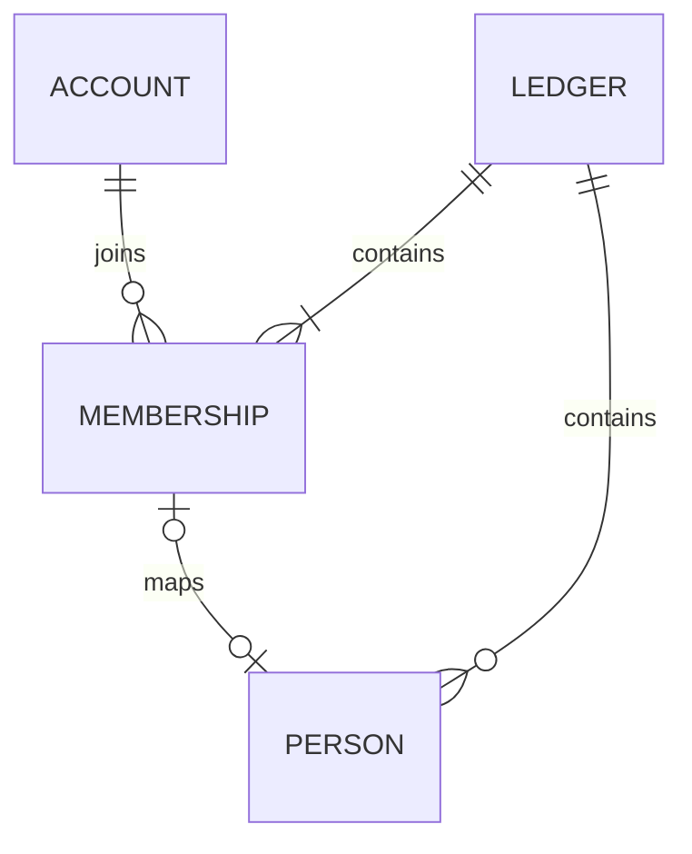

# 家計簿のDB・業務モデル・保存構成

[← 家計簿共通設計の入口](ledger-foundation-core.md)

## 新版の業務モデル・DB設計方針（未実装）

新版は、旧版と基本的に同じ機能を実現できることを基準に、業務モデルとDB構造を一から設計する。レシート・振替・残高・支払メモ・マスタ・集計について、操作・記録内容・計算結果を整理してから、必要な表・列・型・NULL許容・関連・制約・索引を決める。旧版の表名・列名・列の存在を、そのまま新版の要件としない。ソースの命名方針は[04](architecture-winui.md#新版windows版の構成)を正本とする。

新設する業務テーブルの主キーと採番も、整数・UUID等の候補、キーの一意性の範囲、同時登録・再送・親子参照の要件から検討する。旧版のSeq／Codeや、実装済みAPIのUUIDを一律に引き継ぐ前提にはしない。人物IDについては比較後にUUIDの採用を確定した。それ以外の未確定の列名・キーは設計案として見直す。実装済みの認証・家計簿APIの現行契約と、新たに検討する業務構造を区別する。

構造の再設計と機能の変更を分け、旧版と異なる操作・計算・保存内容が必要になった場合は実装前に確認する。既存データの引継ぎと保存時合計の保持は[新規利用と既存DBの境界](ledger-core-transition.md#新規利用と既存dbの境界)に従い、新スキーマ確定後に旧列・旧キーとの対応を整理する。人物以外の業務テーブルや採番方式は後続で確定する。

## 支払方法の所有者・表示順（DEC-118・仕様確定／未実装）

支払方法は家計簿ごとに独立し、所有者として**同じ家計簿の人物**を指定する。所有者は未設定を許可する。所有者未設定は「共有」等の利用目的を確定する区分ではなく、あくまで人物を指定していない状態とする。家計簿内の編集権限と本人に対応する人物を用い、**管理者は所有者を問わず編集可、編集者は自分に対応した人物が所有する支払方法だけ編集可**とする。所有者未設定の支払方法は管理者だけが編集できる。閲覧者には編集権限を付与しない。これは支払方法自体の編集権限であり、レシートでの支払方法の利用可否や他の業務操作へ自動的には拡張しない。

支払方法の一覧・選択候補は、**現在のログインアカウントに対応する人物の支払方法 → 所有者未設定 → 他の人物の支払方法**の順で表示する。

- 「自分」はその家計簿のアカウント・人物の任意対応で判定する。対応がなければ「自分」のグループは存在しない。名前やWindowsログイン名では照合しない。
- 同一所有者に属する支払方法、および所有者未設定の支払方法は、支払方法マスタの**共通表示順**で並べる。
- 「他の人物」は人物マスタの**共通表示順**に従い、人物ごとに支払方法の共通表示順で並べる。
- 閲覧者ごとに表示上のグループ順は変わるが、支払方法マスタには個人別表示順を保存しない。

**未確定・後続設計：** 支払方法の物理テーブル・主キー・表示順の更新API・同順位時の順序、追加／削除時の権限と操作、所有者変更時の制約、支払方法の有効期間とポイント設定、分類マスタの税率初期値は別途決める。旧版の`valid_from`／`valid_to`が存在することだけで有効期間を実装済みとはみなさない。業務API・DB・WinUI 3画面はこの決定だけでは変更しない。

## 保存構成（APIの初回定義へ実装済み）

認証ストアは引き続きアカウント・鍵・セッションを保存する。家計簿用のモデルと権限確認は`Features/Monetail`へ配置し、認証基盤から家計簿の参加者・人物を参照しない。SQLiteの接続と初回定義はPersistence/ApiDbContextでまとめ、家計簿モデルの制約はLedgerModelで設定する。これらのAPI用テーブルは未リリースAPIの初回定義へ組み込む。以前の開発用DBを更新する互換経路は作らない。

| テーブル | 主な列 | 主キー・制約 |
| --- | --- | --- |
| `ledgers` | `id`, `name`, `created_by_auth_user_id`, `created_at_utc`, `revision`, `people_order_revision` | `id`が主キー。作成者は認証アカウントへRESTRICTのFK。人物順全体の更新版を保存する |
| `ledger_members` | `ledger_id`, `auth_user_id`, `role`, `joined_at_utc`, `revision`, `person_id` | 家計簿ID＋認証IDが主キー。家計簿・認証アカウントへFK。roleはViewer / Editor / AdminのCHECK。NULL許容の人物IDを保存する。家計簿ID＋人物IDをUNIQUEとし、同じ家計簿の人物へのRESTRICTの複合FKを設ける |
| `ledger_people` | `ledger_id`, `person_id`, `name`, `valid_from`, `valid_to`, `display_order`, `revision` | 人物IDはAPI側で生成するUUID。家計簿ID＋人物IDが主キー。家計簿へFK。同一家計簿内の人物名は前後空白除去後の完全一致で重複を禁止。日付はYYYY-MM-DDのTEXT/NULLに確定。更新版は名前・有効期間を対象とするUUID。アカウントIDは持たない |
| `operation_requests` | [共通再送管理表](ledger-operation-retries.md#共通の再送管理表apidb実装済み)の6列 | 要求IDを主キーとする共通の処理履歴。家計簿・人物・招待の作成で共有し、結果IDに削除制限FKを設けない |
| `ledger_invitations` | [家計簿招待](ledger-invitations.md)の招待テーブル9列 | 招待IDが主キー、トークンを一意とし、家計簿・発行者・使用者へRESTRICTのFK |
| `ledger_navigation` | `auth_user_id`, `last_opened_ledger_id` | アカウントIDが主キー。アカウントと家計簿へRESTRICTのFK。参加行へのFKは設けず、参照・開く時に現在の参加を検証 |

- 実装済みの家計簿IDはサーバー生成のランダムなUUIDをTEXTで保持し、作成・参加・要求記録の日時はUTC。家計簿名は空白のみを拒否し、同じ名前でもIDで区別して既存家計簿へ統合しない。未実装の業務データの採番は上記の設計方針で別途検討する。
- 表の列は原則NOT NULL。参加者の人物IDと人物の有効期間の空欄はNULLを認める。人物未対応の参加者は`person_id`がNULLの参加者行、アカウントに対応しない人物はどの参加者からも参照されない人物行として扱う。
- FKは原則RESTRICTとし、人物や参加者への操作から業務データ・認証アカウントを連鎖削除しない。参加者の退会履歴・過去入力者の表示は後続設計。人物削除では参加者との対応を含む参照を自動解除せず、参照が残っている間は削除を拒否する。詳細は[人物の管理](ledger-persons.md#人物の管理dec-055未実装)を参照する。
- `ledger_members(auth_user_id, ledger_id)`に一覧用索引を設ける。家計簿内の役割変更等は`revision`を照合し、更新成功時に新しい値を保存する。
- 再送の記録は共通の`operation_requests`へ移す方針。家計簿専用だった`ledger_creation_requests`を共通表へ置き換え、要求内容の照合値を使い、同じ要求IDで異なる内容を送っても別の家計簿・人物を作らない。
- 業務マスタ・取引の新スキーマは別途設計する。支払方法等は所属を複合FKで検証できるようにし、親レシートと明細・対象者等にも他家計簿を参照させない。現行Windows用テーブルへ今回の列を直接追加する案ではない。

図の任意の1対1は利用者確認済み。FKは家計簿をまたぐ対応を拒否できるが、「管理者1人以上」は単純なFKで表せないため書込時に確認する。

## 支払方法の有効期間（DEC-119・基本仕様確定／未実装）

支払方法の有効期間は、カード券面の期限ではなく、支払方法・口座等の**加入・契約開始から退会・解約までの利用期間**を意味する。開始日・終了日は**それぞれ任意（未設定なら制限なし）**とする。設定した両端日を含み、現在日ではなく**対象の取引日／残高基準日**で判定する。

- **新規レシート・新規振替：** レシート・振替の日付に有効な支払方法だけを新たに選択できる。振替は移動元・移動先の双方で判定する。過去の日付でもその日に有効なら選択可能。
- **既存レシート・振替の編集：** 保存済みの支払方法は、その後に有効期間が終了しても保持して編集できる。自動的な置換・削除は行わない。
- **残高の新規登録：** 残高基準日が支払方法の有効期間内である場合だけ登録できる。期間外の日付には登録しない。過去日付でもその時点で有効なら登録可能。
- **過去の残高・取引の履歴表示・集計：** 退会・解約後も期間内の記録は保持し、履歴表示や集計から除外しない。
- **有効期間の設定変更：** 既存のレシート・振替・残高の値や集計対象を、期間変更だけを理由に自動変更しない。

**後続判断（未確定）：** 既存レシート・振替・残高で日付や支払方法を変更する場合の期間チェック、開始日／終了日の整合性エラーと画面表示、過去データを参照する選択UI、物理DB列・API契約・管理画面・権限・移行手順。旧版`m_payment_classification.valid_from/valid_to`はDB列として存在するが、旧版で実際に期間フィルタを行っているとはみなさない。この決定は業務API・DB・WinUI 3の実装完了を意味しない。

## 支払方法の候補表示（DEC-120・仕様確定／未実装）

**支払方法の管理画面**は、初期状態では**本日現在有効な支払方法だけ**を表示する。「**有効期間外も表示**」を切り替えると、開始日前・終了日後の支払方法も含めて全件表示し、権限に応じて参照・編集できる。管理画面の本日基準と、業務入力候補の対象日基準を区別する。

- **管理画面：** 既定は本日現在有効なものだけ。切替ONでは**将来開始予定・解約／終了済みを含む有効期間外の支払方法**も表示する。並び順はDEC-118の「自分→所有者未設定→他の人物」と共通表示順に従う。
- **新規レシート・振替・残高の入力候補：** 今日現在では有効期間外でも、**入力対象の取引日／残高基準日に有効だった支払方法は表示して選択できる**。例えば10月31日に解約した口座でも9月の日付のレシートには指定できる。対象日付を変えた場合の候補は、新しい日付で判定する。
- **既存取引の編集：** 保存済みの支払方法は有効期間終了後もその取引の表示・編集で失わず、変更しなければ保持できる。過去の取引・残高は削除せず、集計値を自動変更しない。**集計画面で支払方法を表示する条件はDEC-121**に従う。

**後続判断（未確定）：** 既存取引の取引日・支払方法変更時の保存検証、候補の一時的な選択解除や入力保持の画面操作。支払方法を削除する仕様ではなく、表示・新規選択の絞り込み方針である。API・DB・WinUI 3は未実装。

## 集計期間との重なり・有効期間の保存検証（DEC-121・仕様確定／未実装）

- **集計画面の支払方法表示：** 集計対象の開始日～終了日と支払方法の有効期間が、**1日以上重なる場合に表示対象**とする。判定は両端日を含む。有効期間の開始日・終了日がNULLならその側は無制限とする。本日現在の有効／無効では判定しない。例えば2026年（1月1日～12月31日）の集計では、2026年中に1日でも有効だった支払方法を表示対象に含める。集計金額は従来どおり集計対象期間のデータで計算し、重なりだけを理由に別期間の取引を加算しない。
- **有効期間の登録・変更：** 保存しようとする期間の外側に、その支払方法を参照する**既存の日付付き業務データが1件でも存在する場合は保存不可**。期間の追加、開始日の後ろ倒し、終了日の前倒し等を区別せず、**保存後の期間全体**と既存データの日付を照合する。レシート日、振替日（出金側・入金側）、支払方法別の残高基準日、日付付き支払メモのチェック日等が該当する。金額が0の記録も存在するデータとして検証する。
- **拒否時：** 有効期間も既存データも保存・削除・日付補正しない。利用者が既存データか期間設定を見直して再保存する。別途の自動移動・データの一括削除は行わない。
- **有効期間を変更せずに既存取引を編集する場合：** 対象日付・支払方法の変更時にどう判定するかは、引き続き後続設計とする。

**後続判断（未確定）：** 集計画面でデータ0件の支払方法をどう表現するか、日付がNULLの支払メモの扱い、既存データとの不整合を表示するエラー詳細、同時更新時の検証と保存の実装方法、旧版DBからの移行と既存不整合の解消、物理DB・API・WinUI 3の契約。
