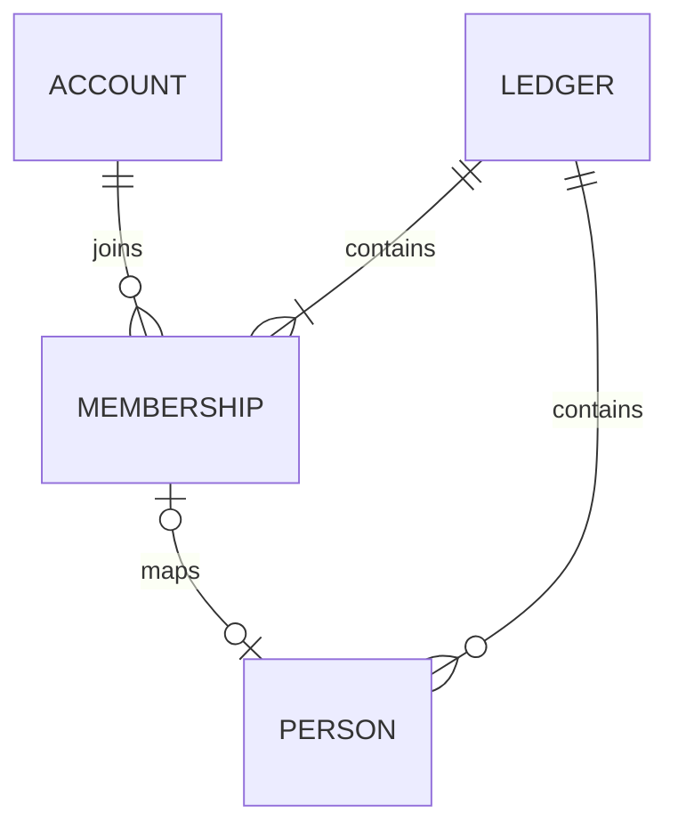

# 家計簿のDB・業務モデル・保存構成

[← 家計簿共通設計の入口](ledger-foundation-core.md)

## 新版の業務モデル・DB設計方針（一部実装）

新版は、旧版と基本的に同じ機能を実現できることを基準に、業務モデルとDB構造を一から設計する。レシート・振替・残高・支払メモ・マスタ・集計について、操作・記録内容・計算結果を整理してから、必要な表・列・型・NULL許容・関連・制約・索引を決める。旧版の表名・列名・列の存在を、そのまま新版の要件としない。ソースの命名方針は[04](architecture-winui.md#新版windows版の構成)を正本とする。

新設する業務テーブルの主キーと採番も、整数・UUID等の候補、キーの一意性の範囲、同時登録・再送・親子参照の要件から検討する。旧版のSeq／Codeや、実装済みAPIのUUIDを一律に引き継ぐ前提にはしない。人物IDと支払方法IDは比較・確認を経てサーバー発行UUIDの採用を確定した（支払方法はDEC-124）。それ以外の未確定の列名・キーは設計案として見直す。実装済みの認証・家計簿APIの現行契約と、新たに検討する業務構造を区別する。

構造の再設計と機能の変更を分け、旧版と異なる操作・計算・保存内容が必要になった場合は実装前に確認する。既存データの引継ぎと保存時合計の保持は[新規利用と既存DBの境界](ledger-core-transition.md#新規利用と既存dbの境界)に従い、新スキーマ確定後に旧列・旧キーとの対応を整理する。科目・共通税履歴の構成は以下で定義し、それ以外の未決定の業務テーブル・採番方式は後続で確定する。


## 科目マスタ（DEC-137・139・140）

<a id="科目マスタdec-137139140dbapiclient実装済み"></a>

<a id="category-master"></a>

科目の外部契約（権限・入力・業務制約・一覧・書込・競合・再送）は[科目API](specs/api/features/categories.md)を正本とする。本節は管理画面と物理DBの仕様を扱う。実装状況は[API実装台帳](specs/api/README.md)・[画面台帳](screen-inventory.md)を参照する。[Client・WinUI接続](architecture-winui.md#科目のclient接続画面)を参照する。

### 科目管理画面

「管理・設定 → 科目管理」の右ペインに、科目名・収支区分・初期税区分・有効開始日・有効終了日を標準ListViewで表示する。収支・税区分は[科目API第3節](specs/api/features/categories.md#3-科目の値業務制約)の日本語名を使用する。API配列の共通順を維持し、収入・支出別に分けない。状態列・状態色・折りたたみ・ドラッグ操作は設けない。

- 初期表示はWindowsの本日日付で有効な科目のみ。［有効期間外も表示］で取得済みの全行へ切り替える。両端を含み、nullの境界は制限なし。切替に追加GETや書込を行わず、非表示になった選択を解除する。表示対象0件はその旨を表示する。
- 共通の［追加］［編集］［削除］［並び順変更］を上部に置く。家計簿Adminのみ変更可能。未選択なら編集・削除不可。全参加者は閲覧可能。参照の有無による削除可否の事前取得・判定・表示は行わず、削除実行時にAPIで参照制約を検証する。
- 追加・編集・削除確認は標準ContentDialog。**追加時のWinUI入力支援初期値は支出（Expense）・標準（Standard）・両期間空欄**とし、登録前にすべて変更可能。API必須条件やDB初期値は変えない。編集時は保存済みの全5項目を表示する。収支区分も編集可能とし、使用済みかどうかの事前取得・判定・入力無効化は行わない。保存時に[科目API](specs/api/features/categories.md#6-競合失敗応答)が使用済み科目の収支変更を拒否する。`category_income_expense_conflict`では入力を保持し、収支区分の近傍に理由を表示する。保存成功まで一覧の保存済み値は変更しない。
- 日付補完・Enter/IME・エラー近傍表示・削除のキャンセル既定は[入力](59-input-controls-design.md)と[共通UI](../UI_DESIGN.md)に従う。名前重複・参照中の削除拒否・期間逆転・既存取引との期間不整合は入力を残して説明する。期間変更の業務制約は[科目API](specs/api/features/categories.md#3-科目の値業務制約)に従う。
- 編集・削除の409は`code`と`latest`の形式で区別する。`revision_conflict`の行版競合では未保存入力と元の行版を保持し、最新の名前・収支・税区分・両期間をすべて別表示する。［最新内容に切り替える］でのみ対象と版を置き換え、切替前の保存は停止する。追加GET・自動保存は行わない。名前重複・参照による削除拒否・期間競合・収支区分変更制限等の業務エラーでは最新内容への切替を要求せず、入力を保持して理由を表示する。自動再送・自動削除は行わない。
- 並び順変更は同じWindowの右ペインの専用画面。全期間・収支混在の全科目に［上へ］［下へ］［保存］［キャンセル］を提供し、全IDと順序版を一括送信する。409 `revision_conflict`の順序版競合では未保存順を破棄し、応答の最新全行と順序版へ切り替える。取消や左メニューへの移動は保存せず破棄する。
- 成功時は応答の一覧だけを反映する。通信再試行は同じ作成requestIdを維持し、業務エラーで勝手に再取得・保存しない。対象不在の404に限る一覧再取得と権限喪失時の処理は[人物・科目の共通処理](ledger-person-conflicts.md#編集削除対象不在時の処理)に従う。
- 認証失効時の追加・編集・未保存順はメモリー内に保持し、同じ接続先・同じ本人の再ログイン後だけ元家計簿と現在権限を確認して復元する。入力・作成requestId・元の行/順序版・全IDを保持し、自動保存しない。別アカウント/接続先へ渡さず、削除確認は自動復元・再送しない。人物・支払方法の既存方式に揃える。

### 科目固有の収支区分と初期税区分（DEC-139・140）

科目の値・名称・用途・変更制約は[科目API](specs/api/features/categories.md#3-科目の値業務制約)を正本とする。収支区分はグループ単位では変更せず、グループ・明細に税区分コードは保存せず、明細には選択した実税率を保持する。明細・周期・計算との接続は[科目とレシート](#category-receipt-handoff)を参照する。

### 科目の物理モデルと制約

`ledger_categories`は次の9列。PKは`(ledger_id, category_id)`。ID/更新版はUUID N形式のTEXT。

| 列 | 型・NULL | 用途 |
| --- | --- | --- |
| `ledger_id`・`category_id` | TEXT・不可 | 所属家計簿ID・科目ID |
| `name` | TEXT BINARY・不可 | 家計簿IDとの複合UNIQUE。期間による部分索引にしない |
| `valid_from`・`valid_to` | TEXT・可 | `YYYY-MM-DD`。CHECKで開始日≦終了日を保護 |
| `display_order` | INTEGER・不可 | 非負。家計簿ID・順序・科目IDの索引 |
| `tax_category_code` | TEXT・不可 | 共通税区分へのRESTRICT FK |
| `income_expense` | TEXT・不可 | CHECKで`Income`/`Expense`のみ。変更制約は[科目API](specs/api/features/categories.md#3-科目の値業務制約)に従う |
| `revision` | TEXT・不可 | 行編集用UUID版・EF同時実行トークン |

家計簿へのFKはRESTRICT。将来の使用先は`(ledger_id, category_id)`へRESTRICT FKと索引を設け、家計簿間の参照と連鎖削除を防ぐ。使用済みの判定は[科目API](specs/api/features/categories.md#3-科目の値業務制約)に従い、専用の「使用済み」フラグを保存しない。

`ledgers.category_order_revision`は家計簿共通の構成・順序用UUID版で、家計簿編集版・人物/支払方法の版から独立する。新しい家計簿はUUIDを初期化し、既存行の補正や空文字デフォルトは設けない。DB初期化は[現行モデル方式](42-api-foundation.md#db初期化登録復旧コマンド)を正本とする。

**責務：** DBはNOT NULL・UNIQUE・FK・非負順序・収支許容値・期間の前後関係を保護する。名前のTrim/UTF-16長と日付の厳密な書式/実在日はAPIで検証する。名前の長さCHECKは補助的なUnicode文字数検証。Admin再検証・条件付き更新・順序版・再送記録の同時確定はAPIの責務。

## 科目CRUD API

<a id="category-crud-api"></a>
<a id="科目crud-api実装済み"></a>

[科目API正本](specs/api/features/categories.md)を参照。

## 科目並び替えAPI

<a id="category-order-api"></a>
<a id="科目並び替えapi実装済み"></a>

[科目API正本](specs/api/features/categories.md)を参照。

## 共通税区分・日付別税率履歴（DEC-138・DB基盤実装済み）

<a id="shared-tax-history"></a>

ここでの税区分（`TaxCategory`）は標準・軽減・非課税の分類であり、従来の税込/税抜設定（`TaxType`）とは別の概念。**税区分は科目の初期税率を決めるためだけに使用**し、レシート入力画面では税区分を選択せず、グループにも税区分を保存しない。税込/税抜設定や既存計算は変更しない。

税区分・税率履歴は**全家計簿で共有**する。家計簿ごとの業務マスタとは分離し、`ledger_id`を持たない。標準・食品軽減・新聞軽減・非課税の4区分を`tax_categories(code PK, name)`へ登録する。食品と新聞は同じ税率でも異なるコードで保持する。確定していない税率履歴は自動投入せず、新規DB初期化では税率履歴を0件で作成する。

`tax_rate_history`は次を保持する。

| 列 | 型・NULL | 用途 |
| --- | --- | --- |
| `id` | TEXT・不可 | UUID N形式の履歴行ID・PK |
| `tax_category_code` | TEXT・不可 | `tax_categories.code`へのRESTRICT FK |
| `valid_from` | TEXT・不可 | 適用開始日 `YYYY-MM-DD`、当日を含む |
| `valid_to` | TEXT・可 | 適用終了日、当日を含む。NULLは終了なし |
| `rate` | TEXT・可 | 百分率のDecimal（8は8%）。REALに変換せず精度を保持 |
| `revision` | TEXT・不可 | 履歴行の編集用UUID版・EF同時実行トークン |

- 実在する日付、開始≦終了をCHECK。税区分・開始日・終了日の索引を持つ。
- 同じ税区分で期間を重複させない。INSERT/UPDATEのSQLiteトリガーで、両端を含む区間と終了なしを照合する。更新では自分の旧行だけを除外し、税区分変更時も移動先を照合する。同時書込みもSQLiteの書込直列化と同じトリガーで保護する。
- 例：4/1〜9/30の次は10/1から設定できる。9/30からの別履歴は重複。期間の隙間は許可し、日付に対応する履歴がなければ、別の日付や別区分の税率を勝手に代用しない。
- **税率履歴の`rate`は、`Standard`・`ReducedFood`・`ReducedNewspaper`を含めてNULLを許可する**（D4-0でDB制約・回帰テスト実装済み）。`Exempt`は引き続きNULL必須とする。課税区分のNULLは当該期間に税を加算しないことを示し、課税`0%`（Decimalの`0`）とは別値。**「該当する履歴行あり・rate=NULL」と「該当する履歴行なし」は区別**する。前者は新規明細の非課税（実税率NULL）を初期選択でき、後者は課税区分の初期税率未選択。数値の読書きは.NET Decimalを使用し、数値の解析・入力検証はアプリ側の責務とする（生SQLも同様）。**`TaxModel`のCHECK緩和と`CategoryTaxSchemaTests`の境界・NULL回帰はD4-0で実装済み。**
- **境界日を含む履歴の例**：`Standard`の`validFrom=0001-01-01`〜`validTo=1989-03-31`を`rate=NULL`とし、`1989-04-01`〜`1997-03-31`を`rate=3`とすれば、各日の初期税率を正しく選択できる。入力日と率の具体例は独立の履歴行で表す。前者と後者の日付に重なりがないことを検証する。これらを`initialize-db`で自動投入するものではない。
- **保存する明細は実税率のみ**なので、`Standard`の履歴`rate=NULL`から選ばれた「制度導入前の税なし」と、`Exempt`科目などの「非課税」はどちらも明細`tax_rate=NULL`であり、**保存後の明細単独では起源を区別できない**。現行の税額計算ではいずれも税を加算しない。起源の区別が必要な将来要件は別設計とする。
- 食品軽減だけ8%→1%→8%、新聞軽減は8%を維持する履歴を表現できる。**1%と日付は仮定の例であり、法令・施行日・初期データではない**。試験データ以外には投入しない。
- 税率履歴の投入・管理は**当面CLI**とし、管理画面・HTTP書込APIは作らない。**全履歴同期CLI（D4-CLI）とJSON4項目は実装済み**。税率・施行日データ自体は自動投入せず、運営者が明示する。

### 税率履歴の全履歴同期CLI（D4-CLI実装済み）

- `sync-tax-rates --file PATH --dry-run`で希望状態とDB現状の差分を検証・表示し、**DBを変更しない**。実際の更新は`sync-tax-rates --file PATH --apply`を明示する。運営者がAPIサービスを停止し、SQLiteの正しいバックアップを取得した上で実行する。既存DB接続設定を使用し、コマンドから新規DBを作成しない。
- 入力JSONは[共通税区分・税率履歴API第5節](specs/api/features/tax-rates.md#5-成功応答並び順)のGET成功応答と同じ項目・型で、全税区分・全期間の**希望する完全な履歴集合**を指定する。抜粋ファイルを部分追加の指示と扱わない。 `Exempt`の率はnull必須、他の3区分のnullも有効。率nullは削除ではない。
- 同一税区分の期間重複・無効日付・数値書式・区分外コード・NULL規則を検証してから反映する。既存行は`(taxCategoryCode,validFrom)`を基準に照合し、値が不変ならID・revisionを維持、終了日・率の変更時だけ更新、新しい開始日は行を追加する。存在しなくなった行は削除候補とし、**通常の`--apply`は削除候補があれば拒否**。削除を許す場合のみ`--apply --allow-delete`を明示する。
- `--apply`時も最新DBを**書込トランザクション内で再照合**して同じ入力ファイルの全差分を検証する。削除許可の有無・期間重複などを判定した後、終了日の短縮・必要な削除・新規追加を**トリガーが有効なまま安全な順序**で処理する。全件成功時だけコミット、失敗時はロールバック。変更のない再適用はID・revision・保存値を変更しない。
- 実装は`TaxRateSyncCommand`/`TaxRateSync`。引数は上記の操作オプションだけを受け付け、DB接続は他の管理CLIと同じ設定ファイル/環境変数を使用する。未知・重複・矛盾オプション、必須項目の欠落、余分/重複JSONプロパティ、不正なDecimalの丸めを拒否する。空の`rates`も完全な希望状態であり、既存行は全件削除候補となる。
- dry-runはSQLiteのReadOnly接続、applyはReadWrite接続の`BEGIN IMMEDIATE`で書込権を確保してから現行構造/初期マスタ・全履歴・差分を読み直す。削除→保持行の更新→新規行の追加の順で重複トリガーを維持する。開始日は照合キーとして不変のため、保持行間で開始日をまたぐ拡張は希望状態の重複検証で拒否される。Decimalの数値が同じ表記差だけでは更新せず、保存済み文字列も保持する。
- 差分は区分コードのOrdinal昇順・開始日昇順で、追加/変更/削除件数と行ごとの終了日/率の変更前後を標準出力へ表示する。失敗は標準エラーと終了1、成功は0。DB接続文字列や秘密は出力しない。運用手順は[Docker/Tailscale構成例](deployment-examples/docker-tailscale.md#税率履歴の手動同期d4-cli実装済み)を参照。
- `initialize-db`は履歴0件のまま。正式リリース前にMigrationや既存スキーマの自動変換を行わない。DB制約緩和後の最新スキーマで新規DBを作成する。CLIによる履歴変更は保存済みレシートを自動書換えしない。

### 登録用の税率履歴JSON（2026-11-12確認、DB未登録）

全期間の希望状態を記述した初期データの管理元は、リポジトリの[`config/tax-history.json`](../config/tax-history.json)とする。**これは運営者が内容を確認し、D4-CLIで明示実行するためのデータファイルであり、DBの初期シード・APIビルド時の埋込み・自動配備ではない。** レートは国税と地方消費税を含む合計の百分率。

- `Standard`は**1989-03-31までNULL、1989-04-01から3%、1997-04-01から5%、2014-04-01から8%、2019-10-01から10%**。2019-10-01以降は終了日を設けず、後の法改正時にJSONを改定する。
- `ReducedFood`・`ReducedNewspaper`は、**2019-09-30以前にはMonetailの科目初期値として同日の標準税率を採用**する。2019-10-01以降は8%。軽減税率制度そのものは2019-10-01導入であり、それ以前に法律上の軽減区分があったという意味ではない。取引の個別例外は実税率を手動選択する。
- `Exempt`は最初の日付`0001-01-01`から終了なし、`rate:null`の1行。過去の消費税未導入期間は他の3区分でも`rate:null`を登録するため、履歴の欠落と区別できる。
- **2027-04-01から食品1%を2年間とする法案は、2026-11-12時点で衆院通過・参院審議中（未成立）**。確定した施行データではないのでファイルに反映しない。法律が成立して改定内容と日付を確認した後、JSONをPRで更新し、CLIのdry-run→明示applyを行う。ファイル変更だけではDB値は変わらない。

照合資料：[国税庁：消費税と地方消費税の税率](https://www.nta.go.jp/taxes/shiraberu/taxanswer/shohi/6303.htm)、[財務省：軽減税率制度](https://www.mof.go.jp/tax_information/qanda023.html)、[国立国会図書館レファレンス：1989～2019年の税率変遷](https://crd.ndl.go.jp/reference/entry/index.php?id=1000339322&page=ref_view)、[衆議院：2027年食品税率引下げ法案の審議経過](https://www.shugiin.go.jp/internet/itdb_gian.nsf/html/gian/keika/1DE342E.htm)。**将来の適用前には改めて法令・附則・経過措置を確認する。** サーバー側の配置例は[Dockerサーバー配備例](deployment-examples/docker-tailscale.md#税率履歴jsonの配置管理cli未実装)を参照。

詳細なCodex受入条件は[工程6-D4ガイド](ledger-receipt-implementation.md#税率履歴全件getと全履歴同期cli仕様確定)を参照.

### 共通税率履歴の全件GET・メモリキャッシュ

HTTP・JSON・認証・認可・失敗応答の正本は[共通税区分・税率履歴API](specs/api/features/tax-rates.md)を参照する。以下はClientキャッシュとレシート入力への接続契約。

- Windows Clientは取得した全履歴を**接続先・認証アカウントのコンテキスト単位のメモリキャッシュ**に保持する。家計簿単位の人物・科目・支払方法キャッシュとは区別し、キャッシュヒット・同一コンテキストの家計簿切替・日付変更では追加GETしない。キャッシュ利用時も認証更新と前後のログインコンテキスト確認を行う。
- 接続先変更・接続の破棄、明示的な再ログイン／復元、ログアウト成功、認証失効・別ログイン検出でキャッシュを破棄し、次の利用時に取得する。通常のトークン更新と通信障害によるログアウト失敗では破棄しない。破棄前の旧応答は返却・キャッシュ保存しない。取得失敗はキャッシュせず、自動再取得しない。ディスク永続化・TTL・定期確認は設けない。
- WinUIは**取引日・科目の初期税区分から、キャッシュ上の有効期間を両端含みで判定**する。新規明細で`Exempt`の科目は履歴なしでも非課税を初期選択し、画面の非課税候補は常設する。**`Standard`等の課税区分でも、当日有効な履歴行の`rate`がNULLなら非課税（実税率NULL）を初期選択する。履歴行自体がなければ未選択。** 数値の課税率は当日適用する履歴だけを候補化して同率を重複排除し、他区分・別日の値で代用しない。
- **キャッシュは保存可否の保証ではない**。保存APIは既存どおりトランザクション内で最新の履歴と全明細を照合する。履歴不一致などで保存を拒否した場合は全件を再取得し、保存済み・入力途中の実税率を自動変更せず、該当明細の再選択を利用者へ求める。

### 既存API用DBの扱い

<a id="category-master-development-databases"></a>

**正式リリース前は**DEC-141に従ってMigration・Snapshot・履歴を使わず、最新EFモデルから新規API DBを作成する。旧11列・8列を含む既存API用DBを自動変換せず、保持したうえで別の新規DBを明示的に準備する。**リリース後にはMigrationを導入**し、その具体的な初回手順はリリース準備時に定める。既存ファイルや認証データを本変更で削除・初期化しない。現行の正しいDBは再初期化で保存値を変えない。手順と拒否条件は[DB初期化](42-api-foundation.md#db初期化登録復旧コマンド)に集約する。

### 後続レシート実装への引き継ぎ（DEC-139以降・DB基盤実装済み）

<a id="category-receipt-handoff"></a>

この節は**科目・共通税率履歴とレシートの接続点**。レシート4表の列・FK・索引・周期等は[レシート物理設計](ledger-receipt-schema.md)、HTTP/JSON（DEC-257〜260）・保存時の計算・入力検証・権限は[レシートAPI](ledger-receipt-api.md)、初期値・下書き・流用は[レシート画面](ledger-receipt-ui.md)を正本とする。DB・API・計算・WinUIの画面内編集は実装済みで、WinUIからの**全体保存・履歴候補UIは未接続**。

- **科目とグループ**：レシートのグループは科目単位で、同一科目は1グループだけ（[複合UNIQUE](ledger-receipt-schema.md#3-ledger_receipt_groups科目グループ)）。科目収支区分はグループに複製せず、金額の正負とも独立。**使用済み科目の収支区分は変更禁止**。明細には税区分コードではなく実税率を保持し、同じグループで異なる税率を許可する。
- **税率の初期値・保存（DEC-158）**：科目の初期税区分と取引日で判定。非課税科目は履歴0件でも非課税、課税区分の履歴行があり`rate:null`なら非課税、履歴行がなければ未選択。候補は非課税常設＋当日有効な数値税率（同率重複なし）で、課税0%とは別。通常新規で直前明細の税率は自動継承せず、複製・流用と編集では保存済みの税率を尊重。**APIは新規・更新・流用の全明細を最新の取引日履歴で保存前に再検証**し、保存済みの実税率を自動変更しない。
- **明細・周期・人物（DEC-161）**：費用区分と発生区分は明細単位。収入科目は費用区分`Excluded`のみ、支出科目は`Fixed`/`Variable`/`Excluded`（初期`Variable`）、発生区分は`Regular`/`Irregular`/`Temporary`（初期`Irregular`）。レシート周期は親の`recurrence_interval`/`recurrence_unit`（`Week`/`Month`/`Year`）で、周期ありなら正の間隔と定期明細1件以上が必須。人物は初回0人選択、連続入力時は選択を保持し、流用時は各明細の保存値を維持。0人でも保存可能。
- **金額の計算（DEC-156・DEC-157）**：レシート会計合計は科目・グループをまたいだ同率合算、グループ参考額は各グループ内の税率別合算。人物ごとのグループ参考額は明細の人数按分後にグループ内で税率別集計。**人物別レシート全体・期間合計の集計境界と、按分の最終端数は未決定**。参考額の合計を会計合計へ流用しない。

### レシート操作の権限（利用者確認済み・API未実装）

- **Admin**：すべての支払方法を利用してレシートを登録し、登録者を問わず全レシートを編集・削除可能。
- **Editor**：家計簿内で自分のアカウントと対応する人物が所有する支払方法のみ、レシートの登録・編集・削除に利用できる。**他の登録者のレシートでも、支払方法が本人所有なら編集・削除できる**。本人対応がなければ利用可能な支払方法はない。権限・所有者はAPIの書込時に現時点の関係で照合する。
- **Viewer**：当該家計簿のレシートを閲覧のみ可能。登録・編集・削除は不可。
- **Editorが編集で支払方法を変更するときは、変更前・変更後の両方が本人の対応人物の所有であることを確認する。** 保存済みレシートの日付変更時の人物・支払方法の有効期間は書込時に検証する。書込APIの詳細は[レシート設計](ledger-receipt-schema.md)を参照。


## 支払方法の評価額と残高連携（DEC-305〜347・未実装）

評価額属性・残高関連のDB/API/WinUI実装は後続。詳細な業務判断は[決定履歴](13-glossary-decisions.md#3-決定履歴決定時点の記録)、画面は[共通UI](../UI_DESIGN.md#集計分析の画面切替dec-2852026-11-15確定winui画面業務api未実装)、推算GETは[残高API契約](ledger-balance-api.md)を正本とする。

- **支払方法の評価額属性（DEC-305〜311）**：［評価額あり／なし］を設け、新規は初期オフ。オンなら評価額のみの登録も可、オフなら評価額登録不可。0円を含む非NULL評価額の履歴があればオン→オフは禁止し、APIでも検証する。オフ→オンは残高履歴の有無に関係なく許可し、残高と評価額を転記・代用・自動削除しない。通常集計は残高、評価額モードではオンの支払方法は評価額のみ、オフは残高を参照。評価額属性のHTTP・編集権限は[支払方法API](specs/api/features/payment-methods.md)を正本とする。物理列は下記の`has_valuation`。
- **残高の保存（DEC-312〜320）**：同一家計簿・登録日・支払方法につき最大1行で、残高・評価額は独立したNULL許容値。0円は入力済み。両方NULLの行は保存せず、登録日全体の保存対象が0件なら「残高または評価額を1件以上入力してください」と拒否する。既存日の新規重複は拒否して編集へ案内する。既存行の両金額を空欄にすればその行を削除するが、通常保存で登録日全体の削除は不可。全体削除は対象日を示す`ContentDialog`で明示確認し、成功後だけ一覧へ戻って選択解除。失敗時は入力を保持し手動再試行可能。登録・編集の保存成功後は対象月の［月指定］へ移して保存行を選択する。
- **画面・推算（DEC-321〜347）**：入力表は［支払方法／残高／推算残高／反映／評価額／メモ］の6列。評価額対象外は「—」と理由を表示。推算の起点は対象日より前の最新の非NULL残高で、評価額のみの行を使わない。残高・評価額・推算残高はInt64、SQLite `INTEGER`、C# `long?`、API JSONは正規10進整数文字列か`null`（DEC-336〜338）。推算一括GETは`calculated`／`no_data`／`overflow`の3状態で、現在の家計簿参加者Admin・Editor・Viewerが対象日有効な全支払方法を参照可能。全結果は同一DBスナップショットから取得し、配列順は保証しない。全体取得失敗では「取得失敗」表示・［反映］無効・入力保持とし、失敗時のみ`InfoBar`の明示［再試行］を出す。
- **導入境界（DEC-309・141）**：正式リリース前は最新EFモデルと新規`initialize-db`で実装し、Migration・旧版データからの属性推定・既存DBの無断変換はしない。レシート・振替の金額はInt32のまま。APIエラー本文の残り、具体的なDB読取方式などは後続設計。

関連する個別決定の参照番号：DEC-310・DEC-311・DEC-313・DEC-314・DEC-315・DEC-316・DEC-317・DEC-318・DEC-319・DEC-323・DEC-334・DEC-337・DEC-338・DEC-339・DEC-340・DEC-341・DEC-342・DEC-343・DEC-344・DEC-345・DEC-346・DEC-347。詳細は各正本と決定履歴を参照。


<a id="支払方法の所有者表示順dec-118dec-130で所有者必須へ変更未実装"></a>
<a id="支払方法名の重複制約dec-123dec-130で所有者必須に対応未実装"></a>
<a id="支払方法idの採番dec-124仕様確定未実装"></a>
<a id="支払方法の削除制約dec-125仕様確定未実装"></a>
<a id="支払方法の削除権限dec-126dec-130対応未実装"></a>
<a id="支払方法の追加権限dec-127dec-130対応未実装"></a>
<a id="支払方法の並び替え権限dec-128dec-130対応未実装"></a>
<a id="支払方法の並び順更新版の単位dec-129dec-130で保存先確定未実装"></a>
<a id="支払方法の所有者必須と人物表への並び順更新版dec-130仕様確定未実装"></a>
<a id="支払方法の所有者変更禁止dec-131仕様確定未実装"></a>
<a id="支払方法の並び順採番保存api競合dec-132api実装済み"></a>
<a id="並び順の保存採番確定"></a>
<a id="api契約確定"></a>

## 支払方法の業務・API契約

所有者・名前・有効期間・評価額属性・削除制約・権限・採番・所有者別順序・更新版の外部契約は[支払方法API](specs/api/features/payment-methods.md)を正本とする。物理DBと画面は以下の各節に従う。旧版データの取込み時、所有者を判定できない支払方法に対し推測で人物を割り当てない。

<a id="支払方法マスタの物理db構成dec-133モデルとmigration実装済業務api未実装"></a>

## 支払方法マスタの物理DB構成（DEC-133・実装済み）

DEC-123〜132とDEC-305〜311の確定仕様に従い、SQLite/EF Coreの**物理テーブル・9列（現行8列に評価額属性を追加）＋人物表1列・PK・FK・UNIQUE・索引・CHECKを採用する**。評価額属性は未実装。旧版の`m_payment_classification`をそのまま再利用せず、家計簿単位の新テーブル`ledger_payment_methods`を設ける。所有者変更はDEC-131で禁止され、**DBトリガーでの強制はDEC-134で確定**した。

| 保存先・列 | SQLite型 | NULL | 用途 |
| --- | --- | --- | --- |
| `ledger_payment_methods.ledger_id` | TEXT | 不可 | 所属家計簿ID |
| `payment_method_id` | TEXT | 不可 | APIが発行するUUID（N形式）、名前等と独立 |
| `owner_person_id` | TEXT | 不可 | 同じ家計簿の所有者人物ID。作成後変更不可（DEC-130・131） |
| `name` | TEXT COLLATE BINARY | 不可 | 前後空白除去後の名前1〜100 UTF-16コード単位（DEC-123） |
| `display_order` | INTEGER | 不可 | その所有者内の並び順。0以上、欠番・同順位は許容（DEC-132） |
| `valid_from` | TEXT | 可 | 有効開始日。制限なしならNULL（`YYYY-MM-DD`） |
| `valid_to` | TEXT | 可 | 有効終了日。制限なしならNULL（`YYYY-MM-DD`） |
| `has_valuation` | INTEGER | 不可 | 評価額属性。0=false、1=trueのみ許容（未実装）。APIの新規作成時の省略値はfalse |
| `revision` | TEXT | 不可 | この支払方法の名前・有効期間・評価額属性の編集用UUID更新版 |
| `ledger_people.payment_order_revision`（追加列） | TEXT | 不可 | **人物ごとの支払方法並び順更新版**。人物作成時に初期化（DEC-129・130） |

**確定したSQLite DDLの基本構造**（評価額属性を除き実装済み。評価額属性は最新EF Coreモデルと新規DB初期化へ直接追加する。以下は構成の説明であり、既存DBへ手動で直接実行するSQLではない）：

```sql
CREATE TABLE ledger_payment_methods (
    ledger_id TEXT NOT NULL,
    payment_method_id TEXT NOT NULL,
    owner_person_id TEXT NOT NULL,
    name TEXT NOT NULL COLLATE BINARY,
    display_order INTEGER NOT NULL CHECK (display_order >= 0),
    valid_from TEXT NULL,
    valid_to TEXT NULL,
    has_valuation INTEGER NOT NULL CHECK (has_valuation IN (0, 1)),
    revision TEXT NOT NULL,
    PRIMARY KEY (ledger_id, payment_method_id),
    FOREIGN KEY (ledger_id) REFERENCES ledgers(id) ON DELETE RESTRICT,
    FOREIGN KEY (ledger_id, owner_person_id)
        REFERENCES ledger_people(ledger_id, person_id) ON DELETE RESTRICT,
    CHECK (valid_from IS NULL OR valid_to IS NULL OR valid_from <= valid_to)
);
CREATE UNIQUE INDEX ux_ledger_payment_methods_owner_name
    ON ledger_payment_methods(ledger_id, owner_person_id, name);
CREATE INDEX ix_ledger_payment_methods_owner_order
    ON ledger_payment_methods(ledger_id, owner_person_id,
                              display_order, payment_method_id);
```

- **主キー・外部キー：** `(ledger_id, payment_method_id)`を主キーとし、支払方法を参照する今後のレシート・振替両側・残高・支払メモ等も**家計簿IDを含む複合FK**で参照する。`ON DELETE CASCADE`は使わずRESTRICT（DEC-125）。同一家計簿の人物しか所有者にできず、その人物に支払方法があれば人物削除は不可。
- **名前の一意性：** 所有者必須なので`(ledger_id, owner_person_id, name)`の通常のUNIQUEでよい。APIは前後空白除去・Unicode空白判定・.NET `string.Length`の1〜100上限を検証。**SQLiteの`length()`はUTF-16コード単位と一致しない場合がある**ため、同じ100文字チェックを単純なSQLite `length(name)`制約で重ねない。SQLの`BINARY`照合を一意制約にも適用する。
- **有効期間：** `DateOnly?`をISO固定桁`YYYY-MM-DD`で保存する。日付の実在・形式はAPIで検証し、DB CHECKで両端の前後関係を守る（DEC-119〜122）。既存のレシート・振替・残高・評価額等が期間外となる変更は[支払方法API](specs/api/features/payment-methods.md)に従い同一書込処理で拒否する（DEC-121）。
- **所有者の不変性：** API編集DTOには所有者変更を含めず、DBでも`BEFORE UPDATE OF owner_person_id`トリガーにより実際に値が変わる更新を拒否する（DEC-134）。通常操作での誤作成訂正は未使用なら削除→新規（DEC-131）。
- **並び順：** 1人物内で`display_order ASC, payment_method_id ASC`を使用。順序のUNIQUEは設けない。0件の人物でも`payment_order_revision`は人物行に残る。ポイント関連列は旧版に`default_point_code`があるが、新版のポイントモデル未確定のため**支払方法の確定列へは含めない**。採用する場合はポイントマスタと整合したFK・列を別途設計する。
- **更新版・競合：** 所有者別順序版は対象人物の`payment_order_revision`に保持し、人物編集用`ledger_people.revision`や人物共通順版と独立させる。`payment_order_revision`を人物エンティティ全更新のEF Core同時実行トークンにしない。支払方法自体の`revision`は属性編集用とする。版の照合・更新条件・原子性は[支払方法API第6・7節](specs/api/features/payment-methods.md#6-競合失敗応答)に従う。
- **人物の順序版初期化：** 新規人物はAPIで`payment_order_revision`へ個別のUUID v4（N形式）を指定する。空文字デフォルトや既存行のバックフィルは行わない。旧版整数IDや所有者不明行を自動推測で割り当てない。既存API DBの扱いは[現行DB初期化](42-api-foundation.md#db初期化登録復旧コマンド)に従う。

**実装範囲：** EFマッピング・人物順序版・支払方法のPK/FK/UNIQUE/索引/CHECKと制約テストを実装済み。新規DBは現行モデルから作成する。CRUD・並び替え・WinUIは接続済み。評価額属性のDB・API・WinUIは未実装。ポイント機能・旧版データ移行は後続。

<a id="支払方法の所有者変更をdbトリガーで禁止dec-134migration実装済業務api未実装"></a>

## 支払方法の所有者変更をDBトリガーで禁止（DEC-134・実装済み）

支払方法の所有者`owner_person_id`はDEC-131により作成後変更不可。**APIの入力拒否だけでなく、SQLiteのBEFORE UPDATEトリガーを採用してDBでも変更を拒否する**。家計簿管理者の操作やAPI側の誤実装によっても変更させない。

```sql
CREATE TRIGGER trg_ledger_payment_methods_owner_immutable
BEFORE UPDATE OF owner_person_id ON ledger_payment_methods
FOR EACH ROW
WHEN OLD.owner_person_id IS NOT NEW.owner_person_id
BEGIN
    SELECT RAISE(ABORT, 'payment_method_owner_immutable');
END;
```

- `OLD.owner_person_id`と`NEW.owner_person_id`が**異なるときだけ**更新SQLを中止。同じ所有者を再指定するUPDATEや、名前・有効期間・表示順など他列の更新には影響させない。
- 所有者必須（`NOT NULL`）および同一家計簿の人物への複合FK（RESTRICT）はDEC-133のまま維持する。
- 誤作成時は未使用の支払方法を削除して正しい所有者で新規作成する。新しい支払方法IDを発行する（DEC-124・125・131）。トリガーはINSERT／DELETEを禁止しない。
- `RAISE(ABORT)`は当該SQL文の変更を取り消す。既存トランザクション全体を自動で取り消すわけではないので、API側では例外を検知して業務トランザクション全体をロールバックし、保存失敗として扱う。
- 所有者変更禁止トリガーは`Persistence/DatabaseSchema`で明示定義し、新規DBの表/索引/初期値と同一トランザクションで作成する。Migration/Downによる適用・削除は行わない。
- `PaymentMethodSchemaTests`で所有者変更の拒否、同じ所有者へのUPDATEの許容、他列更新の許容、未使用削除→別所有者での新規作成、トリガー失敗時のトランザクション全体のロールバックを検証する。

**後続作業：** DBトリガーとテストはPRへ実装済み。CRUD APIはDEC-135で実装し、更新要求は所有者列を受け付けない。トリガーを直接発火させる所有者変更APIは設けず、並び替えAPIも接続済み。WinUIへの接続は後続とする。

<a id="支払方法の作成編集削除apidec-135crud実装済み"></a>
<a id="エンドポイント確定"></a>
<a id="支払方法の作成編集削除apidec-135仕様確定未実装"></a>

## 支払方法の作成・編集・削除API

GET・POST・PATCH・DELETE・所有者別順PUTのHTTP・JSON・再送・競合契約は[支払方法API](specs/api/features/payment-methods.md)に従う。APIの実装状況は[API実装台帳](specs/api/README.md)で管理する。

## Windows版の支払方法管理画面（DEC-136・WinUI実装済み）

新Windows版（WinUI 3）の「管理・設定 → 支払方法」で扱う。操作条件・API契約は[支払方法API](specs/api/features/payment-methods.md)、画面の共通レイアウトは[UI_DESIGN.md](../UI_DESIGN.md)、日付入力・キー操作は[59](59-input-controls-design.md)、認証・編集競合の共通契約は[人物管理](ledger-persons.md)に従う。API・Windows Client・このWinUI画面を実装済み。製品と同じXAML/partialを合成APIで検証し、実API接続・実Windows手動操作・実IME・モニター間DPI移動は未検証。

### 一覧・操作（利用者確認済み）

- 一覧は標準`ListView`を所有者人物ごとにグループ化し、見出しに人物名を表示する。人物グループは常に展開し、折りたたみ機能は設けない。表示順は本人所有分を先頭、その他の人物は人物の共通順、人物内は支払方法の保存順とする。本人対応がなければ人物の共通順を使い、人物グループの表示順を保存順に書き戻さない。
- 行は**支払方法名・有効開始日・有効終了日**の3列のみ。状態列・「開始前」「終了済み」等の状態ラベル・期間外を示す色分けを設けない。期間の空欄は制限なしとして扱う。
- 初期表示は**本日有効な支払方法だけ**。「有効期間外も表示」チェックをONにすると、開始前・終了後も含む全件を表示する。表示対象が0件の人物は**見出しごと非表示**（OFF/ONとも表示対象が0件なら非表示）。フィルターは画面表示だけに適用し、取得済みの全支払方法と人物別順序版を破棄しない。
- 一覧の直上に共通の［追加］［編集］［削除］を置き、［編集］［削除］は支払方法の行を1件選択して操作する。未選択・操作権限なしでは該当ボタンを無効にする。行の直接編集や列見出しからの任意ソートは追加しない。
- **各人物グループの見出し**に［並び順変更］を配置し、権限がある人物の見出しにだけ表示する。管理者は全人物、編集者は現在の本人対応人物のみ、閲覧者は非表示。見出しボタンを押すと対象人物を固定した専用画面を開く。一覧上部の共通［並び順変更］や人物選択用の追加コントロールは設けない。

### 追加・編集・削除（利用者確認済み）

- ［追加］は一覧上部の共通ボタンから標準`ContentDialog`を開き、**所有者・支払方法名・有効開始日・有効終了日**を入力する。管理者の所有者`ComboBox`は**初期値未選択**とし、明示選択なしでは登録できない。編集者は本人対応人物を自動設定し、変更できない固定表示とする。人物未対応の編集者・閲覧者は追加できない。
- ［編集］も標準`ContentDialog`を使用する。所有者は人物名を**読み取り専用`TextBlock`**で表示し、変更用`ComboBox`は置かない。現行画面で変更できるのは支払方法名・有効開始日・有効終了日。評価額属性の入力UIは未実装であり、評価額履歴による変更制限の画面動作は[共通UIのDEC-310](../UI_DESIGN.md#集計分析の画面切替dec-2852026-11-15確定winui画面業務api未実装)、業務・API契約は[支払方法API](specs/api/features/payment-methods.md)に従う。名前・有効期間の検証はDEC-123・119〜122と[59](59-input-controls-design.md)に従う。
- ［削除］は標準`ContentDialog`で**所有者名と支払方法名**を提示して確認し、キャンセルを既定とする。削除を確定しても参照済みの場合はAPIで拒否し、保存済みデータを変更しない。失敗時も一覧を維持する。使用済みの支払方法は終了日による管理を促し、参照を自動削除しない。

### 人物別の並び順変更（利用者確認済み）

- 同じWindowの管理・設定右ペインを専用画面に切り替え、**押した見出しの人物名を固定表示**する。画面内で対象人物を選択・変更しない。
- 対象人物の**有効期間外を含む全支払方法**を、保存されている所有者内の順序で表示する。1件選択して［上へ］［下へ］で移動し、先頭の［上へ］・末尾の［下へ］は無効化する。ドラッグ＆ドロップは設けない。
- ［保存］で対象人物の**全支払方法ID・対象人物の順序版**を1要求で送信し、成功時だけ確定する。［キャンセル］は未保存の順序を破棄して一覧へ戻る。人物間の移動・複数人物の一括保存・位置変更ごとの通信はしない。
- 更新版競合（409）では通知して未保存順を破棄し、応答に含まれる**対象人物の最新全件順・更新版**に置き換える。追加GETや自動上書きは行わない。権限喪失時は既存の権限エラー処理を優先する。

**実装時の境界：** 画面は`PaymentMethodsWorkspace`経由で通信し、SQL・独自の認証管理を追加しない。変更・削除の行更新版競合は既存の人物編集と同じ入力保持・最新内容への明示切替の方針に従い、並び替え競合と混同しない。今回決めていない新たな保存条件・自動再取得・自動切替・確認ダイアログは追加しない。

## 保存構成（APIの初回定義へ実装済み）

認証ストアは引き続きアカウント・鍵・セッションを保存する。家計簿用のモデルと権限確認は`Features/Monetail`へ配置し、認証基盤から家計簿の参加者・人物を参照しない。SQLiteの接続と初回定義はPersistence/ApiDbContextでまとめ、家計簿モデルの制約はLedgerModelで設定する。これらのAPI用テーブルは未リリースAPIの初回定義へ組み込む。以前の開発用DBを更新する互換経路は作らない。

| テーブル | 主な列 | 主キー・制約 |
| --- | --- | --- |
| `ledgers` | `id`, `name`, `created_by_auth_user_id`, `created_at_utc`, `revision`, `people_order_revision` | `id`が主キー。作成者は認証アカウントへRESTRICTのFK。人物順全体の更新版を保存する |
| `ledger_members` | `ledger_id`, `auth_user_id`, `role`, `joined_at_utc`, `revision`, `person_id` | 家計簿ID＋認証IDが主キー。家計簿・認証アカウントへFK。roleはViewer / Editor / AdminのCHECK。NULL許容の人物IDを保存する。家計簿ID＋人物IDをUNIQUEとし、同じ家計簿の人物へのRESTRICTの複合FKを設ける |
| `ledger_people` | `ledger_id`, `person_id`, `name`, `valid_from`, `valid_to`, `display_order`, `revision` | 人物IDはAPI側で生成するUUID。家計簿ID＋人物IDが主キー。家計簿へFK。同一家計簿内の人物名は前後空白除去後の完全一致で重複を禁止。日付はYYYY-MM-DDのTEXT/NULLに確定。更新版は名前・有効期間を対象とするUUID。アカウントIDは持たない |
| `operation_requests` | [共通再送管理表](ledger-operation-retries.md#共通の再送管理表apidb実装済み)の6列 | 要求IDを主キーとする共通の処理履歴。家計簿・人物・招待の作成で共有し、結果IDに削除制限FKを設けない |
| `ledger_invitations` | [家計簿招待](ledger-invitations.md)の招待テーブル9列 | 招待IDが主キー、トークンを一意とし、家計簿・発行者・使用者へRESTRICTのFK |
| `ledger_navigation` | `auth_user_id`, `last_opened_ledger_id` | アカウントIDが主キー。アカウントと家計簿へRESTRICTのFK。参加行へのFKは設けず、参照・開く時に現在の参加を検証 |

- 実装済みの家計簿IDはサーバー生成のランダムなUUIDをTEXTで保持し、作成・参加・要求記録の日時はUTC。家計簿名は空白のみを拒否し、同じ名前でもIDで区別して既存家計簿へ統合しない。未実装の業務データの採番は上記の設計方針で別途検討する。
- 表の列は原則NOT NULL。参加者の人物IDと人物の有効期間の空欄はNULLを認める。人物未対応の参加者は`person_id`がNULLの参加者行、アカウントに対応しない人物はどの参加者からも参照されない人物行として扱う。
- FKは原則RESTRICTとし、人物や参加者への操作から業務データ・認証アカウントを連鎖削除しない。参加者の退会履歴・過去入力者の表示は後続設計。人物削除では参加者との対応を含む参照を自動解除せず、参照が残っている間は削除を拒否する。詳細は[人物の管理](ledger-persons.md#人物の管理dec-055未実装)を参照する。
- 家計簿一覧のアカウント別順序・順序版と削除時の関連データの扱いは[家計簿API](specs/api/features/ledgers.md)に従う。物理構成の追加設計・実装状況は[API実装台帳](specs/api/README.md)を参照する。
- `ledger_members(auth_user_id, ledger_id)`に一覧用索引を設ける。家計簿内の役割変更等は`revision`を照合し、更新成功時に新しい値を保存する。
- 再送の記録は共通の`operation_requests`へ移す方針。家計簿専用だった`ledger_creation_requests`を共通表へ置き換え、要求内容の照合値を使い、同じ要求IDで異なる内容を送っても別の家計簿・人物を作らない。
- 業務マスタ・取引の新スキーマは別途設計する。支払方法等は所属を複合FKで検証できるようにし、親レシートと明細・対象者等にも他家計簿を参照させない。現行Windows用テーブルへ今回の列を直接追加する案ではない。



図の任意の1対1は利用者確認済み。FKは家計簿をまたぐ対応を拒否できるが、「管理者1人以上」は単純なFKで表せないため書込時に確認する。

<a id="支払方法の有効期間dec-119基本仕様確定未実装"></a>
<a id="支払方法の候補表示dec-120仕様確定未実装"></a>
<a id="集計期間との重なり有効期間の保存検証dec-121仕様確定未実装"></a>
<a id="既存業務データの日付変更時の有効期間チェックdec-122仕様確定未実装"></a>

## 支払方法の候補表示・集計

- 管理画面は本日有効な支払方法を初期表示とし、有効期間外も表示する切替を持つ。詳細は上記の支払方法管理画面に従う。
- 新規レシート・振替・残高の入力候補は現在日ではなく入力対象日で判定する。過去日でもその日に有効なら選択可能。対象日変更時は候補を新しい日付で判定する。保存済みの支払方法は元の対象日が期間内なら保持して編集できる。期間外となる保存は拒否し、自動削除・置換を行わない。
- 集計対象期間と支払方法の有効期間が1日以上重なる場合に表示対象とする。両端を含み、開始日・終了日がNULLならその側は無制限。本日有効かどうかは判定に使わない。集計金額は集計対象期間内の記録で計算し、別期間の記録を加算しない。データ0件時の表現等は集計の設計に従う。
- 有効期間の保存・削除・業務記録との整合性は[支払方法API第3節](specs/api/features/payment-methods.md#3-支払方法の値業務制約)と各業務APIの契約に従う。
