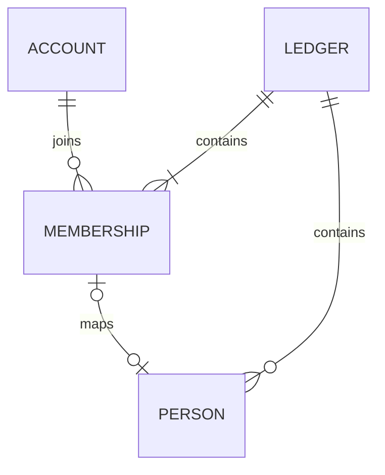

# 家計簿のDB・業務モデル・保存構成

[← 家計簿共通設計の入口](ledger-foundation-core.md)

## 新版の業務モデル・DB設計方針（一部実装）

新版は、旧版と基本的に同じ機能を実現できることを基準に、業務モデルとDB構造を一から設計する。レシート・振替・残高・支払メモ・マスタ・集計について、操作・記録内容・計算結果を整理してから、必要な表・列・型・NULL許容・関連・制約・索引を決める。旧版の表名・列名・列の存在を、そのまま新版の要件としない。ソースの命名方針は[04](architecture-winui.md#新版windows版の構成)を正本とする。

新設する業務テーブルの主キーと採番も、整数・UUID等の候補、キーの一意性の範囲、同時登録・再送・親子参照の要件から検討する。旧版のSeq／Codeや、実装済みAPIのUUIDを一律に引き継ぐ前提にはしない。人物IDと支払方法IDは比較・確認を経てサーバー発行UUIDの採用を確定した（支払方法はDEC-124）。それ以外の未確定の列名・キーは設計案として見直す。実装済みの認証・家計簿APIの現行契約と、新たに検討する業務構造を区別する。

構造の再設計と機能の変更を分け、旧版と異なる操作・計算・保存内容が必要になった場合は実装前に確認する。既存データの引継ぎと保存時合計の保持は[新規利用と既存DBの境界](ledger-core-transition.md#新規利用と既存dbの境界)に従い、新スキーマ確定後に旧列・旧キーとの対応を整理する。科目・共通税履歴の構成は以下で定義し、それ以外の未決定の業務テーブル・採番方式は後続で確定する。


## 科目マスタ（DEC-137・DB基盤実装済み）

<a id="category-master"></a>

科目は家計簿ごとの独立したマスタ。全参加者が閲覧でき、追加・編集・削除・無効化・再有効化・並び替えは**家計簿Adminのみ**。アカウント全体のAdminを家計簿Adminとして扱わない。家計簿作成時に初期科目を生成せず、0件なら後続の管理画面で手動登録する。API・画面・権限の実行時検証は今回未実装。

- 名称は.NETの`Trim()`後に1〜100 UTF-16コード単位（`string.Length`）。同一家計簿内はBINARY完全一致で同名不可。無効な科目も重複判定へ含め、別家計簿では同名を許可する。
- IDは名称・初期値・状態・並び順から独立し、改名でも維持する。過去の記録・集計は科目を参照して新しい名称を表示する。初期値のスナップショットとは区別する。
- 未使用なら削除可能。参照があれば物理削除不可とし、無効化で対応する。無効化した科目は新規入力候補から除くが、既存データ・集計から除かない。再有効化可能で、開始日・終了日は持たない。
- 順序は家計簿共通。新規は無効科目を含む末尾（MAX+1、0件なら0）。有効・無効の切替だけで`display_order`を変えない。順序の欠番・同順位を許容し、保存順の補助キーは科目IDとする。並び替えAPIの全件指定・競合応答等の契約は後続。

### 科目からグループへコピーする初期値

| 項目 | 保存値・選択肢 |
| --- | --- |
| 税区分 | `Standard` 標準・`ReducedFood` 食品軽減・`ReducedNewspaper` 新聞軽減・`Exempt` 非課税 |
| 収支区分 | `Income` 収入・`Expense` 支出 |
| 費用区分 | `Fixed` 固定費・`Variable` 変動費・`NotApplicable` 対象外 |
| 発生区分 | `Regular` 定期・`Irregular` 不定期・`Extraordinary` 臨時 |
| 発生周期 | `recurrence_months=1` 毎月・`12` 毎年・NULL なし |

収入の費用区分は対象外のみ。支出は固定費・変動費のみ。発生区分は収支に関係なく3種類を選択できる。定期では周期1または12が必須、不定期・臨時ではNULL。周期は表示文字列ではなく月数として保持し、将来の隔月・半年ごとは選択肢とCHECKの拡張で対応できる。今回2・6等を選択可能にはしない。定期取引の自動生成・次回発生日管理・入力候補の自動生成は行わない。

### 科目の物理モデルと制約

`ledger_categories`のPKは`(ledger_id, category_id)`。既存の人物・支払方法と同じUUID文字列を採用し、複合FKで将来のレシート等から家計簿をまたいだ参照を防げる構造とする。

| 列 | 型・NULL | 用途 |
| --- | --- | --- |
| `ledger_id`・`category_id` | TEXT・不可 | 所属家計簿ID・科目ID（UUID N形式） |
| `name` | TEXT BINARY・不可 | 科目名。家計簿IDとの複合UNIQUE、有効状態による部分索引にはしない |
| `is_enabled` | INTEGER・不可 | 有効1・無効0。CHECKで他の値を拒否 |
| `display_order` | INTEGER・不可 | 0以上。家計簿ID・順序・科目IDの索引 |
| `tax_category_code` | TEXT・不可 | 共通税区分へのRESTRICT FK |
| `income_expense`・`cost`・`occurrence` | TEXT・不可 | 上表のコード。CHECKで組合せを保護 |
| `recurrence_months` | INTEGER・可 | 定期だけ1または12。それ以外はNULL |
| `revision` | TEXT・不可 | 科目行の編集用UUID版。EF同時実行トークン |
| `ledgers.category_order_revision` | TEXT・不可 | 家計簿共通の科目構成・順序用UUID版。家計簿編集版・人物順とは独立 |

家計簿へのFKはRESTRICT。将来の使用先は当該列に索引を設け、必ず`(ledger_id, category_id)`へRESTRICT FKを張り、参照のある科目の削除をDBでも防ぐ。今回、使用先テーブルや「使用済み」フラグは仮実装しない。新しいUUIDはアプリが発行する。既存家計簿の科目順版はMigrationで個別のUUID v4を付与し、再適用時には変えない。SQLiteの既存表へのNOT NULL列追加用に空文字DDLデフォルトを用いるが、業務上の有効な版にはせず、新規`Ledger`は必ずUUIDを初期化する（支払方法順版と同じ移行方式）。

**責務の分担：** DBはNOT NULL・UNIQUE・FK・有効状態・非負順序・初期値の組合せを保護する。名称の空白除去と正確なUTF-16文字数は`LedgerCategory.Name`の設定時に検証し、DBの長さCHECKも補助的に使う（SQLiteの`length`はUnicode文字数でありUTF-16単位とは異なる）。後続APIの条件付きUPDATE・生SQLでも同じ正規化・検証が必要。Adminの再検証、未使用判定、末尾採番と科目順版のCASを同一トランザクションにまとめる処理・エラー表示・再送契約はAPI実装で行う。`category_order_revision`を家計簿全体のEF同時実行トークンにはせず、対象列の条件付きUPDATEで照合する。

## 共通税区分・日付別税率履歴（DEC-138・DB基盤実装済み）

<a id="shared-tax-history"></a>

ここでの税区分（`TaxCategory`）は標準・軽減・非課税の分類であり、従来の税込/税抜設定（`TaxType`）とは別の概念。税込/税抜設定や既存計算は変更しない。

税区分・税率履歴は**全家計簿で共有**する。家計簿ごとの業務マスタとは分離し、`ledger_id`を持たない。標準・食品軽減・新聞軽減・非課税の4区分を`tax_categories(code PK, name)`へ登録する。食品と新聞は同じ税率でも異なるコードで保持する。確定していない税率履歴は自動投入せず、今回のMigrationは税率履歴を0件で作成する。

`tax_rate_history`は次を保持する。

| 列 | 型・NULL | 用途 |
| --- | --- | --- |
| `id` | TEXT・不可 | UUID N形式の履歴行ID・PK |
| `tax_category_code` | TEXT・不可 | `tax_categories.code`へのRESTRICT FK |
| `valid_from` | TEXT・不可 | 適用開始日 `YYYY-MM-DD`、当日を含む |
| `valid_to` | TEXT・可 | 適用終了日、当日を含む。NULLは終了なし |
| `rate` | TEXT・可 | 百分率のDecimal（8は8%）。REALに変換せず精度を保持 |
| `revision` | TEXT・不可 | 履歴行の編集用UUID版・EF同時実行トークン |

- 実在する日付、開始≦終了をCHECK。税区分・開始日・終了日の索引を持つ。
- 同じ税区分で期間を重複させない。INSERT/UPDATEのSQLiteトリガーで、両端を含む区間と終了なしを照合する。更新では自分の旧行だけを除外し、税区分変更時も移動先を照合する。同時書込みもSQLiteの書込直列化と同じトリガーで保護する。
- 例：4/1〜9/30の次は10/1から設定できる。9/30からの別履歴は重複。期間の隙間は許可し、日付に対応する履歴がなければ、別の日付や別区分の税率を勝手に代用しない。
- 非課税の率はNULL、課税区分の率は非NULLをCHECK。課税0%と非課税を区別する。履歴行自体の不在と、存在する非課税行のNULLも区別できる構造とする。数値の読書きは.NET Decimalを使用する。DBの率CHECKはNULL条件を保護し、数値の解析・入力検証はアプリ側の責務とする（生SQLも同様）。
- 食品軽減だけ8%→1%→8%、新聞軽減は8%を維持する履歴を表現できる。**1%と日付は仮定の例であり、法令・施行日・初期データではない**。試験データ以外には投入しない。
- 税履歴の管理権限・API・編集UI・確定した履歴データの投入手順は後続設計。今回、暗黙の編集者・全体Admin用API等は追加しない。

Migration `20261106204316_AddLedgerCategoriesAndTaxHistory`は科目・税関連3表と科目順版だけを追加し、既存の認証・人物・支払方法・旧Windows版データを変更しない。Downは追加した科目・税履歴と科目順版を失わせる。再Upしてもそのデータは戻らず、運用データの復旧には停止バックアップを使う。

### 後続レシート実装への引き継ぎ（未実装）

- グループは科目を持ち、税区分・収支・費用・発生区分・周期を作成時にコピーし、グループごとに変更可能とする。マスタの変更を保存済みグループへ反映しない。
- 税率は取引日とグループの税区分から初期決定し、**実際の税区分と率をグループへ保存する**。履歴IDの参照だけから現在の率を引き直さず、税率改定時にも保存済み値・金額を変更しない。
- 同一レシート内で同じ科目のグループを複数認める。同じ科目でも税区分が異なるグループを作れる。科目IDをレシート内のUNIQUEにしない。
- 新版明細に税区分・税率・課税対象フラグを持たせず、グループ単位の設定に統一する。旧Windows版の既存列・モデルは変更しない。
- 既存の符号による収入・支出判定、税率別合算、端数処理、保存済み金額は変更しない。**新しい収支区分と金額符号の整合性は未決定で、レシート実装前に確認する**。今回、税計算・グループ・明細・旧版移行を実装しない。

## 支払方法の所有者・表示順（DEC-118・DEC-130で所有者必須へ変更／未実装）

支払方法は家計簿ごとに独立し、**必ずその家計簿に存在する人物1人を所有者とする**（DEC-130）。DEC-118の「所有者未設定を許可する」は撤回した。所有者未設定の支払方法は新規作成・更新とも保存できない。所有者は管理の責任主体を示し、支払方法を使う人や登録した認証アカウントとは区別する。**人物と認証アカウントとの対応は任意のまま**とし、人物にアカウントがなくても管理者がその人物の支払方法を管理できる。

管理者は所有者を問わず編集可。編集者は自分のアカウントに対応した人物が所有する支払方法だけ編集可。閲覧者は編集不可。これは支払方法自体の編集権限で、レシート等での利用可否へ自動的には拡張しない。

支払方法の一覧・選択候補は**本人に対応する人物の支払方法 → 他の人物の支払方法**の順で表示する。本人対応がなければ先頭への移動を行わない。

- 同一所有者内では支払方法の家計簿共通順に従う。他の人物間は人物マスタの共通順に従う。
- 本人の支払方法を先に見せるのは閲覧者ごとの表示処理であり、DBの保存順や所有者別の更新版を変更しない。
- **所有者は作成後に変更不可（DEC-131）**。誤って登録した場合、未使用なら削除して正しい所有者で新規作成する。使用済みなら削除も所有者変更もできず、履歴を保護する。

**実装状況：** 物理DBはDEC-133、並び順APIはDEC-132、CRUD APIはDEC-135で実装済み。WinUIの管理画面はDEC-136に従い実装済み。科目と税関連のDB基盤は前節に定義。ポイント設定・科目のAPI/画面・取引DBは後続設計。

## 支払方法名の重複制約（DEC-123・DEC-130で所有者必須に対応／未実装）

同一家計簿・**同一所有者の人物**が持つ支払方法は同名不可。所有者が異なれば同名可。有効期間が異なっていても同じ所有者内の同名は禁止する。所有者未設定はDEC-130により存在しない。

- 例：夫の「現金」と妻の「現金」は共存可能だが、夫の「現金」2件は不可。
- 新規作成と名前変更の際に一意性を検証し、衝突する場合は保存を拒否する。所有者変更はDEC-131で禁止する。
- 支払方法名は**保存時に前後の空白を除去し、除去後1〜100文字が必須**。空欄・空白のみは拒否し、文字数超過は自動切り詰めせずエラー。文字数は .NET `string.Length`（UTF-16コード単位）で数え、APIでも検証する。
- 前後空白除去後に**SQLite BINARY相当の完全一致**で比較し、大小文字や表記差を自動同一視しない。「現金」と「 現金 」は同名、「現金」と「げんきん」は別名。
- 所有者IDはNOT NULLなので、DBでは`(ledger_id, owner_person_id, name)`の**単純な複合UNIQUE**で同時登録も防止できる。旧案のNULL所有者用の部分UNIQUEインデックスは不要。

**後続判断（未確定）：** エラー文言、物理DB定義の細部・API契約。比較前に保存値を正規化する。
## 支払方法IDの採番（DEC-124・仕様確定／未実装）

支払方法IDには、人物IDと同様に**APIサーバーが新規作成時に発行するランダムUUID**を採用する。識別子は名前・所有者・表示順・有効期間から独立させ、これらを変更してもIDは変えない。家計簿ごとのデータとして扱い、支払方法への参照には家計簿IDと支払方法IDの一致を検証する。旧Windows版の整数コードを新IDとして流用しない。

- 既存の家計簿ID・人物IDと同様、APIとSQLiteでは**UUIDのN形式（ハイフンなし32桁）をTEXT**として扱う案を基本とする。UUIDの採用とAPI発行は確定済み。形式・DBの主キー構成などの詳細は物理スキーマ設計で整合確認する。
- 同じ作成要求が通信失敗などで再送された際の重複防止を、UUIDの偶然の一意性だけで代替しない。共通の`operation_requests`を利用するかどうかは、支払方法作成APIの契約で別途決める。

**後続判断：** 支払方法の物理テーブル名・複合主キー・外部キー・基本列と索引はDEC-133で確定。作成要求の再送API契約やその他の業務項目は別途決める。ここまでの仕様確定はDB・APIの実装完了を意味しない。

## 支払方法の削除制約（DEC-125・仕様確定／未実装）

- **未使用の支払方法：** レシート・振替（移動元／移動先）・支払方法別残高・支払メモなど、支払方法を参照する保存済みデータが**1件もない場合に限り削除可能**とする。金額が0のデータ、日付未設定の支払メモも参照があれば使用済みと判定する。
- **使用済みの支払方法：** 参照データが1件でもあれば削除を拒否し、過去の取引・残高・支払メモや集計を失わせない。画面の候補絞り込みや現在の有効／無効に関係なく検証する。参照データの自動削除・支払方法の自動付け替えは行わない。
- **解約・退会済み：** 使用履歴がある支払方法は削除せず、**有効終了日を設定して管理**する。終了後も過去の取引と集計に残す（DEC-119〜121）。設定した終了日より後に既存データがある場合はDEC-121の有効期間保存チェックで拒否する。
- **DB/APIでの保護：** 削除前に使用状況を確認するだけでなく、同時登録で削除と参照作成が競合しても参照整合性を壊さない制約・トランザクションを設ける。支払方法を参照する外部キーは原則RESTRICTとし、連鎖削除は行わない。

**画面：** 削除確認の表示はDEC-136に従う。削除可否はこの節とDEC-126に従い、個別のエラー文言の細部は画面実装時に整理する。


## 支払方法の削除権限（DEC-126・DEC-130対応／未実装）

削除はDEC-125の**未使用の支払方法のみ**に許可する。現在の家計簿参加・ロールと本人に対応した人物を照合する。

- **管理者（Admin）：** どの人物が所有する未使用の支払方法も削除可能。
- **編集者（Editor）：** 自分に対応する人物が所有する未使用の支払方法のみ削除可能。人物未対応なら削除不可。
- **閲覧者（Viewer）：** 削除不可。
- **API：** 削除要求ごとに権限・本人対応・所有者・参照有無を再検証する。利用中になっていれば保存を拒否し、参照を連鎖削除しない。

**実装状況：** DELETEのAPI・更新版・競合処理はDEC-135で実装済み。削除確認はDEC-136で確定。所有者の誤登録は未使用なら削除後に別IDで新規登録する（DEC-131）。

## 支払方法の追加権限（DEC-127・DEC-130対応／未実装）

支払方法の作成には**家計簿内の人物の所有者IDが必須**（DEC-130）。参加者全員が追加できるわけではない。

- **管理者（Admin）：** 同じ家計簿にいる任意の人物を所有者にして追加可能。管理者本人の人物対応は必須ではない。人物が0人なら、先に人物を登録する。
- **編集者（Editor）：** 自分に対応する人物を所有者とする場合だけ追加可能。人物未対応なら追加不可。
- **閲覧者（Viewer）：** 追加不可。
- **API：** 作成要求時の現在の参加・ロール・本人対応・指定された所有者と家計簿一致を確認。所有者なし・他家計簿の人物は拒否し、名前検証はDEC-123に従う。

**実装状況：** 所有者欄の初期選択と追加画面はDEC-136で確定。APIパス・再送・エラー形式はDEC-135で実装済み。

## 支払方法の並び替え権限（DEC-128・DEC-130対応／未実装）

並び替えは**所有者の人物ごと**に行う。本人を先頭へ表示するグループ順や人物マスタ自体の順序は変更しない。

- **管理者（Admin）：** 全人物の所有分を並び替え可能。
- **編集者（Editor）：** 自分に対応する人物が所有する支払方法だけ並び替え可能。人物未対応なら不可。
- **閲覧者（Viewer）：** 並び替え不可。
- **API：** 現在の参加・権限・人物対応・所有者を照合し、他人の順序変更を防ぐ。

**実装状況：** 並び順採番・追加削除時の版更新・保存APIはDEC-132で実装済み。画面はDEC-136に従い実装済み。所有者変更はDEC-131で禁止。

## 支払方法の並び順更新版の単位（DEC-129・DEC-130で保存先確定／未実装）

支払方法の並び順更新版は**人物（所有者）ごと**に管理する。所有者未設定のグループは廃止（DEC-130）。**新テーブルは作らず、既存`ledger_people`に`payment_order_revision`（UUID文字列）を追加する**。

- 人物作成時に、新しい`payment_order_revision`を発行する。支払方法が0件でもその人物行と版を保持する。
- 並び替えを保存する際は対象人物の`payment_order_revision`を照合し、同じトランザクションで対象の支払方法の順序と版を更新。他人物の版は変えない。
- 支払方法の**追加・削除**は該当人物の並び順更新版のみ更新する。所有者変更はDEC-131で禁止するため、移動元・移動先の2人物を同時に更新する処理は不要。これにより対象人物の構成が変わった場合に取得済みの順序の競合を検出できる。
- 夫の並び替えでは妻の版を変更しないため、妻の独立した並び替えを不必要に競合させない。
- この列は、人物名・人物有効期間の編集版`ledger_people.revision`とも、人物自体の並び順の版`ledgers.people_order_revision`とも**別物**。支払方法の並び替えでこれらの既存の版を変更しない。EFでの競合検証も対象版だけを照合し、無関係な編集が衝突しないようにする。
- 支払方法を所有する人物は削除できない（同一家計簿への外部キーでRESTRICT）。所有者を付け替える操作はなく、人物を削除するには所有する支払方法をすべて削除する必要がある。使用済み支払方法は削除できないため、持ち主の人物も残す。人物削除ができた場合、その人物行と更新版も消える。

**後続設計（未確定）：** 更新版の具体的なDB移行・初期値と実装方式。採番・人物単位の更新API・競合時の基本動作はDEC-132で確定。列追加の設計確定はAPI・DB実装完了を意味しない。

## 支払方法の所有者必須と人物表への並び順更新版（DEC-130・仕様確定／未実装）

**1つの支払方法は同じ家計簿の人物1人が管理責任を持つ。** 所有者未設定を許可したDEC-118の旧案を撤回し、支払方法の`owner_person_id`は**NOT NULL**とする。`(ledger_id, owner_person_id)`は同じ家計簿の`ledger_people(ledger_id, person_id)`を参照するRESTRICT外部キーで守り、人物0人では支払方法を追加できない。

- 旧案の「本人→未設定→他人」の表示は**「本人→他人」**へ変更。本人に対応する人物がいなければ人物共通順のままとする。
- 名称重複の制約は`(ledger_id, owner_person_id, name)`の複合UNIQUEで実現可能となる。所有者未設定向けの別グループ・インデックスは作らない。
- 並び順の更新版は人物ごとに`ledger_people.payment_order_revision`として保持する（DEC-129）。未設定用グループ専用テーブルや家計簿全体の`payment_order_revision`は設けない。人物が0件でも新たな更新版専用テーブルは作らない。
- **管理責任とアカウント紐付けは別**：人物とアカウントの対応は任意のまま。アカウントに対応していない人物が所有していても、家計簿管理者は管理できる。他人がレシートでその支払方法を使う権限まで所有者の指定だけで制限しない。
- 旧版からの移行で所有者が判定できない支払方法がある場合、誰かへ**推測で自動割当しない**。移行前に明示的に所有者を決めてから取り込む。

**後続判断（未確定）：** 物理支払方法テーブルの基本8列はDEC-133で確定。既存レコードの移行方法、作成・編集・削除時のAPI・競合・UI詳細は後続とする。所有者変更はDEC-131で禁止。既存の稼働DBやAPIへは未適用。

## 支払方法の所有者変更禁止（DEC-131・仕様確定／未実装）

**支払方法の所有者は新規作成時に決め、作成後は誰も変更できない。** 管理者を含め、使用済みか未使用かに関係なく変更不可とする（DEC-118・130の所有者必須に追加する制約）。所有者の人物IDは支払方法の恒久的な属性とし、編集画面では読み取り専用にする。

- **誤登録の訂正：** 支払方法が未使用なら、DEC-125・126の権限と削除制約に従って削除し、正しい人物を所有者にして新規作成する。新規作成した支払方法にはDEC-124に従い**新しいUUID**を発行し、旧IDの付け替え・再利用は行わない。
- **使用済みの場合：** 支払方法の所有者変更も削除も不可。過去のレシート・振替・残高・支払メモ等との参照や集計を守る。過去の所属を遡及して書き換える手段は通常操作には設けない。
- **API：** 作成時は所有者を必須として検証し、既存支払方法の更新要求で所有者を別の人物へ変更しようとした場合は権限にかかわらず拒否する。クライアントの読み取り専用表示だけに依存しない。
- **順序と更新版：** 所有者間の移動が発生しないため、所有者変更に伴う移動元・移動先の再採番と両者の`payment_order_revision`同時更新は不要。追加・削除・並び替えは対象所有者だけを変更する（DEC-129・130）。
- **人物削除：** 支払方法からの人物へのRESTRICT外部キーを維持し、支払方法が残る人物は削除不可。使用済みの支払方法がある人物は履歴保持のため残す。

**実装状況：** 保存API・並び順APIはDEC-135・132で実装済み。編集画面での所有者の読み取り専用表示・削除確認はDEC-136に従い実装済み。

## 支払方法の並び順採番・保存API・競合（DEC-132・API実装済み）

人物の並び順API（`PUT /people/order`）と同じ設計を、**所有者（人物）ごと**に適用する。DEC-128の権限、DEC-129・130の所有者別更新版、DEC-131の所有者変更禁止を前提とする。**1回の並び替え操作と保存要求で扱えるのは1人物の支払方法のみ**とし、複数人物をまとめて並び替え・一括保存する機能は設けない。

### 並び順の保存・採番（確定）

- 支払方法ごとに`display_order`（SQLite INTEGER / API int相当）を保持する。数値は同一所有者内でのみ比較し、**所有者の異なる支払方法同士の順位は比較しない**。
- **新規作成：** 当該所有者の`MAX(display_order)+1`（0件なら0）をサーバーが付与し、その所有者の`ledger_people.payment_order_revision`を新UUIDへ更新する。要求で表示順を任意指定させない。
- **削除：** 未使用・操作権限の検証後に削除し、該当所有者の更新版を変更。既存の`display_order`の欠番はそのまま許容し、削除のたびに全件を書き換えない。
- **人物単位の並び替え：** 指定された**1人物**が所有する支払方法IDを、**有効期間外も含む全件**、設定順で重複なく一度ずつ受け取る。保存時に先頭から`0,1,2,...`と振り直し、同じトランザクションでその人物の更新版を変更する。位置変更ごとのAPI呼出しはしない。複数人物を1要求で並び替えたり、所有者をまたいで支払方法を移動させたりしない。
- **通常表示：** 所有者ごとに`display_order ASC, payment_method_id ASC`で安定化し、所有者の表示順はDEC-118の本人優先と人物マスタの共通順を使う。順位を一意制約にせず、同順位が残った場合も表示が不定にならないようIDで決める。
- **名前・有効期間の変更：** 支払方法自体の`revision`だけを更新し、順序も`payment_order_revision`も変更しない。所有者は変更不可（DEC-131）。
- **0件の場合：** 所有者の人物行に並び順更新版が存在する。並び替えを送る必要はないが、全件と一致する空配列を保存する場合も新版を発行する。1件や同じ順序の再保存も、保存要求が成功すれば新版を発行する。

### API契約（確定）

`GET /ledgers/{ledgerId}/payment-methods`で、各支払方法のID・所有者ID・共通順等に加え、**人物ごとの並び順更新版**を返す。支払方法0件の人物にも版を返せるよう、所有者別の版一覧は人物行を起点に構築する。

`PUT /ledgers/{ledgerId}/payment-methods/order`のJSON本文：

```json
{
  "ownerPersonId": "所有者人物のUUID",
  "revision": "その人物のpayment_order_revision",
  "paymentMethodIds": ["支払方法UUIDその1", "支払方法UUIDその2"]
}
```

- **アクセス権：** 管理者は任意の**1人物を選択して**その所有分だけを並び替え可能。編集者は現在の自分に対応する人物のみ。閲覧者・人物未対応の編集者は不可。APIで現在の参加・権限・本人対応・所有者の実在を検証する（DEC-128）。
- **一覧検証：** `paymentMethodIds`は対象人物の保存済み全支払方法IDと完全一致すること（重複・欠落・他人のIDを拒否）。本人への表示上の優先処理や「本日有効」のフィルターはここに適用しない。
- **競合防止：** 現在の`ledger_people.payment_order_revision`と本文の`revision`が一致する場合にのみ、並び順と新版UUIDを同一書込トランザクションで確定。**DB更新時にも旧版一致の条件を付けて原子的に検証**し、同時書込で古い順を上書きしない。無関係な人物の順序版・人物自身の`revision`は変更しない。
- **成功応答：** 更新後の支払方法一覧と所有者別更新版を同じ応答に含め、別のGETを要求しない。
- **競合応答：** 更新版不一致はHTTP 409と`revision_conflict`、対象人物の最新の全支払方法順・更新版を`latest`（`ownerPersonId`、`orderRevision`、`paymentMethodIds`、`paymentMethods`）に含める。`paymentMethods`は対象人物の全行（ID・所有者ID・名前・表示順・有効開始/終了日・行revision）を`paymentMethodIds`と同順で含み、他人物の行は含めない。既存3項目は維持する。画面は競合を通知して未保存順を破棄し、応答の対象人物データだけを最新順・新版へ置き換える。未知の追加行も応答だけで反映し、追加GETや自動保存は行わない。
- **入力・権限：** 配列やIDの不備は400、権限不足は403、対象・家計簿不在等は404とする。最新版を取得できない場合に存在や他人の詳細を漏らさない。

**実装状態：** DEC-133/134の既存DBとDEC-135のCRUDに接続し、並び替えPUT・所有者単位の条件付き版更新・全件検証・保存後の権限再検証・対象人物だけの競合応答を実装済み。認証・CSRF・Originとアカウント単位の既存書込枠（20回/分）を共用する。DB/Migrationは変更しない。WinUIの並び替え画面・画面内の競合処理もDEC-136に従い実装済み。

<a id="支払方法マスタの物理db構成dec-133モデルとmigration実装済業務api未実装"></a>

## 支払方法マスタの物理DB構成（DEC-133・実装済み）

DEC-123〜132の確定仕様に従い、SQLite/EF Coreの**物理テーブル・8列＋人物表1列・PK・FK・UNIQUE・索引・日付CHECKを採用する**。旧版の`m_payment_classification`をそのまま再利用せず、家計簿単位の新テーブル`ledger_payment_methods`を設ける。所有者変更はDEC-131で禁止され、**DBトリガーでの強制はDEC-134で確定**した。

| 保存先・列 | SQLite型 | NULL | 用途 |
| --- | --- | --- | --- |
| `ledger_payment_methods.ledger_id` | TEXT | 不可 | 所属家計簿ID |
| `payment_method_id` | TEXT | 不可 | APIが発行するUUID（N形式）、名前等と独立 |
| `owner_person_id` | TEXT | 不可 | 同じ家計簿の所有者人物ID。作成後変更不可（DEC-130・131） |
| `name` | TEXT COLLATE BINARY | 不可 | 前後空白除去後の名前1〜100 UTF-16コード単位（DEC-123） |
| `display_order` | INTEGER | 不可 | その所有者内の並び順。0以上、欠番・同順位は許容（DEC-132） |
| `valid_from` | TEXT | 可 | 有効開始日。制限なしならNULL（`YYYY-MM-DD`） |
| `valid_to` | TEXT | 可 | 有効終了日。制限なしならNULL（`YYYY-MM-DD`） |
| `revision` | TEXT | 不可 | この支払方法の名前・有効期間等の編集用UUID更新版 |
| `ledger_people.payment_order_revision`（追加列） | TEXT | 不可 | **人物ごとの支払方法並び順更新版**。人物作成時に初期化（DEC-129・130） |

**確定したSQLite DDLの基本構造**（EF CoreモデルとMigration `20261105010000_AddLedgerPaymentMethods` に実装。以下は構成の説明であり、既存DBへ手動で直接実行するSQLではない）：

```sql
CREATE TABLE ledger_payment_methods (
    ledger_id TEXT NOT NULL,
    payment_method_id TEXT NOT NULL,
    owner_person_id TEXT NOT NULL,
    name TEXT NOT NULL COLLATE BINARY,
    display_order INTEGER NOT NULL CHECK (display_order >= 0),
    valid_from TEXT NULL,
    valid_to TEXT NULL,
    revision TEXT NOT NULL,
    PRIMARY KEY (ledger_id, payment_method_id),
    FOREIGN KEY (ledger_id) REFERENCES ledgers(id) ON DELETE RESTRICT,
    FOREIGN KEY (ledger_id, owner_person_id)
        REFERENCES ledger_people(ledger_id, person_id) ON DELETE RESTRICT,
    CHECK (valid_from IS NULL OR valid_to IS NULL OR valid_from <= valid_to)
);
CREATE UNIQUE INDEX ux_ledger_payment_methods_owner_name
    ON ledger_payment_methods(ledger_id, owner_person_id, name);
CREATE INDEX ix_ledger_payment_methods_owner_order
    ON ledger_payment_methods(ledger_id, owner_person_id,
                              display_order, payment_method_id);
```

- **主キー・外部キー：** `(ledger_id, payment_method_id)`を主キーとし、支払方法を参照する今後のレシート・振替両側・残高・支払メモ等も**家計簿IDを含む複合FK**で参照する。`ON DELETE CASCADE`は使わずRESTRICT（DEC-125）。同一家計簿の人物しか所有者にできず、その人物に支払方法があれば人物削除は不可。
- **名前の一意性：** 所有者必須なので`(ledger_id, owner_person_id, name)`の通常のUNIQUEでよい。APIは前後空白除去・Unicode空白判定・.NET `string.Length`の1〜100上限を検証。**SQLiteの`length()`はUTF-16コード単位と一致しない場合がある**ため、同じ100文字チェックを単純なSQLite `length(name)`制約で重ねない。SQLの`BINARY`照合を一意制約にも適用する。
- **有効期間：** `DateOnly?`をISO固定桁`YYYY-MM-DD`で保存する。日付の実在・形式はAPIで検証し、DB CHECKで両端の前後関係を守る（DEC-119〜122）。既存のレシート等が期間外となる変更はAPIの同一書込処理で拒否する（DEC-121）。
- **所有者の不変性：** API編集DTOには所有者変更を含めず、DBでも`BEFORE UPDATE OF owner_person_id`トリガーにより実際に値が変わる更新を拒否する（DEC-134）。通常操作での誤作成訂正は未使用なら削除→新規（DEC-131）。
- **並び順：** 1人物内で`display_order ASC, payment_method_id ASC`を使用。順序のUNIQUEは設けない。0件の人物でも`payment_order_revision`は人物行に残る。ポイント関連列は旧版に`default_point_code`があるが、新版のポイントモデル未確定のため**今回の8列へは含めない**。採用する場合はポイントマスタと整合したFK・列を別途設計する。
- **更新版・競合：** 並び替え・追加・削除は**対象人物の`payment_order_revision`だけを条件付きUPDATEで照合・変更**し、支払方法の順序変更と同一トランザクションで確定する。人物編集用`ledger_people.revision`は変更しない。**`payment_order_revision`を単純に人物エンティティ全更新のEF Core同時実行トークンにすると人物名編集まで無関係な競合を起こし得る**ため、対象列を明示した条件付き更新（CAS相当）で独立性を維持する。支払方法自体の`revision`は名前・期間変更の競合検知に使う。
- **既存人物の移行（Migrationに実装）：** `ledger_people`に`payment_order_revision`をNOT NULL列として追加し、既存人物ごとにSQLiteの乱数から個別のUUID v4（N形式）をバックフィルする。SQLiteの`ADD COLUMN`制約上、既存行がある表への列追加時のみ定数の空文字デフォルトをDDLに付け、直後に既存行を更新する。**今後の人物新規作成ではAPIが必ず新UUIDを列へ指定**し、空文字を業務上の有効な更新版とは扱わない。旧版の支払方法整数IDや所有者不明の行は、新しいUUID／所有者へ自動推測で割り当てない。

**実装範囲：** `LedgerPaymentMethod`のEF Coreマッピング、人物の順序版列と初期化、支払方法テーブル・複合FK・UNIQUE・索引・CHECKを追加するMigration、およびDB制約テストをPR #115へ実装。CRUD APIはDEC-135で接続済み。**後続：** WinUI、ポイント機能、旧版の支払方法データ移行。Migrationは本番DBに自動適用されず、APIの明示的な`initialize-db`を経る。

<a id="支払方法の所有者変更をdbトリガーで禁止dec-134migration実装済業務api未実装"></a>

## 支払方法の所有者変更をDBトリガーで禁止（DEC-134・実装済み）

支払方法の所有者`owner_person_id`はDEC-131により作成後変更不可。**APIの入力拒否だけでなく、SQLiteのBEFORE UPDATEトリガーを採用してDBでも変更を拒否する**。家計簿管理者の操作やAPI側の誤実装によっても変更させない。

```sql
CREATE TRIGGER trg_ledger_payment_methods_owner_immutable
BEFORE UPDATE OF owner_person_id ON ledger_payment_methods
FOR EACH ROW
WHEN OLD.owner_person_id IS NOT NEW.owner_person_id
BEGIN
    SELECT RAISE(ABORT, 'payment_method_owner_immutable');
END;
```

- `OLD.owner_person_id`と`NEW.owner_person_id`が**異なるときだけ**更新SQLを中止。同じ所有者を再指定するUPDATEや、名前・有効期間・表示順など他列の更新には影響させない。
- 所有者必須（`NOT NULL`）および同一家計簿の人物への複合FK（RESTRICT）はDEC-133のまま維持する。
- 誤作成時は未使用の支払方法を削除して正しい所有者で新規作成する。新しい支払方法IDを発行する（DEC-124・125・131）。トリガーはINSERT／DELETEを禁止しない。
- `RAISE(ABORT)`は当該SQL文の変更を取り消す。既存トランザクション全体を自動で取り消すわけではないので、API側では例外を検知して業務トランザクション全体をロールバックし、保存失敗として扱う。
- EF Core Migration `20261105010000_AddLedgerPaymentMethods`に、テーブル作成後の`migrationBuilder.Sql(...)`によるトリガー追加と、ロールバック時の`DROP TRIGGER IF EXISTS`を実装。既存の稼働DBへは適用していない。
- `PaymentMethodSchemaTests`で所有者変更の拒否、同じ所有者へのUPDATEの許容、他列更新の許容、未使用削除→別所有者での新規作成、トリガー失敗時のトランザクション全体のロールバックを検証する。

**後続作業：** DBトリガーとテストはPRへ実装済み。CRUD APIはDEC-135で実装し、更新要求は所有者列を受け付けない。トリガーを直接発火させる所有者変更APIは設けず、並び替えAPIも接続済み。WinUIへの接続は後続とする。

<a id="支払方法の作成編集削除apidec-135仕様確定未実装"></a>

## 支払方法の作成・編集・削除API（DEC-135・CRUD実装済み）

既存の人物API・`operation_requests`に合わせて、支払方法の取得・作成・編集・削除のAPI契約を確定する。所有者必須・不変（DEC-130・131・134）、利用権限（DEC-118・125〜128）、有効期間（DEC-119〜122）、人物別の並び順（DEC-129・132）に従う。**GET・POST・PATCH・DELETEは実装済み**。DEC-133/134のDBを利用し、並び替えPUTはDEC-132で実装済み、WinUIもDEC-136に従い実装済み。

### エンドポイント（確定）

以下の相対パスはすべて`/ledgers/{ledgerId}`以下。ログイン・参加の検証と既存の認証／CSRF／レート制限を適用する。

| HTTP・パス | 権限 | 本文 | 処理・応答 |
| --- | --- | --- | --- |
| `GET /payment-methods` | 参加者全員 | なし | **有効期間外も含む全支払方法**と所有者別の順序更新版・本人の人物ID・現在ロールを返す。所有者の支払方法0件でも版を返す |
| `POST /payment-methods` | Adminは任意の同一家計簿人物、Editorは本人対応人物のみ | `requestId`、`ownerPersonId`、`name`、任意の`validFrom`／`validTo` | 新UUIDで作成、所有者内末尾へ追加。成功201、同要求の再送200。変更後の一覧を返す |
| `PATCH /payment-methods/{paymentMethodId}` | Adminは全件、Editorは本人所有分のみ | 必須`revision`、変更対象の`name`／`validFrom`／`validTo` | 名前・有効期間だけ変更し、新しい行`revision`を発行。成功200で変更後の一覧を返す |
| `DELETE /payment-methods/{paymentMethodId}` | Adminは全件、Editorは本人所有分のみ | 必須`revision` | **未使用の支払方法だけ**削除し、所有者の順序更新版を更新。成功200で変更後の一覧を返す |

- **POSTの必須項目：** `requestId`は操作ごとにクライアントが発行するUUID、`ownerPersonId`は当該家計簿に存在する人物のUUID、`name`は前後空白除去後1〜100 UTF-16コード単位。所有者が指定されない・他家計簿の人物・無権限の人物なら拒否。作成時の期間は省略・`null`のどちらも制限なしとし、日付の文字列は`YYYY-MM-DD`（DEC-119）。
- **PATCHの部分更新：** `name`を省略した場合は据え置き、指定時は文字列必須（`null`不可）。`validFrom`／`validTo`は省略＝据え置き、明示的な`null`＝その側の期間制限を解除。変更項目を1つ以上必須とし、実値が変わらなければ何も更新せず行版も変えない。実値が変わる場合は必須の旧`revision`との一致を検証し、値と新UUIDの行版を同一トランザクションで保存する。
- **所有者の不変性：** PATCHでは`ownerPersonId`、`ledgerId`、`paymentMethodId`、`displayOrder`を受け付けない。所有者変更はAdminでも許可しない（DEC-131）。所有者列のDB直接更新もDEC-134のトリガーで拒否する。表示順はDEC-132の専用PUTだけで更新する。
- **期間検証：** 作成・更新時は開始日≦終了日を検証。更新時には既存のレシート・振替（両側）・残高・日付付き支払メモ等の保存済み参照日付が新期間外にならないかを、業務データの実装段階で同じ書込処理内で確認する（DEC-121）。無効化対象の既存データがあれば支払方法も保存しない。
- **DELETEの使用済み判定：** レシート・振替両側・残高・支払メモなど、参照が1件でもあれば不可（DEC-125）。使用額0や日付なしの参照も使用済み。FKのRESTRICTで同時作成からも保護し、参照失敗は`payment_method_referenced`として409。失敗時は順序更新版を変更しない。
- **一覧の返却：** 共通レスポンスは`paymentMethods`（各`paymentMethodId`、`ownerPersonId`、`name`、`displayOrder`、`validFrom`、`validTo`、`revision`）、`ownerOrderRevisions`（`personId`と`orderRevision`の配列）、`myPersonId`、`currentRole`。管理画面ではDEC-120の「本日有効」を初期表示としてUIで絞るが、並び替え用の集合は有効期間外も含む全件とする。POST成功・再送では作成した`paymentMethodId`も応答に含める。
- **API配列順と画面表示順：** `paymentMethods`配列は`ownerPersonId ASC, displayOrder ASC, paymentMethodId ASC`で返す。これは画面表示順ではない。画面側で`myPersonId`の所有分を最優先にし、他の人物は人物マスタの共通順（`ownerOrderRevisions`の配列順）、同一人物内は`displayOrder ASC, paymentMethodId ASC`で表示する。本人対応がなければ人物共通順を使う。表示の並び替えでDBの保存順・更新版は変更しない。
- **権限・競合：** 保存の直前にも現在の参加・ロール・本人の人物対応・対象所有者を検証する。行更新版不一致は409 `revision_conflict`で、権限の範囲で最新の支払方法情報を`latest`に返す。名前重複は409 `duplicate_payment_method_name`で区別し、所有者・名前入力エラーは400、権限不足403、未参加・対象不在404、予期しない保存障害503とする。行版の更新はDB側の旧値一致の条件付きUPDATEとし、同時操作で古い値が上書きされないようにする。
- **追加・削除時の順序版：** 新規追加・削除では対象の`ledger_people.payment_order_revision`だけを新UUIDに更新し、支払方法の増減と版更新を1トランザクションで確定する。**POSTの作成成功時だけ**共通再送記録も同じトランザクションに含める。所有者別順序版の旧値条件付きUPDATEで別端末との増減・並び替えを競合検出する。無関係な所有者や人物名編集用の`ledger_people.revision`は変更しない。
- **再送管理：** POSTは既存の`operation_requests`を共用し、操作種別を`payment_method.create`とする。UUID`requestId`＋操作種別＋現在アカウント＋家計簿ID・所有者ID・正規化済み名前・期間の内容ハッシュで照合し、成功時に作成結果IDを同時記録。同じ要求は新しい支払方法を作らず現在の一覧と元の作成IDを返し、順序版も再更新しない。異なる内容による同じ要求IDは409 `request_conflict`。元の作成結果が削除済みなら、所有者の人物も削除されていても409 `created_result_deleted`で、同じ要求IDで再作成しない。現在の参加・操作権限を確認してから再送記録を照合し、所有者の実在確認は再送記録がない新規作成に対して行う。再送時にも現在の家計簿参加・作成権限を検証する。更新・削除に要求IDを追加する必要はない。

**後続設計：** WinUIの画面配置と所有者欄初期値はDEC-136に従い実装済み。画面エラー文言の細部と、期間検証に必要な取引テーブルは後続。CRUD APIは既存のトランザクション・共通再送・認証境界へ接続済み。現行DBには取引の参照表がないため使用済み判定は実在するRESTRICT FK違反で拒否する。将来のレシート・振替・残高等を追加する段階で、複合FKと参照日付の期間検証を接続する。並び替えPUTはDEC-132で実装済み。


## Windows版の支払方法管理画面（DEC-136・WinUI実装済み）

新Windows版（WinUI 3）の「管理・設定 → 支払方法」で扱う。操作条件・API契約は上記DEC-118〜135、画面の共通レイアウトは[UI_DESIGN.md](../UI_DESIGN.md)、日付入力・キー操作は[59](59-input-controls-design.md)、認証・編集競合の共通契約は[人物管理](ledger-persons.md)に従う。API・Windows Client・このWinUI画面を実装済み。製品と同じXAML/partialを合成APIで検証し、実API接続・実Windows手動操作・実IME・モニター間DPI移動は未検証。

### 一覧・操作（利用者確認済み）

- 一覧は標準`ListView`を所有者人物ごとにグループ化し、見出しに人物名を表示する。人物グループは常に展開し、折りたたみ機能は設けない。表示順は本人所有分を先頭、その他の人物は人物の共通順、人物内は支払方法の保存順とする。本人対応がなければ人物の共通順を使い、人物グループの表示順を保存順に書き戻さない。
- 行は**支払方法名・有効開始日・有効終了日**の3列のみ。状態列・「開始前」「終了済み」等の状態ラベル・期間外を示す色分けを設けない。期間の空欄は制限なしとして扱う。
- 初期表示は**本日有効な支払方法だけ**。「有効期間外も表示」チェックをONにすると、開始前・終了後も含む全件を表示する。表示対象が0件の人物は**見出しごと非表示**（OFF/ONとも表示対象が0件なら非表示）。フィルターは画面表示だけに適用し、取得済みの全支払方法と人物別順序版を破棄しない。
- 一覧の直上に共通の［追加］［編集］［削除］を置き、［編集］［削除］は支払方法の行を1件選択して操作する。未選択・操作権限なしでは該当ボタンを無効にする。行の直接編集や列見出しからの任意ソートは追加しない。
- **各人物グループの見出し**に［並び順変更］を配置し、権限がある人物の見出しにだけ表示する。管理者は全人物、編集者は現在の本人対応人物のみ、閲覧者は非表示。見出しボタンを押すと対象人物を固定した専用画面を開く。一覧上部の共通［並び順変更］や人物選択用の追加コントロールは設けない。

### 追加・編集・削除（利用者確認済み）

- ［追加］は一覧上部の共通ボタンから標準`ContentDialog`を開き、**所有者・支払方法名・有効開始日・有効終了日**を入力する。管理者の所有者`ComboBox`は**初期値未選択**とし、明示選択なしでは登録できない。編集者は本人対応人物を自動設定し、変更できない固定表示とする。人物未対応の編集者・閲覧者は追加できない。
- ［編集］も標準`ContentDialog`を使用する。所有者は人物名を**読み取り専用`TextBlock`**で表示し、変更用`ComboBox`は置かない。変更できるのは支払方法名・有効開始日・有効終了日だけ。名前・有効期間の検証はDEC-123・119〜122と[59](59-input-controls-design.md)に従う。
- ［削除］は標準`ContentDialog`で**所有者名と支払方法名**を提示して確認し、キャンセルを既定とする。削除を確定しても参照済みの場合はAPIで拒否し、保存済みデータを変更しない。失敗時も一覧を維持する。使用済みの支払方法は終了日による管理を促し、参照を自動削除しない。

### 人物別の並び順変更（利用者確認済み）

- 同じWindowの管理・設定右ペインを専用画面に切り替え、**押した見出しの人物名を固定表示**する。画面内で対象人物を選択・変更しない。
- 対象人物の**有効期間外を含む全支払方法**を、保存されている所有者内の順序で表示する。1件選択して［上へ］［下へ］で移動し、先頭の［上へ］・末尾の［下へ］は無効化する。ドラッグ＆ドロップは設けない。
- ［保存］で対象人物の**全支払方法ID・対象人物の順序版**を1要求で送信し、成功時だけ確定する。［キャンセル］は未保存の順序を破棄して一覧へ戻る。人物間の移動・複数人物の一括保存・位置変更ごとの通信はしない。
- 更新版競合（409）では通知して未保存順を破棄し、応答に含まれる**対象人物の最新全件順・更新版**に置き換える。追加GETや自動上書きは行わない。権限喪失時は既存の権限エラー処理を優先する。

**実装時の境界：** 画面は`PaymentMethodsWorkspace`経由で通信し、SQL・独自の認証管理を追加しない。変更・削除の行更新版競合は既存の人物編集と同じ入力保持・最新内容への明示切替の方針に従い、並び替え競合と混同しない。今回決めていない新たな保存条件・自動再取得・自動切替・確認ダイアログは追加しない。

## 保存構成（APIの初回定義へ実装済み）

認証ストアは引き続きアカウント・鍵・セッションを保存する。家計簿用のモデルと権限確認は`Features/Monetail`へ配置し、認証基盤から家計簿の参加者・人物を参照しない。SQLiteの接続と初回定義はPersistence/ApiDbContextでまとめ、家計簿モデルの制約はLedgerModelで設定する。これらのAPI用テーブルは未リリースAPIの初回定義へ組み込む。以前の開発用DBを更新する互換経路は作らない。

| テーブル | 主な列 | 主キー・制約 |
| --- | --- | --- |
| `ledgers` | `id`, `name`, `created_by_auth_user_id`, `created_at_utc`, `revision`, `people_order_revision` | `id`が主キー。作成者は認証アカウントへRESTRICTのFK。人物順全体の更新版を保存する |
| `ledger_members` | `ledger_id`, `auth_user_id`, `role`, `joined_at_utc`, `revision`, `person_id` | 家計簿ID＋認証IDが主キー。家計簿・認証アカウントへFK。roleはViewer / Editor / AdminのCHECK。NULL許容の人物IDを保存する。家計簿ID＋人物IDをUNIQUEとし、同じ家計簿の人物へのRESTRICTの複合FKを設ける |
| `ledger_people` | `ledger_id`, `person_id`, `name`, `valid_from`, `valid_to`, `display_order`, `revision` | 人物IDはAPI側で生成するUUID。家計簿ID＋人物IDが主キー。家計簿へFK。同一家計簿内の人物名は前後空白除去後の完全一致で重複を禁止。日付はYYYY-MM-DDのTEXT/NULLに確定。更新版は名前・有効期間を対象とするUUID。アカウントIDは持たない |
| `operation_requests` | [共通再送管理表](ledger-operation-retries.md#共通の再送管理表apidb実装済み)の6列 | 要求IDを主キーとする共通の処理履歴。家計簿・人物・招待の作成で共有し、結果IDに削除制限FKを設けない |
| `ledger_invitations` | [家計簿招待](ledger-invitations.md)の招待テーブル9列 | 招待IDが主キー、トークンを一意とし、家計簿・発行者・使用者へRESTRICTのFK |
| `ledger_navigation` | `auth_user_id`, `last_opened_ledger_id` | アカウントIDが主キー。アカウントと家計簿へRESTRICTのFK。参加行へのFKは設けず、参照・開く時に現在の参加を検証 |

- 実装済みの家計簿IDはサーバー生成のランダムなUUIDをTEXTで保持し、作成・参加・要求記録の日時はUTC。家計簿名は空白のみを拒否し、同じ名前でもIDで区別して既存家計簿へ統合しない。未実装の業務データの採番は上記の設計方針で別途検討する。
- 表の列は原則NOT NULL。参加者の人物IDと人物の有効期間の空欄はNULLを認める。人物未対応の参加者は`person_id`がNULLの参加者行、アカウントに対応しない人物はどの参加者からも参照されない人物行として扱う。
- FKは原則RESTRICTとし、人物や参加者への操作から業務データ・認証アカウントを連鎖削除しない。参加者の退会履歴・過去入力者の表示は後続設計。人物削除では参加者との対応を含む参照を自動解除せず、参照が残っている間は削除を拒否する。詳細は[人物の管理](ledger-persons.md#人物の管理dec-055未実装)を参照する。
- `ledger_members(auth_user_id, ledger_id)`に一覧用索引を設ける。家計簿内の役割変更等は`revision`を照合し、更新成功時に新しい値を保存する。
- 再送の記録は共通の`operation_requests`へ移す方針。家計簿専用だった`ledger_creation_requests`を共通表へ置き換え、要求内容の照合値を使い、同じ要求IDで異なる内容を送っても別の家計簿・人物を作らない。
- 業務マスタ・取引の新スキーマは別途設計する。支払方法等は所属を複合FKで検証できるようにし、親レシートと明細・対象者等にも他家計簿を参照させない。現行Windows用テーブルへ今回の列を直接追加する案ではない。



図の任意の1対1は利用者確認済み。FKは家計簿をまたぐ対応を拒否できるが、「管理者1人以上」は単純なFKで表せないため書込時に確認する。

## 支払方法の有効期間（DEC-119・基本仕様確定／未実装）

支払方法の有効期間は、カード券面の期限ではなく、支払方法・口座等の**加入・契約開始から退会・解約までの利用期間**を意味する。開始日・終了日は**それぞれ任意（未設定なら制限なし）**とする。設定した両端日を含み、現在日ではなく**対象の取引日／残高基準日**で判定する。

- **新規レシート・新規振替：** レシート・振替の日付に有効な支払方法だけを新たに選択できる。振替は移動元・移動先の双方で判定する。過去の日付でもその日に有効なら選択可能。
- **既存レシート・振替の編集：** 保存済みの支払方法は、その後に有効期間が終了しても、元の取引日が期間内なら保持して編集できる。日付を変更する場合の検証はDEC-122に従う。自動的な置換・削除は行わない。
- **残高の新規登録：** 残高基準日が支払方法の有効期間内である場合だけ登録できる。期間外の日付には登録しない。過去日付でもその時点で有効なら登録可能。
- **過去の残高・取引の履歴表示・集計：** 退会・解約後も期間内の記録は保持し、履歴表示や集計から除外しない。
- **有効期間の設定変更：** 既存のレシート・振替・残高の値や集計対象を、期間変更だけを理由に自動変更しない。

**後続判断（未確定）：** 開始日／終了日の整合性エラーと画面表示、過去データを参照する選択UI、物理DB列・API契約・管理画面・権限・移行手順。既存データの日付・支払方法変更時の期間チェック方針はDEC-122を参照する。旧版`m_payment_classification.valid_from/valid_to`はDB列として存在するが、旧版で実際に期間フィルタを行っているとはみなさない。この決定は業務API・DB・WinUI 3の実装完了を意味しない。

## 支払方法の候補表示（DEC-120・仕様確定／未実装）

**支払方法の管理画面**は、初期状態では**本日現在有効な支払方法だけ**を表示する。「**有効期間外も表示**」を切り替えると、開始日前・終了日後の支払方法も含めて全件表示し、権限に応じて参照・編集できる。管理画面の本日基準と、業務入力候補の対象日基準を区別する。

- **管理画面：** 既定は本日現在有効なものだけ。切替ONでは**将来開始予定・解約／終了済みを含む有効期間外の支払方法**も表示する。並び順はDEC-118の「自分→所有者未設定→他の人物」と共通表示順に従う。
- **新規レシート・振替・残高の入力候補：** 今日現在では有効期間外でも、**入力対象の取引日／残高基準日に有効だった支払方法は表示して選択できる**。例えば10月31日に解約した口座でも9月の日付のレシートには指定できる。対象日付を変えた場合の候補は、新しい日付で判定する。
- **既存取引の編集：** 保存済みの支払方法は、有効期間終了後でも元の取引日が有効期間内なら保持できる。日付変更後に期間外となる場合はメッセージを表示して保存を防ぐ（DEC-122）。過去の取引・残高は自動削除せず、集計値を自動変更しない。**集計画面で支払方法を表示する条件はDEC-121**に従う。

**後続判断（未確定）：** 日付変更で候補が変化したときの一時的な選択解除や入力保持の画面操作。既存取引編集時の期間検証方針はDEC-122を参照する。支払方法を削除する仕様ではなく、表示・新規選択の絞り込み方針である。API・DB・WinUI 3は未実装。

## 集計期間との重なり・有効期間の保存検証（DEC-121・仕様確定／未実装）

- **集計画面の支払方法表示：** 集計対象の開始日～終了日と支払方法の有効期間が、**1日以上重なる場合に表示対象**とする。判定は両端日を含む。有効期間の開始日・終了日がNULLならその側は無制限とする。本日現在の有効／無効では判定しない。例えば2026年（1月1日～12月31日）の集計では、2026年中に1日でも有効だった支払方法を表示対象に含める。集計金額は従来どおり集計対象期間のデータで計算し、重なりだけを理由に別期間の取引を加算しない。
- **有効期間の登録・変更：** 保存しようとする期間の外側に、その支払方法を参照する**既存の日付付き業務データが1件でも存在する場合は保存不可**。期間の追加、開始日の後ろ倒し、終了日の前倒し等を区別せず、**保存後の期間全体**と既存データの日付を照合する。レシート日、振替日（出金側・入金側）、支払方法別の残高基準日、日付付き支払メモのチェック日等が該当する。金額が0の記録も存在するデータとして検証する。
- **拒否時：** 有効期間も既存データも保存・削除・日付補正しない。利用者が既存データか期間設定を見直して再保存する。別途の自動移動・データの一括削除は行わない。
- **有効期間を変更せずに既存取引を編集する場合：** 日付変更・支払方法変更時の期間検証はDEC-122に従う。

**後続判断（未確定）：** 集計画面でデータ0件の支払方法をどう表現するか、日付がNULLの支払メモの扱い、既存データとの不整合を表示するエラー詳細、同時更新時の検証と保存の実装方法、旧版DBからの移行と既存不整合の解消、物理DB・API・WinUI 3の契約。

## 既存業務データの日付変更時の有効期間チェック（DEC-122・仕様確定／未実装）

- **日付変更と保存：** 既存のレシート・振替・残高（および日付を持つ支払方法関連データ）の日付を変更するときは、変更後の日付が参照する支払方法の有効期間内でなければ、**有効期間外であることをメッセージで知らせ、保存を拒否**する。振替は移動元・移動先の双方を確認し、残高は各支払方法に対応する基準日を確認する。
- **支払方法の変更：** 編集画面で選択できる支払方法は、現在の取引日／残高基準日に有効なものに限る（DEC-120）。選択肢に特例を追加しない。一方、画面の選択候補だけに依存せず、**API保存時にも変更後の日付と支払方法の組み合わせを検証**し、期間外の組み合わせを保存しない。画面表示後に支払方法の期間が変わった場合や直接APIが呼ばれた場合も同様とする。
- **保存拒否後：** 既存の保存済みデータは変更・削除しない。現在は有効期間外でも、元の取引日が期間内なら、保存済み支払方法をそのまま保持して編集できる。

**後続設計（未確定）：** 具体的なメッセージ文言、保存拒否後の編集中入力保持、候補更新後の選択状態、APIエラー形式と競合時の処理、日付がNULLの支払メモ等の境界、DB/API/画面の実装。ここでは方針のみを確定する。
