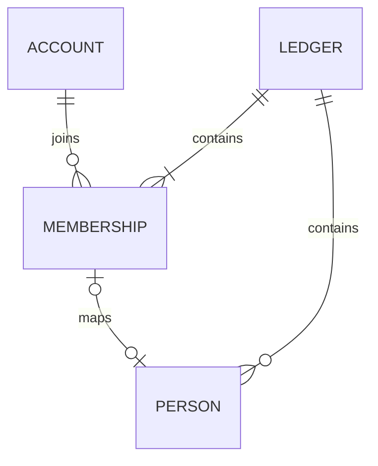

# 家計簿のDB・業務モデル・保存構成

[← 家計簿共通設計の入口](ledger-foundation-core.md)

## 新版の業務モデル・DB設計方針（未実装）

新版は、旧版と基本的に同じ機能を実現できることを基準に、業務モデルとDB構造を一から設計する。レシート・振替・残高・支払メモ・マスタ・集計について、操作・記録内容・計算結果を整理してから、必要な表・列・型・NULL許容・関連・制約・索引を決める。旧版の表名・列名・列の存在を、そのまま新版の要件としない。ソースの命名方針は[04](architecture-winui.md#新版windows版の構成)を正本とする。

新設する業務テーブルの主キーと採番も、整数・UUID等の候補、キーの一意性の範囲、同時登録・再送・親子参照の要件から検討する。旧版のSeq／Codeや、実装済みAPIのUUIDを一律に引き継ぐ前提にはしない。人物IDについては比較後にUUIDの採用を確定した。それ以外の未確定の列名・キーは設計案として見直す。実装済みの認証・家計簿APIの現行契約と、新たに検討する業務構造を区別する。

構造の再設計と機能の変更を分け、旧版と異なる操作・計算・保存内容が必要になった場合は実装前に確認する。既存データの引継ぎと保存時合計の保持は[新規利用と既存DBの境界](ledger-core-transition.md#新規利用と既存dbの境界)に従い、新スキーマ確定後に旧列・旧キーとの対応を整理する。人物以外の業務テーブルや採番方式は後続で確定する。

## 保存構成（APIの初回定義へ実装済み）

認証ストアは引き続きアカウント・鍵・セッションを保存する。家計簿用のモデルと権限確認は`Features/Monetail`へ配置し、認証基盤から家計簿の参加者・人物を参照しない。SQLiteの接続と初回定義はPersistence/ApiDbContextでまとめ、家計簿モデルの制約はLedgerModelで設定する。これらのAPI用テーブルは未リリースAPIの初回定義へ組み込む。以前の開発用DBを更新する互換経路は作らない。

| テーブル | 主な列 | 主キー・制約 |
| --- | --- | --- |
| `ledgers` | `id`, `name`, `created_by_auth_user_id`, `created_at_utc`, `revision`, `people_order_revision` | `id`が主キー。作成者は認証アカウントへRESTRICTのFK。人物順全体の更新版を保存する |
| `ledger_members` | `ledger_id`, `auth_user_id`, `role`, `joined_at_utc`, `revision`, `person_id` | 家計簿ID＋認証IDが主キー。家計簿・認証アカウントへFK。roleはViewer / Editor / AdminのCHECK。NULL許容の人物IDを保存する。家計簿ID＋人物IDをUNIQUEとし、同じ家計簿の人物へのRESTRICTの複合FKを設ける |
| `ledger_people` | `ledger_id`, `person_id`, `name`, `valid_from`, `valid_to`, `display_order`, `revision` | 人物IDはAPI側で生成するUUID。家計簿ID＋人物IDが主キー。家計簿へFK。同一家計簿内の人物名は前後空白除去後の完全一致で重複を禁止。日付はYYYY-MM-DDのTEXT/NULLに確定。更新版は名前・有効期間を対象とするUUID。アカウントIDは持たない |
| `operation_requests` | [共通再送管理表](ledger-operation-retries.md#共通の再送管理表apideb実装済み)の6列 | 要求IDを主キーとする共通の処理履歴。家計簿・人物・招待の作成で共有し、結果IDに削除制限FKを設けない |
| `ledger_invitations` | [家計簿招待](ledger-invitations.md)の招待テーブル9列 | 招待IDが主キー、トークンを一意とし、家計簿・発行者・使用者へRESTRICTのFK |
| `ledger_navigation` | `auth_user_id`, `last_opened_ledger_id` | アカウントIDが主キー。アカウントと家計簿へRESTRICTのFK。参加行へのFKは設けず、参照・開く時に現在の参加を検証 |

- 実装済みの家計簿IDはサーバー生成のランダムなUUIDをTEXTで保持し、作成・参加・要求記録の日時はUTC。家計簿名は空白のみを拒否し、同じ名前でもIDで区別して既存家計簿へ統合しない。未実装の業務データの採番は上記の設計方針で別途検討する。
- 表の列は原則NOT NULL。参加者の人物IDと人物の有効期間の空欄はNULLを認める。人物未対応の参加者は`person_id`がNULLの参加者行、アカウントに対応しない人物はどの参加者からも参照されない人物行として扱う。
- FKは原則RESTRICTとし、人物や参加者への操作から業務データ・認証アカウントを連鎖削除しない。参加者の退会履歴・過去入力者の表示は後続設計。人物削除では参加者との対応を含む参照を自動解除せず、参照が残っている間は削除を拒否する。詳細は[人物の管理](ledger-persons.md#人物の管理dec-055未実装)を参照する。
- `ledger_members(auth_user_id, ledger_id)`に一覧用索引を設ける。家計簿内の役割変更等は`revision`を照合し、更新成功時に新しい値を保存する。
- 再送の記録は共通の`operation_requests`へ移す方針。家計簿専用だった`ledger_creation_requests`を共通表へ置き換え、要求内容の照合値を使い、同じ要求IDで異なる内容を送っても別の家計簿・人物を作らない。
- 業務マスタ・取引の新スキーマは別途設計する。支払方法等は所属を複合FKで検証できるようにし、親レシートと明細・対象者等にも他家計簿を参照させない。現行Windows用テーブルへ今回の列を直接追加する案ではない。

図の任意の1対1は利用者確認済み。FKは家計簿をまたぐ対応を拒否できるが、「管理者1人以上」は単純なFKで表せないため書込時に確認する。

