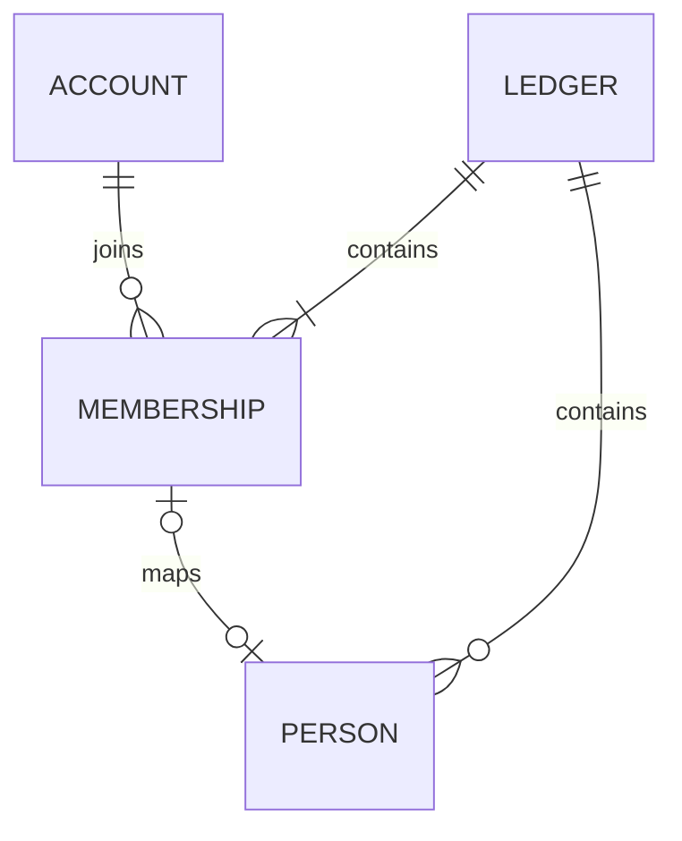

# 58 家計簿のDB・APIと後続設計

更新: 2026-11-03。**家計簿・人物・参加者・家計簿招待のAPIと共通再送記録を実装。Windows 11向けWinUI 3はホームと人物一覧に加えて接続・認証・家計簿操作の画面を実装し、製品起動から接続・保存ログインの復元を開始する。Clientは実装済み。人物の追加・編集・削除を接続済み。共通順の表示・移動・一括保存・競合処理を接続済み。並び順保存中の認証失効後の同一アカウントでの復元も接続済み。参加者・招待の管理画面、ブラウザーの招待受領、レシート等の業務入力は未実装。** 現行契約と後続の設計案を区別し、未確定事項は実装時に推測で埋めない。

## 確定済みの前提

- SQLiteは1ファイル。認証アカウントは全体、家計簿・人物・業務マスタ・取引は家計簿ごとに管理する。同じアカウントの複数参加を認める。
- 全登録利用者が家計簿を作成できる。家計簿の参加招待と、全体管理者によるアカウント登録招待は別の操作。
- 家計簿の権限は閲覧者・編集者・管理者。招待を受けて参加した人は閲覧者。全体のAdminロールを家計簿の権限へ読み替えない。
- アカウントと人物は別管理。家計簿管理者が任意に対応を設定する。人物だけの登録、人物との対応なしでの登録・ログインを認め、名前一致で自動対応しない。
- 編集者は自分の支払方法を編集でき、管理者は他人のものも編集できる。振替は両側の編集権限を確認する。これをレシートの使用可能な支払方法や全業務操作の権限へそのまま広げない。
- 通常操作では最後の有効な家計簿管理者を保護する。紛失・復元等の緊急復旧中はログイン可能な管理者が一時的に0人でもよい。

## 確定した仕様（DEC-046・048）

| 項目 | 仕様 | 状態 |
| --- | --- | --- |
| 家計簿作成 | 入力は名前だけ。作成者を家計簿管理者にし、人物・支払方法は自動作成しない | API・Client・WinUI画面実装済み |
| 任意の人物対応 | 同じ家計簿では1アカウント0〜1人物、1人物0〜1アカウント。家計簿ごとに独立 | API実装・管理画面は未実装 |

家計簿名は前後空白を除いて1〜100文字。同名を認め、名前で統合しない。上限は.NETのstring.Lengthで数える。作成にパスキーの直近再確認は要求しない。人物名は下記の人物管理、参加者一覧等の未確定事項は後述する。

親のアカウントだけが家計簿管理者として参加し、人物は子供だけを登録する構成も認める。親自身の人物登録・紐づけや、子供のアカウント作成は不要。家計簿を操作するアカウントと記録対象の人物を分け、人物対応の有無を管理権限の条件にしない。

## 新版の業務モデル・DB設計方針（未実装）

新版は、旧版と基本的に同じ機能を実現できることを基準に、業務モデルとDB構造を一から設計する。レシート・振替・残高・支払メモ・マスタ・集計について、操作・記録内容・計算結果を整理してから、必要な表・列・型・NULL許容・関連・制約・索引を決める。旧版の表名・列名・列の存在を、そのまま新版の要件としない。ソースの命名方針は[04](04-architecture.md#新版windows版の構成)を正本とする。

新設する業務テーブルの主キーと採番も、整数・UUID等の候補、キーの一意性の範囲、同時登録・再送・親子参照の要件から検討する。旧版のSeq／Codeや、実装済みAPIのUUIDを一律に引き継ぐ前提にはしない。人物IDについては比較後にUUIDの採用を確定した。それ以外の未確定の列名・キーは設計案として見直す。実装済みの認証・家計簿APIの現行契約と、新たに検討する業務構造を区別する。

構造の再設計と機能の変更を分け、旧版と異なる操作・計算・保存内容が必要になった場合は実装前に確認する。既存データの引継ぎと保存時合計の保持は[新規利用と既存DBの境界](#新規利用と既存dbの境界)に従い、新スキーマ確定後に旧列・旧キーとの対応を整理する。人物以外の業務テーブルや採番方式は後続で確定する。

## 保存構成（APIの初回定義へ実装済み）

認証ストアは引き続きアカウント・鍵・セッションを保存する。家計簿用のモデルと権限確認は`Features/Monetail`へ配置し、認証基盤から家計簿の参加者・人物を参照しない。SQLiteの接続と初回定義はPersistence/ApiDbContextでまとめ、家計簿モデルの制約はLedgerModelで設定する。これらのAPI用テーブルは未リリースAPIの初回定義へ組み込む。以前の開発用DBを更新する互換経路は作らない。

| テーブル | 主な列 | 主キー・制約 |
| --- | --- | --- |
| `ledgers` | `id`, `name`, `created_by_auth_user_id`, `created_at_utc`, `revision`, `people_order_revision` | `id`が主キー。作成者は認証アカウントへRESTRICTのFK。人物順全体の更新版を保存する |
| `ledger_members` | `ledger_id`, `auth_user_id`, `role`, `joined_at_utc`, `revision`, `person_id` | 家計簿ID＋認証IDが主キー。家計簿・認証アカウントへFK。roleはViewer / Editor / AdminのCHECK。NULL許容の人物IDを保存する。家計簿ID＋人物IDをUNIQUEとし、同じ家計簿の人物へのRESTRICTの複合FKを設ける |
| `ledger_people` | `ledger_id`, `person_id`, `name`, `valid_from`, `valid_to`, `display_order`, `revision` | 人物IDはAPI側で生成するUUID。家計簿ID＋人物IDが主キー。家計簿へFK。同一家計簿内の人物名は前後空白除去後の完全一致で重複を禁止。日付はYYYY-MM-DDのTEXT/NULLに確定。更新版は名前・有効期間を対象とするUUID。アカウントIDは持たない |
| `operation_requests` | 上記の共通再送管理表の6列 | 要求IDを主キーとする共通の処理履歴。家計簿・人物・招待の作成で共有し、結果IDに削除制限FKを設けない |
| `ledger_invitations` | 上記の招待テーブル9列 | 招待IDが主キー、トークンを一意とし、家計簿・発行者・使用者へRESTRICTのFK |
| `ledger_navigation` | `auth_user_id`, `last_opened_ledger_id` | アカウントIDが主キー。アカウントと家計簿へRESTRICTのFK。参加行へのFKは設けず、参照・開く時に現在の参加を検証 |

- 実装済みの家計簿IDはサーバー生成のランダムなUUIDをTEXTで保持し、作成・参加・要求記録の日時はUTC。家計簿名は空白のみを拒否し、同じ名前でもIDで区別して既存家計簿へ統合しない。未実装の業務データの採番は上記の設計方針で別途検討する。
- 表の列は原則NOT NULL。参加者の人物IDと人物の有効期間の空欄はNULLを認める。人物未対応の参加者は`person_id`がNULLの参加者行、アカウントに対応しない人物はどの参加者からも参照されない人物行として扱う。
- FKは原則RESTRICTとし、人物や参加者への操作から業務データ・認証アカウントを連鎖削除しない。参加者の退会履歴・過去入力者の表示は後続設計。人物削除では参加者との対応を含む参照を自動解除せず、参照が残っている間は削除を拒否する。詳細は[人物の管理](ledger-persons.md#人物の管理dec-055未実装)を参照する。
- `ledger_members(auth_user_id, ledger_id)`に一覧用索引を設ける。家計簿内の役割変更等は`revision`を照合し、更新成功時に新しい値を保存する。
- 再送の記録は共通の`operation_requests`へ移す方針。家計簿専用だった`ledger_creation_requests`を共通表へ置き換え、要求内容の照合値を使い、同じ要求IDで異なる内容を送っても別の家計簿・人物を作らない。
- 業務マスタ・取引の新スキーマは別途設計する。支払方法等は所属を複合FKで検証できるようにし、親レシートと明細・対象者等にも他家計簿を参照させない。現行Windows用テーブルへ今回の列を直接追加する案ではない。

図の任意の1対1は利用者確認済み。FKは家計簿をまたぐ対応を拒否できるが、「管理者1人以上」は単純なFKで表せないため書込時に確認する。

## 家計簿作成と再送

1. 有効なログインアカウントであることを確認し、名前とクライアント生成の空でない`requestId`を受け取る。作成者ID・role・人物IDを入力から受け付けない。
2. SQLiteの書込トランザクションで、操作者が現在も有効で同じセッションが利用可能か確認する。
3. 要求IDが未処理なら、家計簿・作成者のAdmin参加・要求記録・最終選択を同じトランザクションで保存する。どこかで失敗した場合は全て戻し、管理者のない家計簿だけを残さない。
4. 最終選択の保存後、確定前にもセッション・利用可否と作成者のAdmin参加を確認する。生コードや家計簿参加用の招待はこの操作では発行しない。
5. 同じ操作者・要求ID・名前の再送は、現在の参加を確認して同じ家計簿を開き、最終選択を更新して同じ家計簿IDを返す。別操作者または異なる名前は409とし、元の家計簿情報を返さない。別の要求IDは別操作として扱う。

作成者が参加者から外れた後に同じ要求を再送した場合、家計簿情報の再表示は現在の参加権限も確認して拒否する。要求記録だけを根拠に閲覧権限を復活させない。家計簿削除APIは初回実装に含めず、共通の要求記録は自動削除せず残し、将来の家計簿削除APIの扱いは削除設計時に決める。

## 作成・参照APIと後続案

家計簿を指定して開く・最後の家計簿を開く・作成して開くを、それぞれ1回の要求で完了する。現在の本人と参加の確認はAPI内部で行い、確定後に画面に必要な家計簿データを返す。

| メソッド・パス | 条件・用途 |
| --- | --- |
| `POST /ledgers` | 有効な登録アカウントが名前・requestIdを送り、家計簿を作成して開き、最終選択も更新。初回201、同じ要求の再送200 |
| `GET /ledgers` | 自分が参加する家計簿だけを返す。未参加なら空配列。全体Adminでも他家計簿を含めない |
| `GET /ledgers/{id}` | 現在の参加を検証し、ledgerId・name・現在の自分のrole・revisionを返す |
| `POST /ledgers/open-last` | 最終選択から対象を決め、同じトランザクションで現在の参加を確認して開く。200で`{ledger: 上記4項目}`。履歴なし・現在は未参加なら`{ledger: null}`を返し、履歴を変更せず通常の起動先判定へ進める |
| `POST /ledgers/{id}/open` | 本文は不要。本人と参加を確認して家計簿データを取得し、最終家計簿の更新を同じトランザクションで確定してから上記4項目を200で返す |
| `GET /ledgers/{id}/members` | 当該家計簿の管理者のみが参加者一覧を閲覧できる。項目は当該家計簿のメンバーのID・表示名・role等に限定し、具体的な返却形式は後続設計 |
| `PATCH /ledgers/{id}/members/{accountId}` | 家計簿管理者がroleとrevisionを送る案。最新の権限・最後の管理者・競合を検証 |

POST /ledgersの本文はnameと空でないUUIDのrequestIdだけを受け付ける。余分な列・不正な名前／要求IDは400。GETの一覧と個別参照も同じ4項目を返す。

人物とアカウントの対応は参加者編集から保存する方針を利用者確認済み（DEC-061）。人物保存APIには含めない。参加者保存APIのパスと項目は上記のとおり実装し、同じ対応を操作する複数のAPIを重複して実装しない。

一覧・個別参照では最終家計簿を変更しない。指定／最後の家計簿を開く処理と、作成して開く処理で更新する。保存障害なら503でデータを返さず、以前の選択を維持し、新規作成も含めてトランザクション全体を戻す。保存中に本人が失効・停止なら401で全体を戻す。参加を失った場合、指定して開く操作と作成要求の再送は404、最後を開く操作は上記のnull応答とする。新規作成時に作成者のAdmin参加を失った場合は整合性エラーの503とする。不在と未参加の応答は同じ。別アカウントのIDを入力から受け取らない。正常応答でも端末への到達は保証できないため、応答喪失時は同じ家計簿を開き直せる。複数端末が同時に開いた場合は、最後に確定した操作が記録される。

人物・参加者・招待のAPIは、上記の確認済みの権限・一括保存・競合契約を実装した。参加者追加は家計簿招待の受領で行い、任意のアカウントID指定による直接追加APIは作らない。招待発行・受領APIは後述の定義に従う。

- 作成を除き、対象家計簿の現在の参加・roleを要求ごとにDBで確認する。Cookieの全体Adminやクライアントのroleを信用しない。
- 未認証・セッション失効・利用停止は401。指定した家計簿の未参加と不存在は同じ404、参加済みで役割不足は403、古いrevision・対応の重複・要求IDの競合は409。人物・参加者・招待の操作にも適用する。
- 全体のアカウント検索・一覧・存在照会を家計簿管理者へ追加しない。人物名・表示名からの照合も行わない。
- 書込時はDBの最新の参加・権限・対象所属をトランザクション内で再確認する。最後の有効な管理者の同時降格・除外は、同じ書込ロック内で確認し、片方しか成立させない。
- 全体のアカウント停止と家計簿管理者保護の関係、緊急時の家計簿管理者復旧は別途具体化する。既存の全失効コマンドへ、今回新しい家計簿参照を加えない。
- /ledgersはProgram.csから共通HTTP境界へ追加する。ログイン、固定HTTPS・ホスト検証・no-store、POSTのOrigin・CSRF・64KiB上限、認証／保存障害時503を適用する。GETは追加の本人再確認を要求しない。認証APIの既存のIP単位の回数制限は維持する。

### アカウント単位の回数制限（DEC-049）

認証済みの業務APIは原則として同じアカウントで、作成・更新・削除・順序保存等の書込を合わせて固定1分20回、参照・家計簿を開く操作を合わせて固定1分120回の別枠とする方針を確認済み（DEC-069。DEC-068の全操作を共有120回とする方針から変更）。現行コードでは家計簿作成の20回枠を人物・参加者・招待の書込でも共有する枠へ拡張した。機能ごとに書込枠や参照枠を追加せず、新しい別枠は必要な理由と対象を示して確認してから追加する。

| 対象 | 現行実装 |
| --- | --- |
| 家計簿・人物・参加者・招待の作成・更新・削除・順序保存・参加確定 | 同一アカウントで共有20回／分 |
| 家計簿の参照・開く、人物・参加者・招待の一覧／編集情報、招待preview | 同一アカウントで共有120回／分 |

認証後の検証済みアカウントIDで数え、端末・セッション・IPや対象家計簿が違っても同じ枠の要求は合算する。別アカウントの枠と、書込・参照の2枠は独立。作成して開く操作や更新後一覧の取得等のAPI内部処理は別のHTTP要求として二重計上せず、書込要求は書込枠だけを使う。既存の指定家計簿・最後の家計簿を開く要求は、最終選択の更新を含めても従来どおり参照枠とする。HTTPメソッドだけで書込・参照を判定しない。制限判定を通る要求は入力不備等も数え、超過は待機させず429とする。Cookie検証で未認証・失効と判断した要求はアカウント枠を使わず401等の認証結果を返す。認証APIは[43](43-passkey-authentication-design.md)の既存のIP単位の制限を維持する。DBにカウンターや列を追加しない。

## 新規利用と既存DBの境界

初回管理者の想定する遷移は「明示初期設定 → 初回管理者登録 → 明示ログイン → 所属0件の家計簿作成 → 家計簿ホーム」。通常のログイン後の行き先と家計簿切替は上記の画面仕様に従う。

新規DBには最初から家計簿行や人物を埋めず、認証登録後に家計簿作成を行う。通常起動・HTTP要求での自動初期化は採用しない。初期設定と再開の現行手順は[42](42-api-foundation.md#db移行登録復旧コマンド)を参照する。

既存Windows版DBの引継ぎは、新構成確定後に一度きりのSQLを手動適用して行う（DEC-047）。APIは移行後の新構成を扱い、新旧DBを切り替える設定・互換モデル・専用の移行画面やAPIは追加しない。以下は移行手順の骨子であり、移行SQL自体は新スキーマ確定後に作成する。

1. サービスを停止し、既存DBをバックアップして作業コピーを用意する。
2. 作業コピーへ、アカウント登録に必要な新構造を準備するSQLを適用する。EFの移行履歴は実際に適用した定義と対応させ、未実行の移行を適用済みにしない。
3. 管理者・利用者のアカウントを通常の登録処理で作り、生成されたアカウントIDを確認する。認証情報・パスキーを手動で作らない。
4. アカウントID・対象家計簿ID・旧人物コード等をSQLに明示して、参加者・人物対応・既存の業務データを新構造へ移す。人物名による自動照合や、人物名のアカウント名へのコピーはしない。
5. 件数・金額・型・外部キー・関連付けを合成データで事前検証し、実際の作業コピーでも照合してから切り替える。失敗したコピーに推測でSQLを重ねず、バックアップからやり直せる手順にする。

保存済み`receipt.total`（NULLを含む）・過去の更新者・業務値は再計算・補正しない。移行SQLは登録されたアカウントのIDを対応先として使い、アカウントのID自体を書き換えない。構造準備とデータ移行を分け、既存DBへのSQL適用を通常の初期化コマンドに混ぜない。

新規APIの保存構成は`Persistence/ApiDbContext`と専用EF移行系列にまとめた。登録・ログイン・復旧は家計簿内の人物対応に依存しない。家計簿の4表も同じ初回定義に含める。SQL移行を済ませるまではWindows版DBを新APIへ接続しない。

## 次の実装と確認

人物表・参加者の人物対応・人物順全体の版・共通作成要求記録・招待表とAPI・共有回数枠を実装した。Windowsは人物一覧の表示基盤と、Clientの作成要求の再送・競合応答の受領を実装した。追加・編集・削除は接続済み。共通順設定と認証失効後の復元も接続済み。次はWindowsの参加者・招待管理画面と、ブラウザーの招待受領・ログインからの復帰を実装・検証する。実装時点で残る未確定の利用者向け仕様が見つかった場合は、その箇所を確認済みと混同しない。

実Windowsで家計簿の選択・作成・切替と認証を確認する作業は引き続き残る。レシート一覧・入力の本体に必要な支払方法・分類・取引と、各業務での人物期間検証は後続のモデル設計で具体化する。これらや一度きりのSQL移行を、人物・参加者管理の設計完了だけで実装・検証済みとは扱わない。

実HTTPと合成SQLiteで一般アカウントの作成、名前の境界と再送、同時作成、作成と最終選択の保存失敗、保存中の失効と作成者Adminの喪失、現在の参加／役割、全体Adminの非特権化、FK・役割制約、HTTP境界を確認する。検証結果の正本は[tests/README](../tests/README.md)。招待・人物対応・権限変更はAPIの自動テストで確認した。参加者・招待の管理画面、実Windowsでの手動受入確認と一度きりの実DB移行は未実施。

## 後続で確定すること

[人物の管理](ledger-persons.md#人物の管理dec-055未実装)に残る画面・各業務での期間検証の詳細、参加履歴の要否、全体の利用停止と家計簿管理者保護、入力者／更新者の保存・表示、マスタ初期値、家計簿の改名・削除・画面の細かな遷移は保留。この案のテーブルやAPIを、それらまで完成した仕様とは扱わない。
